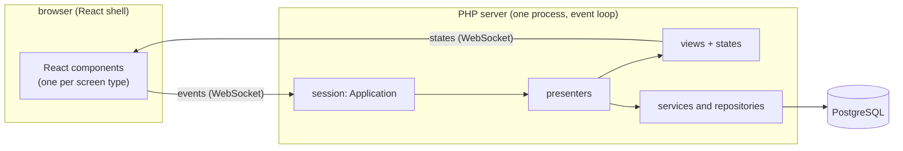
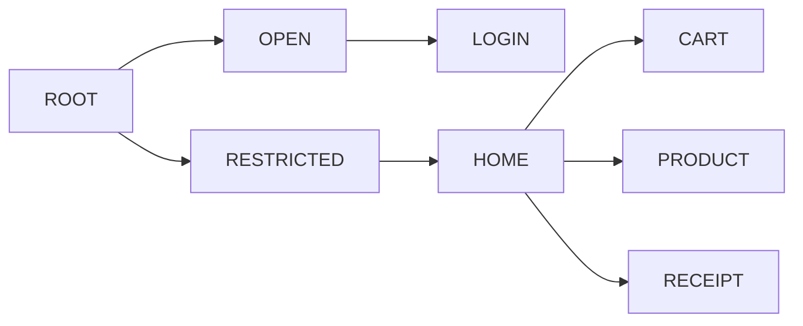
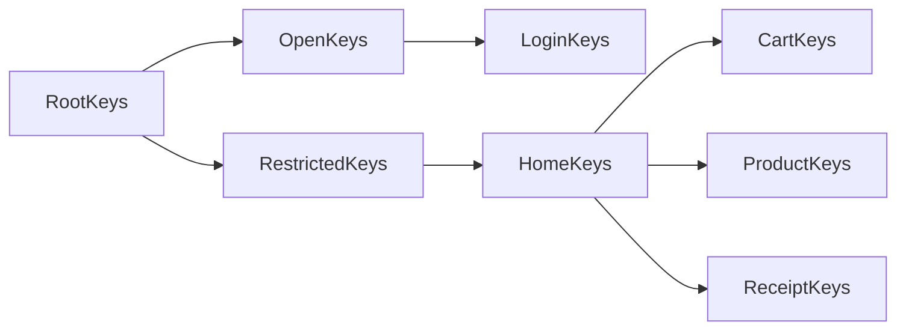

# Architecture

**Cube MVP** puts presentation logic on the server. The *presenters* — what each screen shows,
what happens on each click, where to navigate — run on a long-lived PHP server. The client (here,
a React shell) only draws the state it receives and sends back the user's events.



What you gain:

- **A single implementation of the screen logic**, testable without a browser: the Store
  acceptance tests exercise the presenters with fake views.
- **A thin, replaceable client**: the client only knows the shape of the states and events.
  Another client (native, another framework) can speak the same protocol.
- **Data stays on the server**: the client never queries the database; it receives only what the
  screen displays.

## 1. The engine (`src/Framework/Cube/`)

### Application

`CubeApplication` is a user session. It holds the active presenters, the current place, the
session attributes and access to the client storage (`clientSessionStore`,
`clientPersistentStore`). Each application extends the class and states which place is the root.

### Places: the screen tree

A *place* is a node in a tree of screens, identified by an id that grows with depth. In Store:



Being at `CART` means having the presenters of the whole chain active: `ROOT`, `RESTRICTED`, `HOME`
and `CART`. The address is the name of the deepest place plus the published parameters, signed by
the server (`#cart?rt-user=0&sign=...`), so F5 and the back button work.

### Presenter, view and state

- The **presenter** (`AbstractCubePresenter`) holds the logic of a screen: it receives the
  navigation parameters, loads data through the services and handles the events (`onBuy()`,
  `onRemoveProduct()`...).
- The **state** (`ViewState`) is a plain object with what the screen shows. The presenter changes
  it and calls `update()`.
- The **view** (`CubeView`) carries the state to the client. On the remote server it is always the
  same class, `RemoteView`, which serializes the state and sends it; the client picks the component
  by the view id (`<classId>:<n>`).
- The **skeleton** binds the events coming from the client to the presenter's methods: an event
  code becomes a call.

### Intent and navigation

A navigation is described by a `CubeIntent` — the target place, the **parameters** (they go into
the URL), the **attributes** (server-only) and the **slots**, read and written through the keys
(below) — and runs as a transaction (`CubeNavigation`):

1. it walks the chain of places from the root to the target, reusing the presenters that are
   already active and creating the missing ones; each one receives `applyParameters($intent, ...)`;
2. a presenter can refuse (return `false`) — this is how guards and redirects are done
   (e.g. `RESTRICTED` with no logged-in user sends you to the login);
3. **commit**: the presenters of the new chain stay; the ones that left are released, from leaf to root;
4. **rollback** on an exception: the presenters that already existed go back to their previous
   state and the newly created ones are released.

Store's routes (`Routes`) are just chains of places:

```php
$app->navigate()->step(Place::ROOT)->step(Place::RESTRICTED)->step(Place::HOME)->step(Place::CART)
    ->execute($intent);
```

Presenters do not call the routes directly: they navigate through the target's **keys** (below),
whose `go()` calls the place's route.

### Keys: typed reading of the intent

Parameter and attribute names do not appear in the presenters. Each place has its own **keys**
class, which inherits from the keys of the place above - the class hierarchy mirrors the tree:



The keys expose the values as typed properties, already validated on read, and navigate to their
place:

```php
$keys = new ProductKeys($this->app, $intent);       // inside applyParameters
$productId = $keys->productId;                      // integer >= 0, or null if the address has no valid one

$receipt = ReceiptKeys::of($this->app);             // a trip that starts from the current state
$receipt->purchaseId = 7;
$receipt->go();

(new LoginKeys($this->app, $intent))->go();         // redirect INSIDE applyParameters,
                                                    // carrying the intent in transit
```

Inheriting from the keys above lets a deeper place READ what an ancestor publishes (the receipt
sees the user published by the root). Keys with no names of their own (`CartKeys`) only state
which place they belong to.

Each keys file declares a two-letter prefix, unique in the application, and all its names start
with it (`pr-id`, `rc-id`). Since a navigation passes the same intent through every presenter on
the path, two owners of the same name would silently overwrite each other; a test
(`KeysNamesTest`) scans the keys and enforces the rule - and also that every place has exactly one
keys class.

### Slots: screens inside screens

A parent presenter offers a *slot* — a place on its screen where a child's view fits — and passes
it in the intent (`$keys->ownerSlot = $this->contentSlot`). The child plugs itself into it
(`$keys->ownerSlot->setView($this->view)`). This way `HOME` shows the cart, the product or the
receipt in the central panel, without any of them knowing the other's implementation.

The slot is decided by whoever is above, on every navigation: that is why the owner offers it on
every navigation that passes through it, and the child reads it on every `applyParameters` - not
only on creation. A presenter that survives a trip has no way of knowing whether the composition
above changed.

## 2. The remote view and the protocol (`src/Framework/Cube/Remote/`)

### Session start

1. The browser requests `/<shell>/index.html`. The server responds with two cookies: `app_id` (the
   session id, RSA-signed by the server) and `app_skey` (the handshake public key).
   Clients without cookies use `GET /api/session/init`, which returns the same as JSON.
2. The client opens the WebSocket at `/dispatcher/<appId>`, `wdc` subprotocol.
3. In the first message, it sends a secret encrypted with the public key. Both sides derive from it
   an AES-256 key (PBKDF2, 250 thousand iterations), used to encrypt the client's secure storage
   (the automatic login token, for example).
4. The server creates the session (the `Application`) and navigates to the path the client asked for.

The `appId` can be verified without state: the server only accepts ids signed with its own key.

### Messages

The client sends events and the views' form data:

```json
{ "requestId": 12, "event": ["7b32e816a191:3:1"], "7b32e816a191:3": { "p.quantity": "2" } }
```

The server responds, at most every 50 ms, with what changed since the last response:

```json
{ "requestId": 12, "uri": "restricted/home/cart", "states": { "7b32e816a191:3": { ... } },
  "storage": { ... }, "releasedViews": [ ... ] }
```

- `states`: the full state of each changed view (`ViewStateSerializer`);
- `uri`: the new address, when there was a navigation;
- `storage`: changes to the client storage (the secure part is encrypted);
- `releasedViews`: views the client can discard.

### Sessions, drops and reconnection

Sessions live in an in-memory registry (`RemoteApplicationRegistry`). If the connection drops, the
session waits for a reconnection for a while (`server.sessionTtlSeconds`, 180 s by default) and
resumes where it left off. If the session no longer exists, the server creates a new one from what
the client keeps: the URL path and the storage (which includes the automatic login token).

Close codes: `4001` (invalid session, the shell reloads the page) and `4003` (capacity exhausted,
see `server.maxSessions`).

## 3. Persistence (`src/Framework/Persistence/`, `src/Framework/Domain/`)

### Repository, criteria and projection

Each entity has a repository (`insert`, `update`, `delete`, `count`, `fetch`, `fetchPage`,
`fetchById`) and a **criteria**, with one `Criterion` per filterable field:

```php
$criteria = (new ProductCriteria())->withOrderBy(ProductOrderBy::CHEAPEST_FIRST);
$criteria->price()->ge(10.0);
$criteria->name()->or()->like('Wilson%')->name()->like('Thread%');
```

Conditions on the same field apply together (AND), unless the field is marked with `or()`. A
`null` value does not filter — an empty screen filter means "do not filter".

The **projection** says what to fetch. It is the entity itself used as a mask: field filled in =
field to fetch. Relations nest, and 1:N collections carry their own criteria and slicing:

```php
$projection = (new Purchase())->withId(PV::INT)->withBuyDate(PV::dateTime())
    ->withItems(PV::singletonList(
        (new PurchaseItem())->withAmount(PV::INT)->withProduct((new Product())->withName(PV::STR)),
        (new PurchaseItemCriteria())->withOrderBy(PurchaseItemOrderBy::MOST_EXPENSIVE_FIRST),
    )->withLimit(3));
```

### JsonQuery: the whole graph in one query

`JsonQuery` translates the projection into a **single SELECT** that returns the graph already
assembled, using the database's JSON functions: 1:1 relations become JSON objects, 1:N collections
become JSON arrays aggregated by a correlated subquery, already filtered, ordered and sliced per
parent. No matter how many purchases and items come back: it is one trip to the database. This
eliminates the N+1 problem without caching or batch loading.

What changes from one database to another sits behind `SqlDialect` (sequences, pagination) and
`JsonDialect` (the JSON functions). The project uses PostgreSQL; another database would come in as
another dialect.

### Asynchronous access

`Database` talks to PostgreSQL through an asynchronous connection pool (`amphp/postgres`). A query
suspends only the Fiber that issued it: while the database responds, the event loop serves the
other sessions, and queries from different sessions run at the same time, each on a pooled
connection. For repository and presenter code nothing changes — `fetchAll()` returns the rows,
like an ordinary call.

Two design consequences:

- **The transaction belongs to the Fiber.** `required()` takes a connection from the pool, opens
  the transaction and binds it to the current Fiber; that Fiber's SQL goes to the transaction,
  other Fibers' SQL keeps using the pool. The call's security context is also stored per Fiber.
- **Each session has a lock.** While a query is in progress, a timer or the background flush of the
  same session can run. Navigation, form synchronization and state computation go through a
  session lock; the event handling itself does not, so that a slow event lets the intermediate
  state ("please wait...") reach the client.

### Transactions

`TransactionService::required($work)` opens a transaction (or joins the current one) and commits on
normal return or rolls back on an exception. The cart checkout (purchase + items) uses it.

### Where the repositories are found: `Beans`

The repositories, the transaction service and the authentication service are created once, at
server startup, and registered by interface in `Wdc\Framework\Commons\Beans`. Whoever needs one
asks for it by interface, from anywhere:

```php
$this->products = Beans::of(ProductRepository::class);   // in the ProductService constructor
```

`Beans::of` is typed (PHPStan knows the return is a `ProductRepository`) and throws a wiring error
if nothing was registered; `Beans::find` returns `null` for an optional service, such as disabled
authentication. The registry is written only at startup and only read afterwards. Since the
repositories keep no state between calls, the sessions use the same instances at the same time:
each Fiber has its own variables, and an open transaction stays bound to its Fiber. Application
services look up their own dependencies in the constructor; the presenter just does
`new ProductService()`.

## 4. Security

- **HMAC challenge login**: the server sends a nonce; the client answers with
  `HMAC(password hash, user + nonce)`. The password never goes over the wire.
- **Session**: access JWT, refresh token and a persistent token for automatic login (stored
  encrypted in the client storage).
- **Role-based permissions** (`Role`): `entity:operation` (`purchase:write`, `product:read`...) and
  `data:all`, which grants access to every user's data. Without `data:all`, each user only sees
  and changes their own data.
- **Where permissions are checked: in the REST API** (`SecurityEnforcer`), which also restricts
  each user to their own data. There the request arrives ready-made from a client we do not
  control. The presenters use the repositories directly: they run on the server, are written to
  respect the authorization rules based on the session user, and the browser only receives what
  the screen draws.

## 5. REST API (`src/Framework/Rest/`, `src/Store/Persistence/Rest/`)

For clients that prefer to access the data directly (native apps, other SPAs), the server exposes
the repositories over HTTP — `/api/auth`, `/api/repo/<entity>/<operation>` and `/api/tx` — with the
criteria and projection in JSON, the same permission and per-user scoping rules, and **remote
transactions**: the client opens a transaction, makes several writes with the `X-Tx-Id` header and
then commits or rolls it back. Each remote transaction has its own database connection, bound to
the request only while it runs. The endpoints are listed in the [README](../README.md#rest-api).

## 6. Execution: one process, one event loop

The server (Amp) runs in a single PHP process with an event loop. Each connection is a Fiber:
network and database waits block no one, so many sessions coexist in one process. What does not
wait — the PHP code itself — uses one CPU core, and the sessions take turns on it. What burns a lot
of CPU at once (the handshake's PBKDF2) runs in worker processes.

For more than one core or more users, run several instances behind a load balancer: see
[scaling.md](scaling.md).

## 7. Where everything lives

| Folder | What |
|---|---|
| `src/Framework/Cube/` | the engine: application, places, presenters, navigation, slots |
| `src/Framework/Cube/Remote/` | remote view, protocol, channel security, session registry |
| `src/Framework/Cube/Remote/Http/` | integration with the HTTP/WebSocket server (Amp) |
| `src/Framework/Domain/` | contracts: repository, criteria, projection, transaction, security, codecs |
| `src/Framework/Persistence/` | PostgreSQL access, JsonQuery, dialects, transactions (local and remote) |
| `src/Framework/Rest/` | REST API base |
| `src/Framework/Commons/` | utilities: `Beans`, scheduler, Base62, RSA, JSON, logging |
| `src/Store/Domain/` | Store's entities, criteria, orderings and codecs |
| `src/Store/Persistence/` | repositories, schema and seed, authentication, REST API |
| `src/Store/Presentation/` | Store's places, routes, keys and presenters |
| `src/Store/RemoteHost/`, `src/Store/Server/` | Store's remote session and server |
| `frontend/` | the React shell and the bridge that implements the protocol on the client |
