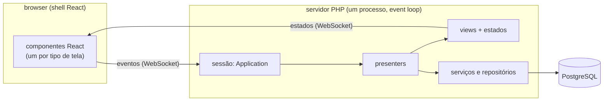
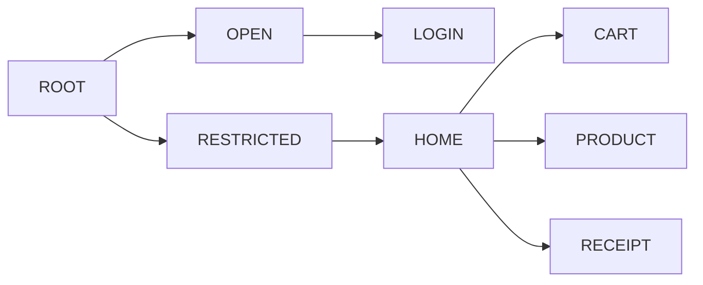
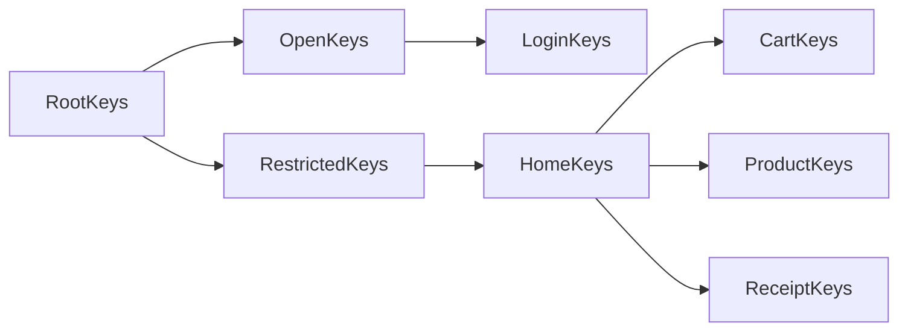

# Arquitetura

O **Cube MVP** põe a lógica de apresentação no servidor. Os *presenters* — o que cada tela
mostra, o que acontece em cada clique, para onde navegar — rodam num servidor PHP de longa
duração. O cliente (aqui, um shell React) só desenha o estado que recebe e devolve os eventos do
usuário.



O que se ganha:

- **Uma só implementação da lógica de tela**, testável sem browser: os testes de aceitação do
  Shopping exercitam os presenters com views falsas.
- **Cliente fino e trocável**: o cliente só conhece o formato dos estados e dos eventos. Outro
  cliente (nativo, outro framework) pode falar o mesmo protocolo.
- **Dados ficam no servidor**: o cliente nunca consulta o banco; recebe só o que a tela exibe.

## 1. O motor (`src/Framework/Cube/`)

### Application

`CubeApplication` é uma sessão de usuário. Guarda os presenters ativos, o place corrente, os
atributos da sessão e o acesso ao armazenamento do cliente (`clientSessionStore`,
`clientPersistentStore`). Cada aplicação estende a classe e diz qual é o place raiz.

### Places: a árvore de telas

Um *place* é um nó de uma árvore de telas, identificado por um id que cresce com a profundidade.
No Shopping:



Estar em `CART` significa ter ativos os presenters de toda a cadeia: `ROOT`, `RESTRICTED`, `HOME`
e `CART`. O endereço é o nome do place mais fundo mais os parâmetros publicados, assinado pelo servidor
(`#cart?rt-user=0&sign=...`), então F5 e o botão voltar funcionam.

### Presenter, view e estado

- O **presenter** (`AbstractCubePresenter`) tem a lógica de uma tela: recebe os parâmetros da
  navegação, carrega dados pelos serviços e trata os eventos (`onBuy()`, `onRemoveProduct()`...).
- O **estado** (`ViewState`) é um objeto simples com o que a tela mostra. O presenter o altera e
  chama `update()`.
- A **view** (`CubeView`) leva o estado ao cliente. No servidor remoto é sempre a mesma classe,
  `RemoteView`, que serializa o estado e o envia; o cliente escolhe o componente pelo id da view
  (`<classId>:<n>`).
- O **skeleton** liga os eventos que chegam do cliente aos métodos do presenter: um código de
  evento vira uma chamada.

### Intent e navegação

Uma navegação é descrita por um `CubeIntent` — o place de destino, os **parâmetros** (vão para a
URL), os **atributos** (só no servidor) e os **slots**, lidos e escritos pelas keys (abaixo) — e executada como uma transação
(`CubeNavigation`):

1. percorre a cadeia de places da raiz até o destino, reaproveitando os presenters que já estão
   ativos e criando os que faltam; cada um recebe `applyParameters($intent, ...)`;
2. um presenter pode recusar (devolver `false`) — é assim que se faz guarda e redirecionamento
   (ex.: `RESTRICTED` sem usuário logado manda para o login);
3. **commit**: ficam os presenters da nova cadeia; os que saíram são liberados, da folha para a raiz;
4. **rollback** em caso de exceção: os presenters que já existiam voltam ao estado anterior e os
   recém-criados são liberados.

As rotas do Shopping (`Routes`) são só cadeias de places:

```php
$app->navigate()->step(Place::ROOT)->step(Place::RESTRICTED)->step(Place::HOME)->step(Place::CART)
    ->execute($intent);
```

Os presenters não chamam as rotas diretamente: navegam pelas **keys** do destino (abaixo), cujo
`go()` chama a rota do place.

### Keys: a leitura tipada do intent

Os nomes de parâmetros e atributos não aparecem nos presenters. Cada place tem a sua classe de
**keys**, que herda das keys do place acima - a hierarquia das classes espelha a árvore:



As keys expõem os valores como propriedades tipadas, já validadas na leitura, e navegam para o
seu place:

```php
$keys = new ProductKeys($this->app, $intent);       // dentro de applyParameters
$productId = $keys->productId;                      // inteiro >= 0, ou null se o endereço não traz um válido

$receipt = ReceiptKeys::of($this->app);             // uma viagem que parte do estado atual
$receipt->purchaseId = 7;
$receipt->go();

(new LoginKeys($this->app, $intent))->go();         // redirecionar DENTRO de applyParameters,
                                                    // levando o intent em trânsito
```

Herdar das keys de cima permite que um place mais fundo LEIA o que um ancestral publica (o
recibo enxerga o usuário publicado pela raiz). Keys sem nomes próprios (`CartKeys`) só dizem
qual é o seu place.

Cada arquivo de keys declara um prefixo de duas letras, único na aplicação, e todos os seus
nomes começam por ele (`pr-id`, `rc-id`). Como uma navegação passa o mesmo intent por todos os
presenters do caminho, dois donos do mesmo nome se sobrescreveriam em silêncio; um teste
(`KeysNamesTest`) varre as keys e garante a regra - e também que todo place tem exatamente uma
classe de keys.

### Slots: telas dentro de telas

Um presenter pai oferece um *slot* — um lugar na sua tela onde cabe a view de um filho — e o passa
no intent (`$keys->ownerSlot = $this->contentSlot`). O filho se encaixa nele
(`$keys->ownerSlot->setView($this->view)`). Assim a `HOME` tem o carrinho, o produto ou o recibo
no painel central, sem que um conheça a implementação do outro.

O slot é decidido por quem está acima, a cada navegação: por isso o dono o oferece em toda
navegação que passa por ele, e o filho o lê em todo `applyParameters` - não só na criação. Um
presenter que sobrevive a uma viagem não tem como saber se a composição acima mudou.

## 2. A view remota e o protocolo (`src/Framework/Cube/Remote/`)

### Início de sessão

1. O browser pede `/<shell>/index.html`. O servidor responde com dois cookies: `app_id` (o id da
   sessão, assinado com RSA pelo servidor) e `app_skey` (a chave pública do handshake).
   Clientes sem cookies usam `GET /api/session/init`, que devolve o mesmo em JSON.
2. O cliente abre o WebSocket em `/dispatcher/<appId>`, subprotocolo `wdc`.
3. Na primeira mensagem, manda um segredo cifrado com a chave pública. Os dois lados derivam dele
   uma chave AES-256 (PBKDF2, 250 mil iterações), usada para cifrar o armazenamento seguro do
   cliente (token de login automático, por exemplo).
4. O servidor cria a sessão (a `Application`) e navega para o caminho que o cliente pediu.

O `appId` é verificável sem estado: o servidor só aceita ids assinados com a sua chave.

### Mensagens

O cliente manda eventos e os dados de formulário das views:

```json
{ "requestId": 12, "event": ["7b32e816a191:3:1"], "7b32e816a191:3": { "p.quantity": "2" } }
```

O servidor responde, no máximo a cada 50 ms, com o que mudou desde a última resposta:

```json
{ "requestId": 12, "uri": "restricted/home/cart", "states": { "7b32e816a191:3": { ... } },
  "storage": { ... }, "releasedViews": [ ... ] }
```

- `states`: o estado completo de cada view alterada (`ViewStateSerializer`);
- `uri`: o novo endereço, quando houve navegação;
- `storage`: alterações no armazenamento do cliente (a parte segura vai cifrada);
- `releasedViews`: views que o cliente pode descartar.

### Sessões, quedas e reconexão

As sessões ficam num registro em memória (`RemoteApplicationRegistry`). Se a conexão cai, a sessão
espera a reconexão por um tempo (`server.sessionTtlSeconds`, 180 s por padrão) e continua de onde
parou. Se a sessão já não existe, o servidor cria uma nova a partir do que o cliente guarda: o
caminho da URL e o armazenamento (que inclui o token de login automático).

Códigos de fechamento: `4001` (sessão inválida, o shell recarrega a página) e `4003` (capacidade
esgotada, ver `server.maxSessions`).

## 3. Persistência (`src/Framework/Persistence/`, `src/Framework/Domain/`)

### Repositório, critério e projeção

Cada entidade tem um repositório (`insert`, `update`, `delete`, `count`, `fetch`, `fetchPage`,
`fetchById`) e um **critério**, com um `Criterion` por campo filtrável:

```php
$criteria = (new ProductCriteria())->withOrderBy(ProductOrderBy::CHEAPEST_FIRST);
$criteria->price()->ge(10.0);
$criteria->name()->or()->like('Bola%')->name()->like('Fita%');
```

Pedidos no mesmo campo valem juntos (AND), a menos que o campo seja marcado com `or()`. Valor
`null` não filtra — um filtro de tela vazio significa "não filtrar".

A **projeção** diz o que buscar. É a própria entidade usada como máscara: campo preenchido =
campo a trazer. Relações entram aninhadas, e coleções 1:N carregam critério e recorte próprios:

```php
$projection = (new Purchase())->withId(PV::INT)->withBuyDate(PV::dateTime())
    ->withItems(PV::singletonList(
        (new PurchaseItem())->withAmount(PV::INT)->withProduct((new Product())->withName(PV::STR)),
        (new PurchaseItemCriteria())->withOrderBy(PurchaseItemOrderBy::MOST_EXPENSIVE_FIRST),
    )->withLimit(3));
```

### JsonQuery: o grafo inteiro numa consulta

O `JsonQuery` traduz a projeção num **único SELECT** que já devolve o grafo montado, usando as
funções JSON do banco: relações 1:1 viram objetos JSON, coleções 1:N viram arrays JSON agregados
por subconsulta correlacionada, já filtrados, ordenados e recortados por pai. Não importa quantas
compras e itens venham: é uma ida ao banco. Isso elimina o problema do N+1 sem cache nem carga em
lote.

O que muda de um banco para outro fica atrás de `SqlDialect` (sequências, paginação) e
`JsonDialect` (as funções JSON). O projeto usa PostgreSQL; outro banco entraria como outro dialeto.

### Acesso assíncrono

O `Database` fala com o PostgreSQL por um pool de conexões assíncrono (`amphp/postgres`). Uma
consulta suspende só a Fiber que a fez: enquanto o banco responde, o event loop atende as outras
sessões, e consultas de sessões diferentes rodam ao mesmo tempo, cada uma numa conexão do pool.
Para o código dos repositórios e presenters nada muda — `fetchAll()` devolve as linhas, como uma
chamada comum.

Duas consequências de projeto:

- **A transação é da Fiber.** `required()` pega uma conexão do pool, abre a transação e a liga à
  Fiber corrente; o SQL daquela Fiber vai para a transação, o das outras continua no pool. O
  contexto de segurança da chamada também é guardado por Fiber.
- **Cada sessão tem um lock.** Enquanto uma consulta está em andamento, um timer ou o envio de
  fundo da mesma sessão podem rodar. A navegação, a sincronização dos formulários e o cálculo do
  estado passam por um lock da sessão; o tratamento do evento em si não, para que um evento demorado
  deixe o estado intermediário ("aguarde...") chegar ao cliente.

### Transações

`TransactionService::required($work)` abre uma transação (ou participa da corrente) e faz commit
no retorno normal ou rollback na exceção. A compra do carrinho (compra + itens) usa isso.

### Onde se acham os repositórios: o `Beans`

Os repositórios, o serviço de transação e o de autenticação são criados uma vez, na subida do
servidor, e registrados pela interface em `Wdc\Framework\Commons\Beans`. Quem precisa de um
pede pela interface, de qualquer ponto:

```php
$this->products = Beans::of(ProductRepository::class);   // no construtor do ProductService
```

`Beans::of` é tipado (o PHPStan sabe que o retorno é um `ProductRepository`) e lança um erro de
montagem se nada foi registrado; `Beans::find` devolve `null` para um serviço opcional, como a
autenticação desligada. O registro só é escrito na subida e depois apenas lido. Como os
repositórios não guardam estado entre chamadas, as sessões usam as mesmas instâncias ao mesmo
tempo: cada Fiber tem as próprias variáveis, e a transação aberta fica presa à Fiber. Os
serviços de aplicação buscam as próprias dependências no construtor; o presenter só faz
`new ProductService()`.

## 4. Segurança

- **Login por desafio HMAC**: o servidor manda um nonce; o cliente responde com
  `HMAC(hash da senha, usuário + nonce)`. A senha nunca trafega.
- **Sessão**: JWT de acesso, refresh token e um token persistente para login automático (guardado
  cifrado no armazenamento do cliente).
- **Permissões por papel** (`Role`): `entidade:operação` (`purchase:write`, `product:read`...) e
  `data:all`, que libera os dados de todos os usuários. Sem `data:all`, cada usuário só vê e altera
  os próprios dados.
- **Onde as permissões são conferidas: na API REST** (`SecurityEnforcer`), que também restringe
  cada usuário aos próprios dados. Lá a requisição chega pronta de um cliente que não
  controlamos. Os presenters usam os repositórios direto: rodam no servidor, são escritos para
  respeitar as regras de autorização a partir do usuário da sessão, e o navegador só recebe o
  que a tela desenha.

## 5. API REST (`src/Framework/Rest/`, `src/Shopping/Persistence/Rest/`)

Para clientes que preferem acessar os dados diretamente (apps nativos, outras SPAs), o servidor
expõe os repositórios por HTTP — `/api/auth`, `/api/repo/<entidade>/<operação>` e `/api/tx` — com o
critério e a projeção em JSON, as mesmas regras de permissão e escopo por usuário e **transações
remotas**: o cliente abre uma transação, faz várias escritas com o cabeçalho `X-Tx-Id` e depois a
confirma ou desfaz. Cada transação remota tem uma conexão própria com o banco, ligada à requisição
só enquanto ela roda. Os endpoints estão listados no [README](../README.md#api-rest).

## 6. Execução: um processo, um event loop

O servidor (Amp) roda num único processo PHP com um event loop. Cada conexão é uma Fiber: as
esperas de rede e de banco não bloqueiam ninguém, então muitas sessões convivem num processo. O
que não espera — o código PHP em si — usa um núcleo de CPU, e as sessões se revezam nele. O que
gasta muita CPU de uma vez (o PBKDF2 do handshake) roda em processos-worker.

Para mais de um núcleo ou mais usuários, roda-se várias instâncias atrás de um balanceador: ver
[escalando.md](escalando.md).

## 7. Onde está cada coisa

| Pasta | O quê |
|---|---|
| `src/Framework/Cube/` | o motor: application, places, presenters, navegação, slots |
| `src/Framework/Cube/Remote/` | view remota, protocolo, segurança do canal, registro de sessões |
| `src/Framework/Cube/Remote/Http/` | integração com o servidor HTTP/WebSocket (Amp) |
| `src/Framework/Domain/` | contratos: repositório, critério, projeção, transação, segurança, codecs |
| `src/Framework/Persistence/` | acesso ao PostgreSQL, JsonQuery, dialetos, transações (locais e remotas) |
| `src/Framework/Rest/` | base da API REST |
| `src/Framework/Commons/` | utilitários: `Beans`, agendador, Base62, RSA, JSON, log |
| `src/Shopping/Domain/` | entidades, critérios, ordenações e codecs do Shopping |
| `src/Shopping/Persistence/` | repositórios, schema e seed, autenticação, API REST |
| `src/Shopping/Presentation/` | places, rotas, keys e presenters do Shopping |
| `src/Shopping/RemoteHost/`, `src/Shopping/Server/` | a sessão remota e o servidor do Shopping |
| `frontend/` | o shell React e o bridge que implementa o protocolo no cliente |
