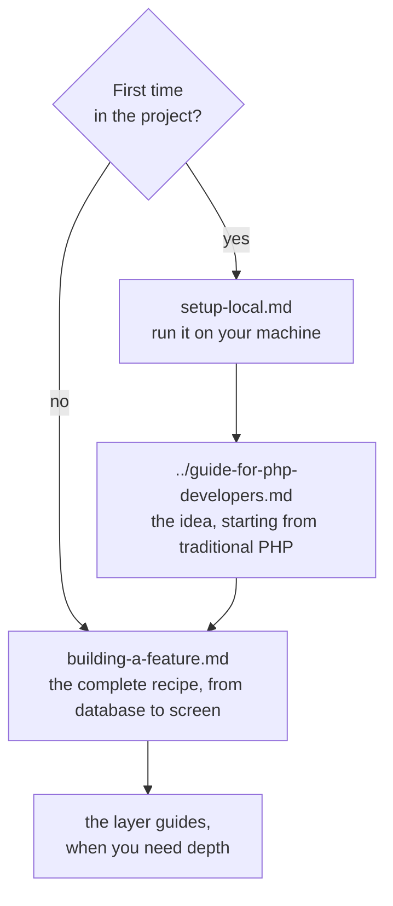

# Developer guides

Hands-on, step-by-step guides for anyone writing code in this project. The
[architecture](../architecture.md) explains *how Cube works*; these guides explain *how to
build* with it, layer by layer.

They all follow the same **running example**: a new **product reviews** feature (the customer
sees a product's reviews and writes their own), built from database to screen on top of the demo
shop. The example code was implemented and tested while writing the guides, but it is not part of
the project: it is the exercise you will build.

## Where to start

## The guides

| Guide | What it teaches |
|---|---|
| [setup-local.md](setup-local.md) | Prerequisites, configuration, database, frontend build, running, testing and troubleshooting |
| [building-a-feature.md](building-a-feature.md) | **The master guide**: the order in which a feature is built and how the layers tie together |
| [repository.md](repository.md) | Entity, criteria, repository, schema and seed, permissions, registration and tests |
| [json-query.md](json-query.md) | Projection queries: the whole graph in one SELECT, 1:1 and 1:N relations, filters, ordering, slicing |
| [application-service.md](application-service.md) | Application services: the business logic the presenter uses, without bloating it |
| [transaction-service.md](transaction-service.md) | Transactions: `required()`, the Fiber-bound transaction and the REST API's remote transaction |
| [presentation-module.md](presentation-module.md) | Presenter, place and route, keys, child presenters, derived state, guards |
| [react-views.md](react-views.md) | The React shell's views: classes, state, events, slots, styles and registration |

## See also

- [Project README](../../README.md) - install, run and test, in short.
- [guide-for-php-developers.md](../guide-for-php-developers.md) - the idea for developers coming
  from template frameworks.
- [architecture.md](../architecture.md) - the full architecture.
- [scaling.md](../scaling.md) - multiple instances behind a load balancer.
- [skills/cube-architecture-php](../../skills/cube-architecture-php/SKILL.md) - the model's rules,
  with a review checklist and a diagnosis table.
