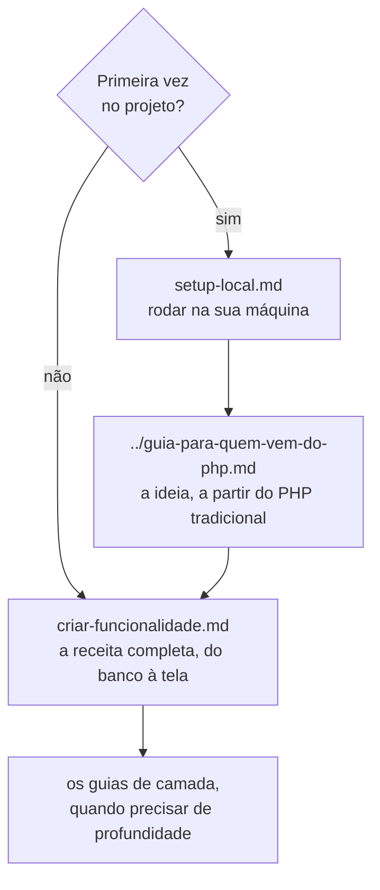

# Guias do desenvolvedor

Guias práticos, passo a passo, para quem vai escrever código neste projeto. A
[arquitetura](../arquitetura.md) explica *como o Cube funciona*; estes guias explicam *como
construir* com ele, camada por camada.

Todos seguem o mesmo **exemplo condutor**: uma funcionalidade nova de **avaliações de
produto** (o cliente vê as avaliações de um produto e escreve a sua), construída do banco à
tela sobre a loja de demonstração. O código do exemplo foi implementado e testado ao escrever
os guias, mas não faz parte do projeto: ele é o exercício que você vai montar.

## Por onde começar

## Os guias

| Guia | O que ensina |
|---|---|
| [setup-local.md](setup-local.md) | Pré-requisitos, configuração, banco, build do front, rodar, testar e resolver problemas |
| [criar-funcionalidade.md](criar-funcionalidade.md) | **O guia-mestre**: a ordem em que se monta uma funcionalidade e as amarrações entre as camadas |
| [repository.md](repository.md) | Entidade, critério, repositório, schema e seed, permissões, registro e testes |
| [json-query.md](json-query.md) | Consultas por projeção: o grafo inteiro num SELECT, relações 1:1 e 1:N, filtros, ordem, recorte |
| [application-service.md](application-service.md) | Serviços de aplicação: a lógica de negócio que o presenter usa, sem engordá-lo |
| [transaction-service.md](transaction-service.md) | Transações: `required()`, a transação presa à Fiber e a transação remota da API REST |
| [presentation-module.md](presentation-module.md) | Presenter, place e rota, keys, presenters-filhos, estado derivado, guardas |
| [react-views.md](react-views.md) | As views do shell React: classes, estado, eventos, slots, estilos e registro |

## Veja também

- [README do projeto](../../README.md) - instalar, rodar e testar, em resumo.
- [guia-para-quem-vem-do-php.md](../guia-para-quem-vem-do-php.md) - a proposta para quem vem
  de frameworks de template.
- [arquitetura.md](../arquitetura.md) - a arquitetura completa.
- [escalando.md](../escalando.md) - várias instâncias atrás de um balanceador.
- [skills/cube-architecture-php](../../skills/cube-architecture-php/SKILL.md) - as regras do
  modelo, com checklist de revisão e tabela de diagnóstico.
