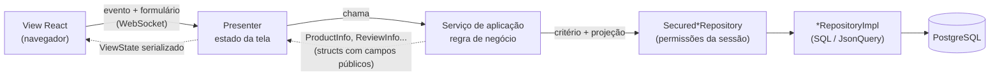

# Serviços de aplicação — os objetivos de negócio da tela

> **Para quem é:** quem vai escrever a consulta ou a gravação que uma tela precisa e quer saber
> onde esse código mora, que forma ele tem e como o presenter o usa.
> **Não cobre:** como escrever um repositório ([repository.md](repository.md)), o formato das
> consultas ([json-query.md](json-query.md)) nem os detalhes de transação
> ([transaction-service.md](transaction-service.md)).

---

## Índice

1. [O problema que esse padrão resolve](#1-o-problema-que-esse-padrão-resolve)
2. [A regra de ouro](#2-a-regra-de-ouro)
3. [Onde vive na arquitetura](#3-onde-vive-na-arquitetura)
4. [Onde colocar no projeto](#4-onde-colocar-no-projeto)
5. [Como estruturar a classe](#5-como-estruturar-a-classe)
6. [Exemplo 1 — consulta com filtros de negócio](#6-exemplo-1--consulta-com-filtros-de-negócio)
7. [Exemplo 2 — mutação com validação](#7-exemplo-2--mutação-com-validação)
8. [Exemplo 3 — mutação que envolve dois repositórios](#8-exemplo-3--mutação-que-envolve-dois-repositórios)
9. [Como o presenter usa o serviço](#9-como-o-presenter-usa-o-serviço)
10. [Anti-padrões — o que não fazer](#10-anti-padrões--o-que-não-fazer)
11. [Referência rápida](#11-referência-rápida)

---

## 1. O problema que esse padrão resolve

Pense na funcionalidade "avaliar um produto". Quando o usuário clica em **Enviar**, o sistema
precisa:

1. conferir se a nota está entre 1 e 5;
2. conferir se o comentário não passa de 500 caracteres (caracteres, não bytes — é UTF-8);
3. tratar comentário vazio como "sem comentário";
4. montar a avaliação com o autor **logado** (nunca um id que veio do cliente) e a data em UTC;
5. gravar;
6. recarregar a lista, agora com a nova avaliação no topo.

Se tudo isso for parar dentro do **presenter**, ele mistura duas coisas que mudam por motivos
diferentes: a lógica da tela (estado, `update()`, mensagens de erro, navegação) e a regra de
negócio (limites, defaults, montagem da entidade). O método `onSubmitReview()` vira uma página de
código, difícil de ler e impossível de reaproveitar em outra tela.

Se for parar no **repositório**, ele deixa de ser o acesso genérico a uma tabela
(`insert`, `fetch`, `count`...) e passa a conhecer regras de uma tela — também errado, porque o
mesmo repositório atende a API REST, os testes e outras telas.

O **serviço de aplicação** é o lugar do meio: uma classe pequena que **orquestra** um objetivo de
negócio — valida, monta, chama os repositórios, converte o resultado — e devolve à tela algo pronto
para mostrar. O presenter fica fino: recebe o evento, chama o serviço, põe o resultado no estado.

---

## 2. A regra de ouro

> **O presenter decide o que a tela mostra; o serviço decide o que é verdade no negócio.**
>
> O serviço não conhece a tela: não toca no `ViewState`, não chama `update()`, não navega, não
> guarda a `ShoppingApplication`. Recebe valores, devolve *structs* de apresentação (ou nada) e,
> quando a regra recusa a operação, **lança uma exceção esperada**.
>
> O presenter não conhece o banco: não monta critério, não escolhe projeção, não chama
> repositório. Chama o serviço e traduz o resultado — ou a exceção — em estado da tela.

Quando bater a dúvida "isto vai no presenter ou no serviço?", pergunte: *"se outra tela (ou um
teste sem tela) precisasse fazer a mesma coisa, ela precisaria deste código?"* Se sim, é do serviço.

---

## 3. Onde vive na arquitetura



Três pontos do desenho:

- **O serviço recebe os repositórios já protegidos.** A `ShoppingApplication` (a sessão) entrega
  cada repositório embrulhado num `Secured*Repository`, que põe o contexto de segurança do usuário
  logado em cada chamada. Assim, as regras de permissão e de "cada cliente só vê os próprios dados"
  valem automaticamente dentro do serviço.
- **O que volta para o presenter são structs de apresentação** — classes com campos públicos, como
  `ProductInfo` e `ReviewInfo` —, não entidades. Elas são o que o serializador sabe enviar ao React.
- **A consulta é uma só.** O serviço pede exatamente os campos que a tela usa (a projeção), e
  relações vêm dentro dela; ver [json-query.md](json-query.md).

---

## 4. Onde colocar no projeto

O serviço mora **ao lado do presenter que o usa**, na mesma pasta da tela. Não existe uma pasta
`Services/` global: o serviço é parte da funcionalidade.

| Serviço | Pasta | Quem usa |
|---|---|---|
| `ProductService` | `src/Shopping/Presentation/Presenter/Restricted/Products/` | `ProductPresenter`, `ProductsPanelPresenter` |
| `ReceiptService` | `src/Shopping/Presentation/Presenter/Restricted/Receipt/` | `ReceiptPresenter` |
| `LoginService` | `src/Shopping/Presentation/Presenter/Open/Login/` | `LoginPresenter` |
| `PurchasesPanelService` | `src/Shopping/Presentation/Presenter/Restricted/Home/Purchases/` | `PurchasesPanelPresenter` |
| `CartManager` | `src/Shopping/Presentation/Presenter/Restricted/Cart/` | `HomePresenter` (cria), `CartPresenter`, `ProductPresenter` |

O `CartManager` é um caso especial: além de regra de negócio, ele **guarda estado da sessão** (os
itens do carrinho em memória até a compra) e avisa ouvintes. Por isso ele é criado uma vez por
sessão e fica na `ShoppingApplication` (`cart()` / `setCart()`), em vez de ser criado por cada
presenter. Os demais serviços não guardam estado e cada presenter cria o seu.

No exemplo guiado de [criar-funcionalidade.md](criar-funcionalidade.md) (avaliações de produto), o
serviço fica em `Presenter/Restricted/Products/Reviews/ReviewService.php`, junto do
`ReviewsPanelPresenter`, do `ReviewsPanelViewState` e da struct `ReviewInfo`.

Convenção de nomes:

- `XxxService` — o serviço;
- `XxxInfo` (ou `XxxItem`, `XxxForm`) — a struct que ele devolve, na mesma pasta;
- exceções esperadas em `src/Shopping/Presentation/Exception/` (`ProductNotFoundException`,
  `WrongParametersException`, `InvalidReviewException`...) ou, quando são do domínio, em
  `src/Shopping/Domain/Exception/` (`InvalidCartItemException`).

---

## 5. Como estruturar a classe

**Construtor: só dependências, já protegidas.** O serviço recebe as **interfaces** dos
repositórios (`ProductRepository`, `PurchaseRepository`...) e, se precisar, o
`TransactionService`. Quem cria o serviço passa o que a `ShoppingApplication` oferece:

```php
// ProductPresenter::__construct
$this->productService = new ProductService($app->productRepository());

// HomePresenter (o carrinho da sessão)
$this->cart = new CartManager($this->app->tx(), $this->app->purchaseRepository());
```

`$app->productRepository()` devolve um `SecuredProductRepository` — o embrulho que roda cada
chamada com o `SecurityContext` da sessão. Nunca entregue ao serviço o repositório "cru" do
`ShoppingContext`: ele não aplicaria as permissões do usuário.

> **Dica de PHP:** `private readonly` no parâmetro do construtor é a *promoção de propriedade*:
> declara o campo, atribui e o torna imutável numa linha só. `final class` impede herança — os
> serviços não são pontos de extensão.

**Retorno: structs de apresentação, montadas com a projeção da tela.** A struct sabe duas coisas:
quais campos a tela precisa (`projection()`) e como converter a entidade (`create()`). O serviço
usa as duas:

```php
/** Produto como a tela o mostra. Structs de apresentação têm campos públicos. */
final class ProductInfo
{
    public int $id = -1;
    public string $name = 'unknown';
    public float $price = 0.0;
    // ... image, description

    public static function projection(): Product
    {
        return new Product()->withId(PV::INT)->withName(PV::STR)->withPrice(PV::FLOAT)->withDescription(PV::STR);
    }

    public static function create(?Product $product): ?self { /* copia campo a campo */ }
}
```

Por que campos públicos? O estado da view é serializado a partir dos campos públicos do objeto. Uma
entidade (`Product`, `Review`) tem campos privados com *getters*: chegaria ao React como `{}`.

**Falhas: exceções esperadas.** Quando a regra de negócio recusa a operação (nota inválida,
produto inexistente, parâmetro ausente), o serviço lança uma exceção específica, com uma mensagem
para o usuário. O presenter captura **essa** exceção e a transforma em código de erro no estado.
Qualquer outra exceção é um defeito ou uma falha de infraestrutura e segue o caminho do alerta de
erro inesperado (seção 9).

**Sem estado entre chamadas.** Fora o `CartManager`, os serviços não guardam nada além das
dependências. Isso os torna fáceis de testar e seguros de compartilhar entre presenters da mesma
tela.

---

## 6. Exemplo 1 — consulta com filtros de negócio

A lista de avaliações de um produto: só as daquele produto, as mais recentes primeiro, no máximo
`$limit`, e só os campos que o painel mostra — com o nome do autor na **mesma consulta**.

```php
/** @return list<ReviewInfo> mais recentes primeiro */
public function listForProduct(int $productId, int $limit = 50): array
{
    $criteria = new ReviewCriteria()
        ->withProductId($productId)
        ->withProjection(ReviewInfo::projection())
        ->withOrderBy(ReviewOrderBy::NEWEST_FIRST);

    return array_map(ReviewInfo::create(...), $this->reviews->fetch($criteria, 0, $limit));
}
```

E a projeção, definida na struct:

```php
/** Só o que o painel mostra; o nome do autor vem na mesma consulta (subconsulta JSON). */
public static function projection(): Review
{
    return new Review()
        ->withId(PV::INT)
        ->withRating(PV::INT)
        ->withComment(PV::STR)
        ->withCreatedAt(PV::dateTime())
        ->withUser(new User()->withId(PV::INT)->withName(PV::STR));
}
```

O que observar:

- **O filtro de negócio vira critério**, não um `array_filter` depois da busca. Filtrar no PHP
  traria do banco linhas que a tela vai jogar fora.
- **A ordem também é do critério** (`ReviewOrderBy::NEWEST_FIRST`), não um `usort` no PHP.
- **A relação `user` está dentro da projeção.** O nome do autor chega junto, numa subconsulta
  JSON; não há um `fetchById` por avaliação.
- `ReviewInfo::create(...)` é a sintaxe de *first-class callable* do PHP: transforma o método
  estático numa `Closure` que o `array_map` aplica a cada entidade.

Um segundo exemplo, já no código: o painel de produtos da home não mostra a descrição (que é HTML
grande). Em vez de criar outra struct, o serviço **tira um campo da projeção**:

```php
/** @return list<ProductInfo> */
public function loadProductsWithoutDescription(int $limit): array
{
    $projection = ProductInfo::projection()->withDescription(null);
    $products = $this->products->fetch(new ProductCriteria()->withProjection($projection), 0, $limit);

    return array_values(array_filter(array_map(ProductInfo::create(...), $products)));
}
```

O `PurchasesPanelService` faz o mesmo com as compras **do usuário**: um método privado `ofUser()`
monta o critério (`withUserId` + projeção + `MOST_RECENT_PURCHASE_FIRST`), reaproveitado pela
lista e pela paginação.

---

## 7. Exemplo 2 — mutação com validação

Gravar uma avaliação. A validação vem **antes** de qualquer acesso ao banco, e cada recusa é uma
`InvalidReviewException` com a mensagem que o usuário vai ler.

```php
public const int MIN_RATING = 1;
public const int MAX_RATING = 5;
public const int MAX_COMMENT_LENGTH = 500;

/**
 * Valida e grava a avaliação de quem está logado.
 *
 * @throws InvalidReviewException nota ou comentário inválidos (falha esperada)
 */
public function add(Subject $subject, int $productId, ?int $rating, ?string $comment): void
{
    if ($rating === null || $rating < self::MIN_RATING || $rating > self::MAX_RATING) {
        throw new InvalidReviewException('Escolha uma nota de 1 a 5.');
    }
    $comment = trim($comment ?? '');
    if (mb_strlen($comment) > self::MAX_COMMENT_LENGTH) {   // mb_: conta caracteres, não bytes (UTF-8)
        throw new InvalidReviewException('O comentário pode ter no máximo ' . self::MAX_COMMENT_LENGTH . ' caracteres.');
    }

    $review = new Review()
        ->withProduct(new Product()->withId($productId))   // só o id: vira a FK PRODUCTID
        ->withUser(new User()->withId($subject->id))        // o autor é sempre o logado, nunca vem da view
        ->withRating($rating)
        ->withComment($comment === '' ? null : $comment)
        ->withCreatedAt(new DateTimeImmutable('now', new DateTimeZone('UTC')));
    $this->reviews->insert($review);
}
```

Decisões que valem para qualquer mutação:

- **Parâmetros que vêm do formulário são anuláveis** (`?int $rating`, `?string $comment`). O
  presenter converte o que chegou do cliente com `Coerce::asInt` / `Coerce::asString`, que devolvem
  `null` para lixo; o serviço trata `null` como inválido em vez de confiar no cliente.
- **Limites viram constantes públicas** (`MAX_COMMENT_LENGTH`), para o teste e a mensagem usarem o
  mesmo número.
- **`mb_strlen`, não `strlen`.** `strlen('ação')` é 6 (bytes); `mb_strlen('ação')` é 4.
- **Defaults de negócio ficam aqui:** comentário vazio vira `null`; a data é "agora" em UTC — o
  banco guarda UTC e o navegador converte para o fuso de quem lê.
- **Identidade vem da sessão.** O `Subject` (o usuário logado) é passado pelo presenter a partir de
  `$this->app->subject()`. O serviço nunca aceita um "id do autor" vindo do formulário.
- **Relação por id:** `new Product()->withId($productId)` basta para o repositório gravar a chave
  estrangeira; não é preciso carregar o produto.

Uma única gravação não precisa de transação explícita: cada chamada de repositório já é um comando
completo no banco. Transação entra quando há **mais de uma** escrita que precisa ser atômica — o
próximo exemplo.

---

## 8. Exemplo 3 — mutação que envolve dois repositórios

Fechar a compra do carrinho grava uma linha em `EN_PURCHASE` e uma linha em `EN_PURCHASEITEM` para
cada item. Se a terceira linha de item falhar, a compra não pode ficar gravada pela metade.

O `CartManager::commit()` resolve com o `TransactionService` que recebeu no construtor:

```php
public function commit(Subject $subject): int
{
    $purchaseId = $this->doPurchase($subject->id);
    $this->clear();
    $this->fire($this->changeListeners);
    $this->fire($this->commitListeners);

    return $purchaseId;
}

private function doPurchase(int $userId): int
{
    $items = [];
    foreach ($this->items as $cartItem) {
        if ($cartItem->quantity < 0) {
            throw new InvalidCartItemException();
        }
        $items[] = new PurchaseItem()
            ->withProduct(new Product()->withId($cartItem->id))
            ->withPrice($cartItem->price)
            ->withAmount($cartItem->quantity);
    }
    $purchase = new Purchase()
        ->withUser(new User()->withId($userId))
        ->withBuyDate(new DateTimeImmutable())
        ->withItems($items);

    // a única fronteira de transação da apresentação: compra + itens, tudo ou nada
    $this->tx->required(function () use ($purchase): void {
        if (!$this->purchases->insert($purchase)) {
            throw new LogicException('Record not inserted');
        }
    });

    return $purchase->id() ?? throw new LogicException('Compra sem id depois do insert');
}
```

Onde estão os "dois repositórios"? O `PurchaseRepositoryImpl::insert()` grava a compra e, em
seguida, chama o repositório de itens para cada um:

```php
/** Insere a compra e, junto, os itens (cada item passa a apontar para ela). */
public function insert(object $bean): bool
{
    $inserted = $this->insertBean($bean, [self::USERID => $bean->userId()]);
    if ($inserted) {
        foreach ($bean->items() ?? [] as $item) {
            $this->repos->purchaseItems->insert($item->withPurchase($bean));
        }
    }

    return $inserted;
}
```

São vários comandos `INSERT`, em dois repositórios, e todos rodam **dentro** do `required()`
porque estão na mesma Fiber. Se qualquer um lançar exceção, o `required()` faz rollback e repropaga
a exceção — o carrinho não é esvaziado, porque `clear()` só roda depois que `doPurchase()` voltou.

O padrão para qualquer mutação com várias escritas:

1. **Valide e monte tudo fora da transação** (o laço que confere as quantidades e cria os
   `PurchaseItem`). A transação segura uma conexão do pool: quanto mais curta, melhor.
2. **Dentro do `required()`, só as escritas.**
3. **Efeitos que não são do banco** (esvaziar o carrinho, avisar ouvintes, navegar) **depois** do
   `required()` voltar com sucesso.

Se o próprio serviço chamasse dois repositórios, a forma seria a mesma: as duas chamadas dentro
da mesma closure passada ao `required()`.

Tudo sobre `required()`, `setRollbackOnly()` e o que acontece por baixo está em
[transaction-service.md](transaction-service.md).

---

## 9. Como o presenter usa o serviço

O presenter cria o serviço no construtor e o chama nos tratadores de evento e no
`applyParameters`. O `ReviewsPanelPresenter` mostra os três desfechos possíveis:

```php
public function onSubmitReview(?int $rating, ?string $comment): void
{
    try {
        $subject = $this->app->subject() ?? throw new LogicException('Sem usuário logado');
        $productId = $this->productId ?? throw new LogicException('Sem produto carregado');
        $this->service->add($subject, $productId, $rating, $comment);
        $this->clearError();
        $this->loadReviews($productId);   // a nova avaliação entra no topo, e média/contagem acompanham
    } catch (InvalidReviewException $caught) {
        // esperada: vai para o estado do painel; a lista fica como estava
        $this->state->errorCode = self::ERROR_INVALID_REVIEW;
        $this->state->errorMessage = $caught->getMessage();
        $this->update();
    } catch (Throwable $caught) {
        $this->app->alertUnexpectedError('Submitting a review', $caught);
    }
}
```

1. **Sucesso:** o presenter atualiza o próprio estado (aqui, recarrega a lista pelo serviço) e chama
   `update()` para a view ser reenviada.
2. **Falha esperada:** a exceção específica vira um **código de erro** e uma mensagem no
   `ViewState`. A view React mostra o erro junto do formulário. Os códigos são constantes do
   presenter (`ERROR_INVALID_REVIEW = 1`), e a view decide como exibi-los.
3. **Falha inesperada:** `alertUnexpectedError()` registra no log e mostra o alerta genérico da
   aplicação. O presenter não tenta adivinhar o que deu errado.

O `CartPresenter::onBuy()` segue o mesmo desenho com mais de uma exceção esperada:
`InvalidCartItemException` vira o código 1, `OfflineException` (banco fora do ar) vira o código 4,
e o resto vai para o alerta.

**No `applyParameters`, a exceção sobe.** Quando o serviço é chamado durante a navegação, o
presenter **não** captura: `ProductService::loadProductById()` lança `ProductNotFoundException` e
o motor desfaz a navegação inteira (o usuário fica na tela anterior). Quem decide o que mostrar é
quem iniciou a viagem — a `HomePresenter`, por exemplo, captura `ProductNotFoundException` ao abrir
um produto.

```php
// ProductPresenter::applyParameters
if ($this->state->product === null || $newId !== $oldId) {
    $this->state->product = $this->productService->loadProductById($newId);
    $this->update();
}
```

Repare no `if`: o presenter só chama o serviço **quando o produto mudou**. Passar pelo caminho não
é recarregar — ver [presentation-module.md](presentation-module.md).

---

## 10. Anti-padrões — o que não fazer

### ❌ Consultar dentro de um laço (N+1)

```php
// ERRADO: uma consulta por avaliação para buscar o nome do autor
$reviews = $this->reviews->fetch($criteria);
foreach ($reviews as $review) {
    $author = $this->users->fetchById($review->user()?->id());
    // ...
}
```

Com 50 avaliações, são 51 idas ao banco, e a latência cresce com a lista. A relação vai **dentro da
projeção** (`->withUser(new User()->withId(PV::INT)->withName(PV::STR))`), e o repositório traz
tudo numa consulta só. Relações 1:N (os itens de uma compra) também: `->withItems([$item])`.
Detalhes em [json-query.md](json-query.md).

### ❌ Devolver entidades para o estado da view

```php
// ERRADO
$this->state->reviews = $this->reviews->fetch($criteria);   // list<Review>
```

A entidade tem campos privados: o React recebe `{}`. Além disso, ela carrega mais do que a tela
deveria ver (o hash da senha de um `User`, por exemplo). O serviço sempre converte para a struct
de apresentação (`ReviewInfo::create(...)`).

### ❌ Capturar tudo dentro do serviço

Um `try { ... } catch (Throwable) {}` em volta da gravação faz o presenter achar que deu certo.
Engolir a exceção esconde defeitos e, dentro de uma transação, impede o rollback (o `required()`
só desfaz o que vê falhar). O serviço só captura o que sabe resolver; o resto sobe. E nunca
devolva `false` ou `null` para dizer "deu erro de validação" — use a exceção esperada, que carrega
a mensagem. (`null` é legítimo quando significa "não encontrado" ou "credenciais inválidas", como
em `ReceiptService::loadReceipt()` e `LoginService::fetchSubject()`.)

### ❌ Regra de negócio na view

A view React formata para exibição — número no padrão do navegador (`NumberUtils.format`), data
no fuso de quem lê (`new Date(ms)`). Isso é dela. O que **não** é dela é decidir regras: o limite
de 500 caracteres, se o frete é grátis, a média das notas, o que conta como "comentário vazio".
Valores derivados de regra são calculados no servidor (serviço ou presenter) e chegam prontos no
estado — o `ReviewsPanelPresenter` envia `averageLabel = "4,5 de 5"`, não a lista para o React
somar. Se a regra mudar, muda num lugar só, e o teste de aceitação (que roda sem navegador) a
cobre.

### ❌ Fazer I/O que bloqueia o event loop

O servidor é **um processo** com **um event loop** atendendo todas as sessões. As chamadas ao banco
já são assíncronas (suspendem só a Fiber de quem perguntou). Mas um serviço que faça:

```php
sleep(2);                                          // ERRADO: congela todo mundo
$cep = file_get_contents('https://viacep.com.br/...');   // ERRADO: HTTP síncrono
```

trava **todos** os usuários enquanto espera. Para esperar, use `($this->app->context->sleep)($s)`
(passado ao serviço por quem o cria) ou o `scheduler()`; para HTTP, os clientes do Amp
(`amphp/http-client`); para CPU pesada, um processo à parte (`amphp/parallel`, como o servidor já
faz com a derivação de chaves do login). Ver [../arquitetura.md](../arquitetura.md).

### ❌ Serviço que mexe na tela

Receber a `ShoppingApplication` no construtor (para chamar `$this->app->go(...)`, por exemplo)
dá ao serviço acesso a tudo — navegação, estado, alertas — e o amarra à sessão. Receba só os repositórios de que precisa; deixe navegação e `update()` para o
presenter.

---

## 11. Referência rápida

| Pergunta | Resposta |
|---|---|
| Onde fica o serviço? | Na pasta do presenter que o usa: `Presenter/<Área>/<Tela>/XxxService.php`. |
| Quem cria? | O presenter, no construtor: `new XxxService($app->xxxRepository())`. O `CartManager` é criado uma vez por sessão. |
| O que recebe no construtor? | As interfaces dos repositórios **protegidos** da `ShoppingApplication` e, se escrever em mais de um lugar, `$app->tx()`. |
| O que devolve? | Structs de apresentação com campos públicos (`ProductInfo`, `ReviewInfo`), `list<...>`, `Page<...>`, um id, ou nada. |
| Como escolhe os campos? | `XxxInfo::projection()` no critério (`withProjection`) ou no `fetchById($id, $projection)`. |
| Filtros e ordem? | No critério (`withProductId`, `withUserId`, `withOrderBy`), nunca em PHP depois da busca. |
| Relações? | Dentro da projeção (`withUser(...)`, `withItems([...])`). Nunca um `fetch` por linha. |
| Validação recusou? | `throw new XxxException('mensagem para o usuário')`; o presenter vira `errorCode` + `errorMessage`. |
| Várias escritas? | Dentro de `$this->tx->required(fn () => ...)`; validar antes, efeitos colaterais depois. |
| Pode guardar estado? | Não (exceção: `CartManager`, que é o carrinho da sessão). |
| Pode chamar `update()`, navegar, guardar a `ShoppingApplication`? | Não. |
| Pode usar `sleep()`, `file_get_contents` de URL, cliente HTTP síncrono? | Não: travam todas as sessões. |

**Para continuar:** [repository.md](repository.md) (o outro lado da chamada),
[json-query.md](json-query.md) (projeções e critérios), [transaction-service.md](transaction-service.md),
[presentation-module.md](presentation-module.md) (o presenter que chama o serviço) e
[react-views.md](react-views.md) (como a view mostra o resultado e os códigos de erro).
