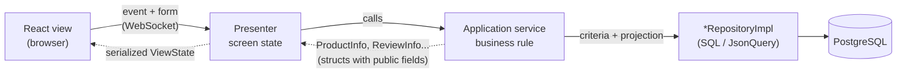

# Application services — the screen's business goals

> **Who it's for:** anyone about to write the query or the write a screen needs and who wants to
> know where that code lives, what shape it has and how the presenter uses it.
> **Doesn't cover:** how to write a repository ([repository.md](repository.md)), the query format
> ([json-query.md](json-query.md)) or transaction details
> ([transaction-service.md](transaction-service.md)).

---

## Contents

1. [The problem this pattern solves](#1-the-problem-this-pattern-solves)
2. [The golden rule](#2-the-golden-rule)
3. [Where it lives in the architecture](#3-where-it-lives-in-the-architecture)
4. [Where to put it in the project](#4-where-to-put-it-in-the-project)
5. [How to structure the class](#5-how-to-structure-the-class)
6. [Example 1 — a query with business filters](#6-example-1--a-query-with-business-filters)
7. [Example 2 — a mutation with validation](#7-example-2--a-mutation-with-validation)
8. [Example 3 — a mutation involving two repositories](#8-example-3--a-mutation-involving-two-repositories)
9. [How the presenter uses the service](#9-how-the-presenter-uses-the-service)
10. [Anti-patterns — what not to do](#10-anti-patterns--what-not-to-do)
11. [Quick reference](#11-quick-reference)

---

## 1. The problem this pattern solves

Think of the "review a product" feature. When the user clicks **Submit**, the system needs to:

1. check that the rating is between 1 and 5;
2. check that the comment is no longer than 500 characters (characters, not bytes — it's UTF-8);
3. treat an empty comment as "no comment";
4. build the review with the **logged-in** author (never an id that came from the client) and the
   date in UTC;
5. save it;
6. reload the list, now with the new review at the top.

If all of this ends up inside the **presenter**, it mixes two things that change for different
reasons: screen logic (state, `update()`, error messages, navigation) and business rules (limits,
defaults, building the entity). The `onSubmitReview()` method becomes a page of code, hard to read
and impossible to reuse on another screen.

If it ends up in the **repository**, the repository stops being generic access to a table
(`insert`, `fetch`, `count`...) and starts knowing a screen's rules — also wrong, because the same
repository serves the REST API, the tests and other screens.

The **application service** is the middle ground: a small class that **orchestrates** a business
goal — validates, builds, calls the repositories, converts the result — and gives the screen
something ready to show. The presenter stays thin: it receives the event, calls the service, puts
the result in the state.

---

## 2. The golden rule

> **The presenter decides what the screen shows; the service decides what is true for the business.**
>
> The service doesn't know the screen: it doesn't touch the `ViewState`, doesn't call `update()`,
> doesn't navigate, doesn't keep the `StoreApplication`. It receives values, returns
> presentation *structs* (or nothing) and, when the rule refuses the operation, **throws an
> expected exception**.
>
> The presenter doesn't know the database: it doesn't build criteria, doesn't choose a projection,
> doesn't call a repository. It calls the service and translates the result — or the exception —
> into screen state.

When in doubt whether "this goes in the presenter or the service?", ask: *"if another screen (or a
test with no screen) had to do the same thing, would it need this code?"* If yes, it belongs to the
service.

---

## 3. Where it lives in the architecture



Three points of the design:

- **Authorization is the responsibility of the presenter and the service.** The
  `StoreApplication` (the session) hands out repositories with no security wrapper. Code
  running on the server is already written to respect the rules: the service filters by the
  logged-in user (`$app->subject()`) when the screen is "my data". Role-based permission checks
  exist only in the REST API, where the request arrives ready-made from a client we don't control.
- **What comes back to the presenter are presentation structs** — classes with public fields, like
  `ProductInfo` and `ReviewInfo` —, not entities. They are what the serializer knows how to send to
  React.
- **There is a single query.** The service asks for exactly the fields the screen uses (the
  projection), and relations come inside it; see [json-query.md](json-query.md).

---

## 4. Where to put it in the project

The service lives **next to the presenter that uses it**, in the screen's folder. There is no
global `Services/` folder: the service is part of the feature.

| Service | Folder | Used by |
|---|---|---|
| `ProductService` | `src/Store/Presentation/Presenter/Restricted/Products/` | `ProductPresenter`, `ProductsPanelPresenter` |
| `ReceiptService` | `src/Store/Presentation/Presenter/Restricted/Receipt/` | `ReceiptPresenter` |
| `LoginService` | `src/Store/Presentation/Presenter/Open/Login/` | `LoginPresenter` |
| `PurchasesPanelService` | `src/Store/Presentation/Presenter/Restricted/Home/Purchases/` | `PurchasesPanelPresenter` |
| `CartManager` | `src/Store/Presentation/Presenter/Restricted/Cart/` | `HomePresenter` (creates it), `CartPresenter`, `ProductPresenter` |

`CartManager` is a special case: besides business rules, it **keeps session state** (the cart
items in memory until the purchase) and notifies listeners. That's why it is created once per
session and lives in the `StoreApplication` (`cart()` / `setCart()`), instead of being created
by each presenter. The other services keep no state and each presenter creates its own.

In the guided example in [building-a-feature.md](building-a-feature.md) (product reviews), the
service lives in `Presenter/Restricted/Products/Reviews/ReviewService.php`, next to
`ReviewsPanelPresenter`, `ReviewsPanelViewState` and the `ReviewInfo` struct.

Naming convention:

- `XxxService` — the service;
- `XxxInfo` (or `XxxItem`, `XxxForm`) — the struct it returns, in the same folder;
- expected exceptions in `src/Store/Presentation/Exception/` (`ProductNotFoundException`,
  `WrongParametersException`, `InvalidReviewException`...) or, when they belong to the domain, in
  `src/Store/Domain/Exception/` (`InvalidCartItemException`).

---

## 5. How to structure the class

**Constructor: the service finds its own dependencies.** In the constructor, it looks up in
`Beans`, by **interface**, the repositories (`ProductRepository`, `PurchaseRepository`...) and, if
needed, the `TransactionService`, and keeps them in `readonly` fields. Whoever creates the service
doesn't know what it depends on:

```php
// ProductPresenter::__construct
$this->productService = new ProductService();

// HomePresenter (the session's cart)
$this->cart = new CartManager();

// ProductService: the constructor looks up what it uses
private readonly ProductRepository $products;

public function __construct()
{
    $this->products = Beans::of(ProductRepository::class);
}
```

Looking up in the constructor, and not on every call, makes a forgotten registration show up right
away, when the service is created. The registry doesn't change after startup, so the stored field
stays valid. To swap an implementation in a test, register the other one with `Beans::set(...)`
before creating the service (`StoreServiceTest` registers the repositories in `setUp`).

> **PHP tip:** a `readonly` field can only be assigned once, from inside the class itself - here,
> in the constructor. After that, trying to change it is an error. `final class` prevents
> inheritance: services are not extension points.

**Return: presentation structs, built with the screen's projection.** The struct knows two things:
which fields the screen needs (`projection()`) and how to convert the entity (`create()`). The
service uses both:

```php
/** Product as the screen shows it. Presentation structs have public fields. */
final class ProductInfo
{
    public int $id = -1;
    public string $name = 'unknown';
    public float $price = 0.0;
    // ... image, description

    public static function projection(): Product
    {
        return new Product()->withId(PV::INT)->withName(PV::STR)->withPrice(PV::FLOAT)->withDescription(PV::STR);
    }

    public static function create(?Product $product): ?self { /* copies field by field */ }
}
```

Why public fields? The view state is serialized from the object's public fields. An entity
(`Product`, `Review`) has private fields with *getters*: it would reach React as `{}`.

**Failures: expected exceptions.** When the business rule refuses the operation (invalid rating,
nonexistent product, missing parameter), the service throws a specific exception, with a message
for the user. The presenter catches **that** exception and turns it into an error code in the
state. Any other exception is a defect or an infrastructure failure and follows the
unexpected-error alert path (section 9).

**No state between calls.** Apart from `CartManager`, services keep nothing besides their
dependencies. That makes them easy to test and safe to share between presenters of the same
screen.

---

## 6. Example 1 — a query with business filters

A product's list of reviews: only that product's, newest first, at most `$limit`, and only the
fields the panel shows — with the author's name in the **same query**.

```php
/** @return list<ReviewInfo> newest first */
public function listForProduct(int $productId, int $limit = 50): array
{
    $criteria = new ReviewCriteria()
        ->withProductId($productId)
        ->withProjection(ReviewInfo::projection())
        ->withOrderBy(ReviewOrderBy::NEWEST_FIRST);

    return array_map(ReviewInfo::create(...), $this->reviews->fetch($criteria, 0, $limit));
}
```

And the projection, defined in the struct:

```php
/** Only what the panel shows; the author's name comes in the same query (JSON subquery). */
public static function projection(): Review
{
    return new Review()
        ->withId(PV::INT)
        ->withRating(PV::INT)
        ->withComment(PV::STR)
        ->withCreatedAt(PV::dateTime())
        ->withUser(new User()->withId(PV::INT)->withName(PV::STR));
}
```

What to notice:

- **The business filter becomes criteria**, not an `array_filter` after the fetch. Filtering in
  PHP would bring rows from the database that the screen will throw away.
- **The ordering is also in the criteria** (`ReviewOrderBy::NEWEST_FIRST`), not a `usort` in PHP.
- **The `user` relation is inside the projection.** The author's name comes along, in a JSON
  subquery; there is no `fetchById` per review.
- `ReviewInfo::create(...)` is PHP's *first-class callable* syntax: it turns the static method into
  a `Closure` that `array_map` applies to each entity.

A second example, already in the code: the home products panel doesn't show the description (which
is large HTML). Instead of creating another struct, the service **removes a field from the
projection**:

```php
/** @return list<ProductInfo> */
public function loadProductsWithoutDescription(int $limit): array
{
    $projection = ProductInfo::projection()->withDescription(null);
    $products = $this->products->fetch(new ProductCriteria()->withProjection($projection), 0, $limit);

    return array_values(array_filter(array_map(ProductInfo::create(...), $products)));
}
```

`PurchasesPanelService` does the same with **the user's** purchases: a private `ofUser()` method
builds the criteria (`withUserId` + projection + `MOST_RECENT_PURCHASE_FIRST`), reused by the list
and by pagination.

---

## 7. Example 2 — a mutation with validation

Saving a review. Validation comes **before** any database access, and each refusal is an
`InvalidReviewException` with the message the user will read.

```php
public const int MIN_RATING = 1;
public const int MAX_RATING = 5;
public const int MAX_COMMENT_LENGTH = 500;

/**
 * Validates and saves the logged-in user's review.
 *
 * @throws InvalidReviewException invalid rating or comment (expected failure)
 */
public function add(Subject $subject, int $productId, ?int $rating, ?string $comment): void
{
    if ($rating === null || $rating < self::MIN_RATING || $rating > self::MAX_RATING) {
        throw new InvalidReviewException('Choose a rating from 1 to 5.');
    }
    $comment = trim($comment ?? '');
    if (mb_strlen($comment) > self::MAX_COMMENT_LENGTH) {   // mb_: counts characters, not bytes (UTF-8)
        throw new InvalidReviewException('The comment can have at most ' . self::MAX_COMMENT_LENGTH . ' characters.');
    }

    $review = new Review()
        ->withProduct(new Product()->withId($productId))   // id only: becomes the PRODUCTID FK
        ->withUser(new User()->withId($subject->id))        // the author is always the logged-in user, never from the view
        ->withRating($rating)
        ->withComment($comment === '' ? null : $comment)
        ->withCreatedAt(new DateTimeImmutable('now', new DateTimeZone('UTC')));
    $this->reviews->insert($review);
}
```

Decisions that apply to any mutation:

- **Parameters coming from the form are nullable** (`?int $rating`, `?string $comment`). The
  presenter converts what arrived from the client with `Coerce::asInt` / `Coerce::asString`, which
  return `null` for garbage; the service treats `null` as invalid instead of trusting the client.
- **Limits become public constants** (`MAX_COMMENT_LENGTH`), so the test and the message use the
  same number.
- **`mb_strlen`, not `strlen`.** `strlen('ação')` is 6 (bytes); `mb_strlen('ação')` is 4.
- **Business defaults live here:** an empty comment becomes `null`; the date is "now" in UTC — the
  database stores UTC and the browser converts to the reader's time zone.
- **Identity comes from the session.** The `Subject` (the logged-in user) is passed by the
  presenter from `$this->app->subject()`. The service never accepts an "author id" coming from the
  form.
- **Relation by id:** `new Product()->withId($productId)` is enough for the repository to write the
  foreign key; there is no need to load the product.

A single write doesn't need an explicit transaction: each repository call is already a complete
statement in the database. A transaction comes in when there is **more than one** write that must
be atomic — the next example.

---

## 8. Example 3 — a mutation involving two repositories

Checking out the cart writes one row to `EN_PURCHASE` and one row to `EN_PURCHASEITEM` per item.
If the third item row fails, the purchase can't be left half-written.

`CartManager::commit()` solves this with the `TransactionService` it received in the constructor:

```php
public function commit(Subject $subject): int
{
    $purchaseId = $this->doPurchase($subject->id);
    $this->clear();
    $this->fire($this->changeListeners);
    $this->fire($this->commitListeners);

    return $purchaseId;
}

private function doPurchase(int $userId): int
{
    $items = [];
    foreach ($this->items as $cartItem) {
        if ($cartItem->quantity < 0) {
            throw new InvalidCartItemException();
        }
        $items[] = new PurchaseItem()
            ->withProduct(new Product()->withId($cartItem->id))
            ->withPrice($cartItem->price)
            ->withAmount($cartItem->quantity);
    }
    $purchase = new Purchase()
        ->withUser(new User()->withId($userId))
        ->withBuyDate(new DateTimeImmutable())
        ->withItems($items);

    // the presentation layer's only transaction boundary: purchase + items, all or nothing
    $this->tx->required(function () use ($purchase): void {
        if (!$this->purchases->insert($purchase)) {
            throw new LogicException('Record not inserted');
        }
    });

    return $purchase->id() ?? throw new LogicException('Purchase has no id after insert');
}
```

Where are the "two repositories"? `PurchaseRepositoryImpl::insert()` writes the purchase and then
calls the items repository for each item. `purchaseItemRepository()` finds it in `Beans` on the
first call (`self::repositoryOf(...)`) and keeps it in a field, because at construction time the
items repository may not be registered yet:

```php
/** Inserts the purchase and, with it, the items (each item now points to it). */
public function insert(object $bean): bool
{
    $inserted = $this->insertBean($bean, [self::USERID => $bean->userId()]);
    if ($inserted) {
        foreach ($bean->items() ?? [] as $item) {
            $this->purchaseItemRepository()->insert($item->withPurchase($bean));
        }
    }

    return $inserted;
}
```

These are several `INSERT` statements, in two repositories, and all of them run **inside**
`required()` because they are on the same Fiber. If any of them throws, `required()` rolls back and
rethrows the exception — the cart isn't emptied, because `clear()` only runs after `doPurchase()`
returns.

The pattern for any mutation with several writes:

1. **Validate and build everything outside the transaction** (the loop that checks the quantities
   and creates the `PurchaseItem`s). The transaction holds a connection from the pool: the shorter,
   the better.
2. **Inside `required()`, only the writes.**
3. **Non-database effects** (emptying the cart, notifying listeners, navigating) **after**
   `required()` returns successfully.

If the service itself called two repositories, the shape would be the same: both calls inside the
same closure passed to `required()`.

Everything about `required()`, `setRollbackOnly()` and what happens underneath is in
[transaction-service.md](transaction-service.md).

---

## 9. How the presenter uses the service

The presenter creates the service in its constructor and calls it in event handlers and in
`applyParameters`. `ReviewsPanelPresenter` shows the three possible outcomes:

```php
public function onSubmitReview(?int $rating, ?string $comment): void
{
    try {
        $subject = $this->app->subject() ?? throw new LogicException('No logged-in user');
        $productId = $this->productId ?? throw new LogicException('No product loaded');
        $this->service->add($subject, $productId, $rating, $comment);
        $this->clearError();
        $this->loadReviews($productId);   // the new review goes to the top, and average/count follow
    } catch (InvalidReviewException $caught) {
        // expected: goes into the panel state; the list stays as it was
        $this->state->errorCode = self::ERROR_INVALID_REVIEW;
        $this->state->errorMessage = $caught->getMessage();
        $this->update();
    } catch (Throwable $caught) {
        $this->app->alertUnexpectedError('Submitting a review', $caught);
    }
}
```

1. **Success:** the presenter updates its own state (here, reloads the list through the service)
   and calls `update()` so the view is sent again.
2. **Expected failure:** the specific exception becomes an **error code** and a message in the
   `ViewState`. The React view shows the error next to the form. The codes are presenter constants
   (`ERROR_INVALID_REVIEW = 1`), and the view decides how to display them.
3. **Unexpected failure:** `alertUnexpectedError()` logs it and shows the application's generic
   alert. The presenter doesn't try to guess what went wrong.

`CartPresenter::onBuy()` follows the same design with more than one expected exception:
`InvalidCartItemException` becomes code 1, `OfflineException` (database down) becomes code 4, and
the rest goes to the alert.

**In `applyParameters`, the exception propagates.** When the service is called during navigation,
the presenter does **not** catch: `ProductService::loadProductById()` throws
`ProductNotFoundException` and the engine undoes the whole navigation (the user stays on the
previous screen). Whoever started the trip decides what to show — `HomePresenter`, for example,
catches `ProductNotFoundException` when opening a product.

```php
// ProductPresenter::applyParameters
if ($this->state->product === null || $newId !== $oldId) {
    $this->state->product = $this->productService->loadProductById($newId);
    $this->update();
}
```

Note the `if`: the presenter only calls the service **when the product changed**. Passing through
is not reloading — see [presentation-module.md](presentation-module.md).

---

## 10. Anti-patterns — what not to do

### ❌ Querying inside a loop (N+1)

```php
// WRONG: one query per review to fetch the author's name
$reviews = $this->reviews->fetch($criteria);
foreach ($reviews as $review) {
    $author = $this->users->fetchById($review->user()?->id());
    // ...
}
```

With 50 reviews, that's 51 round trips to the database, and the latency grows with the list. The
relation goes **inside the projection** (`->withUser(new User()->withId(PV::INT)->withName(PV::STR))`),
and the repository brings everything in a single query. 1:N relations (a purchase's items) too:
`->withItems([$item])`. Details in [json-query.md](json-query.md).

### ❌ Returning entities to the view state

```php
// WRONG
$this->state->reviews = $this->reviews->fetch($criteria);   // list<Review>
```

The entity has private fields: React receives `{}`. Besides, it carries more than the screen should
see (a `User`'s password hash, for example). The service always converts to the presentation struct
(`ReviewInfo::create(...)`).

### ❌ Catching everything inside the service

A `try { ... } catch (Throwable) {}` around the write makes the presenter think it worked.
Swallowing the exception hides defects and, inside a transaction, prevents the rollback
(`required()` only undoes what it sees fail). The service only catches what it knows how to
resolve; the rest propagates. And never return `false` or `null` to mean "validation error" — use
the expected exception, which carries the message. (`null` is legitimate when it means "not found"
or "invalid credentials", as in `ReceiptService::loadReceipt()` and `LoginService::fetchSubject()`.)

### ❌ Business rules in the view

The React view formats for display — numbers in the browser's format (`NumberUtils.format`), dates
in the reader's time zone (`new Date(ms)`). That's its job. What is **not** its job is deciding
rules: the 500-character limit, whether shipping is free, the average rating, what counts as an
"empty comment". Rule-derived values are computed on the server (service or presenter) and arrive
ready in the state — `ReviewsPanelPresenter` sends `averageLabel = "4.5 of 5"`, not the list for
React to sum. If the rule changes, it changes in one place, and the acceptance test (which runs
without a browser) covers it.

### ❌ Doing I/O that blocks the event loop

The server is **one process** with **one event loop** serving every session. Database calls are
already asynchronous (they suspend only the Fiber of whoever asked). But a service that does:

```php
sleep(2);                                                 // WRONG: freezes everyone
$data = file_get_contents('https://api.example.com/...');   // WRONG: synchronous HTTP
```

blocks **every** user while it waits. To wait, use `($this->app->context->sleep)($s)` (passed to
the service by whoever creates it) or the `scheduler()`; for HTTP, the Amp clients
(`amphp/http-client`); for heavy CPU work, a separate process (`amphp/parallel`, as the server
already does for the login key derivation). See [../architecture.md](../architecture.md).

### ❌ A service that touches the screen

Receiving the `StoreApplication` in the constructor (to call `$this->app->go(...)`, for example)
gives the service access to everything — navigation, state, alerts — and ties it to the session.
Receive only the repositories it needs; leave navigation and `update()` to the presenter.

---

## 11. Quick reference

| Question | Answer |
|---|---|
| Where does the service live? | In the folder of the presenter that uses it: `Presenter/<Area>/<Screen>/XxxService.php`. |
| Who creates it? | The presenter, in its constructor: `new XxxService()`. `CartManager` is created once per session. |
| Where do the dependencies come from? | From `Beans`, in the service constructor: `Beans::of(XxxRepository::class)` and, if it writes in more than one place, `Beans::of(TransactionService::class)`. |
| What does it return? | Presentation structs with public fields (`ProductInfo`, `ReviewInfo`), `list<...>`, `Page<...>`, an id, or nothing. |
| How does it choose the fields? | `XxxInfo::projection()` in the criteria (`withProjection`) or in `fetchById($id, $projection)`. |
| Filters and ordering? | In the criteria (`withProductId`, `withUserId`, `withOrderBy`), never in PHP after the fetch. |
| Relations? | Inside the projection (`withUser(...)`, `withItems([...])`). Never one `fetch` per row. |
| Validation refused? | `throw new XxxException('message for the user')`; the presenter turns it into `errorCode` + `errorMessage`. |
| Several writes? | Inside `$this->tx->required(fn () => ...)`; validate before, side effects after. |
| Can it keep state? | No (exception: `CartManager`, which is the session's cart). |
| Can it call `update()`, navigate, keep the `StoreApplication`? | No. |
| Can it use `sleep()`, `file_get_contents` on a URL, a synchronous HTTP client? | No: they block every session. |

**Next:** [repository.md](repository.md) (the other side of the call),
[json-query.md](json-query.md) (projections and criteria), [transaction-service.md](transaction-service.md),
[presentation-module.md](presentation-module.md) (the presenter that calls the service) and
[react-views.md](react-views.md) (how the view shows the result and the error codes).
