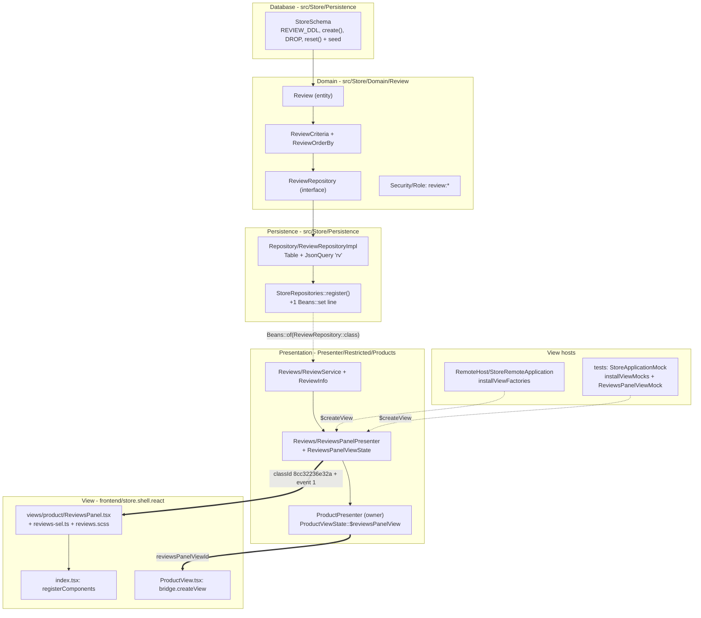
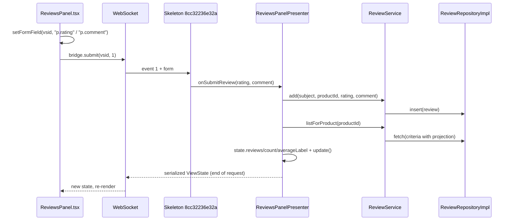

# Building a new feature, end to end

This is the **master guide**: the recipe that stitches the layer guides into a single order,
from the database to the screen. The layer guides ([`repository.md`](repository.md),
[`json-query.md`](json-query.md), [`application-service.md`](application-service.md),
[`transaction-service.md`](transaction-service.md),
[`presentation-module.md`](presentation-module.md), [`react-views.md`](react-views.md))
explain **each piece in depth**. This one explains **in what order the pieces fit together**
and, above all, **the bindings** between layers: the places where each side compiles and passes
PHPStan, yet the feature never shows up on screen.

The running example is the same one used by every guide: **product reviews**. On the product
detail screen, the customer sees the reviews (a 1-5 rating, comment, author, date), the average
and the count, and writes their own. The example code was implemented and verified (tests
green, PHPStan level 8 clean, frontend build ok), but **it is not in the project**: it is the
exercise you will build by following this guide.

---

## Contents

1. [Before you start](#1-before-you-start)
2. [Architecture map](#2-architecture-map)
3. [30-second view: the canonical order](#3-30-second-view-the-canonical-order)
4. [Step by step: product reviews](#4-step-by-step-product-reviews)
5. [The bindings nobody lists in one place](#5-the-bindings-nobody-lists-in-one-place)
6. [Pitfalls found along the way](#6-pitfalls-found-along-the-way)
7. [Consolidated checklist](#7-consolidated-checklist)
8. [References](#8-references)

---

## 1. Before you start

**A running environment.** You need the server starting and the tests green before touching
anything. If you don't have that yet, follow [`setup-local.md`](setup-local.md): PHP with
`pgsql`, PostgreSQL, Composer, Node, and `work/config/application.local.toml` with the server
database **and** the test database (`[test.database]`, which is wiped on every run). Check:

```bash
composer check            # PHPStan level 8 + PHPUnit, all green
bin/build-frontend.sh     # builds the React shell into work/frontend/
php bin/server.php        # http://localhost:8080, log in as john/john
```

If you come from template frameworks (Laravel, Symfony, Twig), first read the
[guide for PHP developers](../guide-for-php-developers.md): it explains why there is no
controller returning HTML here, but a presenter that keeps the screen state on the server.

**A clear specification.** Before writing code, answer in writing:

- What does the user see and do? (Here: the product's list of reviews, the average, and a form
  with rating and comment.)
- What are the rules? (Rating required, 1 to 5; comment optional, up to 500 characters; the
  author is always the logged-in user; newest first.)
- On which **surface** does it appear? Is it a new screen (a *place*, with its own address) or
  a **segment** inside an existing screen? Reviews have no address of their own: they live
  inside the product detail. That decides the presenter type (step 9).

**Minimal modeling.** Sketch the table (columns, types, FKs, indexes), the entity, the filters
and orderings the screens need, and which roles can read and write.

| Decision | Reviews |
|---|---|
| Table | `EN_REVIEW` (`ID`, `PRODUCTID` → `EN_PRODUCT`, `USERID` → `EN_USER`, `RATING`, `REVIEWCOMMENT`, `CREATEDAT`) + `SQ_REVIEW` |
| Filters | by id, product, user, rating |
| Orderings | newest, oldest, best rated |
| Relations | product and user, both N:1 |
| Roles | `ADMIN`: everything; `CUSTOMER`: read and write |
| Presenter type | child presenter (`AbstractChildPresenter`) of the product screen |

> **Golden rule: bottom up.** Database → domain → persistence → application → presentation →
> view. Each layer compiles and is testable before the next one exists. Never start with the
> screen.

---

## 2. Architecture map

Data crosses the layers in this direction. Each box is a file you create or change in the
example; the dashed arrows are the **bindings**, which must match exactly.



At runtime, the pattern is **Cube MVP**: the presenter, on the server, owns the state; React
only draws what it receives and sends back the user's events. The path of a click on
"Submit review":



---

## 3. 30-second view: the canonical order

| # | Step | Where | Details in |
|---:|---|---|---|
| 1 | Table, sequence, index, DROP/reset and seed | `src/Store/Persistence/StoreSchema.php` | [repository.md](repository.md) |
| 2 | Entity | `src/Store/Domain/Review/Review.php` | [repository.md](repository.md) |
| 3 | Criteria + orderings | `Domain/Review/ReviewCriteria.php`, `ReviewOrderBy.php` | [repository.md](repository.md) |
| 4 | Repository interface | `Domain/Review/ReviewRepository.php` | [repository.md](repository.md) |
| 5 | Implementation (`Table` + `JsonQuery`) | `Persistence/Repository/ReviewRepositoryImpl.php` | [repository.md](repository.md), [json-query.md](json-query.md) |
| 6 | Register in `Beans` (one line) | `Persistence/StoreRepositories.php` | [repository.md](repository.md) |
| 7 | Role permissions | `Domain/Security/Role.php` | [repository.md](repository.md) |
| 8 | Application service + screen DTO | `Presenter/Restricted/Products/Reviews/ReviewService.php`, `ReviewInfo.php` | [application-service.md](application-service.md), [transaction-service.md](transaction-service.md) |
| 9 | ViewState + (child) presenter + expected exception | `Reviews/ReviewsPanelViewState.php`, `ReviewsPanelPresenter.php`, `Exception/InvalidReviewException.php` | [presentation-module.md](presentation-module.md) |
| 10 | The owner creates, feeds and releases the child | `Products/ProductPresenter.php`, `ProductViewState.php` | [presentation-module.md](presentation-module.md) |
| 11 | `$createView` in the remote host **and** in the test mock | `RemoteHost/StoreRemoteApplication.php`, `tests/.../Mock/` | [presentation-module.md](presentation-module.md) |
| 12 | React view + selectors + styles + registration + drawing in the owner | `frontend/store.shell.react/src/scripts/...` | [react-views.md](react-views.md) |
| 13 | Repository and presentation tests | `tests/Store/Persistence/`, `tests/Store/Presentation/` | [repository.md](repository.md), [presentation-module.md](presentation-module.md) |
| 14 | Frontend build, `composer check`, see it in the browser | root | [setup-local.md](setup-local.md) |

> **What if it were a screen with its own address?** Between steps 11 and 12 you would add the
> new case to the `Place` enum, the method in `Routes` and a keys class (`XxxKeys extends` the
> keys of the parent place, with a unique two-letter prefix), and `KeysNamesTest` would start
> checking the new place's keys. Reviews don't need this: they are a segment of the product
> screen, and the owner decides which product is on screen. See
> [presentation-module.md](presentation-module.md).

---

## 4. Step by step: product reviews

Each step shows the essentials of the example code and links to the guide that goes deeper.
Keep the layer guide open alongside when you want to understand the reason behind each line.

### Step 1 - Schema, DROP, reset and seed

The shop schema is PHP code: `StoreSchema` creates the tables on first startup and seeds
the demo data. The new table goes in a **separate** constant from the main DDL, so it can be
applied on its own to a database that existed before reviews:

```php
private const string REVIEW_DDL = <<<'SQL'
    CREATE TABLE EN_REVIEW (
        ID BIGINT NOT NULL PRIMARY KEY,
        PRODUCTID BIGINT NOT NULL REFERENCES EN_PRODUCT (ID),
        USERID BIGINT NOT NULL REFERENCES EN_USER (ID),
        RATING INT NOT NULL,
        REVIEWCOMMENT TEXT,
        CREATEDAT TIMESTAMP NOT NULL
    );
    CREATE SEQUENCE SQ_REVIEW START WITH 1 INCREMENT BY 1;
    CREATE INDEX IX_REVIEW_PRODUCT ON EN_REVIEW (PRODUCTID);
    SQL;
```

Four places change in `StoreSchema`, and they all matter:

- **`create()`**: a new database runs `self::DDL . self::REVIEW_DDL`; an old database (it
  already has `EN_USER`) creates only `EN_REVIEW`, if it doesn't exist. Without this, the server
  would start on the old database and fail on the first reviews query.
- **`DROP`**: `EN_REVIEW` goes **first** in the list (it points to `EN_PRODUCT` and
  `EN_USER`), and `SQ_REVIEW` goes into the `DROP SEQUENCE`.
- **`reset()`**: `DELETE FROM EN_REVIEW` before `EN_PRODUCT` and `EN_USER`, for the same reason.
- **Seed**: two reviews of the coffee maker, with fixed ids exposed as constants for the tests,
  and the sequence restarted right after:

```php
// coffee maker reviews: average 4.5; john's is the most recent
public const int ADMIN_COFFEE_MAKER_REVIEW_ID = 0;
public const int JOHN_COFFEE_MAKER_REVIEW_ID = 1;

// ... at the end of reset():
$db->execute('INSERT INTO EN_REVIEW (ID, PRODUCTID, USERID, RATING, REVIEWCOMMENT, CREATEDAT) VALUES '
    . "(0, 0, 0, 5, 'Excellent! Makes great coffee and is easy to clean.', '2024-03-10 12:00:00'), "
    . "(1, 0, 1, 4, 'Good coffee maker, but the carafe gets quite hot.', '2024-05-02 18:45:00')");
$db->restartSequence('SQ_REVIEW', 2);
```

Why the coffee maker, `admin` and `john`? Because the existing tests delete the user `jane`
and the flash drive product; a review pointing to them would break those tests through the FK
(see [pitfall 1](#6-pitfalls-found-along-the-way)).

Details: [repository.md](repository.md).

### Step 2 - The entity

`src/Store/Domain/Review/Review.php`. A mutable entity, with **private**, nullable fields
(`null` = not loaded, or not projected) and `field()` / `withField()` accessors that return
`static` for chaining. Relations are objects (`?Product`, `?User`), not loose ids; the FK value
is derived:

```php
final class Review
{
    private ?int $id = null;
    private ?Product $product = null;
    private ?User $user = null;
    private ?int $rating = null;
    private ?string $comment = null;
    private ?DateTimeImmutable $createdAt = null;

    // ... one field()/withField() pair per field; withX() returns $this

    /** The PRODUCTID FK value: the product only needs its id. */
    public function productId(): ?int
    {
        return $this->product?->id();
    }
}
```

### Step 3 - Criteria and orderings

`ReviewCriteria implements Criteria` carries the projection, the ordering and one
`ComparableCriterion` per filterable field, **created in the constructor** (never `null`):

```php
public function __construct()
{
    $this->reviewId = new ComparableCriterion($this, 'reviewId');
    $this->productId = new ComparableCriterion($this, 'productId');
    // ... userId and rating, the same way
}

/** Shortcut for productId()->eq($value). */
public function withProductId(?int $value): static
{
    return $value === null ? $this : $this->productId->eq($value);
}

public function criterions(): array
{
    return [$this->reviewId, $this->productId, $this->userId, $this->rating];
}
```

Each field has the trio `productId()` (the criterion, for `ge`, `in`...), `hasProductId()` and
the `withProductId()` shortcut. Orderings are a pure enum, `ReviewOrderBy`, with
`NEWEST_FIRST`, `OLDEST_FIRST` and `BEST_RATED_FIRST`. No SQL logic here: translating the
criteria is the implementation's job (step 5).

### Step 4 - The repository interface

```php
/**
 * @extends Repository<Review, ReviewCriteria>
 */
interface ReviewRepository extends Repository
{
}
```

Empty on purpose: `insert`, `update`, `delete`, `count`, `fetch`, `fetchPage`, `fetchById`
and `newProjection` already come from `Repository`. Declare here only what goes **beyond**
that. It is this interface, not the implementation, that the upper layers know.

### Step 5 - The implementation: `Table` + `JsonQuery`

`src/Store/Persistence/Repository/ReviewRepositoryImpl.php`, `extends AbstractRepository
implements ReviewRepository`. In the constructor: the field ↔ column mapping (`Table`) and the
projection query (`JsonQuery`, alias `rv`), with the two N:1 relations. The table, sequence and
column names are public class constants, used everywhere instead of loose text (the reason is in
[repository.md](repository.md#5a-table-and-column-constants)):

```php
public const string TABLE = 'EN_REVIEW';
public const string SEQUENCE = 'SQ_REVIEW';
public const string ID = 'ID';
public const string PRODUCTID = 'PRODUCTID';
public const string USERID = 'USERID';
public const string RATING = 'RATING';
public const string REVIEWCOMMENT = 'REVIEWCOMMENT';
public const string CREATEDAT = 'CREATEDAT';

// ... in the constructor:
// order matters: the first column is the primary key (insertBean/updateBean rely on it)
$table = new Table(self::TABLE, static fn (): Review => new Review(), [
    new Column('id', self::ID, ColumnType::Int, static fn (Review $r) => $r->id(), static fn (Review $r, mixed $v) => $r->withId($v)),
    new Column('rating', self::RATING, ColumnType::Int, static fn (Review $r) => $r->rating(), static fn (Review $r, mixed $v) => $r->withRating($v)),
    new Column('comment', self::REVIEWCOMMENT, ColumnType::Text, /* ... */),
    new Column('createdAt', self::CREATEDAT, ColumnType::DateTime, /* ... */),
]);
$this->query = new JsonQuery($table, ReviewCriteria::class, 'rv', $db->dialect())
    ->withConditions($this->conditions(...))
    ->withOrdering($this->orderBy(...))
    ->addToOne(
        'product',
        static fn (Review $r) => $r->product(),
        static fn (Review $r, ?Product $p) => $r->withProduct($p),
        fn () => $this->productRepository()->query(),   // closure: the other repository may not be registered yet
        self::PRODUCTID,
    )
    ->addToOne('user', /* same, with $this->userRepository()->query() and self::USERID */);

// outside the constructor: each repository used is looked up in Beans once and kept in a field
private ?ProductRepositoryImpl $productRepository = null;

private function productRepository(): ProductRepositoryImpl
{
    return $this->productRepository ??= self::repositoryOf(ProductRepository::class, ProductRepositoryImpl::class);
}
// ... and the same for userRepository()
```

The rest of the class:

- **FKs are not `Table` columns**: they go as extra columns on writes, read from the relations
  (`insertBean($bean, [self::PRODUCTID => $bean->productId(), self::USERID => $bean->userId()])`,
  and the equivalent with getter + type in `updateBean`).
- **`conditions()`** prefixes the columns with the alias (`$c = Sql::alias($a);`) and translates
  each criterion with `CT::translate($c(self::PRODUCTID), $criteria->productId())` (`CT` is the
  alias for `CriterionTranslator`), all inside `Sql::and([...])`.
- **`orderBy()`** is a `match` over `ReviewOrderBy` and **every ordering ends with the id**
  (`"{$c(self::CREATEDAT)} DESC, {$c(self::ID)} DESC"` - PHP doesn't interpolate constants in a
  string, but it does interpolate the call to the `$c` closure), so two reviews in the same
  second don't swap places between pages.
- **`delete()`** rejects criteria without `reviewId` or `productId` (`LogicException`): with no
  filter, `deleteWhere` would become a `DELETE` without `WHERE`.
- **`newProjection()`** is the default projection: plain fields + `new Product()->withId(PV::INT)`
  and `new User()->withId(PV::INT)`. Only the relation's id, read straight from the FK column,
  with no subquery.
- `sequence()` returns `self::SEQUENCE`; `projectionOf()` and `criteriaForIds()` complete the
  `AbstractRepository` contract.

With this, "the product's reviews with the author's name" is **a single SELECT**: the
`ReviewRepositoryTest` counts the statements and requires exactly one. Details:
[repository.md](repository.md) and, for projections and relations, [json-query.md](json-query.md).

### Step 6 - Register in `Beans`

`StoreRepositories::register(Database $db)` creates every repository over the same
`Database` and registers them by interface. The reviews one is one more line; it finds
`products` and `users` on its own, through the `productRepository()`/`userRepository()` methods
from step 5:

```php
// in StoreRepositories::register(): from here on, anything can find the repository by its interface
Beans::set(ReviewRepository::class, new ReviewRepositoryImpl($db));
```

`StoreRepositories` has no field per repository. `register()` runs once, at server startup
(inside `StoreRepositories::open(...)`), and in the tests' `TestDatabase::open()`.
After that, whoever needs the repository asks for it by **interface**:
`Beans::of(ReviewRepository::class)`. PHPStan knows the return is a `ReviewRepository`. There
is no getter on the session and no new argument in any constructor.

### Step 7 - Role permissions

Permissions are `entity:operation` strings, per role, in the `Role` enum
(`src/Store/Domain/Security/Role.php`):

```php
self::ADMIN => ['user:*', 'product:*', 'purchase:*', 'purchase-item:*', 'review:*', PermissionModel::DATA_ALL],
self::CUSTOMER => ['product:read', 'purchase:read', 'purchase:write', 'purchase-item:read', 'purchase-item:write', 'review:read', 'review:write'],
```

They are checked by `SecurityEnforcer::require($entity, $operation)` in the REST API
controllers (`src/Store/Persistence/Rest/`). The example doesn't expose reviews over REST;
the permissions are declared for when there is a controller. Details:
[repository.md](repository.md).

### Step 8 - Application service and screen DTO

Business logic doesn't live in the presenter. `ReviewService` sits next to the presenter that
uses it (`Presenter/Restricted/Products/Reviews/`), finds the repository in `Beans` by
**interface** and keeps no screen state:

```php
final class ReviewService
{
    public const int MIN_RATING = 1;
    public const int MAX_RATING = 5;
    public const int MAX_COMMENT_LENGTH = 500;

    private readonly ReviewRepository $reviews;

    public function __construct()
    {
        $this->reviews = Beans::of(ReviewRepository::class);
    }

    /** @return list<ReviewInfo> newest first */
    public function listForProduct(int $productId, int $limit = 50): array
    {
        $criteria = new ReviewCriteria()
            ->withProductId($productId)
            ->withProjection(ReviewInfo::projection())
            ->withOrderBy(ReviewOrderBy::NEWEST_FIRST);

        return array_map(ReviewInfo::create(...), $this->reviews->fetch($criteria, 0, $limit));
    }

    /** @throws InvalidReviewException invalid rating or comment (expected failure) */
    public function add(Subject $subject, int $productId, ?int $rating, ?string $comment): void
    {
        if ($rating === null || $rating < self::MIN_RATING || $rating > self::MAX_RATING) {
            throw new InvalidReviewException('Choose a rating from 1 to 5.');
        }
        $comment = trim($comment ?? '');
        if (mb_strlen($comment) > self::MAX_COMMENT_LENGTH) {   // mb_: counts characters, not bytes
            throw new InvalidReviewException('The comment can have at most ' . self::MAX_COMMENT_LENGTH . ' characters.');
        }

        $review = new Review()
            ->withProduct(new Product()->withId($productId))   // id only: becomes the PRODUCTID FK
            ->withUser(new User()->withId($subject->id))        // the author is always the logged-in user, never from the view
            ->withRating($rating)
            ->withComment($comment === '' ? null : $comment)
            ->withCreatedAt(new DateTimeImmutable('now', new DateTimeZone('UTC')));
        $this->reviews->insert($review);
    }
}
```

`add()` does a single write, so it needs no explicit transaction. If the action wrote more
than one thing (the review and, say, a consolidated average on the product), the writes would
go together in `Beans::of(TransactionService::class)->required(fn () => ...)`, as explained in
[transaction-service.md](transaction-service.md).

`ReviewInfo` is what the screen shows, with **public fields**: the serializer only sends public
properties, and the entity (private fields) would reach React as `{}`. It also declares the
projection, with the author's name coming in the same query:

```php
public static function projection(): Review
{
    return new Review()
        ->withId(PV::INT)
        ->withRating(PV::INT)
        ->withComment(PV::STR)
        ->withCreatedAt(PV::dateTime())
        ->withUser(new User()->withId(PV::INT)->withName(PV::STR));
}
```

The date goes as milliseconds since 1970 (`(int) $createdAt->format('Uv')`), and the browser
formats it in the reader's time zone. Details: [application-service.md](application-service.md).

### Step 9 - ViewState, child presenter and the expected exception

**The render state** is a contract with the React view, written as public properties:

```php
final class ReviewsPanelViewState implements ViewState
{
    /** @var list<ReviewInfo> newest first */
    public array $reviews = [];
    public int $count = 0;
    /** "4.5 of 5"; empty (omitted when sent) when there are no reviews */
    public string $averageLabel = '';
    /** 0 = no error */
    public int $errorCode = 0;
    public ?string $errorMessage = null;
}
```

**The expected failure** is a dedicated exception, `InvalidReviewException extends
RuntimeException` (in `src/Store/Presentation/Exception/`). It becomes a code + message in the
panel state, not the unexpected-error alert.

**The presenter** is an `AbstractChildPresenter`: it has no place or parameters, the owner
creates and releases it, and the product to show arrives through `showProduct()`. The parts
that matter:

```php
/** @extends AbstractChildPresenter<StoreApplication> */
final class ReviewsPanelPresenter extends AbstractChildPresenter
{
    private const int EVENT_SUBMIT_REVIEW = 1;
    private const int ERROR_INVALID_REVIEW = 1;

    /** @var (Closure(self): CubeView)|null installed by the remote host and by the tests (mock) */
    public static ?Closure $createView = null;

    public readonly ReviewsPanelViewState $state;
    private readonly ReviewService $service;
    private ?int $productId = null;   // CONTROL state: the loaded product

    public function __construct(StoreApplication $app, public readonly ProductPresenter $owner)
    {
        parent::__construct($app);
        $this->state = new ReviewsPanelViewState();
        $this->service = new ReviewService();
    }

    /** Passing through is not reloading: it only queries when the product changed. */
    public function showProduct(int $productId): void
    {
        if ($this->productId === $productId) {
            return;
        }
        $this->loadReviews($productId);
        $this->productId = $productId;   // only after loading: if it fails, the panel stays as it was
        $this->clearError();
    }

    public function onSubmitReview(?int $rating, ?string $comment): void
    {
        try {
            $subject = $this->app->subject() ?? throw new LogicException('No logged-in user');
            $productId = $this->productId ?? throw new LogicException('No product loaded');
            $this->service->add($subject, $productId, $rating, $comment);
            $this->clearError();
            $this->loadReviews($productId);
        } catch (InvalidReviewException $caught) {
            $this->state->errorCode = self::ERROR_INVALID_REVIEW;
            $this->state->errorMessage = $caught->getMessage();
            $this->update();
        } catch (Throwable $caught) {
            $this->app->alertUnexpectedError('Submitting a review', $caught);
        }
    }

    public function skeleton(): CubeSkeleton
    {
        return new Skeleton('8cc32236e32a', function (int $event, int $count, array $form): void {
            match ($event) {
                self::EVENT_SUBMIT_REVIEW => $this->onSubmitReview(
                    Coerce::asInt($form['p.rating'] ?? null),
                    Coerce::asString($form['p.comment'] ?? null),
                ),
                default => Skeleton::unknownEvent($event),
            };
        });
    }

    protected function onCreateView(): CubeView
    {
        return (self::$createView ?? throw new LogicException('ReviewsPanelPresenter::$createView not configured'))($this);
    }

    protected function onInitialize(): void
    {
        $this->update();   // just draws (empty): loading waits for the owner to say which product it is
    }
}
```

The private `loadReviews()` queries the service, fills `reviews`, `count` and `averageLabel`
(`number_format(..., 1, '.', '') . ' of 5'`) and calls `$this->update()`. The average is
computed there, right after loading, and not in `commitComputedState`: it only changes when the
list changes, and `commitComputedState` would run on every send to the view.

Points of attention the code above already handles:

- **`$this->update()` after changing the state.** Nothing observes the state: without
  `update()`, the screen keeps showing the old value.
- **The `classId` is new and random**: 12 hexadecimal characters, generated with
  `php -r 'echo bin2hex(random_bytes(6)), PHP_EOL;'`. Never copy another presenter's.
- **Event arguments arrive as `p.<name>`** and are converted with `Coerce` before validating:
  the form is outside input.
- **Every handler protects itself**: the expected goes into the state; the unexpected, to
  `alertUnexpectedError`.

Details: [presentation-module.md](presentation-module.md).

### Step 10 - The owner creates, feeds and releases the child

`ProductPresenter` gets a field for the child, and `ProductViewState` a `CubeView` field:

```php
/** reviews panel (child presenter); sent to the client as `reviewsPanelViewId` */
public ?CubeView $reviewsPanelView = null;
```

In the owner's `applyParameters`, the child is born **once**, inside `if ($initialization)`,
and receives the product **on every trip**:

```php
if ($initialization) {
    // ... the owner's own view
    $this->reviewsPanel = new ReviewsPanelPresenter($this->app, $this);
    $this->state->reviewsPanelView = $this->reviewsPanel->initialize();
    $this->update();
}
// on every trip: the panel compares and only reloads if the product changed
$this->reviewsPanel?->showProduct($newId);
```

And the owner's `release()` clears the view field, releases the child and only then calls the
parent:

```php
public function release(): void
{
    $this->state->reviewsPanelView = null;
    $this->reviewsPanel?->release();
    $this->reviewsPanel = null;
    parent::release();
}
```

The serializer turns the `CubeView` property `reviewsPanelView` into the JSON field
`reviewsPanelViewId`: that is the name the owner's React view reads (step 12).

### Step 11 - `$createView` in both hosts

The presenter doesn't know how to draw: the host provides the view. There are **two** places,
and missing either one throws "`$createView` not configured":

```php
// src/Store/RemoteHost/StoreRemoteApplication.php, in installViewFactories()
ReviewsPanelPresenter::$createView = static fn (ReviewsPanelPresenter $p) => new RemoteView(self::of($p->app), $p, $p->state, $p->skeleton());

// tests/Store/Presentation/Mock/StoreApplicationMock.php, in installViewMocks()
ReviewsPanelPresenter::$createView = static fn (ReviewsPanelPresenter $p) => new ReviewsPanelViewMock($p);
```

The fake view, `tests/Store/Presentation/Mock/ReviewsPanelViewMock.php`, extends
`AbstractViewMock` and only exposes `$presenter` and `$state` (the same object as the
presenter's), so tests can call the methods and check the state.

### Step 12 - The React view

Three new files in `frontend/store.shell.react/src/scripts/views/product/`:

- **`ReviewsPanel.tsx`**: the view class, `extends BaseViewClass<ViewProps,
  ReviewsPanelState>`;
- **`reviews-sel.ts`**: the CSS selectors (`wdc-reviews__*`), spreading `GlobalSel` and
  importing `reviews.scss`;
- **`reviews.scss`**: the styles, using the theme variables (`var(--app-surface)`...).

The state type mirrors `ReviewsPanelViewState`, and **every field the server may omit is
optional** (`null` and empty strings are not sent):

```tsx
const ON_SUBMIT_REVIEW = 1 // the SAME code as the skeleton

type ReviewsPanelState = {
  reviews?: Review[]
  count: number
  averageLabel?: string // omitted when there are no reviews
  errorCode: number
  errorMessage?: string
}
```

The form (rating and comment) is **local** view state: it only goes to the server on submit,
as the event's arguments:

```tsx
readonly emitSubmitReview = () => {
  const { vsid } = this
  // the real validation is on the server: 0 (no rating) goes as null and comes back as an error in the state
  bridge.setFormField(vsid, "p.rating", this.rating > 0 ? this.rating : null)
  bridge.setFormField(vsid, "p.comment", this.comment)
  bridge.submit(vsid, ON_SUBMIT_REVIEW)
}
```

```tsx
export default BaseViewClass.FC(ReviewsPanelClass, "8cc32236e32a") // the SAME classId as the skeleton
```

Two more changes, outside the new files:

```tsx
// index.tsx: import and register
import ReviewsPanel from "./views/product/ReviewsPanel"
bridge.registerComponents(/* ... */, ProductView, ReviewsPanel, /* ... */)

// ProductView.tsx: the type gets the field and render draws the child
reviewsPanelViewId?: string // the child presenter's view (ReviewsPanelPresenter)
{bridge.createView(state.reviewsPanelViewId)}
```

Details (classes, local state, events, styles): [react-views.md](react-views.md).

### Step 13 - Tests

Two files, each on its own layer, both against the test database:

**`tests/Store/Persistence/ReviewRepositoryTest.php`** (`extends RepositoryTestCase`):
lists by product with the author's name **in a single SQL statement** (counted with
`$this->db->onQuery(...)`), the three orderings, the default projection (only the FK ids),
`insert` generating the id from the sequence and writing the FKs, `count` by product and by
rating (`rating()->ge(5)`), and `update` changing only what changed.

**`tests/Store/Presentation/ProductReviewsTest.php`** (`extends PresentationTestCase`):
no browser; it calls what the events would call and checks the state of the fake views:

```php
private function openCoffeeMaker(): ReviewsPanelViewMock
{
    $home = $this->login('john', 'john');
    $home->presenter->onOpenProduct(Seed::COFFEE_MAKER_ID);
    $product = ProductViewMock::cast($home->state->contentView);

    return ReviewsPanelViewMock::cast($product->state->reviewsPanelView);
}

#[Test]
public function openingTheProduct_listsTheSeededReviews_newestFirst(): void
{
    $panel = $this->openCoffeeMaker();

    self::assertSame([Seed::JOHN_COFFEE_MAKER_REVIEW_ID, Seed::ADMIN_COFFEE_MAKER_REVIEW_ID], self::ids($panel->state->reviews));
    self::assertSame('4.5 of 5', $panel->state->averageLabel);
}
```

The other cases cover: a product without reviews (empty panel); a valid review goes to the top
and the average becomes `"3.3 of 5"`; an invalid rating puts the error in the state, keeps the
list and does **not** become an alert; a missing rating and a 501-character comment are rejected
(500 `é`, 1000 bytes, still passes); passing through the same product again **does not query**
the database; leaving the product releases the panel (`$panel->released`).

### Step 14 - Build, check and browser

```bash
bin/build-frontend.sh     # BEFORE composer check: StoreServerTest uses the built shell
composer check            # PHPStan level 8 + PHPUnit
php bin/server.php
```

Open http://localhost:8080, log in as `john`/`john`, open the coffee maker: two reviews,
"4.5 of 5". Submit one without a rating (error in the panel), then a valid one (it goes to the
top, the count goes up and the form clears). Remember the build doesn't check TypeScript types
([pitfall 4](#6-pitfalls-found-along-the-way)): the browser is the final proof of the view.

---

## 5. The bindings nobody lists in one place

These are the points where one half compiles, the other half compiles, PHPStan doesn't
complain, and still **nothing works at runtime**. Check them one by one:

| Binding | The two (or more) sides | Symptom if they diverge |
|---|---|---|
| **`classId`** | `new Skeleton('8cc32236e32a', ...)` in PHP **=** `BaseViewClass.FC(ReviewsPanelClass, "8cc32236e32a")` in React | the panel area stays blank, with no error on the server |
| **Event codes** | `EVENT_SUBMIT_REVIEW = 1` in the `match` **=** `ON_SUBMIT_REVIEW = 1` in `bridge.submit` | `eventCode(N) not handled` in the log and an unexpected-error alert on click |
| **`p.*` arguments** | `bridge.setFormField(vsid, "p.rating", ...)` **=** `$form['p.rating']` in the skeleton | the argument arrives `null`; validation rejects it and it looks like a "rule bug" |
| **`$createView`** | `StoreRemoteApplication::installViewFactories` **and** `StoreApplicationMock::installViewMocks` | `LogicException` "`$createView` not configured" (in the browser or only in the tests) |
| **View registration** | `import` **and** argument to `bridge.registerComponents` in `index.tsx` | the same blank screen as a wrong `classId` |
| **Child view in the owner** | `ProductViewState::$reviewsPanelView` (PHP) → `reviewsPanelViewId` (JSON) → `bridge.createView(state.reviewsPanelViewId)` (React) | the panel exists on the server but never appears |
| **ViewState fields** | **public** properties in PHP **=** TypeScript type fields, optional when they can be omitted | a field that is always empty in React, or `{}` instead of an object |
| **Complete schema** | `REVIEW_DDL` **+** `create()` for an old database **+** `DROP` **+** `reset()` **+** `restartSequence` | the server breaks on an old database, or `insert` collides with a seed id |
| **Registered repository** | `Beans::set(ReviewRepository::class, new ReviewRepositoryImpl($db))` in `StoreRepositories::register()` | `LogicException` "No implementation registered for ...ReviewRepository" on the first screen that uses it |
| **Frontend rebuild** | `bin/build-frontend.sh` (or `npm run watch`) after changing React | the server serves the old shell from `work/frontend/` |

---

## 6. Pitfalls found along the way

These really came up while implementing the example. None is exotic; all of them cost time if
you don't know they exist.

1. **A new table with an FK can break old tests.** `UserRepositoryTest` deletes `jane` and
   `ProductRepositoryTest` deletes the flash drive. A seeded review pointing to either of them
   would make those `DELETE`s fail on the FK. That's why the seed uses the coffee maker, `admin`
   and `john`. Before seeding, look in the tests for who deletes what.
2. **The shared test database keeps the new table when you switch branches.** Tests start with
   `StoreSchema::drop()` (`tests/Support/TestDatabase.php`). On a branch without reviews,
   the old `DROP` doesn't know about `EN_REVIEW`, and dropping `EN_PRODUCT`/`EN_USER` fails
   because `EN_REVIEW` still points to them. Fix: drop `EN_REVIEW` and `SQ_REVIEW` by hand in
   the **test** database (`DROP TABLE EN_REVIEW; DROP SEQUENCE SQ_REVIEW;`).
3. **`StoreServerTest` needs the built frontend.** Without `work/frontend/
   store.shell.react/index.html`, it is skipped; with a stale build, it tests the stale
   shell. Run `bin/build-frontend.sh` before `composer check`.
4. **The frontend build doesn't check types.** Parcel transpiles TypeScript with SWC, which
   strips the types without checking them: a misnamed field in the state type compiles and only
   shows up as an "empty field" on screen. The project has no type-check configured: check the
   state type against the `ViewState` field by field and test in the browser (see
   [react-views.md](react-views.md)).
5. **Dates are stored without fractional seconds.** `ColumnType::DateTime` stores in the
   `Y-m-d H:i:s` format, in UTC. Two reviews submitted in the same second have the same
   `CREATEDAT`; the id tie-breaker, at the end of every ordering, is what keeps the list stable.
6. **Repository written but not registered.** Without the line
   `Beans::set(ReviewRepository::class, ...)` in `StoreRepositories::register()`, the first
   call to `Beans::of(ReviewRepository::class)` (or to the `repositoryOf` of whoever uses it)
   throws "No implementation registered". The tests catch this right away: both the repository
   and the presentation tests find the repository through `Beans`.
7. **The first `Table` column is the primary key.** `insertBean` and `updateBean` rely on it.
   Putting `rating` before `id` produces wrong writes without any compile error.
8. **The `classId` must be identical on both sides.** One different character between the
   `Skeleton` and `BaseViewClass.FC` leaves the area blank, with no error on the server.
   Generate a new id for each view and copy it; don't type it.
9. **`$createView` goes in both hosts.** Only in the remote host: the screen works in the
   browser, but the presentation tests throw "`$createView` not configured". Only in the mock:
   the tests pass and the browser breaks.
10. **Writing to a property of a temporary object is a PHP fatal error.**
    `(new ProductKeys($this->app, $intent))->productId = 3;` doesn't compile ("Cannot use
    temporary expression in write context"). Put the object in a variable first:
    `$keys = new ProductKeys($this->app, $intent); $keys->productId = 3;`. Calling a method on
    the temporary, like `(new XxxKeys($this->app, $intent))->go()`, is fine.

---

## 7. Consolidated checklist

Database and domain:

- [ ] Table and sequence DDL, with an index for the most used filter
- [ ] `create()` also creates the new table on a database that already existed
- [ ] `DROP` and `reset()` with the new table **before** the tables it references
- [ ] Seed with fixed ids in constants, `restartSequence` afterwards, not pointing to records the tests delete
- [ ] Entity with nullable private fields, `field()`/`withField()` and FKs derived from the relations
- [ ] Criteria with one criterion per filterable field, created in the constructor, and a complete `criterions()`
- [ ] Orderings enum
- [ ] Repository interface (`@extends Repository<Entity, Criteria>`)

Persistence and application:

- [ ] Table, sequence and column names as public repository constants; no column name as loose text
- [ ] `Table` with the primary key as the **first** column
- [ ] `JsonQuery` with its own alias, conditions, ordering (ending with the id) and relations in closures
- [ ] FKs as extra columns in `insert` and `update`
- [ ] `newProjection()` with only the relation ids
- [ ] Registered in `Beans` (one line in `StoreRepositories::register()`)
- [ ] Permissions in `Role`

Presentation:

- [ ] The service finds the repository in its constructor (`Beans::of(XxxRepository::class)`), validates outside the write and projects only what the screen shows
- [ ] Multiple writes in a transaction (`Beans::of(TransactionService::class)->required(...)`)
- [ ] Screen DTO with public fields
- [ ] ViewState with public properties and default values
- [ ] Dedicated exception for the expected failure
- [ ] Presenter with a new `classId`, events and error codes as constants, `match` with `Skeleton::unknownEvent`
- [ ] `p.*` arguments converted with `Coerce`
- [ ] Every handler with `try`: expected in the state, unexpected in `alertUnexpectedError`
- [ ] `$this->update()` after every state change
- [ ] Child created in the owner's `if ($initialization)`, fed on every trip, released in the owner's `release()`
- [ ] (screen with an address) `Place`, `Routes` and keys with a unique prefix
- [ ] `$createView` in `StoreRemoteApplication` **and** in `StoreApplicationMock` + mock view

View:

- [ ] Component with the **same** `classId` and the **same** event codes
- [ ] State type with optionals for everything that can be omitted
- [ ] Selectors in `*-sel.ts`, styles in a `.scss` imported only by the selectors
- [ ] Registered in `index.tsx`
- [ ] Drawn in the owner with `bridge.createView(state.xxxViewId)`

Tests and delivery:

- [ ] Repository test (including "a single SQL statement" for the screen query)
- [ ] Presentation test with the mock views: happy path, expected failure, passing through without reloading, release
- [ ] `bin/build-frontend.sh` (and the state type reviewed by hand: the build doesn't check types)
- [ ] `composer check` green
- [ ] Seen working in the browser

---

## 8. References

- [setup-local.md](setup-local.md): environment, database, build, tests and common problems.
- [repository.md](repository.md): entity, criteria, repository, schema and seed, security, registration.
- [json-query.md](json-query.md): projection, 1:1 and 1:N relations, filters and ordering in one SELECT.
- [application-service.md](application-service.md): application services and screen DTOs.
- [transaction-service.md](transaction-service.md): `required()`, the Fiber-bound transaction, the remote transaction.
- [presentation-module.md](presentation-module.md): presenter, place and route, keys, child presenters, derived state.
- [react-views.md](react-views.md): the React shell views.
- [../architecture.md](../architecture.md): how Cube works inside.
- [../guide-for-php-developers.md](../guide-for-php-developers.md): the approach, starting from traditional PHP.
- [../../skills/cube-architecture-php/SKILL.md](../../skills/cube-architecture-php/SKILL.md): the model's rules, with a review and diagnosis checklist.
