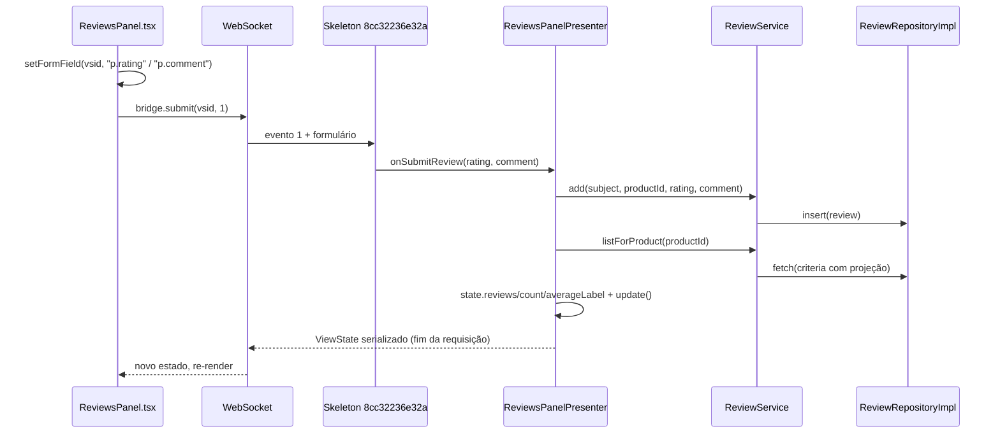

# Criando uma funcionalidade nova, ponta a ponta

Este é o **guia-mestre**: a receita que costura os guias de camada numa ordem única, do banco
à tela. Os guias de camada ([`repository.md`](repository.md),
[`json-query.md`](json-query.md), [`application-service.md`](application-service.md),
[`transaction-service.md`](transaction-service.md),
[`presentation-module.md`](presentation-module.md), [`react-views.md`](react-views.md))
explicam **cada peça em profundidade**. Este explica **em que ordem as peças se montam** e,
principalmente, **as amarrações** entre as camadas: os pontos em que cada lado compila e passa
no PHPStan, mas a funcionalidade não aparece na tela.

O exemplo condutor é o mesmo de todos os guias: **avaliações de produto**. Na tela de detalhe
do produto, o cliente vê as avaliações (nota de 1 a 5, comentário, autor, data), a média e a
contagem, e escreve a sua. O código do exemplo foi implementado e verificado (testes verdes,
PHPStan nível 8 limpo, build do frontend ok), mas **não está no projeto**: é o exercício que
você vai montar seguindo este guia.

---

## Índice

1. [Antes de começar](#1-antes-de-começar)
2. [Mapa da arquitetura](#2-mapa-da-arquitetura)
3. [Visão de 30 segundos: a ordem canônica](#3-visão-de-30-segundos-a-ordem-canônica)
4. [Passo a passo: as avaliações de produto](#4-passo-a-passo-as-avaliações-de-produto)
5. [As amarrações que ninguém conta num lugar só](#5-as-amarrações-que-ninguém-conta-num-lugar-só)
6. [Armadilhas encontradas no caminho](#6-armadilhas-encontradas-no-caminho)
7. [Checklist consolidado](#7-checklist-consolidado)
8. [Referências](#8-referências)

---

## 1. Antes de começar

**Ambiente rodando.** Você precisa do servidor subindo e dos testes verdes antes de mexer em
qualquer coisa. Se ainda não tem, siga [`setup-local.md`](setup-local.md): PHP com `pgsql`,
PostgreSQL, Composer, Node, o `work/config/application.local.toml` com o banco do servidor
**e** o banco de testes (`[test.database]`, que é apagado a cada execução). Confirme:

```bash
composer check            # PHPStan nível 8 + PHPUnit, tudo verde
bin/build-frontend.sh     # compila o shell React para work/frontend/
php bin/server.php        # http://localhost:8080, entre com fulano/fulano
```

Se você vem de frameworks de template (Laravel, Symfony, Twig), leia antes o
[guia para quem vem do PHP](../guia-para-quem-vem-do-php.md): ele explica por que aqui não há
controller que devolve HTML, e sim um presenter que mantém o estado da tela no servidor.

**Especificação clara.** Antes de escrever código, responda por escrito:

- O que o usuário vê e o que ele faz? (Aqui: a lista de avaliações do produto, a média, e um
  formulário com nota e comentário.)
- Quais são as regras? (Nota obrigatória de 1 a 5; comentário opcional, até 500 caracteres;
  o autor é sempre quem está logado; mais recentes primeiro.)
- Em que **face** isso aparece? É uma tela nova (um *place*, com endereço próprio) ou um
  **segmento** dentro de uma tela que já existe? As avaliações não têm endereço próprio: vivem
  dentro do detalhe do produto. Isso decide o tipo de presenter (passo 9).

**Modelagem mínima.** Rascunhe a tabela (colunas, tipos, FKs, índices), a entidade, os
filtros e ordenações de que as telas precisam, e quais papéis podem ler e escrever.

| Decisão | Avaliações |
|---|---|
| Tabela | `EN_REVIEW` (`ID`, `PRODUCTID` → `EN_PRODUCT`, `USERID` → `EN_USER`, `RATING`, `REVIEWCOMMENT`, `CREATEDAT`) + `SQ_REVIEW` |
| Filtros | por id, produto, usuário, nota |
| Ordenações | mais recentes, mais antigas, melhor avaliadas |
| Relações | produto e usuário, ambas N:1 |
| Papéis | `ADMIN`: tudo; `CUSTOMER`: ler e escrever |
| Tipo de presenter | presenter-filho (`AbstractChildPresenter`) da tela de produto |

> **Regra de ouro: de baixo para cima.** Banco → domínio → persistência → aplicação →
> apresentação → view. Cada camada compila e é testável antes da próxima existir. Nunca
> comece pela tela.

---

## 2. Mapa da arquitetura

O dado atravessa as camadas nesta direção. Cada caixa é um arquivo que você cria ou altera
no exemplo; as setas tracejadas são as **amarrações**, que precisam bater exatamente.

```mermaid
flowchart TB
  subgraph db["Banco - src/Shopping/Persistence"]
    SCH["ShoppingSchema<br/>REVIEW_DDL, create(), DROP, reset() + seed"]
  end
  subgraph dom["Domínio - src/Shopping/Domain/Review"]
    ENT["Review (entidade)"]
    CRI["ReviewCriteria + ReviewOrderBy"]
    REP["ReviewRepository (interface)"]
    ROLE["Security/Role: review:*"]
  end
  subgraph per["Persistência - src/Shopping/Persistence"]
    IMP["Repository/ReviewRepositoryImpl<br/>Table + JsonQuery 'rv'"]
    AGG["ShoppingRepositories::register()<br/>+1 linha Beans::set"]
  end
  subgraph app["Aplicação - src/Shopping/Presentation"]
  subgraph pres["Apresentação - Presenter/Restricted/Products"]
    SVC["Reviews/ReviewService + ReviewInfo"]
    PRES["Reviews/ReviewsPanelPresenter<br/>+ ReviewsPanelViewState"]
    OWN["ProductPresenter (dono)<br/>ProductViewState::$reviewsPanelView"]
  end
  subgraph host["Hosts da view"]
    RH["RemoteHost/ShoppingRemoteApplication<br/>installViewFactories"]
    MK["tests: ShoppingApplicationMock<br/>installViewMocks + ReviewsPanelViewMock"]
  end
  subgraph view["View - frontend/shopping.shell.react"]
    RV["views/product/ReviewsPanel.tsx<br/>+ reviews-sel.ts + reviews.scss"]
    IDX["index.tsx: registerComponents"]
    PV["ProductView.tsx: bridge.createView"]
  end

  SCH --> ENT --> CRI --> REP --> IMP --> AGG --> CTX --> SAPP
  SAPP --> SVC --> PRES --> OWN
  RH -. "$createView" .-> PRES
  MK -. "$createView" .-> PRES
  PRES == "classId 8cc32236e32a + evento 1" ==> RV
  OWN == "reviewsPanelViewId" ==> PV
  RV --> IDX
```

Em tempo de execução, o padrão é **Cube MVP**: o presenter, no servidor, é dono do estado; o
React só desenha o que recebe e devolve os eventos do usuário. O caminho de um clique em
"Enviar avaliação":



---

## 3. Visão de 30 segundos: a ordem canônica

| # | Passo | Onde | Detalhe em |
|---:|---|---|---|
| 1 | Tabela, sequência, índice, DROP/reset e seed | `src/Shopping/Persistence/ShoppingSchema.php` | [repository.md](repository.md) |
| 2 | Entidade | `src/Shopping/Domain/Review/Review.php` | [repository.md](repository.md) |
| 3 | Critério + ordenações | `Domain/Review/ReviewCriteria.php`, `ReviewOrderBy.php` | [repository.md](repository.md) |
| 4 | Interface do repositório | `Domain/Review/ReviewRepository.php` | [repository.md](repository.md) |
| 5 | Implementação (`Table` + `JsonQuery`) | `Persistence/Repository/ReviewRepositoryImpl.php` | [repository.md](repository.md), [json-query.md](json-query.md) |
| 6 | Registrar no `Beans` (uma linha) | `Persistence/ShoppingRepositories.php` | [repository.md](repository.md) |
| 7 | Permissões dos papéis | `Domain/Security/Role.php` | [repository.md](repository.md) |
| 8 | Serviço de aplicação + DTO de tela | `Presenter/Restricted/Products/Reviews/ReviewService.php`, `ReviewInfo.php` | [application-service.md](application-service.md), [transaction-service.md](transaction-service.md) |
| 9 | ViewState + presenter (filho) + exceção esperada | `Reviews/ReviewsPanelViewState.php`, `ReviewsPanelPresenter.php`, `Exception/InvalidReviewException.php` | [presentation-module.md](presentation-module.md) |
| 10 | O dono cria, alimenta e libera o filho | `Products/ProductPresenter.php`, `ProductViewState.php` | [presentation-module.md](presentation-module.md) |
| 11 | `$createView` no host remoto **e** no mock de testes | `RemoteHost/ShoppingRemoteApplication.php`, `tests/.../Mock/` | [presentation-module.md](presentation-module.md) |
| 12 | View React + seletores + estilos + registro + desenho no dono | `frontend/shopping.shell.react/src/scripts/...` | [react-views.md](react-views.md) |
| 13 | Testes de repositório e de apresentação | `tests/Shopping/Persistence/`, `tests/Shopping/Presentation/` | [repository.md](repository.md), [presentation-module.md](presentation-module.md) |
| 14 | Build do frontend, `composer check`, ver no navegador | raiz | [setup-local.md](setup-local.md) |

> **E se fosse uma tela com endereço próprio?** Entre os passos 11 e 12 entrariam o caso
> novo no enum `Place`, o método em `Routes` e uma classe de keys (`XxxKeys extends` as keys
> do place de cima, com prefixo de duas letras único), e o `KeysNamesTest` passa a cobrar a
> keys do place novo. As avaliações não precisam disso: são um segmento da tela de produto, e
> quem decide qual produto está na tela é o dono. Veja
> [presentation-module.md](presentation-module.md).

---

## 4. Passo a passo: as avaliações de produto

Cada passo traz o essencial do código do exemplo e o link para o guia que aprofunda. Abra o
guia de camada ao lado quando quiser entender o porquê de cada linha.

### Passo 1 - Schema, DROP, reset e seed

O schema da loja é código PHP: `ShoppingSchema` cria as tabelas na primeira subida e semeia
os dados de demonstração. A tabela nova fica numa constante **separada** do DDL principal,
para poder ser aplicada sozinha num banco que já existia antes das avaliações:

```php
private const string REVIEW_DDL = <<<'SQL'
    CREATE TABLE EN_REVIEW (
        ID BIGINT NOT NULL PRIMARY KEY,
        PRODUCTID BIGINT NOT NULL REFERENCES EN_PRODUCT (ID),
        USERID BIGINT NOT NULL REFERENCES EN_USER (ID),
        RATING INT NOT NULL,
        REVIEWCOMMENT TEXT,
        CREATEDAT TIMESTAMP NOT NULL
    );
    CREATE SEQUENCE SQ_REVIEW START WITH 1 INCREMENT BY 1;
    CREATE INDEX IX_REVIEW_PRODUCT ON EN_REVIEW (PRODUCTID);
    SQL;
```

Quatro lugares mudam no `ShoppingSchema`, e todos importam:

- **`create()`**: banco novo executa `self::DDL . self::REVIEW_DDL`; banco antigo (já tem
  `EN_USER`) cria só `EN_REVIEW` se ela não existir. Sem isso, o servidor subiria sobre o banco
  antigo e falharia na primeira consulta de avaliações.
- **`DROP`**: `EN_REVIEW` entra **primeiro** na lista (ela aponta para `EN_PRODUCT` e
  `EN_USER`), e `SQ_REVIEW` entra no `DROP SEQUENCE`.
- **`reset()`**: `DELETE FROM EN_REVIEW` antes de `EN_PRODUCT` e `EN_USER`, pelo mesmo motivo.
- **Seed**: duas avaliações da cafeteira, com ids fixos expostos como constantes para os
  testes, e a sequência reiniciada logo depois:

```php
// avaliações da cafeteira: média 4,5; a do fulano é a mais recente
public const int ADMIN_CAFETEIRA_REVIEW_ID = 0;
public const int FULANO_CAFETEIRA_REVIEW_ID = 1;

// ... no fim de reset():
$db->execute('INSERT INTO EN_REVIEW (ID, PRODUCTID, USERID, RATING, REVIEWCOMMENT, CREATEDAT) VALUES '
    . "(0, 0, 0, 5, 'Excelente! Faz um café ótimo e é fácil de limpar.', '2024-03-10 12:00:00'), "
    . "(1, 0, 1, 4, 'Boa cafeteira, mas a jarra esquenta bastante.', '2024-05-02 18:45:00')");
$db->restartSequence('SQ_REVIEW', 2);
```

Por que a cafeteira, o `admin` e o `fulano`? Porque os testes existentes apagam o usuário
`beotrano` e o produto pen drive; uma avaliação apontando para eles quebraria esses testes pela
FK (veja a [armadilha 1](#6-armadilhas-encontradas-no-caminho)).

Detalhes: [repository.md](repository.md).

### Passo 2 - A entidade

`src/Shopping/Domain/Review/Review.php`. Entidade mutável, com campos **privados** e anuláveis
(`null` = não carregado, ou não projetado) e acessores `campo()` / `withCampo()` que devolvem
`static` para encadear. As relações são objetos (`?Product`, `?User`), não ids soltos; o valor
da FK é derivado:

```php
final class Review
{
    private ?int $id = null;
    private ?Product $product = null;
    private ?User $user = null;
    private ?int $rating = null;
    private ?string $comment = null;
    private ?DateTimeImmutable $createdAt = null;

    // ... um par campo()/withCampo() por campo; withX() devolve $this

    /** O valor da FK PRODUCTID: basta o produto ter o id. */
    public function productId(): ?int
    {
        return $this->product?->id();
    }
}
```

### Passo 3 - Critério e ordenações

`ReviewCriteria implements Criteria` carrega a projeção, a ordenação e um
`ComparableCriterion` por campo filtrável, **criado no construtor** (nunca `null`):

```php
public function __construct()
{
    $this->reviewId = new ComparableCriterion($this, 'reviewId');
    $this->productId = new ComparableCriterion($this, 'productId');
    // ... userId e rating, do mesmo jeito
}

/** Atalho para productId()->eq($value). */
public function withProductId(?int $value): static
{
    return $value === null ? $this : $this->productId->eq($value);
}

public function criterions(): array
{
    return [$this->reviewId, $this->productId, $this->userId, $this->rating];
}
```

Cada campo tem o trio `productId()` (o criterion, para `ge`, `in`...), `hasProductId()` e o
atalho `withProductId()`. As ordenações são um enum puro, `ReviewOrderBy`, com
`NEWEST_FIRST`, `OLDEST_FIRST` e `BEST_RATED_FIRST`. Nenhuma lógica de SQL aqui: traduzir o
critério é trabalho da implementação (passo 5).

### Passo 4 - A interface do repositório

```php
/**
 * @extends Repository<Review, ReviewCriteria>
 */
interface ReviewRepository extends Repository
{
}
```

Vazia de propósito: `insert`, `update`, `delete`, `count`, `fetch`, `fetchPage`, `fetchById`
e `newProjection` já vêm de `Repository`. Declare aqui só o que for **além** disso. É esta
interface, e não a implementação, que as camadas de cima conhecem.

### Passo 5 - A implementação: `Table` + `JsonQuery`

`src/Shopping/Persistence/Repository/ReviewRepositoryImpl.php`, `extends AbstractRepository
implements ReviewRepository`. No construtor, o mapeamento campo ↔ coluna (`Table`) e a
consulta por projeção (`JsonQuery`, alias `rv`), com as duas relações N:1. Os nomes da
tabela, da sequência e das colunas são constantes públicas da classe, usadas em todo lugar no
lugar do texto solto (o porquê está em
[repository.md](repository.md#5a-constantes-de-tabela-e-colunas)):

```php
public const string TABLE = 'EN_REVIEW';
public const string SEQUENCE = 'SQ_REVIEW';
public const string ID = 'ID';
public const string PRODUCTID = 'PRODUCTID';
public const string USERID = 'USERID';
public const string RATING = 'RATING';
public const string REVIEWCOMMENT = 'REVIEWCOMMENT';
public const string CREATEDAT = 'CREATEDAT';

// ... no construtor:
// a ordem importa: a primeira coluna é a chave primária (insertBean/updateBean contam com isso)
$table = new Table(self::TABLE, static fn (): Review => new Review(), [
    new Column('id', self::ID, ColumnType::Int, static fn (Review $r) => $r->id(), static fn (Review $r, mixed $v) => $r->withId($v)),
    new Column('rating', self::RATING, ColumnType::Int, static fn (Review $r) => $r->rating(), static fn (Review $r, mixed $v) => $r->withRating($v)),
    new Column('comment', self::REVIEWCOMMENT, ColumnType::Text, /* ... */),
    new Column('createdAt', self::CREATEDAT, ColumnType::DateTime, /* ... */),
]);
$this->query = new JsonQuery($table, ReviewCriteria::class, 'rv', $db->dialect())
    ->withConditions($this->conditions(...))
    ->withOrdering($this->orderBy(...))
    ->addToOne(
        'product',
        static fn (Review $r) => $r->product(),
        static fn (Review $r, ?Product $p) => $r->withProduct($p),
        fn () => $this->productRepository()->query(),   // closure: o outro repositório pode ainda não estar registrado
        self::PRODUCTID,
    )
    ->addToOne('user', /* idem, com $this->userRepository()->query() e self::USERID */);

// fora do construtor: cada repositório usado é achado no Beans uma vez e guardado num campo
private ?ProductRepositoryImpl $productRepository = null;

private function productRepository(): ProductRepositoryImpl
{
    return $this->productRepository ??= self::repositoryOf(ProductRepository::class, ProductRepositoryImpl::class);
}
// ... e o mesmo para userRepository()
```

O resto da classe:

- **FKs não são colunas da `Table`**: vão como colunas extras nas escritas, lidas das relações
  (`insertBean($bean, [self::PRODUCTID => $bean->productId(), self::USERID => $bean->userId()])`,
  e o equivalente com getter + tipo em `updateBean`).
- **`conditions()`** prefixa as colunas com o alias (`$c = Sql::alias($a);`) e traduz cada
  criterion com `CT::translate($c(self::PRODUCTID), $criteria->productId())` (`CT` é o alias de
  `CriterionTranslator`), tudo dentro de `Sql::and([...])`.
- **`orderBy()`** é um `match` sobre `ReviewOrderBy` e **toda ordenação termina no id**
  (`"{$c(self::CREATEDAT)} DESC, {$c(self::ID)} DESC"` - o PHP não interpola constantes numa
  string, mas interpola a chamada da closure `$c`), para que duas avaliações no mesmo segundo
  não troquem de lugar entre páginas.
- **`delete()`** recusa um critério sem `reviewId` nem `productId` (`LogicException`): sem
  filtro, `deleteWhere` viraria um `DELETE` sem `WHERE`.
- **`newProjection()`** é a projeção padrão: campos simples + `new Product()->withId(PV::INT)`
  e `new User()->withId(PV::INT)`. Só o id da relação sai direto da coluna da FK, sem
  subconsulta.
- `sequence()` devolve `self::SEQUENCE`; `projectionOf()` e `criteriaForIds()` completam o
  contrato de `AbstractRepository`.

Com isso, "as avaliações do produto com o nome de quem escreveu" é **um único SELECT**: o
`ReviewRepositoryTest` conta os comandos e cobra exatamente um. Detalhes:
[repository.md](repository.md) e, para projeções e relações, [json-query.md](json-query.md).

### Passo 6 - Registrar no `Beans`

`ShoppingRepositories::register(Database $db)` cria todos os repositórios sobre o mesmo
`Database` e os registra pela interface. O de avaliações é uma linha a mais; ele acha `products`
e `users` sozinho, pelos métodos `productRepository()`/`userRepository()` do passo 5:

```php
// em ShoppingRepositories::register(): a partir daqui, qualquer ponto acha o repositório pela interface
Beans::set(ReviewRepository::class, new ReviewRepositoryImpl($db));
```

O `ShoppingRepositories` não tem campo por repositório. O `register()` roda uma vez, na subida do servidor
(dentro de `ShoppingRepositories::open(...)`), e no `TestDatabase::open()` dos testes.
Depois disso, quem precisa do repositório pede pela **interface**:
`Beans::of(ReviewRepository::class)`. O PHPStan sabe que o retorno é um `ReviewRepository`. Não
há getter na sessão nem argumento novo em construtor nenhum.

### Passo 7 - Permissões dos papéis

As permissões são strings `entidade:operação`, por papel, no enum `Role`
(`src/Shopping/Domain/Security/Role.php`):

```php
self::ADMIN => ['user:*', 'product:*', 'purchase:*', 'purchase-item:*', 'review:*', PermissionModel::DATA_ALL],
self::CUSTOMER => ['product:read', 'purchase:read', 'purchase:write', 'purchase-item:read', 'purchase-item:write', 'review:read', 'review:write'],
```

Quem as confere é o `SecurityEnforcer::require($entity, $operation)` dos controllers da API
REST (`src/Shopping/Persistence/Rest/`). O exemplo não expõe avaliações por REST; as
permissões ficam declaradas para quando houver um controller. Detalhes:
[repository.md](repository.md).

### Passo 8 - Serviço de aplicação e DTO de tela

A lógica de negócio não mora no presenter. `ReviewService` fica junto ao presenter que o usa
(`Presenter/Restricted/Products/Reviews/`), acha o repositório no `Beans` pela **interface** e
não guarda estado de tela:

```php
final class ReviewService
{
    public const int MIN_RATING = 1;
    public const int MAX_RATING = 5;
    public const int MAX_COMMENT_LENGTH = 500;

    private readonly ReviewRepository $reviews;

    public function __construct()
    {
        $this->reviews = Beans::of(ReviewRepository::class);
    }

    /** @return list<ReviewInfo> mais recentes primeiro */
    public function listForProduct(int $productId, int $limit = 50): array
    {
        $criteria = new ReviewCriteria()
            ->withProductId($productId)
            ->withProjection(ReviewInfo::projection())
            ->withOrderBy(ReviewOrderBy::NEWEST_FIRST);

        return array_map(ReviewInfo::create(...), $this->reviews->fetch($criteria, 0, $limit));
    }

    /** @throws InvalidReviewException nota ou comentário inválidos (falha esperada) */
    public function add(Subject $subject, int $productId, ?int $rating, ?string $comment): void
    {
        if ($rating === null || $rating < self::MIN_RATING || $rating > self::MAX_RATING) {
            throw new InvalidReviewException('Escolha uma nota de 1 a 5.');
        }
        $comment = trim($comment ?? '');
        if (mb_strlen($comment) > self::MAX_COMMENT_LENGTH) {   // mb_: conta caracteres, não bytes
            throw new InvalidReviewException('O comentário pode ter no máximo ' . self::MAX_COMMENT_LENGTH . ' caracteres.');
        }

        $review = new Review()
            ->withProduct(new Product()->withId($productId))   // só o id: vira a FK PRODUCTID
            ->withUser(new User()->withId($subject->id))        // o autor é sempre o logado, nunca vem da view
            ->withRating($rating)
            ->withComment($comment === '' ? null : $comment)
            ->withCreatedAt(new DateTimeImmutable('now', new DateTimeZone('UTC')));
        $this->reviews->insert($review);
    }
}
```

`add()` faz uma única escrita, então não precisa de transação explícita. Se a ação gravasse
mais de uma coisa (a avaliação e, digamos, uma média consolidada no produto), as escritas
iriam juntas em `Beans::of(TransactionService::class)->required(fn () => ...)`, como explica
[transaction-service.md](transaction-service.md).

`ReviewInfo` é o que a tela mostra, com **campos públicos**: o serializador só envia
propriedades públicas, e a entidade (campos privados) chegaria ao React como `{}`. Ele também
declara a projeção, com o nome do autor vindo na mesma consulta:

```php
public static function projection(): Review
{
    return new Review()
        ->withId(PV::INT)
        ->withRating(PV::INT)
        ->withComment(PV::STR)
        ->withCreatedAt(PV::dateTime())
        ->withUser(new User()->withId(PV::INT)->withName(PV::STR));
}
```

A data vai como milissegundos desde 1970 (`(int) $createdAt->format('Uv')`), e o navegador a
formata no fuso de quem lê. Detalhes: [application-service.md](application-service.md).

### Passo 9 - ViewState, presenter-filho e a exceção esperada

**O estado de renderização** é um contrato com a view React, escrito em propriedades públicas:

```php
final class ReviewsPanelViewState implements ViewState
{
    /** @var list<ReviewInfo> mais recentes primeiro */
    public array $reviews = [];
    public int $count = 0;
    /** "4,5 de 5"; vazio (omitido no envio) quando não há avaliações */
    public string $averageLabel = '';
    /** 0 = sem erro */
    public int $errorCode = 0;
    public ?string $errorMessage = null;
}
```

**A falha esperada** é uma exceção própria, `InvalidReviewException extends RuntimeException`
(em `src/Shopping/Presentation/Exception/`). Ela vira código + mensagem no estado do painel, e
não o alerta de erro inesperado.

**O presenter** é um `AbstractChildPresenter`: não tem place nem parâmetros, quem o cria e o
libera é o dono, e o produto mostrado chega por `showProduct()`. Os trechos que importam:

```php
/** @extends AbstractChildPresenter<ShoppingApplication> */
final class ReviewsPanelPresenter extends AbstractChildPresenter
{
    private const int EVENT_SUBMIT_REVIEW = 1;
    private const int ERROR_INVALID_REVIEW = 1;

    /** @var (Closure(self): CubeView)|null instalado pelo host remoto e pelos testes (mock) */
    public static ?Closure $createView = null;

    public readonly ReviewsPanelViewState $state;
    private readonly ReviewService $service;
    private ?int $productId = null;   // estado de CONTROLE: o produto carregado

    public function __construct(ShoppingApplication $app, public readonly ProductPresenter $owner)
    {
        parent::__construct($app);
        $this->state = new ReviewsPanelViewState();
        $this->service = new ReviewService();
    }

    /** Passar pelo caminho não é recarregar: só consulta quando o produto mudou. */
    public function showProduct(int $productId): void
    {
        if ($this->productId === $productId) {
            return;
        }
        $this->loadReviews($productId);
        $this->productId = $productId;   // só depois da carga: se ela falhar, o painel fica como estava
        $this->clearError();
    }

    public function onSubmitReview(?int $rating, ?string $comment): void
    {
        try {
            $subject = $this->app->subject() ?? throw new LogicException('Sem usuário logado');
            $productId = $this->productId ?? throw new LogicException('Sem produto carregado');
            $this->service->add($subject, $productId, $rating, $comment);
            $this->clearError();
            $this->loadReviews($productId);
        } catch (InvalidReviewException $caught) {
            $this->state->errorCode = self::ERROR_INVALID_REVIEW;
            $this->state->errorMessage = $caught->getMessage();
            $this->update();
        } catch (Throwable $caught) {
            $this->app->alertUnexpectedError('Submitting a review', $caught);
        }
    }

    public function skeleton(): CubeSkeleton
    {
        return new Skeleton('8cc32236e32a', function (int $event, int $qtde, array $form): void {
            match ($event) {
                self::EVENT_SUBMIT_REVIEW => $this->onSubmitReview(
                    Coerce::asInt($form['p.rating'] ?? null),
                    Coerce::asString($form['p.comment'] ?? null),
                ),
                default => Skeleton::unknownEvent($event),
            };
        });
    }

    protected function onCreateView(): CubeView
    {
        return (self::$createView ?? throw new LogicException('ReviewsPanelPresenter::$createView não configurado'))($this);
    }

    protected function onInitialize(): void
    {
        $this->update();   // só desenha (vazio): a carga espera o dono dizer qual é o produto
    }
}
```

O `loadReviews()` privado consulta o serviço, preenche `reviews`, `count` e `averageLabel`
(`number_format(..., 1, ',', '') . ' de 5'`) e chama `$this->update()`. A média é calculada
ali, logo depois da carga, e não em `commitComputedState`: ela só muda quando a lista muda, e
`commitComputedState` rodaria a cada envio da view.

Pontos de atenção que o código acima já resolve:

- **`$this->update()` depois de mudar o estado.** Nada observa o estado: sem `update()`, a
  tela continua mostrando o valor antigo.
- **O `classId` é novo e aleatório**: 12 caracteres hexadecimais, gerados com
  `php -r 'echo bin2hex(random_bytes(6)), PHP_EOL;'`. Nunca copie o de outro presenter.
- **Argumentos de evento chegam como `p.<nome>`** e são convertidos com `Coerce` antes de
  validar: o formulário é entrada de fora.
- **Todo handler se protege**: o esperado vai para o estado; o inesperado, para
  `alertUnexpectedError`.

Detalhes: [presentation-module.md](presentation-module.md).

### Passo 10 - O dono cria, alimenta e libera o filho

O `ProductPresenter` ganha um campo para o filho, e o `ProductViewState` um campo `CubeView`:

```php
/** painel de avaliações (presenter-filho); vai para o cliente como `reviewsPanelViewId` */
public ?CubeView $reviewsPanelView = null;
```

No `applyParameters` do dono, o filho nasce **uma vez**, dentro de `if ($initialization)`, e
recebe o produto **a cada viagem**:

```php
if ($initialization) {
    // ... a view do próprio dono
    $this->reviewsPanel = new ReviewsPanelPresenter($this->app, $this);
    $this->state->reviewsPanelView = $this->reviewsPanel->initialize();
    $this->update();
}
// a cada viagem: o painel compara e só recarrega se o produto mudou
$this->reviewsPanel?->showProduct($newId);
```

E o `release()` do dono limpa o campo da view, libera o filho e só então chama o pai:

```php
public function release(): void
{
    $this->state->reviewsPanelView = null;
    $this->reviewsPanel?->release();
    $this->reviewsPanel = null;
    parent::release();
}
```

O serializador transforma a propriedade `CubeView` `reviewsPanelView` no campo
`reviewsPanelViewId` do JSON: é esse nome que a view React do dono lê (passo 12).

### Passo 11 - `$createView` nos dois hosts

O presenter não sabe desenhar: quem fornece a view é o host. São **dois** lugares, e faltar
qualquer um lança "`$createView` não configurado":

```php
// src/Shopping/RemoteHost/ShoppingRemoteApplication.php, em installViewFactories()
ReviewsPanelPresenter::$createView = static fn (ReviewsPanelPresenter $p) => new RemoteView(self::of($p->app), $p, $p->state, $p->skeleton());

// tests/Shopping/Presentation/Mock/ShoppingApplicationMock.php, em installViewMocks()
ReviewsPanelPresenter::$createView = static fn (ReviewsPanelPresenter $p) => new ReviewsPanelViewMock($p);
```

A view falsa, `tests/Shopping/Presentation/Mock/ReviewsPanelViewMock.php`, estende
`AbstractViewMock` e só expõe `$presenter` e `$state` (o mesmo objeto do presenter), para os
testes chamarem os métodos e conferirem o estado.

### Passo 12 - A view React

Três arquivos novos em `frontend/shopping.shell.react/src/scripts/views/product/`:

- **`ReviewsPanel.tsx`**: a classe da view, `extends BaseViewClass<ViewProps,
  ReviewsPanelState>`;
- **`reviews-sel.ts`**: os seletores CSS (`wdc-reviews__*`), espalhando `GlobalSel` e
  importando o `reviews.scss`;
- **`reviews.scss`**: os estilos, com as variáveis do tema (`var(--app-surface)`...).

O tipo do estado espelha o `ReviewsPanelViewState`, e **todo campo que o servidor pode omitir
é opcional** (`null` e strings vazias não são enviados):

```tsx
const ON_SUBMIT_REVIEW = 1 // o MESMO código do skeleton

type ReviewsPanelState = {
  reviews?: Review[]
  count: number
  averageLabel?: string // omitido quando não há avaliações
  errorCode: number
  errorMessage?: string
}
```

O formulário (nota e comentário) é estado **local** da view: só vai ao servidor no envio, como
argumento do evento:

```tsx
readonly emitSubmitReview = () => {
  const { vsid } = this
  // a validação de verdade é do servidor: 0 (sem nota) vai como null e volta como erro no estado
  bridge.setFormField(vsid, "p.rating", this.rating > 0 ? this.rating : null)
  bridge.setFormField(vsid, "p.comment", this.comment)
  bridge.submit(vsid, ON_SUBMIT_REVIEW)
}
```

```tsx
export default BaseViewClass.FC(ReviewsPanelClass, "8cc32236e32a") // o MESMO classId do skeleton
```

Mais duas mudanças, fora dos arquivos novos:

```tsx
// index.tsx: importar e registrar
import ReviewsPanel from "./views/product/ReviewsPanel"
bridge.registerComponents(/* ... */, ProductView, ReviewsPanel, /* ... */)

// ProductView.tsx: o tipo ganha o campo e o render desenha o filho
reviewsPanelViewId?: string // a view do presenter-filho (ReviewsPanelPresenter)
{bridge.createView(state.reviewsPanelViewId)}
```

Detalhes (classes, estado local, eventos, estilos): [react-views.md](react-views.md).

### Passo 13 - Testes

Dois arquivos, cada um sobre a sua camada, ambos contra o banco de testes:

**`tests/Shopping/Persistence/ReviewRepositoryTest.php`** (`extends RepositoryTestCase`):
lista por produto com o nome do autor **num único comando SQL** (conta com
`$this->db->onQuery(...)`), as três ordenações, a projeção padrão (só os ids das FKs),
`insert` gerando o id pela sequência e gravando as FKs, `count` por produto e por nota
(`rating()->ge(5)`), e `update` mudando só o que mudou.

**`tests/Shopping/Presentation/ProductReviewsTest.php`** (`extends PresentationTestCase`):
sem navegador, chama o que os eventos chamariam e confere o estado das views falsas:

```php
private function openCafeteira(): ReviewsPanelViewMock
{
    $home = $this->login('fulano', 'fulano');
    $home->presenter->onOpenProduct(Seed::CAFETEIRA_ID);
    $product = ProductViewMock::cast($home->state->contentView);

    return ReviewsPanelViewMock::cast($product->state->reviewsPanelView);
}

#[Test]
public function openingTheProduct_listsTheSeededReviews_newestFirst(): void
{
    $panel = $this->openCafeteira();

    self::assertSame([Seed::FULANO_CAFETEIRA_REVIEW_ID, Seed::ADMIN_CAFETEIRA_REVIEW_ID], self::ids($panel->state->reviews));
    self::assertSame('4,5 de 5', $panel->state->averageLabel);
}
```

Os outros casos cobrem: produto sem avaliações (painel vazio); avaliação válida entra no topo
e a média vira `"3,3 de 5"`; nota inválida põe o erro no estado, mantém a lista e **não**
vira alerta; nota ausente e comentário com 501 caracteres recusados (com 500 `é`, 1000 bytes,
ainda passa); passar de novo pelo mesmo produto **não consulta** o banco; sair do produto
libera o painel (`$panel->released`).

### Passo 14 - Build, checagem e navegador

```bash
bin/build-frontend.sh     # ANTES do composer check: o ShoppingServerTest usa o shell compilado
composer check            # PHPStan nível 8 + PHPUnit
php bin/server.php
```

Abra http://localhost:8080, entre como `fulano`/`fulano`, abra a cafeteira: duas avaliações,
"4,5 de 5". Envie uma sem nota (erro no painel), depois uma válida (entra no topo, a contagem
sobe e o formulário se limpa). Lembre que o build não confere os tipos do TypeScript
([armadilha 4](#6-armadilhas-encontradas-no-caminho)): o navegador é a prova final da view.

---

## 5. As amarrações que ninguém conta num lugar só

São os pontos em que uma metade compila, a outra compila, o PHPStan não reclama, e mesmo
assim **nada funciona em runtime**. Confira um a um:

| Amarração | Os dois (ou mais) lados | Sintoma se divergir |
|---|---|---|
| **`classId`** | `new Skeleton('8cc32236e32a', ...)` no PHP **=** `BaseViewClass.FC(ReviewsPanelClass, "8cc32236e32a")` no React | a área do painel fica em branco, sem erro no servidor |
| **Códigos de evento** | `EVENT_SUBMIT_REVIEW = 1` no `match` **=** `ON_SUBMIT_REVIEW = 1` no `bridge.submit` | `eventCode(N) not handled` no log e alerta de erro inesperado ao clicar |
| **Argumentos `p.*`** | `bridge.setFormField(vsid, "p.rating", ...)` **=** `$form['p.rating']` no skeleton | o argumento chega `null`; a validação recusa e parece "bug de regra" |
| **`$createView`** | `ShoppingRemoteApplication::installViewFactories` **e** `ShoppingApplicationMock::installViewMocks` | `LogicException` "`$createView` não configurado" (no navegador ou só nos testes) |
| **Registro da view** | `import` **e** argumento em `bridge.registerComponents` no `index.tsx` | mesma tela em branco do `classId` errado |
| **View do filho no dono** | `ProductViewState::$reviewsPanelView` (PHP) → `reviewsPanelViewId` (JSON) → `bridge.createView(state.reviewsPanelViewId)` (React) | o painel existe no servidor, mas nunca aparece |
| **Campos do ViewState** | propriedades **públicas** no PHP **=** campos do tipo TypeScript, opcionais quando podem ser omitidos | campo sempre vazio no React, ou `{}` no lugar de um objeto |
| **Schema completo** | `REVIEW_DDL` **+** `create()` para banco antigo **+** `DROP` **+** `reset()` **+** `restartSequence` | servidor quebra num banco antigo, ou o `insert` colide com o id do seed |
| **Repositório registrado** | `Beans::set(ReviewRepository::class, new ReviewRepositoryImpl($db))` em `ShoppingRepositories::register()` | `LogicException` "Nenhuma implementação registrada para ...ReviewRepository" na primeira tela que o usa |
| **Rebuild do front** | `bin/build-frontend.sh` (ou `npm run watch`) depois de mexer no React | o servidor serve o shell antigo de `work/frontend/` |

---

## 6. Armadilhas encontradas no caminho

Estas apareceram de verdade ao implementar o exemplo. Nenhuma é exótica; todas custam tempo
se você não souber que existem.

1. **Uma tabela nova com FK pode quebrar testes antigos.** `UserRepositoryTest` apaga o
   `beotrano` e `ProductRepositoryTest` apaga o pen drive. Uma avaliação semeada apontando
   para qualquer um deles faria esses `DELETE` falharem pela FK. Por isso o seed usa a
   cafeteira, o `admin` e o `fulano`. Antes de semear, procure nos testes quem apaga o quê.
2. **O banco de testes compartilhado guarda a tabela nova quando você troca de branch.** Os
   testes começam com `ShoppingSchema::drop()` (`tests/Support/TestDatabase.php`). Num branch
   sem avaliações, o `DROP` antigo não conhece `EN_REVIEW`, e apagar `EN_PRODUCT`/`EN_USER`
   falha porque `EN_REVIEW` ainda aponta para elas. Saída: apague `EN_REVIEW` e `SQ_REVIEW` à
   mão no banco de **testes** (`DROP TABLE EN_REVIEW; DROP SEQUENCE SQ_REVIEW;`).
3. **O `ShoppingServerTest` precisa do frontend compilado.** Sem `work/frontend/
   shopping.shell.react/index.html`, ele é pulado; com um build velho, testa o shell velho.
   Rode `bin/build-frontend.sh` antes do `composer check`.
4. **O build do frontend não confere tipos.** Parcel transpila o TypeScript com SWC, que
   descarta os tipos sem verificá-los: um campo com nome errado no tipo do estado compila e
   só aparece como "campo vazio" na tela. O projeto não traz um type-check configurado:
   confira o tipo do estado contra o `ViewState` campo a campo e teste no navegador (veja
   [react-views.md](react-views.md)).
5. **As datas são gravadas sem fração de segundo.** `ColumnType::DateTime` grava no formato
   `Y-m-d H:i:s`, em UTC. Duas avaliações enviadas no mesmo segundo têm o mesmo `CREATEDAT`;
   o desempate pelo id, no fim de toda ordenação, é o que mantém a lista estável.
6. **Repositório escrito mas não registrado.** Sem a linha
   `Beans::set(ReviewRepository::class, ...)` em `ShoppingRepositories::register()`, a primeira
   chamada a `Beans::of(ReviewRepository::class)` (ou ao `repositoryOf` de quem o usa) lança
   "Nenhuma implementação registrada". Os testes pegam isso logo: tanto os de repositório quanto
   os de apresentação acham o repositório pelo `Beans`.
7. **A primeira coluna da `Table` é a chave primária.** `insertBean` e `updateBean` contam com
   isso. Pôr `rating` antes de `id` produz escritas erradas sem nenhum erro de compilação.
8. **O `classId` precisa ser idêntico nos dois lados.** Um caractere trocado entre o
   `Skeleton` e o `BaseViewClass.FC` deixa a área em branco, sem erro no servidor. Gere um id
   novo para cada view e copie-o, não o digite.
9. **`$createView` vai nos dois hosts.** Só no host remoto: a tela funciona no navegador, mas
   os testes de apresentação lançam "`$createView` não configurado". Só no mock: os testes
   passam e o navegador quebra.
10. **Escrever numa propriedade de um objeto temporário é erro fatal do PHP.**
    `(new ProductKeys($this->app, $intent))->productId = 3;` não compila ("Cannot use
    temporary expression in write context"). Ponha o objeto numa variável antes:
    `$keys = new ProductKeys($this->app, $intent); $keys->productId = 3;`. Chamar um método
    no temporário, como `(new XxxKeys($this->app, $intent))->go()`, pode.

---

## 7. Checklist consolidado

Banco e domínio:

- [ ] DDL da tabela e da sequência, com índice para o filtro mais usado
- [ ] `create()` cria a tabela nova também num banco que já existia
- [ ] `DROP` e `reset()` com a tabela nova **antes** das tabelas que ela referencia
- [ ] Seed com ids fixos em constantes, `restartSequence` depois, sem apontar para registros que os testes apagam
- [ ] Entidade com campos privados anuláveis, `campo()`/`withCampo()` e FKs derivadas das relações
- [ ] Critério com um criterion por campo filtrável, criado no construtor, e `criterions()` completo
- [ ] Enum de ordenações
- [ ] Interface do repositório (`@extends Repository<Entidade, Criterio>`)

Persistência e aplicação:

- [ ] Nomes de tabela, sequência e colunas como constantes públicas do repositório; nenhum nome de coluna como texto solto
- [ ] `Table` com a chave primária como **primeira** coluna
- [ ] `JsonQuery` com alias próprio, condições, ordenação (terminando no id) e relações em closures
- [ ] FKs como colunas extras em `insert` e `update`
- [ ] `newProjection()` com só os ids das relações
- [ ] Registrado no `Beans` (uma linha em `ShoppingRepositories::register()`)
- [ ] Permissões em `Role`

Apresentação:

- [ ] Serviço acha o repositório no construtor (`Beans::of(XxxRepository::class)`), valida fora da escrita e projeta só o que a tela mostra
- [ ] Várias escritas numa transação (`Beans::of(TransactionService::class)->required(...)`)
- [ ] DTO de tela com campos públicos
- [ ] ViewState com propriedades públicas e valores padrão
- [ ] Exceção própria para a falha esperada
- [ ] Presenter com `classId` novo, eventos e códigos de erro como constantes, `match` com `Skeleton::unknownEvent`
- [ ] Argumentos `p.*` convertidos com `Coerce`
- [ ] Todo handler com `try`: esperado no estado, inesperado em `alertUnexpectedError`
- [ ] `$this->update()` depois de cada mudança de estado
- [ ] Filho criado no `if ($initialization)` do dono, alimentado a cada viagem, liberado no `release()` do dono
- [ ] (tela com endereço) `Place`, `Routes` e keys com prefixo único
- [ ] `$createView` em `ShoppingRemoteApplication` **e** em `ShoppingApplicationMock` + view mock

View:

- [ ] Componente com o **mesmo** `classId` e os **mesmos** códigos de evento
- [ ] Tipo do estado com opcionais para tudo o que pode ser omitido
- [ ] Seletores em `*-sel.ts`, estilos em `.scss` importado só pelos seletores
- [ ] Registrado em `index.tsx`
- [ ] Desenhado no dono com `bridge.createView(state.xxxViewId)`

Testes e entrega:

- [ ] Teste de repositório (incluindo "um único comando SQL" para a consulta da tela)
- [ ] Teste de apresentação com as views mock: caminho feliz, falha esperada, passar sem recarregar, release
- [ ] `bin/build-frontend.sh` (e o tipo do estado revisado à mão: o build não confere tipos)
- [ ] `composer check` verde
- [ ] Visto funcionando no navegador

---

## 8. Referências

- [setup-local.md](setup-local.md): ambiente, banco, build, testes e problemas comuns.
- [repository.md](repository.md): entidade, critério, repositório, schema e seed, segurança, registro.
- [json-query.md](json-query.md): projeção, relações 1:1 e 1:N, filtros e ordenação num SELECT.
- [application-service.md](application-service.md): serviços de aplicação e DTOs de tela.
- [transaction-service.md](transaction-service.md): `required()`, a transação presa à Fiber, a transação remota.
- [presentation-module.md](presentation-module.md): presenter, place e rota, keys, presenters-filhos, estado derivado.
- [react-views.md](react-views.md): as views do shell React.
- [../arquitetura.md](../arquitetura.md): como o Cube funciona por dentro.
- [../guia-para-quem-vem-do-php.md](../guia-para-quem-vem-do-php.md): a proposta a partir do PHP tradicional.
- [../../skills/cube-architecture-php/SKILL.md](../../skills/cube-architecture-php/SKILL.md): as regras do modelo, com checklist de revisão e diagnóstico.
