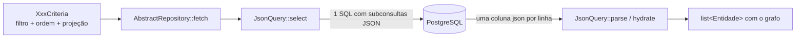

# Guia da JsonQuery

A `JsonQuery` (`src/Framework/Persistence/Json/JsonQuery.php`) é o motor de leitura de todos os
repositórios. Este guia explica o que ela gera, como declarar uma entidade nela, como projetar,
filtrar, ordenar e paginar, e como trazer relações 1:1 e 1:N — sempre na **mesma** consulta.

Os exemplos de 1:1 usam a entidade `Review` (avaliação de produto) construída em
[repository.md](repository.md); os de 1:N usam o código existente de `Purchase`/`PurchaseItem`
(`src/Shopping/Persistence/Repository/`).

> Guias relacionados: [criar-funcionalidade.md](criar-funcionalidade.md),
> [repository.md](repository.md), [application-service.md](application-service.md),
> [../arquitetura.md](../arquitetura.md) e a referência curta em
> [persistence.md](../../skills/cube-architecture-php/references/persistence.md).

## Índice

1. [O que é e por que existe](#1-o-que-é-e-por-que-existe)
2. [Anatomia](#2-anatomia)
3. [Executando consultas](#3-executando-consultas)
4. [Projeção com `ProjectionValues`](#4-projeção-com-projectionvalues)
5. [Filtros](#5-filtros)
6. [Paginação e ordenação](#6-paginação-e-ordenação)
7. [Relação 1:1 — `addToOne`](#7-relação-11--addtoone)
8. [Relação 1:N — `addToMany`](#8-relação-1n--addtomany)
9. [Filtrando e recortando a subcoleção — `ProjectionList`](#9-filtrando-e-recortando-a-subcoleção--projectionlist)
10. [Dependências circulares](#10-dependências-circulares)
11. [Inspecionando o SQL](#11-inspecionando-o-sql)
12. [Referência rápida](#12-referência-rápida)

---

## 1. O que é e por que existe

Uma tela de "minhas compras" mostra, para cada compra, a data e os nomes dos produtos. O jeito
ingênuo é buscar as compras e, para cada uma, buscar os itens, e para cada item, o produto: são
`1 + N + N×M` idas ao banco — o famoso **N+1**. Num servidor assíncrono onde cada consulta suspende
a sessão até o banco responder, isso vira latência que cresce com a lista.

A `JsonQuery` resolve de outro jeito: **um único SELECT devolve, por linha, um objeto JSON com
exatamente os campos pedidos**, e as relações entram como **subconsultas correlacionadas dentro do
próprio JSON**:

```text
SELECT {
    "id": pu1.ID,
    "buyDate": pu1.BUYDATE,
    "user":  (SELECT {"id": u2.ID, "name": u2.NAME} FROM EN_USER u2 WHERE u2.ID = pu1.USERID),
    "items": (SELECT [ {...} ORDER BY pi3.ID ] FROM EN_PURCHASEITEM pi3 WHERE pi3.PURCHASEID = pu1.ID)
} AS json
FROM EN_PURCHASE pu1 WHERE ... ORDER BY ... LIMIT ...
```

(`{...}` e `[...]` são pseudo-SQL: quem os monta com as funções do banco é o `JsonDialect` —
`PostgresJsonDialect` concatena texto e usa `string_agg` para os arrays.) O PHP decodifica cada
linha e hidrata o grafo de entidades.

O que se ganha:

- **Uma ida ao banco**, qualquer que seja a profundidade do grafo.
- **Só o que a tela pediu**: a projeção decide as colunas, inclusive dentro das relações.
- **Filtro, ordem e recorte por pai** nas coleções, no próprio SQL.



---

## 2. Anatomia

Uma `JsonQuery` junta quatro coisas: a **tabela** (colunas rasas), as **condições** (critério →
WHERE), a **ordenação** (OrderBy → lista de ordenação) e as **relações**. No construtor do
repositório:

```php
$table = new Table('EN_REVIEW', static fn (): Review => new Review(), [
    new Column('id', 'ID', ColumnType::Int, static fn (Review $r) => $r->id(), static fn (Review $r, mixed $v) => $r->withId($v)),
    new Column('rating', 'RATING', ColumnType::Int, static fn (Review $r) => $r->rating(), static fn (Review $r, mixed $v) => $r->withRating($v)),
    new Column('comment', 'REVIEWCOMMENT', ColumnType::Text, static fn (Review $r) => $r->comment(), static fn (Review $r, mixed $v) => $r->withComment($v)),
    new Column('createdAt', 'CREATEDAT', ColumnType::DateTime, static fn (Review $r) => $r->createdAt(), static fn (Review $r, mixed $v) => $r->withCreatedAt($v)),
]);

$this->query = new JsonQuery($table, ReviewCriteria::class, 'rv', $db->dialect())
    ->withConditions($this->conditions(...))
    ->withOrdering($this->orderBy(...))
    ->addToOne(/* product */)
    ->addToOne(/* user */);
```

| Peça                               | Papel                                                                         |
|------------------------------------|-------------------------------------------------------------------------------|
| `Table(nome, fábrica, colunas)`    | colunas rasas; **a primeira é a chave primária** (`Table::id()`)              |
| `Column(campo, coluna, tipo, get, set)` | `campo` é a chave no JSON e o campo do bean; `tipo` converte banco ⇄ PHP |
| `ReviewCriteria::class`            | a `JsonQuery` confere que o critério recebido é deste tipo (`LogicException` se não) |
| `'rv'`                             | prefixo de alias; o `QueryContext` numera: `rv1`, `u2`, `pi3`...              |
| `withConditions(Closure)`          | `(C $criteria, string $alias, QueryContext $ctx): ?Sql`                       |
| `withOrdering(Closure)`            | `(?C $criteria, string $alias): string` — sem o `ORDER BY`                    |
| `addToOne` / `addToMany`           | relações N:1 e 1:N (seções 7 e 8)                                             |

Por que tudo recebe um **alias**? Porque a mesma entidade aparece várias vezes numa consulta — como
raiz, dentro da subconsulta de outra entidade, dentro do recorte de uma coleção. Cada aparição
ganha um alias novo do `QueryContext`, e as condições/ordenações são escritas contra ele
(`"{$a}.PRODUCTID"`), nunca contra o nome da tabela.

Tipos de coluna (`ColumnType`):

| Caso       | PHP                 | Banco                                                       |
|------------|---------------------|-------------------------------------------------------------|
| `Int`      | `int`               | `BIGINT`/`INT`                                              |
| `Float`    | `float`             | `NUMERIC(20,2)` (gravado com `round(..., 2)`)               |
| `Text`     | `string`            | `VARCHAR`/`TEXT`                                            |
| `DateTime` | `DateTimeImmutable` (UTC) | `TIMESTAMP`, formato `'Y-m-d H:i:s'` em UTC (sem fração) |
| `Blob`     | `string` (bytes)    | `BYTEA` (no JSON vai em base64; o dialeto decodifica)       |

---

## 3. Executando consultas

Ninguém chama a `JsonQuery` diretamente: os métodos de leitura de `AbstractRepository` fazem isso.

| Método                                     | SQL enviado                         | Devolve                 |
|--------------------------------------------|-------------------------------------|-------------------------|
| `fetch($criteria, $offset = 0, $limit = 0)`| 1 SELECT (0 = sem limite/deslocamento) | `list<E>`            |
| `fetchById($id, $projection = null)`       | 1 SELECT (`criteriaForIds([$id])`, limit 1) | `?E` (null se `$id` null) |
| `count($criteria)`                         | `SELECT COUNT(*) ... WHERE`         | `int`                   |
| `fetchPage($criteria, $page, $pageSize)`   | `count` + `fetch` (2 comandos)      | `Page<E>` (página 0-based) |

```php
// lista
$reviews = $this->reviews->fetch(new ReviewCriteria()
    ->withProductId($productId)
    ->withProjection(ReviewInfo::projection())
    ->withOrderBy(ReviewOrderBy::NEWEST_FIRST), 0, 50);

// um registro, com projeção explícita
$review = $this->reviews->fetchById($id, ReviewInfo::projection());

// contagem (a projeção é ignorada)
$total = $this->reviews->count(new ReviewCriteria()->withProductId($productId));

// página: items, page, totalPages, totalItems
$page = $this->purchases->fetchPage($criteria, 0, 10);
```

`fetch` usa a projeção do critério (`projectionOf`) ou, sem ela, `newProjection()` do repositório.

---

## 4. Projeção com `ProjectionValues`

A projeção é **a própria entidade usada como máscara**: campo não-null = coluna a selecionar. O
valor em si não importa; `ProjectionValues` (normalmente importado como `PV`) só dá convenções:

| Constante/método       | Para campos do tipo            |
|------------------------|--------------------------------|
| `PV::INT`              | `int`                          |
| `PV::FLOAT`            | `float`                        |
| `PV::STR`              | `string`                       |
| `PV::BOOL`             | `bool`                         |
| `PV::BIN`              | binário (imagem)               |
| `PV::dateTime()`       | `DateTimeImmutable` (é método porque objeto não pode ser constante de classe) |
| `PV::singletonList($shape, $criteria)` | coleção 1:N com critério e recorte (seção 9) |

```php
use Wdc\Framework\Domain\Projection\ProjectionValues as PV;

// o que o painel de avaliações mostra
public static function projection(): Review
{
    return new Review()
        ->withId(PV::INT)
        ->withRating(PV::INT)
        ->withComment(PV::STR)
        ->withCreatedAt(PV::dateTime())
        ->withUser(new User()->withId(PV::INT)->withName(PV::STR));
}
```

Regras:

- **O id entra sempre** (`Table::projected()` o inclui mesmo se a máscara não o pedir).
- No bean lido, **campo não projetado fica `null`** — `$review->product()` é null acima.
- Uma relação projetada é outra máscara, aninhada; a profundidade não muda o número de consultas.
- Mantenha a projeção ao lado da estrutura que ela preenche (`ReviewInfo::projection()`,
  `ReceiptItem::projection()`): o que a tela mostra e o que a consulta busca mudam juntos.

---

## 5. Filtros

### 5.1 A API de `Criterion`

Cada `XxxCriteria` tem um `Criterion` por campo filtrável. Os métodos fluentes devolvem o **dono**
(o critério), para encadear:

```php
$criteria = new ReviewCriteria()->withProductId(Seed::CAFETEIRA_ID);   // atalho de eq
$criteria->rating()->ge(4);                                           // nota >= 4

$products = new ProductCriteria();
$products->price()->between(10.0, 50.0);                               // ou só início/fim
$products->name()->containing('bola');                                // ILIKE '%bola%'
$products->name()->or()->startingWith('Bola')->name()->startingWith('Fita');
$products->productId()->in([1, 2, 3]);
```

| Classe                | Operações                                                     |
|-----------------------|---------------------------------------------------------------|
| `Criterion`           | `eq`, `ne`, `in`, `isNull`, `isNotNull`                        |
| `ComparableCriterion` | + `gt`, `ge`, `lt`, `le`, `between`                            |
| `TextCriterion`       | + `like`, `ilike`, `containing` (`%x%`), `startingWith` (`x%`) |

Semântica:

- Pedidos no **mesmo campo** valem juntos (AND); `or()` torna aquele campo disjuntivo. Campos
  diferentes sempre se combinam com AND.
- **Valor `null` não acrescenta pedido** (`eq(null)`, `in(null)`, `in([])`, `like('')`): um
  filtro de tela vazio significa "não filtrar". Consequência: um id que **precisa** restringir a
  consulta não pode chegar null — a lista mostraria tudo.
- `between(null, $fim)` vira `le`, `between($ini, null)` vira `ge`.
- `like` diferencia maiúsculas; `ilike`/`containing`/`startingWith` não (traduzidos como
  `lower(col) LIKE lower(?)`). Os curingas `%` fazem parte do valor.

### 5.2 `CriterionTranslator` em `conditions()`

O repositório só diz qual coluna corresponde a cada campo; a tradução para SQL é única:

```php
protected function conditions(object $criteria, string $a, QueryContext $ctx): ?Sql
{
    return Sql::and([
        CT::translate("{$a}.ID", $criteria->reviewId()),
        CT::translate("{$a}.PRODUCTID", $criteria->productId()),
        CT::translate("{$a}.USERID", $criteria->userId()),
        CT::translate("{$a}.RATING", $criteria->rating()),
    ]);
}
```

`translate` devolve `null` para campo sem pedido, e `Sql::and`/`Sql::or` descartam nulls — sem
nenhuma condição, o resultado é `null` (sem `WHERE`). Os valores vão como parâmetros `?`, nunca
concatenados. Para colunas de data, passe o conversor:

```php
CT::translate("{$a}.BUYDATE", $criteria->buyDate(), ColumnType::formatDate(...)),
```

### 5.3 Campos virtuais com `EXISTS`

Um critério pode ter campos que não são colunas da tabela. `PurchaseCriteria::productId` significa
"a compra tem um item com este produto" — e vira `EXISTS`:

```php
/** Campo virtual `productId`: existe item desta compra com o produto pedido. */
private function existsItemMatching(PurchaseCriteria $criteria, string $a, QueryContext $ctx): ?Sql
{
    $pi = $ctx->alias('pi');                       // alias novo: não colide com nenhum outro
    $onProduct = CT::translate("{$pi}.PRODUCTID", $criteria->productId());
    if ($onProduct === null) {
        return null;                               // campo não pedido ⇒ nenhuma condição
    }

    return new Sql(
        "EXISTS (SELECT 1 FROM EN_PURCHASEITEM {$pi} WHERE {$pi}.PURCHASEID = {$a}.ID AND {$onProduct->sql})",
        $onProduct->params,
    );
}
```

Ele entra em `conditions()` como mais uma parcela do `Sql::and([...])`. O alias da subconsulta vem
do `$ctx` — é para isso que `conditions` recebe o `QueryContext`. `PurchaseItemRepositoryImpl` faz o
inverso (`userId` do item = dono da compra).

---

## 6. Paginação e ordenação

O `OrderBy` é um enum neutro no domínio; o repositório traduz cada caso num `match`:

```php
protected function orderBy(?object $criteria, string $a): string
{
    return match ($criteria?->orderBy()) {
        null => '',
        ReviewOrderBy::NEWEST_FIRST => "{$a}.CREATEDAT DESC, {$a}.ID DESC",
        ReviewOrderBy::OLDEST_FIRST => "{$a}.CREATEDAT ASC, {$a}.ID ASC",
        ReviewOrderBy::BEST_RATED_FIRST => "{$a}.RATING DESC, {$a}.CREATEDAT DESC, {$a}.ID DESC",
    };
}
```

- **Sem ordem pedida (`''`), a `JsonQuery` ordena pelo id ascendente** — nunca pela ordem física.
- **Toda ordenação termina no id.** Datas são gravadas sem fração de segundo: duas avaliações no
  mesmo segundo empatam, e sem desempate o banco pode devolvê-las em ordem diferente a cada página
  — uma linha aparece duas vezes, outra nunca.
- `$criteria?->orderBy()`: o `?->` existe porque o critério pode ser null (coleção sem critério).

Paginação por deslocamento: `fetch($criteria, $offset, $limit)` gera `LIMIT n OFFSET m`;
`fetchPage($criteria, $page, $pageSize)` calcula `$offset = $page * $pageSize` e acrescenta o total
(um `count` a mais).

---

## 7. Relação 1:1 — `addToOne`

Relação N:1 (vista do lado que guarda a FK): `EN_REVIEW.USERID → EN_USER.ID`.

### 7.1 Declaração

No bean, a relação é uma entidade:

```php
private ?User $user = null;

public function user(): ?User { return $this->user; }
public function withUser(?User $user): static { $this->user = $user; return $this; }
public function userId(): ?int { return $this->user?->id(); }   // usado na escrita da FK
```

Na `JsonQuery`:

```php
->addToOne(
    'user',                                                   // chave no JSON
    static fn (Review $r) => $r->user(),                      // lê a máscara da projeção
    static fn (Review $r, ?User $u) => $r->withUser($u),      // grava o bean hidratado
    fn () => $this->repos->users->query(),                    // JsonQuery do alvo (closure!)
    'USERID',                                                 // coluna de FK NESTA tabela
)
```

### 7.2 O que é gerado

Com `ReviewInfo::projection()` (autor com nome):

```text
SELECT { "id": rv1.ID, "rating": rv1.RATING, "comment": rv1.REVIEWCOMMENT, "createdAt": rv1.CREATEDAT,
         "user": (SELECT {"id": u2.ID, "name": u2.NAME} FROM EN_USER u2 WHERE u2.ID = rv1.USERID) } AS json
FROM EN_REVIEW rv1
WHERE rv1.PRODUCTID = ?
ORDER BY rv1.CREATEDAT DESC, rv1.ID DESC
LIMIT 50
```

A subconsulta usa a projeção do alvo (que pode ter suas próprias relações) e o `JsonDialect`
garante `null` quando não há linha.

### 7.3 Atalho de FK: só o id

Se a máscara da relação pede **só o id** (nem outros campos, nem relações), o id já está na coluna
de FK desta linha — sai sem subconsulta:

```php
->withUser(new User()->withId(PV::INT))      // vira  "user": CASE WHEN rv1.USERID IS NULL THEN NULL ELSE {"id": rv1.USERID} END
```

É o que `newProjection()` faz com todas as relações, e o que o teste
`defaultProjection_bringsTheForeignKeysOnly` confere: `productId()`/`userId()` preenchidos,
`user()->name()` null.

### 7.4 Uso

```php
$reviews = $repo->fetch(new ReviewCriteria()
    ->withProductId(Seed::CAFETEIRA_ID)
    ->withProjection(ReviewInfo::projection())
    ->withOrderBy(ReviewOrderBy::NEWEST_FIRST));

$reviews[0]->user()?->name();   // 'Fulano de Tal' — veio no mesmo SELECT
$reviews[0]->product();         // null: não foi projetado
```

---

## 8. Relação 1:N — `addToMany`

Relação 1:N: o **alvo** guarda a FK desta tabela (`EN_PURCHASEITEM.PURCHASEID → EN_PURCHASE.ID`).

### 8.1 Declaração

No bean, a coleção aceita lista **ou** `ProjectionList` (seção 9):

```php
// Purchase
public function items(): array|ProjectionList|null { return $this->items; }
public function withItems(array|ProjectionList|null $items): static { /* ... */ }
```

Em `PurchaseRepositoryImpl`:

```php
->addToMany(
    'items',
    static fn (Purchase $p) => $p->items(),
    static fn (Purchase $p, array $items) => $p->withItems($items),   // recebe list<PurchaseItem>
    fn () => $this->repos->purchaseItems->query(),
    'PURCHASEID',                                                     // coluna de FK NO FILHO
)
```

### 8.2 Uso: a forma do item como lista de um elemento

Na projeção, a coleção é um array com **um** item-máscara — a forma de cada elemento
(`PurchasesPanelService::projection()`):

```php
$item = new PurchaseItem()
    ->withPrice(PV::FLOAT)
    ->withAmount(PV::INT)
    ->withProduct(new Product()->withName(PV::STR));

return new Purchase()->withId(PV::INT)->withBuyDate(PV::dateTime())->withItems([$item]);
```

Isso gera um array JSON agregado por subconsulta correlacionada, com a ordem **dentro** do
agregado (sem critério, pelo id do filho):

```text
"items": (SELECT [ {"id": pi2.ID, "amount": pi2.AMOUNT, "price": pi2.PRICE,
                    "product": (SELECT {"id": pr3.ID, "name": pr3.NAME} FROM EN_PRODUCT pr3 WHERE pr3.ID = pi2.PRODUCTID)}
                   ORDER BY pi2.ID ASC ]
          FROM EN_PURCHASEITEM pi2 WHERE pi2.PURCHASEID = pu1.ID)
```

Compras, itens e nomes de produto: **um comando**. Uma compra sem itens volta com `items() === []`.

---

## 9. Filtrando e recortando a subcoleção — `ProjectionList`

Um array PHP não carrega metadados. Quando a coleção precisa de filtro, ordem ou recorte, use
`ProjectionList`, criada por `PV::singletonList($shape, $criteria)`:

```php
$items = PV::singletonList(
    new PurchaseItem()->withId(PV::INT)->withPrice(PV::FLOAT),
    new PurchaseItemCriteria()->withOrderBy(PurchaseItemOrderBy::MOST_EXPENSIVE_FIRST),
)->withLimit(3);

$purchases = $this->repos->purchases->fetch(new PurchaseCriteria()
    ->withUserId($userId)
    ->withProjection(new Purchase()->withId(PV::INT)->withItems($items))
    ->withOrderBy(PurchaseOrderBy::OLDEST_FIRST));
```

- **O critério do filho** (`PurchaseItemCriteria`) passa pelo `conditions()` e pelo `orderBy()` do
  repositório de itens — os mesmos usados quando se consulta itens diretamente. Ele precisa ser do
  tipo certo: um `ProductCriteria` ali lança `LogicException('... não serve para EN_PURCHASEITEM ...')`.
- **`withLimit`/`withOffset` valem POR PAI**: "os 3 itens mais caros de cada compra", não "3 itens
  no total".
- O filtro do filho não filtra os pais: uma compra sem itens que casem volta com `items() === []`.
  Para filtrar **compras** por item, use o campo virtual da seção 5.3.

Como o recorte por pai é feito (pseudo-SQL):

```text
"items": (SELECT [ {...} ORDER BY pi2.PRICE DESC, pi2.ID ASC ]
          FROM EN_PURCHASEITEM pi2
          WHERE pi2.PURCHASEID = pu1.ID
            AND pi2.ID IN (SELECT pi4.ID FROM EN_PURCHASEITEM pi4
                           WHERE pi4.PURCHASEID = pu1.ID
                           ORDER BY pi4.PRICE DESC, pi4.ID ASC LIMIT 3))
```

O recorte vira um `ID IN (subconsulta correlacionada ordenada e cortada)` porque não cabe no
agregado nem numa tabela derivada (que não enxergaria a linha do pai). Por isso o desempate pelo
id na ordenação do filho é tão importante quanto na raiz. Os números dos aliases podem pular: cada
`conditions()` pode reservar aliases para seus `EXISTS`.

Testes que mostram cada caso: `tests/Shopping/Persistence/JsonProjectionTest.php`
(`collectionSlice_isPerParent_inTheSameStatement`, `collectionFilter_bindsItsParametersInTheRightPlace`)
e `PurchaseRepositoryTest` (`collection_limitIsPerParent`, `collection_subCriteriaComposesWithSlice`).

---

## 10. Dependências circulares

Compra → item → compra é um ciclo: `PurchaseRepositoryImpl` tem `addToMany('items', ...)` e
`PurchaseItemRepositoryImpl` tem `addToOne('purchase', ...)`. Se cada construtor recebesse a
`JsonQuery` do outro, nenhum dos dois poderia ser criado primeiro.

A solução é o alvo ser uma **closure**, resolvida só na hora de montar a consulta:

```php
// em PurchaseRepositoryImpl
fn () => $this->repos->purchaseItems->query(),

// em PurchaseItemRepositoryImpl
fn () => $this->repos->purchases->query(),
```

Os repositórios recebem o agregado `ShoppingRepositories` (que passa `$this` ao criá-los) e só o
consultam quando precisam. Note `fn` (não `static fn`) nessas closures: elas usam `$this->repos`.
Quem para a recursão é a projeção — a consulta só desce pelas relações cujas máscaras não são null.

---

## 11. Inspecionando o SQL

`Database::onQuery()` registra um observador chamado com cada comando enviado (e seus parâmetros):

```php
$statements = [];
$this->repos->db->onQuery(static function (string $sql, array $params) use (&$statements): void {
    $statements[] = $sql;
});

$this->repos->reviews->fetch(/* ... */);

self::assertCount(1, $statements, 'sem N+1');
self::assertMatchesRegularExpression('/FROM EN_USER u\d+ WHERE u\d+\.ID = rv1\.USERID/', $statements[0]);
```

- É o jeito de **provar** que uma tela não tem N+1: conte os comandos.
- Para depurar, troque o corpo por `error_log($sql)` ou um `var_dump($sql, $params)`.
- `onQuery(null)` remove o observador; `TestDatabase` já faz isso entre os testes.
- Os aliases são previsíveis (`rv1` é sempre a raiz), mas os seguintes dependem da projeção:
  nas expressões regulares, prefira `u\d+`.

---

## 12. Referência rápida

### Montando a JsonQuery

```php
new JsonQuery($table, XxxCriteria::class, 'xx', $db->dialect())
    ->withConditions($this->conditions(...))   // (C, alias, QueryContext): ?Sql
    ->withOrdering($this->orderBy(...))        // (?C, alias): string
    ->addToOne('campo', $get, $set, fn () => $this->repos->alvo->query(), 'FK_NESTA_TABELA')
    ->addToMany('campos', $get, $set, fn () => $this->repos->filho->query(), 'FK_NO_FILHO');
```

### Executando (via `AbstractRepository`)

| Chamada                                   | Comandos | Resultado     |
|-------------------------------------------|----------|---------------|
| `fetch($c, $offset, $limit)`              | 1        | `list<E>`     |
| `fetchById($id, $prj)`                    | 1        | `?E`          |
| `count($c)`                               | 1        | `int`         |
| `fetchPage($c, $page, $size)`             | 2        | `Page<E>`     |

### Projeção

| Quero                                   | Escrevo                                                    |
|-----------------------------------------|------------------------------------------------------------|
| um campo                                | `->withName(PV::STR)` / `PV::INT` / `PV::FLOAT` / `PV::dateTime()` |
| só o id da relação (sem subconsulta)    | `->withUser(new User()->withId(PV::INT))`                  |
| campos da relação                       | `->withUser(new User()->withName(PV::STR))`                |
| coleção inteira                         | `->withItems([new PurchaseItem()->withPrice(PV::FLOAT)])`  |
| coleção filtrada/ordenada/recortada     | `->withItems(PV::singletonList($forma, $criterio)->withLimit(3)->withOffset(0))` |

### Filtros

| Quero                    | Escrevo                                      |
|--------------------------|----------------------------------------------|
| igual / diferente        | `->withXxx($v)`, `xxx()->eq($v)`, `->ne($v)` |
| um de vários             | `xxx()->in([...])`                           |
| nulo / não nulo          | `xxx()->isNull()`, `->isNotNull()`           |
| faixa                    | `->gt ge lt le`, `->between($a, $b)`         |
| texto                    | `->like('A%')`, `->ilike()`, `->containing()`, `->startingWith()` |
| OU dentro do campo       | `xxx()->or()->eq(1)->xxx()->eq(2)`           |
| condição em outra tabela | campo virtual + `EXISTS` com `$ctx->alias()` |

### Regras que quebram em silêncio

- [ ] Toda leitura de tela passa uma projeção com exatamente o que mostra.
- [ ] Nenhuma chamada de repositório dentro de laço sobre linhas: a relação vai na projeção.
- [ ] Toda coleção que pode crescer tem ordem e `withLimit`.
- [ ] Todo `ORDER BY` termina no id (raiz e filhos).
- [ ] Condições e ordenações escritas contra o alias recebido; subconsultas pedem alias ao `$ctx`.
- [ ] Critério com `null` não filtra: id obrigatório nunca chega null.
- [ ] Identificadores SQL sem aspas.
