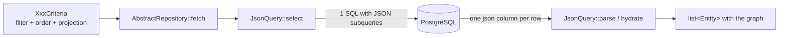

# JsonQuery guide

`JsonQuery` (`src/Framework/Persistence/Json/JsonQuery.php`) is the read engine of every
repository. This guide explains what it generates, how to declare an entity in it, how to project,
filter, order and paginate, and how to bring 1:1 and 1:N relations — always in the **same** query.

The 1:1 examples use the `Review` entity (product review) built in
[repository.md](repository.md); the 1:N ones use the existing `Purchase`/`PurchaseItem` code
(`src/Store/Persistence/Repository/`).

> Related guides: [building-a-feature.md](building-a-feature.md),
> [repository.md](repository.md), [application-service.md](application-service.md),
> [../architecture.md](../architecture.md) and the short reference in
> [persistence.md](../../skills/cube-architecture-php/references/persistence.md).

## Contents

1. [What it is and why it exists](#1-what-it-is-and-why-it-exists)
2. [Anatomy](#2-anatomy)
3. [Running queries](#3-running-queries)
4. [Projection with `ProjectionValues`](#4-projection-with-projectionvalues)
5. [Filters](#5-filters)
6. [Pagination and ordering](#6-pagination-and-ordering)
7. [1:1 relation — `addToOne`](#7-11-relation--addtoone)
8. [1:N relation — `addToMany`](#8-1n-relation--addtomany)
9. [Filtering and slicing the subcollection — `ProjectionList`](#9-filtering-and-slicing-the-subcollection--projectionlist)
10. [Circular dependencies](#10-circular-dependencies)
11. [Inspecting the SQL](#11-inspecting-the-sql)
12. [Quick reference](#12-quick-reference)

---

## 1. What it is and why it exists

A "my purchases" screen shows, for each purchase, the date and the product names. The naive way
is to fetch the purchases and, for each one, fetch the items, and for each item, the product:
that's `1 + N + N×M` round trips to the database — the famous **N+1**. On an asynchronous server
where each query suspends the session until the database answers, this turns into latency that
grows with the list.

`JsonQuery` solves it differently: **a single SELECT returns, per row, a JSON object with exactly
the requested fields**, and relations come in as **correlated subqueries inside the JSON
itself**:

```text
SELECT {
    "id": pu1.ID,
    "buyDate": pu1.BUYDATE,
    "user":  (SELECT {"id": u2.ID, "name": u2.NAME} FROM EN_USER u2 WHERE u2.ID = pu1.USERID),
    "items": (SELECT [ {...} ORDER BY pi3.ID ] FROM EN_PURCHASEITEM pi3 WHERE pi3.PURCHASEID = pu1.ID)
} AS json
FROM EN_PURCHASE pu1 WHERE ... ORDER BY ... LIMIT ...
```

(`{...}` and `[...]` are pseudo-SQL: the `JsonDialect` builds them with the database's functions —
`PostgresJsonDialect` concatenates text and uses `string_agg` for arrays.) PHP decodes each row
and hydrates the entity graph.

What you gain:

- **One round trip**, whatever the depth of the graph.
- **Only what the screen asked for**: the projection decides the columns, including inside
  relations.
- **Filter, order and per-parent slicing** of collections, in the SQL itself.



---

## 2. Anatomy

A `JsonQuery` brings together four things: the **table** (flat columns), the **conditions**
(criteria → WHERE), the **ordering** (OrderBy → ordering list) and the **relations**. In the
repository constructor:

```php
$table = new Table(self::TABLE, static fn (): Review => new Review(), [
    new Column('id', self::ID, ColumnType::Int, static fn (Review $r) => $r->id(), static fn (Review $r, mixed $v) => $r->withId($v)),
    new Column('rating', self::RATING, ColumnType::Int, static fn (Review $r) => $r->rating(), static fn (Review $r, mixed $v) => $r->withRating($v)),
    new Column('comment', self::REVIEWCOMMENT, ColumnType::Text, static fn (Review $r) => $r->comment(), static fn (Review $r, mixed $v) => $r->withComment($v)),
    new Column('createdAt', self::CREATEDAT, ColumnType::DateTime, static fn (Review $r) => $r->createdAt(), static fn (Review $r, mixed $v) => $r->withCreatedAt($v)),
]);

$this->query = new JsonQuery($table, ReviewCriteria::class, 'rv', $db->dialect())
    ->withConditions($this->conditions(...))
    ->withOrdering($this->orderBy(...))
    ->addToOne(/* product */)
    ->addToOne(/* user */);
```

`self::TABLE`, `self::ID`, `self::RATING`... are public constants of the repository itself
(`public const string TABLE = 'EN_REVIEW';` etc.): no table or column name appears as loose text.
The convention and the reason are in
[repository.md](repository.md#5a-table-and-column-constants).

| Piece                              | Role                                                                          |
|------------------------------------|-------------------------------------------------------------------------------|
| `Table(name, factory, columns)`    | flat columns; **the first one is the primary key** (`Table::id()`)            |
| `Column(field, column, type, get, set)` | `field` is the JSON key and the bean field; `type` converts database ⇄ PHP |
| `ReviewCriteria::class`            | `JsonQuery` checks that the criteria it receives is of this type (`LogicException` otherwise) |
| `'rv'`                             | alias prefix; `QueryContext` numbers them: `rv1`, `u2`, `pi3`...              |
| `withConditions(Closure)`          | `(C $criteria, string $alias, QueryContext $ctx): ?Sql`                       |
| `withOrdering(Closure)`            | `(?C $criteria, string $alias): string` — without the `ORDER BY`              |
| `addToOne` / `addToMany`           | N:1 and 1:N relations (sections 7 and 8)                                      |

Why does everything receive an **alias**? Because the same entity appears several times in one
query — as the root, inside another entity's subquery, inside a collection slice. Each appearance
gets a new alias from `QueryContext`, and conditions/orderings are written against it
(`$c = Sql::alias($a); $c(self::PRODUCTID)` is `rv1.PRODUCTID`), never against the table name.

Column types (`ColumnType`):

| Case       | PHP                 | Database                                                    |
|------------|---------------------|-------------------------------------------------------------|
| `Int`      | `int`               | `BIGINT`/`INT`                                              |
| `Float`    | `float`             | `NUMERIC(20,2)` (stored with `round(..., 2)`)               |
| `Text`     | `string`            | `VARCHAR`/`TEXT`                                            |
| `DateTime` | `DateTimeImmutable` (UTC) | `TIMESTAMP`, `'Y-m-d H:i:s'` format in UTC (no fraction) |
| `Blob`     | `string` (bytes)    | `BYTEA` (base64 in the JSON; the dialect decodes it)        |

---

## 3. Running queries

Nobody calls `JsonQuery` directly: the `AbstractRepository` read methods do it.

| Method                                     | SQL sent                            | Returns                 |
|--------------------------------------------|-------------------------------------|-------------------------|
| `fetch($criteria, $offset = 0, $limit = 0)`| 1 SELECT (0 = no limit/offset)      | `list<E>`               |
| `fetchById($id, $projection = null)`       | 1 SELECT (`criteriaForIds([$id])`, limit 1) | `?E` (null if `$id` is null) |
| `count($criteria)`                         | `SELECT COUNT(*) ... WHERE`         | `int`                   |
| `fetchPage($criteria, $page, $pageSize)`   | `count` + `fetch` (2 statements)    | `Page<E>` (0-based page) |

```php
// list
$reviews = $this->reviews->fetch(new ReviewCriteria()
    ->withProductId($productId)
    ->withProjection(ReviewInfo::projection())
    ->withOrderBy(ReviewOrderBy::NEWEST_FIRST), 0, 50);

// one record, with an explicit projection
$review = $this->reviews->fetchById($id, ReviewInfo::projection());

// count (the projection is ignored)
$total = $this->reviews->count(new ReviewCriteria()->withProductId($productId));

// page: items, page, totalPages, totalItems
$page = $this->purchases->fetchPage($criteria, 0, 10);
```

`fetch` uses the criteria's projection (`projectionOf`) or, without one, the repository's
`newProjection()`.

---

## 4. Projection with `ProjectionValues`

The projection is **the entity itself used as a mask**: a non-null field = a column to select. The
value itself doesn't matter; `ProjectionValues` (usually imported as `PV`) only provides
conventions:

| Constant/method        | For fields of type             |
|------------------------|--------------------------------|
| `PV::INT`              | `int`                          |
| `PV::FLOAT`            | `float`                        |
| `PV::STR`              | `string`                       |
| `PV::BOOL`             | `bool`                         |
| `PV::BIN`              | binary (image)                 |
| `PV::dateTime()`       | `DateTimeImmutable` (a method because an object can't be a class constant) |
| `PV::singletonList($shape, $criteria)` | 1:N collection with criteria and slicing (section 9) |

```php
use LogicException;
use Wdc\Framework\Domain\Projection\ProjectionValues as PV;

// what the reviews panel shows
public static function projection(): Review
{
    return new Review()
        ->withId(PV::INT)
        ->withRating(PV::INT)
        ->withComment(PV::STR)
        ->withCreatedAt(PV::dateTime())
        ->withUser(new User()->withId(PV::INT)->withName(PV::STR));
}
```

Rules:

- **The id is always included** (`Table::projected()` adds it even if the mask doesn't ask for it).
- In the bean read, **a field that wasn't projected stays `null`** — `$review->product()` is null above.
- A projected relation is another, nested mask; depth doesn't change the number of queries.
- Keep the projection next to the structure it fills (`ReviewInfo::projection()`,
  `ReceiptItem::projection()`): what the screen shows and what the query fetches change together.

---

## 5. Filters

### 5.1 The `Criterion` API

Each `XxxCriteria` has one `Criterion` per filterable field. The fluent methods return the
**owner** (the criteria), for chaining:

```php
$criteria = new ReviewCriteria()->withProductId(Seed::COFFEE_MAKER_ID);   // eq shortcut
$criteria->rating()->ge(4);                                               // rating >= 4

$products = new ProductCriteria();
$products->price()->between(10.0, 50.0);                               // or only start/end
$products->name()->containing('ball');                                // ILIKE '%ball%'
$products->name()->or()->startingWith('Wilson')->name()->startingWith('Thread');
$products->productId()->in([1, 2, 3]);
```

| Class                 | Operations                                                    |
|-----------------------|---------------------------------------------------------------|
| `Criterion`           | `eq`, `ne`, `in`, `isNull`, `isNotNull`                        |
| `ComparableCriterion` | + `gt`, `ge`, `lt`, `le`, `between`                            |
| `TextCriterion`       | + `like`, `ilike`, `containing` (`%x%`), `startingWith` (`x%`) |

Semantics:

- Requests on the **same field** apply together (AND); `or()` makes that field disjunctive.
  Different fields always combine with AND.
- **A `null` value adds no request** (`eq(null)`, `in(null)`, `in([])`, `like('')`): an empty
  screen filter means "don't filter". Consequence: an id that **must** restrict the query can't
  arrive null — the list would show everything.
- `between(null, $end)` becomes `le`, `between($start, null)` becomes `ge`.
- `like` is case-sensitive; `ilike`/`containing`/`startingWith` are not (translated as
  `lower(col) LIKE lower(?)`). The `%` wildcards are part of the value.

### 5.2 `CriterionTranslator` in `conditions()`

The repository only says which column matches each field; the translation to SQL is shared:

```php
protected function conditions(object $criteria, string $a, QueryContext $ctx): ?Sql
{
    $c = Sql::alias($a);

    return Sql::and([
        CT::translate($c(self::ID), $criteria->reviewId()),
        CT::translate($c(self::PRODUCTID), $criteria->productId()),
        CT::translate($c(self::USERID), $criteria->userId()),
        CT::translate($c(self::RATING), $criteria->rating()),
    ]);
}
```

`translate` returns `null` for a field with no request, and `Sql::and`/`Sql::or` drop nulls — with
no condition at all, the result is `null` (no `WHERE`). Values go as `?` parameters, never
concatenated. For date columns, pass the converter:

```php
CT::translate($c(self::BUYDATE), $criteria->buyDate(), ColumnType::formatDate(...)),
```

### 5.3 Virtual fields with `EXISTS`

A criteria can have fields that are not table columns. `PurchaseCriteria::productId` means "the
purchase has an item with this product" — and becomes `EXISTS`:

```php
/** Virtual field `productId`: this purchase has an item with the requested product. */
private function existsItemMatching(PurchaseCriteria $criteria, string $a, QueryContext $ctx): ?Sql
{
    if (!$criteria->productId()->isSet()) {
        return null;                               // field not requested ⇒ no condition
    }
    $pi = $ctx->alias('pi');                       // new alias: collides with no other
    $i = Sql::alias($pi);                          // the condition is built on the subquery's column
    $onProduct = CT::translate($i(PurchaseItemRepositoryImpl::PRODUCTID), $criteria->productId())
        ?? throw new LogicException('criterion set but produced no condition');   // can't happen: isSet() above
    $c = Sql::alias($a);

    return new Sql(
        'EXISTS (SELECT 1 FROM ' . PurchaseItemRepositoryImpl::TABLE
            . " {$pi} WHERE {$i(PurchaseItemRepositoryImpl::PURCHASEID)} = {$c(self::ID)} AND {$onProduct->sql})",
        $onProduct->params,
    );
}
```

It goes into `conditions()` as one more term of the `Sql::and([...])`. It first checks whether the
field was requested: only then does it reserve the alias, so it doesn't waste a counter number
(and make the generated SQL depend on empty filters) for nothing. After that, `translate()` always
returns a condition; the `?? throw` only exists because the return type is `?Sql`, and it turns a
future change there into a visible error instead of an ignored filter. The subquery's alias comes
from `$ctx` — that's why `conditions` receives the `QueryContext`. The item's table and columns
come from the public constants of `PurchaseItemRepositoryImpl` (concatenated, because PHP doesn't
interpolate constants in strings). `PurchaseItemRepositoryImpl` does the reverse (the item's
`userId` = the purchase owner).

---

## 6. Pagination and ordering

The `OrderBy` is a neutral enum in the domain; the repository translates each case in a `match`:

```php
protected function orderBy(?object $criteria, string $a): string
{
    $c = Sql::alias($a);

    return match ($criteria?->orderBy()) {
        null => '',
        ReviewOrderBy::NEWEST_FIRST => "{$c(self::CREATEDAT)} DESC, {$c(self::ID)} DESC",
        ReviewOrderBy::OLDEST_FIRST => "{$c(self::CREATEDAT)} ASC, {$c(self::ID)} ASC",
        ReviewOrderBy::BEST_RATED_FIRST => "{$c(self::RATING)} DESC, {$c(self::CREATEDAT)} DESC, {$c(self::ID)} DESC",
    };
}
```

- **With no ordering requested (`''`), `JsonQuery` orders by id ascending** — never by physical
  order.
- **Every ordering ends with the id.** Dates are stored without fractional seconds: two reviews in
  the same second tie, and without a tie-breaker the database may return them in a different order
  on each page — one row appears twice, another never.
- `$criteria?->orderBy()`: the `?->` is there because the criteria can be null (a collection
  without criteria).

Offset pagination: `fetch($criteria, $offset, $limit)` generates `LIMIT n OFFSET m`;
`fetchPage($criteria, $page, $pageSize)` computes `$offset = $page * $pageSize` and adds the total
(one extra `count`).

---

## 7. 1:1 relation — `addToOne`

An N:1 relation (seen from the side that holds the FK): `EN_REVIEW.USERID → EN_USER.ID`.

### 7.1 Declaration

In the bean, the relation is an entity:

```php
private ?User $user = null;

public function user(): ?User { return $this->user; }
public function withUser(?User $user): static { $this->user = $user; return $this; }
public function userId(): ?int { return $this->user?->id(); }   // used when writing the FK
```

In the `JsonQuery`:

```php
->addToOne(
    'user',                                                   // key in the JSON
    static fn (Review $r) => $r->user(),                      // reads the projection mask
    static fn (Review $r, ?User $u) => $r->withUser($u),      // stores the hydrated bean
    fn () => $this->userRepository()->query(),                // the target's JsonQuery (closure!)
    self::USERID,                                             // FK column in THIS table
)
```

### 7.2 What gets generated

With `ReviewInfo::projection()` (author with name):

```text
SELECT { "id": rv1.ID, "rating": rv1.RATING, "comment": rv1.REVIEWCOMMENT, "createdAt": rv1.CREATEDAT,
         "user": (SELECT {"id": u2.ID, "name": u2.NAME} FROM EN_USER u2 WHERE u2.ID = rv1.USERID) } AS json
FROM EN_REVIEW rv1
WHERE rv1.PRODUCTID = ?
ORDER BY rv1.CREATEDAT DESC, rv1.ID DESC
LIMIT 50
```

The subquery uses the target's projection (which may have its own relations), and the
`JsonDialect` guarantees `null` when there is no row.

### 7.3 FK shortcut: id only

If the relation's mask asks for **only the id** (no other fields, no relations), the id is already
in this row's FK column — it comes out without a subquery:

```php
->withUser(new User()->withId(PV::INT))      // becomes  "user": CASE WHEN rv1.USERID IS NULL THEN NULL ELSE {"id": rv1.USERID} END
```

That's what `newProjection()` does with every relation, and what the
`defaultProjection_bringsTheForeignKeysOnly` test checks: `productId()`/`userId()` filled,
`user()->name()` null.

### 7.4 Usage

```php
$reviews = $repo->fetch(new ReviewCriteria()
    ->withProductId(Seed::COFFEE_MAKER_ID)
    ->withProjection(ReviewInfo::projection())
    ->withOrderBy(ReviewOrderBy::NEWEST_FIRST));

$reviews[0]->user()?->name();   // 'John Doe' — came in the same SELECT
$reviews[0]->product();         // null: not projected
```

---

## 8. 1:N relation — `addToMany`

A 1:N relation: the **target** holds this table's FK (`EN_PURCHASEITEM.PURCHASEID → EN_PURCHASE.ID`).

### 8.1 Declaration

In the bean, the collection accepts a list **or** a `ProjectionList` (section 9):

```php
// Purchase
public function items(): array|ProjectionList|null { return $this->items; }
public function withItems(array|ProjectionList|null $items): static { /* ... */ }
```

In `PurchaseRepositoryImpl`:

```php
->addToMany(
    'items',
    static fn (Purchase $p) => $p->items(),
    static fn (Purchase $p, array $items) => $p->withItems($items),   // receives list<PurchaseItem>
    fn () => $this->purchaseItemRepository()->query(),
    PurchaseItemRepositoryImpl::PURCHASEID,                           // FK column IN THE CHILD
)
```

### 8.2 Usage: the item's shape as a one-element list

In the projection, the collection is an array with **one** mask item — the shape of each element
(`PurchasesPanelService::projection()`):

```php
$item = new PurchaseItem()
    ->withPrice(PV::FLOAT)
    ->withAmount(PV::INT)
    ->withProduct(new Product()->withName(PV::STR));

return new Purchase()->withId(PV::INT)->withBuyDate(PV::dateTime())->withItems([$item]);
```

This generates a JSON array aggregated by a correlated subquery, with the ordering **inside** the
aggregate (without criteria, by the child's id):

```text
"items": (SELECT [ {"id": pi2.ID, "amount": pi2.AMOUNT, "price": pi2.PRICE,
                    "product": (SELECT {"id": pr3.ID, "name": pr3.NAME} FROM EN_PRODUCT pr3 WHERE pr3.ID = pi2.PRODUCTID)}
                   ORDER BY pi2.ID ASC ]
          FROM EN_PURCHASEITEM pi2 WHERE pi2.PURCHASEID = pu1.ID)
```

Purchases, items and product names: **one statement**. A purchase without items comes back with
`items() === []`.

---

## 9. Filtering and slicing the subcollection — `ProjectionList`

A PHP array carries no metadata. When the collection needs a filter, ordering or slice, use a
`ProjectionList`, created by `PV::singletonList($shape, $criteria)`:

```php
$items = PV::singletonList(
    new PurchaseItem()->withId(PV::INT)->withPrice(PV::FLOAT),
    new PurchaseItemCriteria()->withOrderBy(PurchaseItemOrderBy::MOST_EXPENSIVE_FIRST),
)->withLimit(3);

$purchases = Beans::of(PurchaseRepository::class)->fetch(new PurchaseCriteria()
    ->withUserId($userId)
    ->withProjection(new Purchase()->withId(PV::INT)->withItems($items))
    ->withOrderBy(PurchaseOrderBy::OLDEST_FIRST));
```

- **The child's criteria** (`PurchaseItemCriteria`) goes through the items repository's
  `conditions()` and `orderBy()` — the same ones used when querying items directly. It must be of
  the right type: a `ProductCriteria` there throws `LogicException('... does not apply to EN_PURCHASEITEM ...')`.
- **`withLimit`/`withOffset` apply PER PARENT**: "the 3 most expensive items of each purchase",
  not "3 items in total".
- The child's filter doesn't filter the parents: a purchase with no matching items comes back with
  `items() === []`. To filter **purchases** by item, use the virtual field from section 5.3.

How the per-parent slice is done (pseudo-SQL):

```text
"items": (SELECT [ {...} ORDER BY pi2.PRICE DESC, pi2.ID ASC ]
          FROM EN_PURCHASEITEM pi2
          WHERE pi2.PURCHASEID = pu1.ID
            AND pi2.ID IN (SELECT pi4.ID FROM EN_PURCHASEITEM pi4
                           WHERE pi4.PURCHASEID = pu1.ID
                           ORDER BY pi4.PRICE DESC, pi4.ID ASC LIMIT 3))
```

The slice becomes an `ID IN (correlated subquery, ordered and cut)` because it fits neither in the
aggregate nor in a derived table (which wouldn't see the parent row). That's why the id tie-breaker
in the child's ordering is as important as at the root. Alias numbers may skip: each
`conditions()` can reserve aliases for its `EXISTS`.

Tests showing each case: `tests/Store/Persistence/JsonProjectionTest.php`
(`collectionSlice_isPerParent_inTheSameStatement`, `collectionFilter_bindsItsParametersInTheRightPlace`)
and `PurchaseRepositoryTest` (`collection_limitIsPerParent`, `collection_subCriteriaComposesWithSlice`).

---

## 10. Circular dependencies

Purchase → item → purchase is a cycle: `PurchaseRepositoryImpl` has `addToMany('items', ...)` and
`PurchaseItemRepositoryImpl` has `addToOne('purchase', ...)`. If each constructor received the
other's `JsonQuery`, neither could be created first.

The solution is for the target to be a **closure**, resolved only when the query is built:

```php
// in PurchaseRepositoryImpl
fn () => $this->purchaseItemRepository()->query(),

// in PurchaseItemRepositoryImpl
fn () => $this->purchaseRepository()->query(),

// the method finds the other repository in Beans on the first call and keeps it in the field
private ?PurchaseItemRepositoryImpl $purchaseItemRepository = null;

private function purchaseItemRepository(): PurchaseItemRepositoryImpl
{
    return $this->purchaseItemRepository ??= self::repositoryOf(PurchaseItemRepository::class, PurchaseItemRepositoryImpl::class);
}
```

`repositoryOf` (from `AbstractRepository`) finds the other repository in `Beans`, by interface,
and checks it is the expected concrete class (that's the one with `query()`). When a constructor
runs, the other repository may not be registered yet; by the first query, they all are. The lookup
happens once: after that, the method returns the field. Note `fn` (not `static fn`) in these
closures: they use `$this`.
What stops the recursion is the projection — the query only descends into relations whose masks
are not null.

---

## 11. Inspecting the SQL

`Database::onQuery()` registers an observer called with each statement sent (and its parameters):

```php
$statements = [];
$this->db->onQuery(static function (string $sql, array $params) use (&$statements): void {
    $statements[] = $sql;
});

Beans::of(ReviewRepository::class)->fetch(/* ... */);

self::assertCount(1, $statements, 'no N+1');
self::assertMatchesRegularExpression('/FROM EN_USER u\d+ WHERE u\d+\.ID = rv1\.USERID/', $statements[0]);
```

- It's the way to **prove** a screen has no N+1: count the statements.
- To debug, replace the body with `error_log($sql)` or a `var_dump($sql, $params)`.
- `onQuery(null)` removes the observer; `TestDatabase` already does this between tests.
- Aliases are predictable (`rv1` is always the root), but the next ones depend on the projection:
  in regular expressions, prefer `u\d+`.

---

## 12. Quick reference

### Building the JsonQuery

```php
new JsonQuery($table, XxxCriteria::class, 'xx', $db->dialect())
    ->withConditions($this->conditions(...))   // (C, alias, QueryContext): ?Sql
    ->withOrdering($this->orderBy(...))        // (?C, alias): string
    ->addToOne('field', $get, $set, fn () => $this->targetRepository()->query(), 'FK_IN_THIS_TABLE')
    ->addToMany('fields', $get, $set, fn () => $this->childRepository()->query(), 'FK_IN_THE_CHILD');
```

### Running (via `AbstractRepository`)

| Call                                      | Statements | Result      |
|-------------------------------------------|------------|-------------|
| `fetch($c, $offset, $limit)`              | 1          | `list<E>`   |
| `fetchById($id, $prj)`                    | 1          | `?E`        |
| `count($c)`                               | 1          | `int`       |
| `fetchPage($c, $page, $size)`             | 2          | `Page<E>`   |

### Projection

| I want                                  | I write                                                    |
|-----------------------------------------|------------------------------------------------------------|
| a field                                 | `->withName(PV::STR)` / `PV::INT` / `PV::FLOAT` / `PV::dateTime()` |
| only the relation's id (no subquery)    | `->withUser(new User()->withId(PV::INT))`                  |
| fields of the relation                  | `->withUser(new User()->withName(PV::STR))`                |
| the whole collection                    | `->withItems([new PurchaseItem()->withPrice(PV::FLOAT)])`  |
| a filtered/ordered/sliced collection    | `->withItems(PV::singletonList($shape, $criteria)->withLimit(3)->withOffset(0))` |

### Filters

| I want                   | I write                                      |
|--------------------------|----------------------------------------------|
| equal / not equal        | `->withXxx($v)`, `xxx()->eq($v)`, `->ne($v)` |
| one of several           | `xxx()->in([...])`                           |
| null / not null          | `xxx()->isNull()`, `->isNotNull()`           |
| range                    | `->gt ge lt le`, `->between($a, $b)`         |
| text                     | `->like('A%')`, `->ilike()`, `->containing()`, `->startingWith()` |
| OR within the field      | `xxx()->or()->eq(1)->xxx()->eq(2)`           |
| condition on another table | virtual field + `EXISTS` with `$ctx->alias()` |

### Rules that break silently

- [ ] Every screen read passes a projection with exactly what it shows.
- [ ] No repository call inside a loop over rows: the relation goes in the projection.
- [ ] Every collection that can grow has an ordering and `withLimit`.
- [ ] Every `ORDER BY` ends with the id (root and children).
- [ ] Conditions and orderings written against the alias received; subqueries ask `$ctx` for an alias.
- [ ] A criterion with `null` doesn't filter: a required id never arrives null.
- [ ] SQL identifiers unquoted.
