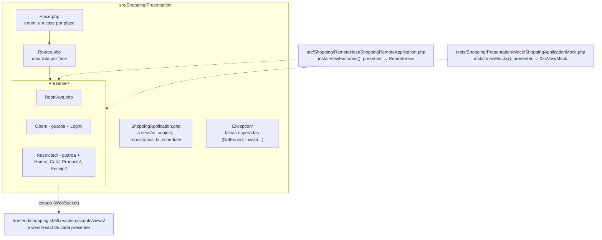
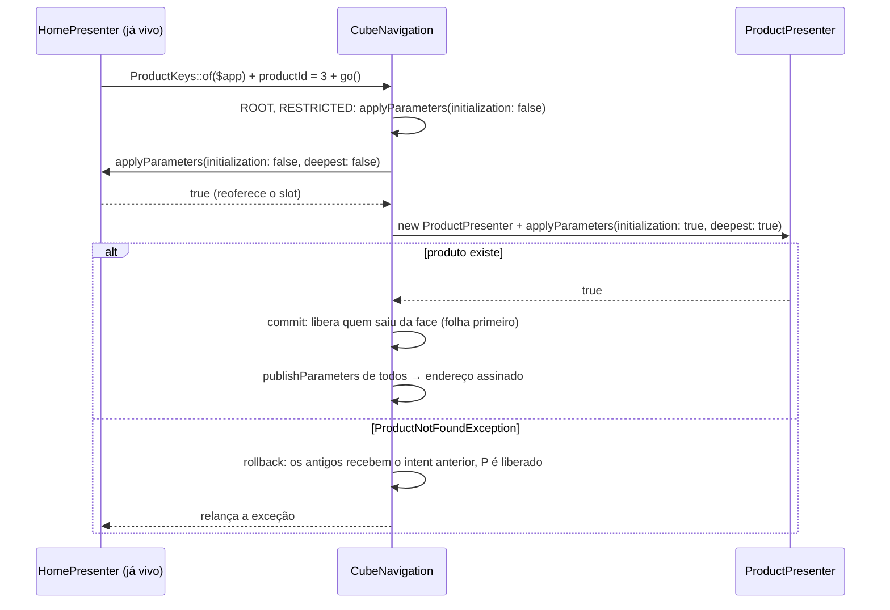
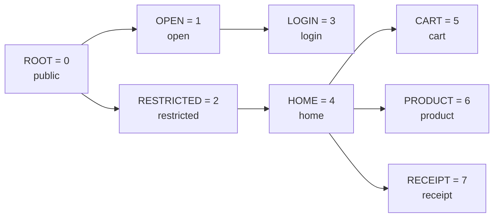
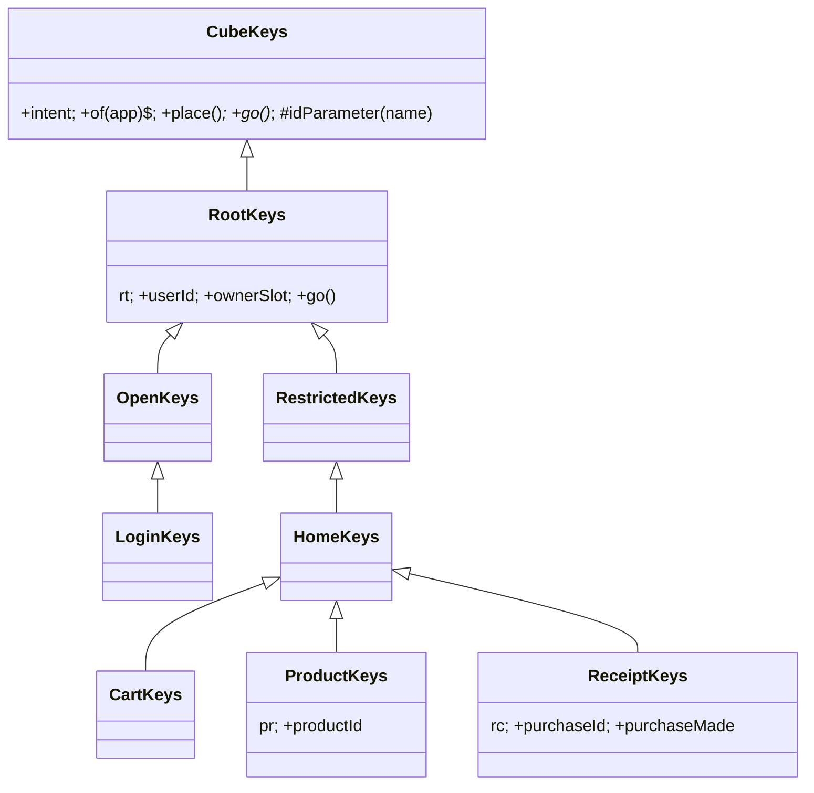
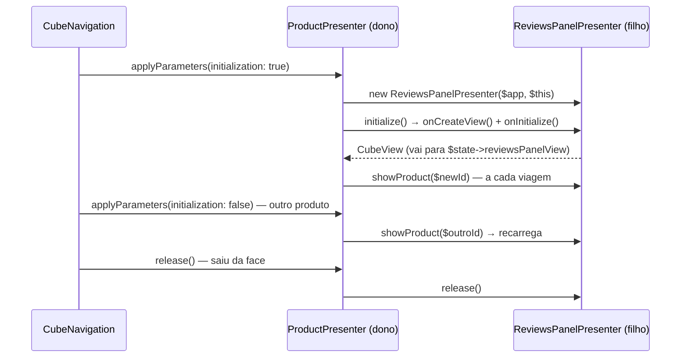

# Criando um módulo na camada de apresentação (Cube MVP)

Este guia ensina a criar um módulo novo na camada de apresentação (`src/Shopping/Presentation`):
o presenter, o estado que ele manda para a tela, o place e a rota, as keys que leem o endereço,
os presenters-filhos e as guardas. O público é quem já sabe rodar o projeto
([setup-local.md](setup-local.md)) e já leu a ideia geral
([../guia-para-quem-vem-do-php.md](../guia-para-quem-vem-do-php.md)), mas ainda não escreveu um
presenter do zero.

O **exemplo condutor** é o painel de **avaliações de produto**: dentro da tela de produto, o
cliente vê a média, a lista de avaliações e um formulário para escrever a sua. As telas e keys
que **já existem** (produto, home, guardas) servem de exemplo para o presenter roteado; o painel
de avaliações (que você vai montar como exercício) serve de exemplo para o presenter-filho.

- A view React correspondente: [react-views.md](react-views.md).
- A regra de negócio que o presenter usa: [application-service.md](application-service.md).
- O repositório por baixo: [repository.md](repository.md).
- A receita inteira, do banco à tela, na ordem certa: [criar-funcionalidade.md](criar-funcionalidade.md).

---

## Índice

1. [O que é o Cube MVP](#1-o-que-é-o-cube-mvp)
2. [Mapa da camada](#2-mapa-da-camada)
3. [O presenter roteado - `AbstractCubePresenter`](#3-o-presenter-roteado---abstractcubepresenter)
4. [Registrando o place e a rota](#4-registrando-o-place-e-a-rota)
5. [As keys: a leitura tipada do endereço](#5-as-keys-a-leitura-tipada-do-endereço)
6. [O presenter-filho - `AbstractChildPresenter`](#6-o-presenter-filho---abstractchildpresenter)
7. [Estado derivado com `commitComputedState()`](#7-estado-derivado-com-commitcomputedstate)
8. [Quando faz sentido um presenter sem view](#8-quando-faz-sentido-um-presenter-sem-view)
9. [Exemplo completo - o painel de avaliações](#9-exemplo-completo---o-painel-de-avaliações)
10. [Checklist](#10-checklist)

---

## 1. O que é o Cube MVP

No Cube a lógica de apresentação roda **no servidor**. Cada sessão de usuário é um objeto
`CubeApplication` (aqui, `ShoppingApplication`) vivo dentro de um processo PHP de longa duração
(Amp, event loop). Nela vivem os **presenters**: o que cada tela mostra, o que cada clique faz,
para onde navegar. O browser roda um shell React fino, que só desenha os estados que recebe por
WebSocket e devolve os eventos do usuário.

Dois tipos de estado, cada um com dono:

| Estado | Onde fica | Para quê |
|---|---|---|
| **De renderização** | o `ViewState` do presenter (`ProductViewState`) | o que a tela desenha; é serializado e enviado ao React |
| **De controle** | os demais campos do presenter (`$ownerSlot`, `$productId`) | o que o presenter precisa saber para decidir; nunca sai do servidor |

Não há store global nem "reducer": quem muda o estado é o presenter que é dono dele, e ele avisa
que a tela precisa ser redesenhada chamando `$this->update()`.

O "cubo" é o conjunto de **faces** possíveis da aplicação: cada face é uma cadeia de **places**
(raiz → área restrita → home → produto). O endereço de uma face é o nome do place mais fundo
mais os parâmetros publicados, como `#product?rt-user=0&pr-id=3&sign=...`. Um **intent**
(`CubeIntent`) é o pedido de mudar de face. A explicação completa está em
[../arquitetura.md](../arquitetura.md); as regras, com o porquê de cada uma, em
[../../skills/cube-architecture-php/SKILL.md](../../skills/cube-architecture-php/SKILL.md).

---

## 2. Mapa da camada



Um módulo de tela mora numa pasta própria dentro de `Presenter/`, seguindo a árvore de places
(`Presenter/Restricted/Products/` para o produto): keys, presenter, view state, as structs de
apresentação (`ProductInfo`) e o serviço da tela (`ProductService`). A lista completa de um
módulo está na seção 9.1.

Quatro tipos de presenter aparecem no projeto:

| Tipo | Tem place? | Desenha? | Base | Exemplo |
|---|---|---|---|---|
| **Tela** | sim | sim | `AbstractCubePresenter` | `ProductPresenter`, `CartPresenter` |
| **Dono de slot** | sim | sim | `AbstractCubePresenter` | `HomePresenter` (as telas abrem dentro dela) |
| **Guarda** | sim | não | `CubePresenter` direto | `RestrictedPresenter`, `OpenPresenter` |
| **Filho (segmento)** | **não** | sim, um pedaço | `AbstractChildPresenter` | `ProductsPanelPresenter`, `ReviewsPanelPresenter` |

---

## 3. O presenter roteado - `AbstractCubePresenter`

Um presenter roteado ocupa um place da cadeia ativa. A base (`src/Framework/Cube/AbstractCubePresenter.php`)
guarda a view (`protected ?CubeView $view`), oferece `update()` e libera a view em `release()`.
Você sobrescreve os quatro métodos do contrato:

| Método | Quando roda | Responsabilidade |
|---|---|---|
| `applyParameters($intent, $initialization, $deepest)` | a cada navegação que passa por este place | aceitar (ou recusar) a face nova e **recuperar o estado a partir do intent** |
| `publishParameters($intent)` | depois de cada navegação e a cada `updateHistory()` | escrever no intent a identificação **mínima** do estado (vira o endereço) |
| `commitComputedState()` | logo antes de a view suja ser serializada | recalcular estado derivado (seção 7) |
| `release()` | quando o presenter sai da face | soltar filhos, ouvintes e timers; chamar `parent::release()` por último |

### 3.1 O ciclo de navegação

Tudo passa por `CubeNavigation` (`$app->navigate()->step(...)->execute($intent)`). Entender este
ciclo explica quase todas as regras do resto do guia:



Consequências práticas:

- **Quem fica no caminho sobrevive.** Abrir um produto dentro da home passa pela home com
  `initialization: false`. Crie view, filhos e ouvintes uma vez (`if ($initialization)`); leia
  parâmetros e o slot **a cada** viagem.
- **Passar pelo caminho não é recarregar.** Compare o que você tem com o que o intent pede e só
  consulte o banco quando mudou.
- **Uma navegação que falha é uma exceção em quem navegou.** O handler que chamou `go()` captura a
  exceção esperada e mostra o erro no próprio estado; a tela fica onde estava.
- **A identidade é derivada.** O endereço é a soma do que os presenters vivos publicam; quem saiu
  da face para de publicar.

### 3.2 O `ViewState`: o contrato com a view React

```php
// src/Shopping/Presentation/Presenter/Restricted/Products/ProductViewState.php
final class ProductViewState implements ViewState
{
    public ?ProductInfo $product = null;

    public int $errorCode = 0;

    public ?string $errorMessage = null;
}
```

O `ViewStateSerializer` (`src/Framework/Cube/Remote/ViewStateSerializer.php`) transforma esse
objeto em JSON. As regras dele **são** o contrato:

- escreve só propriedades **públicas** não estáticas, menos as marcadas com `#[Transient]`;
- `bool`, `int` e `float` não anuláveis vão sempre, inclusive `0` e `false`;
- `null` e **string em branco são omitidos** - a view React precisa ter um valor padrão para
  todo campo que pode faltar;
- um `CubeView` vira `"<nome>Id"`: `$reviewsPanelView` chega ao React como `reviewsPanelViewId`;
- objetos aninhados são escritos com as suas propriedades **públicas**. Uma entidade de domínio
  (campos privados) chegaria como `{}`. Por isso a tela usa structs de apresentação com campos
  públicos (`ProductInfo`, `ReviewInfo`), montadas a partir da entidade;
- dentro de listas e objetos as regras mudam um pouco: `null` fica `null` (mas propriedades `null`
  de um objeto são puladas) e strings **não** são filtradas;
- datas (`DateTimeInterface`) viram texto ISO-8601 em UTC; enums viram o seu valor.

O primeiro campo de todo estado serializado é `"#"`, o id da instância da view
(`<classId>:<n>`), que o React usa para escolher o componente.

### 3.3 `applyParameters` - o método central

O `applyParameters` real do produto (antes do painel de avaliações):

```php
// src/Shopping/Presentation/Presenter/Restricted/Products/ProductPresenter.php
public function applyParameters(CubeIntent $intent, bool $initialization, bool $deepest): bool
{
    $keys = new ProductKeys($this->app, $intent);
    $oldId = $this->state->product?->id;
    $newId = $keys->productId ?? throw new ProductNotFoundException();   // ausente ou inválido

    if ($this->state->product === null || $newId !== $oldId) {
        $this->state->product = $this->productService->loadProductById($newId);
        $this->update();
    }
    if ($initialization) {
        $this->state->errorCode = 0;
        $this->state->errorMessage = null;
        $this->view = (self::$createView ?? throw new LogicException('ProductPresenter::$createView não configurado'))($this);
    }
    $this->ownerSlot = $keys->ownerSlot;   // a cada viagem: quem decide o slot é o dono acima
    $this->ownerSlot?->setView($this->view);

    return true;
}
```

Leia em quatro passos:

1. **Ler o intent pelas keys** (`new ProductKeys($this->app, $intent)`). O getter já validou: se
   o endereço não traz um id utilizável, vem `null`, e o presenter transforma isso numa exceção
   específica - a navegação faz rollback.
2. **Carregar só se mudou.** `loadProductById` lança `ProductNotFoundException` para um id que não
   existe mais; de novo, rollback.
3. **Criar a view uma vez**, na inicialização, pela fábrica `$createView` (3.5).
4. **Encaixar a view no slot do dono, a cada viagem** (3.6).

Retornar `false` interrompe a navegação (é o que as guardas fazem, seção 8).

### 3.4 `publishParameters` e `update()`

```php
public function publishParameters(CubeIntent $intent): void
{
    if ($this->state->product !== null) {
        $keys = new ProductKeys($this->app, $intent);
        $keys->productId = $this->state->product->id;
    }
}
```

Publique o **mínimo** que recria o estado - o id, não o produto. É isso que faz F5, favoritos e
Voltar funcionarem: o `applyParameters` do próximo acesso lê esse id e reconstrói tudo.

`$this->update()` é **explícito**: nada observa o estado. Mudou um campo do `ViewState` e não
chamou `update()`, a tela continua mostrando o valor antigo até que outra coisa suje a view.
Chamar duas vezes não custa nada: as views sujas são coletadas e enviadas uma vez no fim da
requisição (ou pelo flush de fundo de 50 ms). Se a mudança altera o que você **publica** sem
navegar (trocar de página numa lista, por exemplo), chame também `$this->app->updateHistory()`
para o endereço acompanhar.

### 3.5 `$createView`: o presenter não conhece a view concreta

```php
/** @var (Closure(self): CubeView)|null */
public static ?Closure $createView = null;
```

Quem hospeda a aplicação instala a fábrica. Em produção, o host remoto liga o presenter a uma
`RemoteView`; nos testes, a um mock que só guarda o estado. Instale nos **dois** lugares - um
presenter que falta num deles lança "`$createView` não configurado":

```php
// src/Shopping/RemoteHost/ShoppingRemoteApplication.php - installViewFactories()
ProductPresenter::$createView = static fn (ProductPresenter $p) => new RemoteView(self::of($p->app), $p, $p->state, $p->skeleton());

// tests/Shopping/Presentation/Mock/ShoppingApplicationMock.php - installViewMocks()
ProductPresenter::$createView = static fn (ProductPresenter $p) => new ProductViewMock($p);
```

O mock (`tests/Shopping/Presentation/Mock/ProductViewMock.php`) estende `AbstractViewMock` e guarda
o presenter e o **mesmo** objeto de estado que ele altera - objetos PHP são compartilhados por
handle, não copiados. É assim que um teste lê o que a tela mostraria.

### 3.6 Slots: onde a view aparece

Quem decide onde uma tela aparece é o dono acima dela. O dono embrulha um setter num
`CubeViewSlot` e o oferece no intent pela propriedade `RootKeys::$ownerSlot` - o único nome
reusado de propósito em toda a aplicação: cada nível encaixa a sua view no slot que recebeu e
reoferece o próprio slot, com o mesmo nome, ao nível de baixo. Veja a `HomePresenter`:

```php
// src/Shopping/Presentation/Presenter/Restricted/Home/HomePresenter.php (trechos)
$this->contentSlot = new CubeViewSlot($this->setContentView(...));   // no construtor

$keys = new HomeKeys($this->app, $intent);                         // em applyParameters
$this->ownerSlot = $keys->ownerSlot;   // a cada viagem: quem decide o slot é o dono acima
if ($this->ownerSlot === null) {
    return false;
}
$this->ownerSlot->setView($this->view);
if ($deepest) {
    $this->setContentView(null);   // a home é o destino: mostra os painéis
} else {
    $keys->ownerSlot = $this->contentSlot;   // reoferece, com o mesmo nome, ao nível de baixo
}
```

O `setContentView` só troca `$this->state->contentView` e chama `update()` quando o valor mudou.
`HomeViewState::$contentView` vai ao React como `contentViewId`, e a `HomeView` desenha com
`bridge.createView(state.contentViewId)` ([react-views.md](react-views.md)).

Por que ler o slot **a cada** viagem? Porque um presenter que sobrevive não sabe se a decisão de
cima mudou. Publicar a view no slot antigo faz a tela sumir ou aparecer no lugar errado. E, no
`release()` do dono, zere os campos que apontam para views de filhos.

### 3.7 O `Skeleton`: eventos da view

A view React manda eventos numerados. O `skeleton()` liga cada número a um método:

```php
// ProductPresenter
public function skeleton(): CubeSkeleton
{
    return new Skeleton('48b693f67410', function (int $event, int $qtde, array $form): void {
        match ($event) {
            1 => $this->onOpenProducts(),
            2 => $this->onAddToCart(Coerce::asInt($form['p.quantity'] ?? null)),
            default => Skeleton::unknownEvent($event),
        };
    });
}
```

- **O `classId`** (`'48b693f67410'`) é o elo com o React: o mesmo texto vai em
  `BaseViewClass.FC(ProductViewClass, "48b693f67410")`. Diferente de um lado e do outro, a área da
  tela não desenha. Para um módulo novo, gere um id aleatório de 12 hex:
  `php -r 'echo bin2hex(random_bytes(6)), PHP_EOL;'`.
- **Todo código que a view envia precisa de um braço no `match`.** O `default` chama
  `Skeleton::unknownEvent`, que lança `eventCode(N) not handled`: a sessão registra no log e mostra
  o alerta de erro inesperado. É de propósito - um evento que some em silêncio é muito pior.
  Prefira constantes nomeadas (`self::EVENT_SUBMIT_REVIEW`) dos dois lados.
- **Argumentos do evento chegam como `p.<nome>`** em `$form`. Chegam como escalares JSON:
  converta com `Coerce::asInt` / `Coerce::asString` (de `Wdc\Framework\Commons\Lang\Coerce`, que
  devolvem `null` quando o valor não serve) e valide no método.
- **Campos sem o prefixo `p.`** são sincronização de estado: vão para o **terceiro** argumento do
  `Skeleton`, o closure `syncState(array $form)`, que roda antes do evento. Se o skeleton não tem
  `syncState`, esses campos são **descartados em silêncio**. Nenhum presenter do Shopping usa
  `syncState` hoje; o padrão é mandar tudo como argumento `p.` no evento.
- `$qtde` é a contagem de eventos repetidos que chegaram juntos na mesma requisição.

Por que uma closure e não uma classe anônima? Uma closure criada dentro do presenter enxerga os
métodos privados dele; uma classe anônima não.

### 3.8 Handlers de evento: sempre guardados

Todo método `onX` chamado pelo skeleton envolve o corpo num `try`. Falha **esperada** (registro
não encontrado, entrada inválida) vira `errorCode` + `errorMessage` no estado do próprio
presenter; o **inesperado** vai para `$this->app->alertUnexpectedError(...)`, que mostra o alerta
global e registra a exceção. `HomePresenter::onOpenProduct` (seção 5.4) captura
`ProductNotFoundException` e mostra o erro 3 na própria home; `ReviewsPanelPresenter::onSubmitReview`
(seção 9.4) faz o mesmo com `InvalidReviewException`. Os métodos são `public` porque os testes os
chamam diretamente, simulando o clique.

---

## 4. Registrando o place e a rota

Uma tela nova (com endereço próprio) precisa de três coisas: um case no enum `Place`, um método
em `Routes` e uma classe de keys (seção 5). A árvore atual, do docblock de `Place.php`:



### 4.1 O case no enum `Place`

Em `src/Shopping/Presentation/Place.php`, o produto aparece em quatro pontos:

```php
case PRODUCT = 6;                                   // o case, no bloco do nível 3
self::PRODUCT => 'product',                         // em name(): o nome no endereço
self::PRODUCT => new ProductPresenter($app),        // em createPresenter()
self::PRODUCT => Routes::product($app, $intent),    // em go(): a rota
```

- **O id cresce com a profundidade.** O motor libera os presenters da folha para a raiz usando
  essa ordem. Um place novo no nível 3 seria `= 8`.
- **`name()` é o nome no endereço.** Não confunda com a propriedade embutida `->name` de todo enum
  PHP, que devolve o nome do case (`'PRODUCT'`).
- Um `match` sobre um enum sem braço para um case lança `UnhandledMatchError` - e o PHPStan acusa
  antes. Esquecer um dos três `match` não passa despercebido.
- A rota fica no método `go()` porque um enum PHP não tem estado para guardá-la.

### 4.2 O método em `Routes`

```php
// src/Shopping/Presentation/Routes.php
public static function product(ShoppingApplication $app, CubeIntent $intent): bool
{
    return $app->navigate()->step(Place::ROOT)->step(Place::RESTRICTED)->step(Place::HOME)->step(Place::PRODUCT)
        ->execute($intent);
}
```

A cadeia de `step` **é** a face. Repare em dois detalhes: a guarda `RESTRICTED` está no caminho
(é ela que protege a tela, seção 8), e `product` exige o intent - não faz sentido abrir um produto
"a partir do estado atual" sem dizer qual. Rotas sem parâmetro obrigatório aceitam `?CubeIntent
$intent = null` e usam `$intent ?? $app->newIntent()`, como `Routes::cart`.

Você raramente chama `Routes` diretamente: a navegação passa pelas keys do destino
(`ProductKeys::of($app)->go()` → `Place::go` → `Routes::product`).

---

## 5. As keys: a leitura tipada do endereço

Nenhum presenter escreve `$intent->getParameter('pr-id')`. Os nomes de parâmetros e atributos
vivem em **classes de keys**, uma por place, e só nelas.

### 5.1 Por que os nomes precisam ser únicos

Uma navegação passa o **mesmo** intent por todos os `applyParameters`, da raiz à folha. Se dois
presenters usassem o nome `id`, um sobrescreveria o valor do outro no meio do caminho, sem erro.
Por isso cada arquivo de keys declara um `PREFIX` de duas letras, único na aplicação, e todos os
seus nomes começam com ele.

### 5.2 A árvore de keys espelha a árvore de places



`CubeKeys` (framework) dá o construtor, `of()` e o helper `idParameter()`. `RootKeys` implementa
`go()` e declara o que toda tela usa: `$userId` e o slot `$ownerSlot`. Cada place estende as keys
de quem está acima - assim um place mais fundo pode **ler** o que um ancestral publica (o
`ProductPresenter` lê `$keys->ownerSlot`, que é de `RootKeys`). Um nome é declarado uma vez, nas
keys do **dono**.

Todo place tem as suas keys, inclusive guardas e telas sem parâmetros. Uma keys sem nomes só
declara `place()`:

```php
/** Keys do carrinho: `cart`. */
final class CartKeys extends HomeKeys
{
    public function place(): CubePlace
    {
        return Place::CART;
    }
}
```

### 5.3 Anatomia de uma classe de keys

```php
// src/Shopping/Presentation/Presenter/Restricted/Receipt/ReceiptKeys.php
/** Keys do recibo: `receipt?rc-id=7`. */
final class ReceiptKeys extends HomeKeys
{
    /** Prefixo dos nomes deste arquivo - único na aplicação. */
    private const string PREFIX = 'rc';

    /** Parâmetro: a compra do recibo. */
    private const string P_ID = self::PREFIX . '-id';

    /** Atributo: "a compra acabou de ser feita" - o recibo mostra o aviso de sucesso. */
    private const string A_MADE = self::PREFIX . '-made';

    /** A compra: inteiro não negativo, ou null se o endereço não traz uma utilizável. */
    public ?int $purchaseId {
        get => $this->idParameter(self::P_ID);
        set (?int $value) {
            $this->intent->setParameter(self::P_ID, $value);
        }
    }

    /** Se a navegação vem de uma compra recém-concluída (não vai para o endereço). */
    public bool $purchaseMade {
        get => $this->intent->getAttribute(self::A_MADE) === true;
        set (bool $value) {
            $this->intent->setAttribute(self::A_MADE, $value);
        }
    }

    public function place(): CubePlace
    {
        return Place::RECEIPT;
    }
}
```

| Prefixo da constante | É um... | Vai para o endereço? | Para quê |
|---|---|---|---|
| `P_` | parâmetro | sim | estado endereçável: ids, filtros, página |
| `A_` | atributo | não | dado já em mãos, flags ("a compra acabou de ser feita") |

As propriedades usam **property hooks** (PHP 8.4): `get` e `set` rodam código a cada leitura e
escrita, como um getter/setter, mas com sintaxe de propriedade. Duas regras para os hooks:

- **Valide na leitura.** O endereço é entrada de fora - mesmo assinado, um link antigo traz um
  registro que não existe mais. O getter devolve um valor utilizável ou `null` (ids:
  `idParameter()`, que só aceita inteiro não negativo; escolhas: lista permitida).
- **Omita o padrão na escrita.** `setParameter($nome, null)` remove o parâmetro do endereço.

### 5.4 Usando as keys

```php
// 1) dentro de applyParameters / publishParameters: o intent da navegação em curso
$keys = new ProductKeys($this->app, $intent);

// 2) num handler de evento: uma viagem que parte do ESTADO atual
$product = ProductKeys::of($this->app);   // newIntent(): cada presenter vivo publica
$product->productId = $productId;
$product->go();

// 3) num redirecionamento dentro de applyParameters: passe o intent EM TRÂNSITO
(new OpenKeys($this->app, $intent))->go();
```

O caso 3 importa: redirecionar com `OpenKeys::of(...)` perderia o que o endereço acabou de trazer
(por exemplo, o produto que o usuário queria ver antes de logar).

> **Armadilha do PHP:** escrever num hook de um objeto temporário é erro fatal.
> `(new ProductKeys($this->app, $intent))->productId = 3` dá "Cannot use temporary expression in
> write context". Atribua a uma variável primeiro, como nos exemplos acima. Ler e chamar métodos
> (`(new OpenKeys(...))->go()`) não tem problema.

### 5.5 `KeysNamesTest`: a regra verificada

`tests/Shopping/Presentation/KeysNamesTest.php` varre `src/Shopping/**/*Keys.php` e falha se:

- um nome não segue o formato `self::PREFIX . '-codigo'` numa constante `P_`/`A_`;
- um arquivo que declara nomes não tem `PREFIX` de duas letras, ou repete um código local;
- dois arquivos usam o mesmo prefixo;
- um place não tem **exatamente uma** classe de keys;
- algum código fora das keys acessa o intent por nome (`$intent->getParameter('...')`).

Ao criar um place, rode `composer check`: o teste avisa se faltou a keys.

---

## 6. O presenter-filho - `AbstractChildPresenter`

O cubo controla os places. Mas, dentro da view de uma tela, um **segmento** pode ter o seu
próprio presenter: a vitrine e o extrato da home, o painel de avaliações do produto. Um filho:

- **não tem place**, não aparece em `Place` nem em `Routes`, não tem keys e não publica nada;
- é **criado, guardado e liberado pelo dono**;
- tem view, `ViewState`, `skeleton()` e `$createView` como uma tela;
- **delega a navegação ao dono** (`$this->owner->onOpenProduct($id)`).

Trocar um painel não troca a face. Se o estado de um segmento precisa sobreviver ao F5 (a aba
aberta, a página), ele é um **parâmetro do dono**: o dono lê em `applyParameters`, repassa ao
filho e publica.

### 6.1 O contrato

A base (`src/Framework/Cube/AbstractChildPresenter.php`) pede dois métodos protegidos -
`onCreateView(): CubeView` (cria a view pela fábrica `$createView`) e `onInitialize(): void` (a
carga inicial) - e oferece o `final public function initialize(): CubeView`, que chama os dois
nessa ordem e **devolve a view** para o dono guardar no próprio estado. Mais `update()`,
`release()` e um `commitComputedState()` vazio, como na tela. Não há `applyParameters`: o filho
não participa da navegação; quem lhe diz o que mostrar é o dono.

### 6.2 O ciclo de vida, responsabilidade do dono



O dono, em três pontos:

```php
// 1) na inicialização: cria UMA vez e guarda a view do filho no próprio estado
$this->reviewsPanel = new ReviewsPanelPresenter($this->app, $this);
$this->state->reviewsPanelView = $this->reviewsPanel->initialize();

// 2) a cada viagem: diz ao filho o que mostrar (o filho compara e só recarrega se mudou)
$this->reviewsPanel?->showProduct($newId);

// 3) no release(): zera o campo, libera o filho, e só então o pai
public function release(): void
{
    $this->state->reviewsPanelView = null;
    $this->reviewsPanel?->release();
    $this->reviewsPanel = null;
    parent::release();
}
```

O campo `?CubeView $reviewsPanelView` no `ProductViewState` vai ao React como
`reviewsPanelViewId`, e a `ProductView` desenha o filho com `bridge.createView(...)`.

### 6.3 Navegação: sempre pelo dono

O filho não chama `XxxKeys::of(...)->go()` por conta própria. A vitrine da home, por exemplo,
repassa o clique:

```php
// src/Shopping/Presentation/Presenter/Restricted/Home/Products/ProductsPanelPresenter.php
public function onOpenProduct(?int $productId): void
{
    $this->owner->onOpenProduct($productId);
}
```

Assim o tratamento do erro (`ProductNotFoundException` → erro 3 na home) fica num só lugar, o
dono, que é quem está na face e sabe o que fazer. O dono chega pelo construtor:
`public readonly HomePresenter $owner` - o tipo concreto, para o filho chamar os métodos dele.

---

## 7. Estado derivado com `commitComputedState()`

`commitComputedState()` roda **logo antes de uma view suja ser serializada**, dentro do lock da
sessão. Serve para valores que derivam de outra coisa e que você não quer recalcular em cada
ponto que a muda. O exemplo real é a contagem do carrinho na home:

```php
// HomePresenter
/** Estado derivado, recalculado logo antes de a view ser enviada ao cliente. */
public function commitComputedState(): void
{
    $count = $this->cart?->itemCount() ?? 0;
    if ($this->state->cartItemCount !== $count) {
        $this->state->cartItemCount = $count;
        $this->update();
    }
}
```

**Compare antes de atualizar.** `update()` suja a view; se `commitComputedState` chamasse
`update()` sempre, a view ficaria suja para sempre e seria reenviada a cada flush.

Quando **não** usar: se o valor deriva de algo que só muda num ponto conhecido, calcule ali. O
painel de avaliações calcula média e contagem dentro de `loadReviews()`, logo depois de carregar a
lista, porque a lista só muda nesse método; em `commitComputedState` o cálculo rodaria a cada
envio da view, sem necessidade.

Dois detalhes do motor:

- No host remoto, `commitComputedState` é chamado para o presenter de **cada view suja** - filhos
  incluídos. Uma view limpa não passa por ele; por isso a home também atualiza a contagem
  diretamente no ouvinte de mudança do carrinho (`onCartChanged`).
- Nos testes com mocks não há serialização, então ninguém o chama sozinho. Se o seu teste depende
  de estado derivado, chame `$this->app->commitComputedState()` (percorre os presenters de place)
  ou o método do presenter diretamente.

---

## 8. Quando faz sentido um presenter sem view

Uma **guarda** ocupa um place, não desenha nada e decide se a navegação continua. Implementa
`CubePresenter` direto, sem a base:

```php
// src/Shopping/Presentation/Presenter/Restricted/RestrictedPresenter.php
/** Guarda da área restrita (sem view). Sem usuário logado, volta para a área pública. */
final class RestrictedPresenter implements CubePresenter
{
    public function __construct(public readonly ShoppingApplication $app)
    {
    }

    public function applyParameters(CubeIntent $intent, bool $initialization, bool $deepest): bool
    {
        if ($this->app->subject() === null) {
            (new OpenKeys($this->app, $intent))->go();

            return false;
        }
        if ($deepest) {   // é só uma guarda: a tela padrão da área restrita é a home
            (new HomeKeys($this->app, $intent))->go();

            return false;
        }

        return true;
    }

    // publishParameters(), commitComputedState() e release(): vazios - a guarda não tem estado
}
```

- **Redirecionar = navegar e devolver `false`.** O `go()` interno inicia uma navegação nova; a de
  fora é marcada como interrompida (nem commit, nem rollback). Um laço de redirecionamentos é
  detectado e abandonado, e a sessão continua utilizável.
- **O intent em trânsito vai junto** (`new OpenKeys($this->app, $intent)`), para não perder o que o
  endereço trouxe.
- **`$deepest` na guarda:** um ramo sozinho não é tela. Quem pede `#restricted` vai para a home.
- `OpenPresenter` é o espelho: quem já está logado é mandado para a área restrita; quem pede
  `#open` vai para o login.

Tudo o que está **fora** do ramo guardado é público por construção. Para proteger uma tela nova,
basta colocá-la sob `Place::RESTRICTED` na rota.

---

## 9. Exemplo completo - o painel de avaliações

O exercício: na tela de produto, um painel que mostra as avaliações (mais recentes primeiro),
a média ("4,5 de 5"), a contagem e um formulário (nota de 1 a 5, comentário opcional de até 500
caracteres). Nada disso vai para o endereço - o produto mostrado é decidido pelo dono.

### 9.1 Arquivos

```text
src/Shopping/Presentation/
  Exception/InvalidReviewException.php                       falha esperada da validação
  Presenter/Restricted/Products/
    ProductPresenter.php                                      dono: cria, alimenta e libera o filho
    ProductViewState.php                                      + ?CubeView $reviewsPanelView
    Reviews/
      ReviewInfo.php                                          a avaliação como o painel a mostra + projeção
      ReviewService.php                                       listForProduct(), add() com validação
      ReviewsPanelViewState.php                               o estado do painel
      ReviewsPanelPresenter.php                               o filho
src/Shopping/RemoteHost/ShoppingRemoteApplication.php         + $createView → RemoteView
tests/Shopping/Presentation/
  Mock/ReviewsPanelViewMock.php                               o mock da view
  Mock/ShoppingApplicationMock.php                            + $createView → mock
  ProductReviewsTest.php                                      o comportamento, sem browser
frontend/shopping.shell.react/src/scripts/views/product/
  ReviewsPanel.tsx, reviews-sel.ts, reviews.scss              a view (react-views.md)
```

A entidade `Review`, o critério e o repositório são o assunto de [repository.md](repository.md);
o `ReviewService`, de [application-service.md](application-service.md). O serviço acha o
repositório no `Beans`, pela interface (`Beans::of(ReviewRepository::class)`); o presenter só
faz `new ReviewService()`.

### 9.2 O estado e a struct de apresentação

```php
final class ReviewsPanelViewState implements ViewState
{
    /** @var list<ReviewInfo> mais recentes primeiro */
    public array $reviews = [];
    public int $count = 0;
    /** "4,5 de 5"; vazio (omitido no envio) quando não há avaliações */
    public string $averageLabel = '';
    /** 0 = sem erro */
    public int $errorCode = 0;
    public ?string $errorMessage = null;
}
```

`ReviewInfo` é a avaliação como o painel a mostra: campos públicos `$id`, `$author` (o nome de
quem avaliou), `$rating`, `$comment` e `$createdAt` (milissegundos desde 1970, para o browser
formatar no fuso de quem lê), mais `projection()` e `create(Review $review)`. A entidade `Review`,
com campos privados, chegaria ao React como `{}`.

O que o serializador faz com isso: `averageLabel` vazio não vai; `count` e `errorCode` vão sempre;
a lista vai com os campos públicos de cada `ReviewInfo`. Dentro da lista as strings não são
filtradas: um `comment` vazio vai como `""`.

### 9.3 O dono: `ProductPresenter`

O dono ganha o campo `private ?ReviewsPanelPresenter $reviewsPanel = null;`, o campo
`public ?CubeView $reviewsPanelView = null;` no `ProductViewState` e os três pontos da seção 6.2:
criar o filho dentro do `if ($initialization)` do `applyParameters` da seção 3.3 (seguido de
`$this->update()`), chamar `$this->reviewsPanel?->showProduct($newId)` **fora** do `if`, antes de
encaixar a view no slot, e liberar o filho no `release()`.

`showProduct()` roda dentro do `applyParameters`: se a consulta das avaliações falhar, a exceção
sobe para a navegação e há rollback, como com o próprio produto.

### 9.4 O filho: `ReviewsPanelPresenter`

```php
/** @extends AbstractChildPresenter<ShoppingApplication> */
final class ReviewsPanelPresenter extends AbstractChildPresenter
{
    private const int EVENT_SUBMIT_REVIEW = 1;
    private const int ERROR_INVALID_REVIEW = 1;
    private const int MAX_REVIEWS = 50;

    /** @var (Closure(self): CubeView)|null instalado pelo host remoto e pelos testes (mock) */
    public static ?Closure $createView = null;

    public readonly ReviewsPanelViewState $state;
    private readonly ReviewService $service;

    /** estado de controle: o produto cujas avaliações estão carregadas (null = nenhum ainda) */
    private ?int $productId = null;

    public function __construct(ShoppingApplication $app, public readonly ProductPresenter $owner)
    {
        parent::__construct($app);
        $this->state = new ReviewsPanelViewState();
        $this->service = new ReviewService();
    }

    /** Chamado pelo dono em todo applyParameters. Passar pelo caminho não é recarregar. */
    public function showProduct(int $productId): void
    {
        if ($this->productId === $productId) {
            return;
        }
        $this->loadReviews($productId);
        $this->productId = $productId;   // só depois da carga: se ela falhar, o painel fica como estava
        $this->clearError();             // o erro era do formulário do produto anterior
    }

    public function onSubmitReview(?int $rating, ?string $comment): void
    {
        try {
            $subject = $this->app->subject() ?? throw new LogicException('Sem usuário logado');
            $productId = $this->productId ?? throw new LogicException('Sem produto carregado');
            $this->service->add($subject, $productId, $rating, $comment);
            $this->clearError();
            $this->loadReviews($productId);   // a nova avaliação entra no topo
        } catch (InvalidReviewException $caught) {
            // esperada: vai para o estado do painel; a lista fica como estava
            $this->state->errorCode = self::ERROR_INVALID_REVIEW;
            $this->state->errorMessage = $caught->getMessage();
            $this->update();
        } catch (Throwable $caught) {
            $this->app->alertUnexpectedError('Submitting a review', $caught);
        }
    }

    public function skeleton(): CubeSkeleton
    {
        return new Skeleton('8cc32236e32a', function (int $event, int $qtde, array $form): void {
            match ($event) {
                self::EVENT_SUBMIT_REVIEW => $this->onSubmitReview(
                    Coerce::asInt($form['p.rating'] ?? null),
                    Coerce::asString($form['p.comment'] ?? null),
                ),
                default => Skeleton::unknownEvent($event),
            };
        });
    }

    protected function onCreateView(): CubeView
    {
        return (self::$createView ?? throw new LogicException('ReviewsPanelPresenter::$createView não configurado'))($this);
    }

    /** Só desenha (vazio): a carga espera o dono dizer qual é o produto. */
    protected function onInitialize(): void
    {
        $this->update();
    }

    private function loadReviews(int $productId): void
    {
        $reviews = $this->service->listForProduct($productId, self::MAX_REVIEWS);
        $this->state->reviews = $reviews;
        $this->state->count = count($reviews);
        $this->state->averageLabel = $reviews === []
            ? ''
            : number_format(array_sum(array_map(static fn (ReviewInfo $r) => $r->rating, $reviews)) / count($reviews), 1, ',', '') . ' de 5';
        $this->update();
    }

    // clearError(): zera errorCode/errorMessage e chama update() só se havia erro
}
```

Pontos para reparar:

- **O autor nunca vem da view.** `onSubmitReview` usa `$this->app->subject()`; a view manda só
  nota e comentário.
- **A validação é do servidor**: `ReviewService::add` lança `InvalidReviewException` (nota fora de
  1..5, comentário com mais de 500 caracteres). A view pode ajudar, mas não decide.
- **Falha esperada não é alerta**: vira `errorCode`/`errorMessage` do painel.
- `$productId` é **estado de controle**: a tela não precisa dele, então não está no `ViewState`.

### 9.5 A amarração da view

```php
// ShoppingRemoteApplication::installViewFactories()
ReviewsPanelPresenter::$createView = static fn (ReviewsPanelPresenter $p) => new RemoteView(self::of($p->app), $p, $p->state, $p->skeleton());

// ShoppingApplicationMock::installViewMocks()
ReviewsPanelPresenter::$createView = static fn (ReviewsPanelPresenter $p) => new ReviewsPanelViewMock($p);
```

`ReviewsPanelViewMock` é igual ao `ProductViewMock` da seção 3.5, trocando os tipos. O lado React
(`ReviewsPanel.tsx`, com o mesmo `classId`) está em [react-views.md](react-views.md).

### 9.6 O teste, sem browser

`PresentationTestCase` dá um banco de teste re-semeado por teste, autenticação real, um
`ManualScheduler` e a aplicação com mocks; `login()` devolve o mock da home. O teste chama os
métodos que o skeleton chamaria e confere o estado dos mocks:

```php
// tests/Shopping/Presentation/ProductReviewsTest.php (trechos)
private function openCafeteira(): ReviewsPanelViewMock
{
    $home = $this->login('fulano', 'fulano');
    $home->presenter->onOpenProduct(Seed::CAFETEIRA_ID);
    $product = ProductViewMock::cast($home->state->contentView);

    return ReviewsPanelViewMock::cast($product->state->reviewsPanelView);
}

#[Test]
public function invalidRating_setsTheError_andKeepsTheList(): void
{
    $panel = $this->openCafeteira();
    $before = self::ids($panel->state->reviews);

    $panel->presenter->onSubmitReview(9, 'Nota fora da escala');

    self::assertSame(1, $panel->state->errorCode);
    self::assertSame($before, self::ids($panel->state->reviews));
    self::assertNull($this->app->rootView()->state->errorMessage, 'falha esperada não vira alerta');
}
```

Os outros testes do arquivo cobrem o caminho feliz, o produto sem avaliações, a passagem pelo
mesmo produto **sem nenhuma consulta** (`onQuery(...)` no `Database` devolvido por `TestDatabase::open()` conta as instruções) e a
liberação do painel ao sair do produto (`$panel->released`). `::cast($view)` confere o tipo do
mock com uma mensagem útil ("Esperava X, veio null") e o devolve já tipado.

> **Armadilha do PHPStan (nível 8):** depois de `self::assertSame(1, $panel->state->errorCode)`, o
> PHPStan "lembra" que o valor é `1`, mesmo depois de você chamar um método em **outro** objeto
> (`$panel->presenter->onSubmitReview(...)`) que o altera. Repetir `assertSame(1, ...)` sobre a
> mesma propriedade é marcado como `alreadyNarrowedType`. Asserte algo que **difere** entre os
> passos - em `missingRating_orLongComment_areRejected`, a mensagem de erro de cada envio.

Rode `composer check` (PHPStan + PHPUnit) e, para ver no browser, `bin/build-frontend.sh` e o
servidor ([setup-local.md](setup-local.md)).

---

## 10. Checklist

**Tela nova (com place)**

- [ ] Case em `Place` com id que cresce com a profundidade, nos três `match` (`name()`,
      `createPresenter()`, `go()`).
- [ ] Método em `Routes` com a cadeia completa de `step`, passando pela guarda certa.
- [ ] `XxxKeys` estendendo as keys do place de cima, com `place()`. Se declara nomes: `PREFIX`
      novo de duas letras, constantes `P_`/`A_`, hooks que validam no `get` e omitem o padrão no
      `set`.
- [ ] `XxxViewState` com propriedades públicas; nada de entidade de domínio dentro - use uma
      struct com campos públicos.
- [ ] Presenter: `applyParameters` lê pelas keys, só recarrega se mudou, cria a view em
      `$initialization`, lê e preenche o slot **a cada** viagem.
- [ ] `publishParameters` escreve o mínimo que recria o estado.
- [ ] `update()` depois de toda mudança no `ViewState`; `updateHistory()` se mudou o que é
      publicado sem navegar.

**Filho (sem place)**

- [ ] Estende `AbstractChildPresenter`, recebe o dono no construtor, implementa `onCreateView()` e
      `onInitialize()`.
- [ ] O dono cria uma vez, guarda a view num campo `?CubeView` do próprio estado e, em
      `release()`, zera o campo e libera o filho antes de `parent::release()`.
- [ ] Navegação delegada ao dono.

**Em todo presenter com view**

- [ ] `skeleton()` com `classId` novo (`php -r 'echo bin2hex(random_bytes(6)), PHP_EOL;'`), o
      mesmo do `BaseViewClass.FC` no React.
- [ ] Um braço no `match` para cada código que a view envia; `default => Skeleton::unknownEvent($event)`.
- [ ] Argumentos como `p.<nome>`, convertidos com `Coerce` e validados no método.
- [ ] Handlers com `try`: falha esperada → erro no próprio estado; inesperada →
      `alertUnexpectedError`.
- [ ] `$createView` em `ShoppingRemoteApplication::installViewFactories()` **e** em
      `ShoppingApplicationMock::installViewMocks()`, mais o `XxxViewMock`.
- [ ] Estado derivado em `commitComputedState()` comparando antes de `update()` - ou calculado no
      único ponto onde a origem muda.
- [ ] Timers e ouvintes: guarde o `Registration` e chame `remove()` em `release()`.
- [ ] Teste em `tests/Shopping/Presentation` estendendo `PresentationTestCase`.
- [ ] `composer check` verde (inclui `KeysNamesTest`).
- [ ] A view React: [react-views.md](react-views.md).
