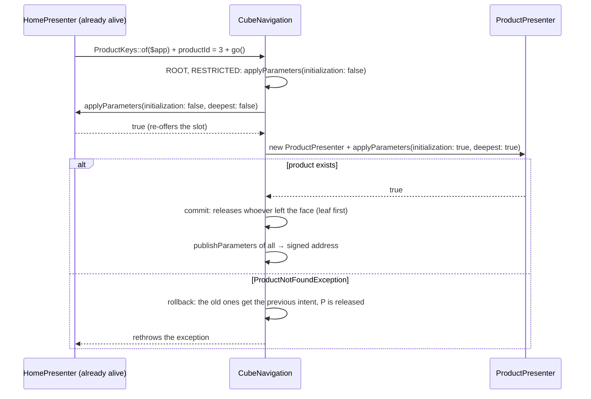
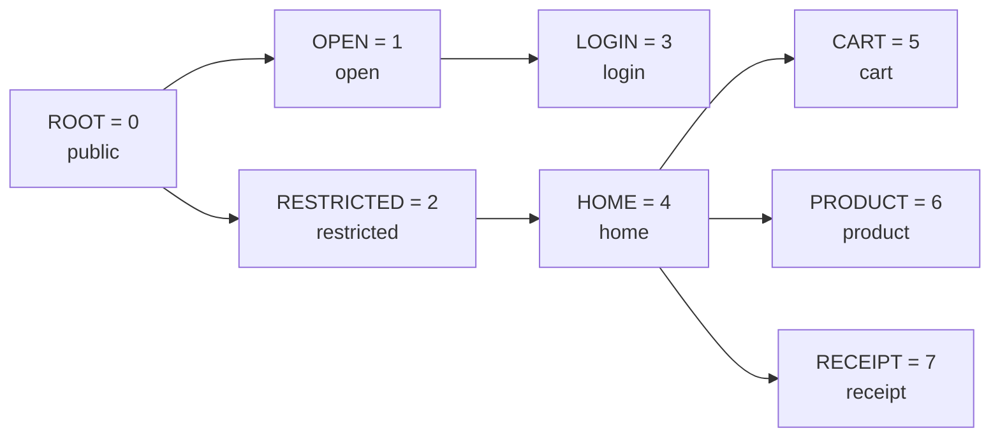
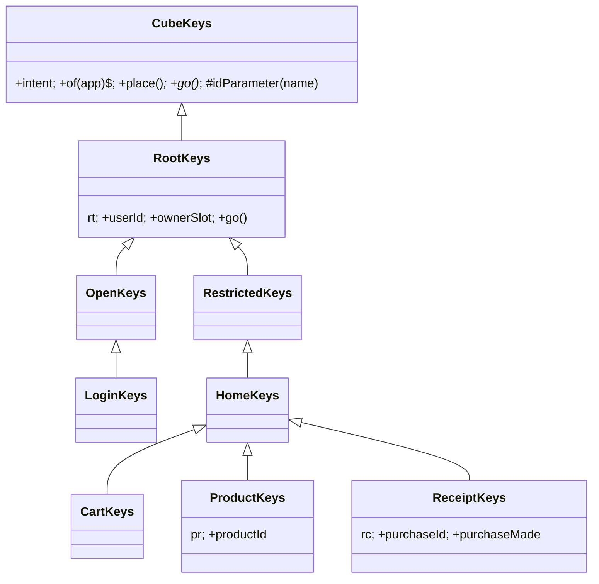
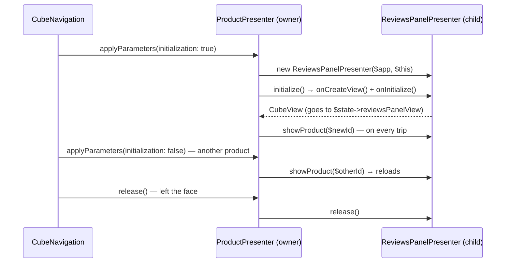

# Building a module in the presentation layer (Cube MVP)

This guide teaches how to build a new module in the presentation layer (`src/Shopping/Presentation`):
the presenter, the state it sends to the screen, the place and the route, the keys that read the
address, child presenters and guards. It is for readers who can already run the project
([setup-local.md](setup-local.md)) and have read the big picture
([../guide-for-php-developers.md](../guide-for-php-developers.md)), but have not written a
presenter from scratch yet.

The **running example** is the **product reviews** panel: inside the product screen, the
customer sees the average, the list of reviews and a form to write their own. The screens and keys
that **already exist** (product, home, guards) serve as examples of the routed presenter; the
reviews panel (which you will build as an exercise) serves as the example of the child presenter.

- The matching React view: [react-views.md](react-views.md).
- The business rules the presenter uses: [application-service.md](application-service.md).
- The repository underneath: [repository.md](repository.md).
- The whole recipe, from database to screen, in the right order: [building-a-feature.md](building-a-feature.md).

---

## Contents

1. [What Cube MVP is](#1-what-cube-mvp-is)
2. [Layer map](#2-layer-map)
3. [The routed presenter - `AbstractCubePresenter`](#3-the-routed-presenter---abstractcubepresenter)
4. [Registering the place and the route](#4-registering-the-place-and-the-route)
5. [Keys: typed reading of the address](#5-keys-typed-reading-of-the-address)
6. [The child presenter - `AbstractChildPresenter`](#6-the-child-presenter---abstractchildpresenter)
7. [Derived state with `commitComputedState()`](#7-derived-state-with-commitcomputedstate)
8. [When a presenter without a view makes sense](#8-when-a-presenter-without-a-view-makes-sense)
9. [Complete example - the reviews panel](#9-complete-example---the-reviews-panel)
10. [Checklist](#10-checklist)

---

## 1. What Cube MVP is

In Cube, presentation logic runs **on the server**. Each user session is a `CubeApplication`
object (here, `ShoppingApplication`) living inside a long-running PHP process (Amp, event loop).
The **presenters** live in it: what each screen shows, what each click does, where to navigate.
The browser runs a thin React shell that only draws the states it receives over WebSocket and
sends back the user's events.

Two kinds of state, each with an owner:

| State | Where it lives | What for |
|---|---|---|
| **Rendering** | the presenter's `ViewState` (`ProductViewState`) | what the screen draws; it is serialized and sent to React |
| **Control** | the presenter's other fields (`$ownerSlot`, `$productId`) | what the presenter needs to know to decide; it never leaves the server |

There is no global store and no "reducer": the state is changed by the presenter that owns it,
and it signals that the screen must be redrawn by calling `$this->update()`.

The "cube" is the set of possible **faces** of the application: each face is a chain of
**places** (root → restricted area → home → product). The address of a face is the name of the
deepest place plus the published parameters, like `#product?rt-user=0&pr-id=3&sign=...`. An
**intent** (`CubeIntent`) is a request to change faces. The full explanation is in
[../architecture.md](../architecture.md); the rules, with the reason behind each one, in
[../../skills/cube-architecture-php/SKILL.md](../../skills/cube-architecture-php/SKILL.md).

---

## 2. Layer map


A screen module lives in its own folder inside `Presenter/`, following the place tree
(`Presenter/Restricted/Products/` for the product): keys, presenter, view state, the presentation
structs (`ProductInfo`) and the screen's service (`ProductService`). The full file list of a
module is in section 9.1.

Four kinds of presenter appear in the project:

| Kind | Has a place? | Draws? | Base | Example |
|---|---|---|---|---|
| **Screen** | yes | yes | `AbstractCubePresenter` | `ProductPresenter`, `CartPresenter` |
| **Slot owner** | yes | yes | `AbstractCubePresenter` | `HomePresenter` (screens open inside it) |
| **Guard** | yes | no | `CubePresenter` directly | `RestrictedPresenter`, `OpenPresenter` |
| **Child (segment)** | **no** | yes, a piece | `AbstractChildPresenter` | `ProductsPanelPresenter`, `ReviewsPanelPresenter` |

---

## 3. The routed presenter - `AbstractCubePresenter`

A routed presenter occupies a place in the active chain. The base (`src/Framework/Cube/AbstractCubePresenter.php`)
holds the view (`protected ?CubeView $view`), provides `update()` and releases the view in
`release()`. You override the four methods of the contract:

| Method | When it runs | Responsibility |
|---|---|---|
| `applyParameters($intent, $initialization, $deepest)` | on every navigation that goes through this place | accept (or refuse) the new face and **recover the state from the intent** |
| `publishParameters($intent)` | after each navigation and on every `updateHistory()` | write the **minimum** identification of the state into the intent (it becomes the address) |
| `commitComputedState()` | right before the dirty view is serialized | recompute derived state (section 7) |
| `release()` | when the presenter leaves the face | let go of children, listeners and timers; call `parent::release()` last |

### 3.1 The navigation cycle

Everything goes through `CubeNavigation` (`$app->navigate()->step(...)->execute($intent)`).
Understanding this cycle explains almost every rule in the rest of the guide:



Practical consequences:

- **Whoever stays on the path survives.** Opening a product inside the home goes through the home
  with `initialization: false`. Create the view, children and listeners once
  (`if ($initialization)`); read parameters and the slot on **every** trip.
- **Passing along the path is not reloading.** Compare what you have with what the intent asks
  for and only query the database when it changed.
- **A failed navigation is an exception in whoever navigated.** The handler that called `go()`
  catches the expected exception and shows the error in its own state; the screen stays where it
  was.
- **Identity is derived.** The address is the sum of what the live presenters publish; whoever
  leaves the face stops publishing.

### 3.2 The `ViewState`: the contract with the React view

```php
// src/Shopping/Presentation/Presenter/Restricted/Products/ProductViewState.php
final class ProductViewState implements ViewState
{
    public ?ProductInfo $product = null;

    public int $errorCode = 0;

    public ?string $errorMessage = null;
}
```

`ViewStateSerializer` (`src/Framework/Cube/Remote/ViewStateSerializer.php`) turns this object
into JSON. Its rules **are** the contract:

- it writes only **public** non-static properties, except those marked with `#[Transient]`;
- non-nullable `bool`, `int` and `float` are always sent, including `0` and `false`;
- `null` and **blank strings are omitted** - the React view needs a default value for every field
  that may be missing;
- a `CubeView` becomes `"<name>Id"`: `$reviewsPanelView` reaches React as `reviewsPanelViewId`;
- nested objects are written with their **public** properties. A domain entity (private fields)
  would arrive as `{}`. That is why the screen uses presentation structs with public fields
  (`ProductInfo`, `ReviewInfo`), built from the entity;
- inside lists and objects the rules change a little: `null` stays `null` (but `null` properties
  of an object are skipped) and strings are **not** filtered;
- dates (`DateTimeInterface`) become ISO-8601 text in UTC; enums become their value.

The first field of every serialized state is `"#"`, the view instance id (`<classId>:<n>`),
which React uses to pick the component.

### 3.3 `applyParameters` - the central method

The real `applyParameters` of the product (before the reviews panel):

```php
// src/Shopping/Presentation/Presenter/Restricted/Products/ProductPresenter.php
public function applyParameters(CubeIntent $intent, bool $initialization, bool $deepest): bool
{
    $keys = new ProductKeys($this->app, $intent);
    $oldId = $this->state->product?->id;
    $newId = $keys->productId ?? throw new ProductNotFoundException();   // missing or invalid

    if ($this->state->product === null || $newId !== $oldId) {
        $this->state->product = $this->productService->loadProductById($newId);
        $this->update();
    }
    if ($initialization) {
        $this->state->errorCode = 0;
        $this->state->errorMessage = null;
        $this->view = (self::$createView ?? throw new LogicException('ProductPresenter::$createView not configured'))($this);
    }
    $this->ownerSlot = $keys->ownerSlot;   // on every trip: the owner above decides the slot
    $this->ownerSlot?->setView($this->view);

    return true;
}
```

Read it in four steps:

1. **Read the intent through the keys** (`new ProductKeys($this->app, $intent)`). The getter has
   already validated: if the address does not carry a usable id, you get `null`, and the
   presenter turns that into a specific exception - the navigation rolls back.
2. **Load only if it changed.** `loadProductById` throws `ProductNotFoundException` for an id
   that no longer exists; again, rollback.
3. **Create the view once**, on initialization, through the `$createView` factory (3.5).
4. **Fit the view into the owner's slot, on every trip** (3.6).

Returning `false` stops the navigation (that is what guards do, section 8).

### 3.4 `publishParameters` and `update()`

```php
public function publishParameters(CubeIntent $intent): void
{
    if ($this->state->product !== null) {
        $keys = new ProductKeys($this->app, $intent);
        $keys->productId = $this->state->product->id;
    }
}
```

Publish the **minimum** that recreates the state - the id, not the product. That is what makes
F5, bookmarks and Back work: the `applyParameters` of the next visit reads that id and rebuilds
everything.

`$this->update()` is **explicit**: nothing observes the state. If you change a `ViewState` field
and don't call `update()`, the screen keeps showing the old value until something else marks the
view dirty. Calling it twice costs nothing: dirty views are collected and sent once at the end of
the request (or by the 50 ms background flush). If the change alters what you **publish** without
navigating (switching pages in a list, for example), also call `$this->app->updateHistory()` so
the address keeps up.

### 3.5 `$createView`: the presenter does not know the concrete view

```php
/** @var (Closure(self): CubeView)|null */
public static ?Closure $createView = null;
```

Whoever hosts the application installs the factory. In production, the remote host binds the
presenter to a `RemoteView`; in tests, to a mock that only holds the state. Install it in **both**
places - a presenter missing from either one throws "`$createView` not configured":

```php
// src/Shopping/RemoteHost/ShoppingRemoteApplication.php - installViewFactories()
ProductPresenter::$createView = static fn (ProductPresenter $p) => new RemoteView(self::of($p->app), $p, $p->state, $p->skeleton());

// tests/Shopping/Presentation/Mock/ShoppingApplicationMock.php - installViewMocks()
ProductPresenter::$createView = static fn (ProductPresenter $p) => new ProductViewMock($p);
```

The mock (`tests/Shopping/Presentation/Mock/ProductViewMock.php`) extends `AbstractViewMock` and
holds the presenter and the **same** state object it changes - PHP objects are shared by handle,
not copied. That is how a test reads what the screen would show.

### 3.6 Slots: where the view appears

The owner above a screen decides where it appears. The owner wraps a setter in a `CubeViewSlot`
and offers it in the intent through the `RootKeys::$ownerSlot` property - the only name reused on
purpose across the whole application: each level fits its view into the slot it received and
re-offers its own slot, under the same name, to the level below. Look at `HomePresenter`:

```php
// src/Shopping/Presentation/Presenter/Restricted/Home/HomePresenter.php (excerpts)
$this->contentSlot = new CubeViewSlot($this->setContentView(...));   // in the constructor

$keys = new HomeKeys($this->app, $intent);                         // in applyParameters
$this->ownerSlot = $keys->ownerSlot;   // on every trip: the owner above decides the slot
if ($this->ownerSlot === null) {
    return false;
}
$this->ownerSlot->setView($this->view);
if ($deepest) {
    $this->setContentView(null);   // the home is the destination: show the panels
} else {
    $keys->ownerSlot = $this->contentSlot;   // re-offer, under the same name, to the level below
}
```

`setContentView` only swaps `$this->state->contentView` and calls `update()` when the value
changed. `HomeViewState::$contentView` goes to React as `contentViewId`, and `HomeView` draws it
with `bridge.createView(state.contentViewId)` ([react-views.md](react-views.md)).

Why read the slot on **every** trip? Because a presenter that survives does not know whether the
decision above changed. Publishing the view into the old slot makes the screen vanish or appear in
the wrong place. Also, in the owner's `release()`, clear the fields that point to child views.

### 3.7 The `Skeleton`: view events

The React view sends numbered events. `skeleton()` maps each number to a method:

```php
// ProductPresenter
public function skeleton(): CubeSkeleton
{
    return new Skeleton('48b693f67410', function (int $event, int $count, array $form): void {
        match ($event) {
            1 => $this->onOpenProducts(),
            2 => $this->onAddToCart(Coerce::asInt($form['p.quantity'] ?? null)),
            default => Skeleton::unknownEvent($event),
        };
    });
}
```

- **The `classId`** (`'48b693f67410'`) is the link to React: the same text goes in
  `BaseViewClass.FC(ProductViewClass, "48b693f67410")`. If the two sides differ, the screen area
  does not draw. For a new module, generate a random 12-hex id:
  `php -r 'echo bin2hex(random_bytes(6)), PHP_EOL;'`.
- **Every code the view sends needs an arm in the `match`.** The `default` calls
  `Skeleton::unknownEvent`, which throws `eventCode(N) not handled`: the session logs it and shows
  the unexpected-error alert. This is on purpose - an event that disappears silently is much
  worse. Prefer named constants (`self::EVENT_SUBMIT_REVIEW`) on both sides.
- **Event arguments arrive as `p.<name>`** in `$form`. They arrive as JSON scalars: convert them
  with `Coerce::asInt` / `Coerce::asString` (from `Wdc\Framework\Commons\Lang\Coerce`, which return
  `null` when the value is not usable) and validate in the method.
- **Fields without the `p.` prefix** are state synchronization: they go to the **third** argument
  of `Skeleton`, the `syncState(array $form)` closure, which runs before the event. If the
  skeleton has no `syncState`, those fields are **silently discarded**. No Shopping presenter uses
  `syncState` today; the standard is to send everything as a `p.` argument on the event.
- `$count` is the number of repeated events that arrived together in the same request.

Why a closure and not an anonymous class? A closure created inside the presenter can see its
private methods; an anonymous class cannot.

### 3.8 Event handlers: always guarded

Every `onX` method called by the skeleton wraps its body in a `try`. An **expected** failure
(record not found, invalid input) becomes `errorCode` + `errorMessage` in the presenter's own
state; the **unexpected** goes to `$this->app->alertUnexpectedError(...)`, which shows the global
alert and logs the exception. `HomePresenter::onOpenProduct` (section 5.4) catches
`ProductNotFoundException` and shows error 3 in the home itself; `ReviewsPanelPresenter::onSubmitReview`
(section 9.4) does the same with `InvalidReviewException`. The methods are `public` because tests
call them directly, simulating the click.

---

## 4. Registering the place and the route

A new screen (with its own address) needs three things: a case in the `Place` enum, a method in
`Routes` and a keys class (section 5). The current tree, from the `Place.php` docblock:



### 4.1 The case in the `Place` enum

In `src/Shopping/Presentation/Place.php`, the product shows up in four spots:

```php
case PRODUCT = 6;                                   // the case, in the level-3 block
self::PRODUCT => 'product',                         // in name(): the name in the address
self::PRODUCT => new ProductPresenter($app),        // in createPresenter()
self::PRODUCT => Routes::product($app, $intent),    // in go(): the route
```

- **The id grows with depth.** The engine releases presenters from leaf to root using this order.
  A new place at level 3 would be `= 8`.
- **`name()` is the name in the address.** Don't confuse it with the built-in `->name` property
  of every PHP enum, which returns the case name (`'PRODUCT'`).
- A `match` over an enum with no arm for a case throws `UnhandledMatchError` - and PHPStan flags
  it earlier. Forgetting one of the three `match` expressions does not go unnoticed.
- The route lives in the `go()` method because a PHP enum has no state to store it in.

### 4.2 The method in `Routes`

```php
// src/Shopping/Presentation/Routes.php
public static function product(ShoppingApplication $app, CubeIntent $intent): bool
{
    return $app->navigate()->step(Place::ROOT)->step(Place::RESTRICTED)->step(Place::HOME)->step(Place::PRODUCT)
        ->execute($intent);
}
```

The `step` chain **is** the face. Notice two details: the `RESTRICTED` guard is on the path (it
is what protects the screen, section 8), and `product` requires the intent - it makes no sense to
open a product "from the current state" without saying which one. Routes without a required
parameter accept `?CubeIntent $intent = null` and use `$intent ?? $app->newIntent()`, like
`Routes::cart`.

You rarely call `Routes` directly: navigation goes through the destination's keys
(`ProductKeys::of($app)->go()` → `Place::go` → `Routes::product`).

---

## 5. Keys: typed reading of the address

No presenter writes `$intent->getParameter('pr-id')`. Parameter and attribute names live in
**keys classes**, one per place, and only there.

### 5.1 Why names must be unique

A navigation passes the **same** intent through every `applyParameters`, from root to leaf. If
two presenters used the name `id`, one would overwrite the other's value midway, with no error.
That is why each keys file declares a two-letter `PREFIX`, unique in the application, and all its
names start with it.

### 5.2 The keys tree mirrors the place tree



`CubeKeys` (framework) provides the constructor, `of()` and the `idParameter()` helper. `RootKeys`
implements `go()` and declares what every screen uses: `$userId` and the `$ownerSlot` slot. Each
place extends the keys of the one above it - so a deeper place can **read** what an ancestor
publishes (`ProductPresenter` reads `$keys->ownerSlot`, which belongs to `RootKeys`). A name is
declared once, in the **owner's** keys.

Every place has its keys, including guards and screens without parameters. A keys class with no
names only declares `place()`:

```php
/** Cart keys: `cart`. */
final class CartKeys extends HomeKeys
{
    public function place(): CubePlace
    {
        return Place::CART;
    }
}
```

### 5.3 Anatomy of a keys class

```php
// src/Shopping/Presentation/Presenter/Restricted/Receipt/ReceiptKeys.php
/** Receipt keys: `receipt?rc-id=7`. */
final class ReceiptKeys extends HomeKeys
{
    /** Prefix of the names in this file - unique in the application. */
    private const string PREFIX = 'rc';

    /** Parameter: the receipt's purchase. */
    private const string P_ID = self::PREFIX . '-id';

    /** Attribute: "the purchase was just made" - the receipt shows the success notice. */
    private const string A_MADE = self::PREFIX . '-made';

    /** The purchase: a non-negative integer, or null if the address does not carry a usable one. */
    public ?int $purchaseId {
        get => $this->idParameter(self::P_ID);
        set (?int $value) {
            $this->intent->setParameter(self::P_ID, $value);
        }
    }

    /** Whether the navigation comes from a just-completed purchase (not part of the address). */
    public bool $purchaseMade {
        get => $this->intent->getAttribute(self::A_MADE) === true;
        set (bool $value) {
            $this->intent->setAttribute(self::A_MADE, $value);
        }
    }

    public function place(): CubePlace
    {
        return Place::RECEIPT;
    }
}
```

| Constant prefix | It is a... | Goes into the address? | What for |
|---|---|---|---|
| `P_` | parameter | yes | addressable state: ids, filters, page |
| `A_` | attribute | no | data already at hand, flags ("the purchase was just made") |

The properties use **property hooks** (PHP 8.4): `get` and `set` run code on every read and
write, like a getter/setter, but with property syntax. Two rules for the hooks:

- **Validate on read.** The address is outside input - even signed, an old link may carry a
  record that no longer exists. The getter returns a usable value or `null` (ids:
  `idParameter()`, which only accepts a non-negative integer; choices: an allow-list).
- **Omit the default on write.** `setParameter($name, null)` removes the parameter from the
  address.

### 5.4 Using the keys

```php
// 1) inside applyParameters / publishParameters: the intent of the ongoing navigation
$keys = new ProductKeys($this->app, $intent);

// 2) in an event handler: a trip that starts from the current STATE
$product = ProductKeys::of($this->app);   // newIntent(): every live presenter publishes
$product->productId = $productId;
$product->go();

// 3) in a redirect inside applyParameters: pass the intent IN TRANSIT
(new OpenKeys($this->app, $intent))->go();
```

Case 3 matters: redirecting with `OpenKeys::of(...)` would lose what the address just brought
(for example, the product the user wanted to see before logging in).

> **PHP pitfall:** writing to a hook of a temporary object is a fatal error.
> `(new ProductKeys($this->app, $intent))->productId = 3` gives "Cannot use temporary expression in
> write context". Assign it to a variable first, as in the examples above. Reading and calling
> methods (`(new OpenKeys(...))->go()`) is fine.

### 5.5 `KeysNamesTest`: the rule, verified

`tests/Shopping/Presentation/KeysNamesTest.php` scans `src/Shopping/**/*Keys.php` and fails if:

- a name does not follow the `self::PREFIX . '-code'` format in a `P_`/`A_` constant;
- a file that declares names has no two-letter `PREFIX`, or repeats a local code;
- two files use the same prefix;
- a place does not have **exactly one** keys class;
- some code outside the keys accesses the intent by name (`$intent->getParameter('...')`).

When you create a place, run `composer check`: the test tells you if the keys class is missing.

---

## 6. The child presenter - `AbstractChildPresenter`

The cube controls the places. But, inside a screen's view, a **segment** can have its own
presenter: the home's showcase and purchase history, the product's reviews panel. A child:

- **has no place**, does not appear in `Place` or `Routes`, has no keys and publishes nothing;
- is **created, held and released by its owner**;
- has a view, `ViewState`, `skeleton()` and `$createView` like a screen;
- **delegates navigation to its owner** (`$this->owner->onOpenProduct($id)`).

Switching a panel does not switch the face. If a segment's state must survive F5 (the open tab,
the page), it is an **owner parameter**: the owner reads it in `applyParameters`, passes it to
the child and publishes it.

### 6.1 The contract

The base (`src/Framework/Cube/AbstractChildPresenter.php`) asks for two protected methods -
`onCreateView(): CubeView` (creates the view through the `$createView` factory) and
`onInitialize(): void` (the initial load) - and provides `final public function initialize(): CubeView`,
which calls both in that order and **returns the view** for the owner to keep in its own state.
Plus `update()`, `release()` and an empty `commitComputedState()`, as in a screen. There is no
`applyParameters`: the child does not take part in navigation; the owner tells it what to show.

### 6.2 The life cycle, the owner's responsibility



The owner, in three spots:

```php
// 1) on initialization: create ONCE and keep the child's view in the owner's own state
$this->reviewsPanel = new ReviewsPanelPresenter($this->app, $this);
$this->state->reviewsPanelView = $this->reviewsPanel->initialize();

// 2) on every trip: tell the child what to show (the child compares and only reloads if it changed)
$this->reviewsPanel?->showProduct($newId);

// 3) in release(): clear the field, release the child, and only then the parent
public function release(): void
{
    $this->state->reviewsPanelView = null;
    $this->reviewsPanel?->release();
    $this->reviewsPanel = null;
    parent::release();
}
```

The `?CubeView $reviewsPanelView` field in `ProductViewState` goes to React as
`reviewsPanelViewId`, and `ProductView` draws the child with `bridge.createView(...)`.

### 6.3 Navigation: always through the owner

The child does not call `XxxKeys::of(...)->go()` on its own. The home showcase, for example,
forwards the click:

```php
// src/Shopping/Presentation/Presenter/Restricted/Home/Products/ProductsPanelPresenter.php
public function onOpenProduct(?int $productId): void
{
    $this->owner->onOpenProduct($productId);
}
```

That way error handling (`ProductNotFoundException` → error 3 in the home) stays in one place,
the owner, which is the one on the face and knows what to do. The owner arrives through the
constructor: `public readonly HomePresenter $owner` - the concrete type, so the child can call its
methods.

---

## 7. Derived state with `commitComputedState()`

`commitComputedState()` runs **right before a dirty view is serialized**, inside the session
lock. It is for values that derive from something else and that you don't want to recompute at
every spot that changes it. The real example is the cart count in the home:

```php
// HomePresenter
/** Derived state, recomputed right before the view is sent to the client. */
public function commitComputedState(): void
{
    $count = $this->cart?->itemCount() ?? 0;
    if ($this->state->cartItemCount !== $count) {
        $this->state->cartItemCount = $count;
        $this->update();
    }
}
```

**Compare before updating.** `update()` marks the view dirty; if `commitComputedState` always
called `update()`, the view would stay dirty forever and be resent on every flush.

When **not** to use it: if the value derives from something that only changes at a known spot,
compute it there. The reviews panel computes the average and count inside `loadReviews()`, right
after loading the list, because the list only changes in that method; in `commitComputedState`
the computation would run on every send of the view, needlessly.

Two engine details:

- In the remote host, `commitComputedState` is called for the presenter of **each dirty view** -
  children included. A clean view does not go through it; that is why the home also updates the
  count directly in the cart change listener (`onCartChanged`).
- In tests with mocks there is no serialization, so nobody calls it on its own. If your test
  depends on derived state, call `$this->app->commitComputedState()` (walks the place presenters)
  or the presenter's method directly.

---

## 8. When a presenter without a view makes sense

A **guard** occupies a place, draws nothing and decides whether the navigation goes on. It
implements `CubePresenter` directly, without the base:

```php
// src/Shopping/Presentation/Presenter/Restricted/RestrictedPresenter.php
/** Guard of the restricted area (no view). With no logged-in user, goes back to the public area. */
final class RestrictedPresenter implements CubePresenter
{
    public function __construct(public readonly ShoppingApplication $app)
    {
    }

    public function applyParameters(CubeIntent $intent, bool $initialization, bool $deepest): bool
    {
        if ($this->app->subject() === null) {
            (new OpenKeys($this->app, $intent))->go();

            return false;
        }
        if ($deepest) {   // it is only a guard: the default screen of the restricted area is the home
            (new HomeKeys($this->app, $intent))->go();

            return false;
        }

        return true;
    }

    // publishParameters(), commitComputedState() and release(): empty - the guard has no state
}
```

- **Redirect = navigate and return `false`.** The inner `go()` starts a new navigation; the outer
  one is marked as interrupted (neither commit nor rollback). A redirect loop is detected and
  abandoned, and the session stays usable.
- **The intent in transit goes along** (`new OpenKeys($this->app, $intent)`), so nothing the
  address brought is lost.
- **`$deepest` in the guard:** a branch by itself is not a screen. Whoever asks for `#restricted`
  goes to the home.
- `OpenPresenter` is the mirror image: whoever is already logged in is sent to the restricted
  area; whoever asks for `#open` goes to the login.

Everything **outside** the guarded branch is public by construction. To protect a new screen,
just put it under `Place::RESTRICTED` in the route.

---

## 9. Complete example - the reviews panel

The exercise: on the product screen, a panel that shows the reviews (newest first), the average
("4.5 out of 5"), the count and a form (rating from 1 to 5, optional comment of up to 500
characters). None of this goes into the address - the product shown is decided by the owner.

### 9.1 Files

```text
src/Shopping/Presentation/
  Exception/InvalidReviewException.php                       expected validation failure
  Presenter/Restricted/Products/
    ProductPresenter.php                                      owner: creates, feeds and releases the child
    ProductViewState.php                                      + ?CubeView $reviewsPanelView
    Reviews/
      ReviewInfo.php                                          the review as the panel shows it + projection
      ReviewService.php                                       listForProduct(), add() with validation
      ReviewsPanelViewState.php                               the panel state
      ReviewsPanelPresenter.php                               the child
src/Shopping/RemoteHost/ShoppingRemoteApplication.php         + $createView → RemoteView
tests/Shopping/Presentation/
  Mock/ReviewsPanelViewMock.php                               the view mock
  Mock/ShoppingApplicationMock.php                            + $createView → mock
  ProductReviewsTest.php                                      the behavior, no browser
frontend/shopping.shell.react/src/scripts/views/product/
  ReviewsPanel.tsx, reviews-sel.ts, reviews.scss              the view (react-views.md)
```

The `Review` entity, the criteria and the repository are the subject of
[repository.md](repository.md); `ReviewService`, of [application-service.md](application-service.md).
The service finds the repository in `Beans`, by interface (`Beans::of(ReviewRepository::class)`);
the presenter just does `new ReviewService()`.

### 9.2 The state and the presentation struct

```php
final class ReviewsPanelViewState implements ViewState
{
    /** @var list<ReviewInfo> newest first */
    public array $reviews = [];
    public int $count = 0;
    /** "4.5 out of 5"; empty (omitted when sent) when there are no reviews */
    public string $averageLabel = '';
    /** 0 = no error */
    public int $errorCode = 0;
    public ?string $errorMessage = null;
}
```

`ReviewInfo` is the review as the panel shows it: public fields `$id`, `$author` (the reviewer's
name), `$rating`, `$comment` and `$createdAt` (milliseconds since 1970, so the browser formats it
in the reader's time zone), plus `projection()` and `create(Review $review)`. The `Review` entity,
with private fields, would reach React as `{}`.

What the serializer does with it: an empty `averageLabel` is not sent; `count` and `errorCode`
are always sent; the list goes with the public fields of each `ReviewInfo`. Inside the list,
strings are not filtered: an empty `comment` goes as `""`.

### 9.3 The owner: `ProductPresenter`

The owner gets the field `private ?ReviewsPanelPresenter $reviewsPanel = null;`, the field
`public ?CubeView $reviewsPanelView = null;` in `ProductViewState`, and the three spots from
section 6.2: create the child inside the `if ($initialization)` of the `applyParameters` from
section 3.3 (followed by `$this->update()`), call `$this->reviewsPanel?->showProduct($newId)`
**outside** the `if`, before fitting the view into the slot, and release the child in `release()`.

`showProduct()` runs inside `applyParameters`: if the reviews query fails, the exception bubbles
up to the navigation and it rolls back, just like with the product itself.

### 9.4 The child: `ReviewsPanelPresenter`

```php
/** @extends AbstractChildPresenter<ShoppingApplication> */
final class ReviewsPanelPresenter extends AbstractChildPresenter
{
    private const int EVENT_SUBMIT_REVIEW = 1;
    private const int ERROR_INVALID_REVIEW = 1;
    private const int MAX_REVIEWS = 50;

    /** @var (Closure(self): CubeView)|null installed by the remote host and by the tests (mock) */
    public static ?Closure $createView = null;

    public readonly ReviewsPanelViewState $state;
    private readonly ReviewService $service;

    /** control state: the product whose reviews are loaded (null = none yet) */
    private ?int $productId = null;

    public function __construct(ShoppingApplication $app, public readonly ProductPresenter $owner)
    {
        parent::__construct($app);
        $this->state = new ReviewsPanelViewState();
        $this->service = new ReviewService();
    }

    /** Called by the owner on every applyParameters. Passing along the path is not reloading. */
    public function showProduct(int $productId): void
    {
        if ($this->productId === $productId) {
            return;
        }
        $this->loadReviews($productId);
        $this->productId = $productId;   // only after loading: if it fails, the panel stays as it was
        $this->clearError();             // the error belonged to the previous product's form
    }

    public function onSubmitReview(?int $rating, ?string $comment): void
    {
        try {
            $subject = $this->app->subject() ?? throw new LogicException('No logged-in user');
            $productId = $this->productId ?? throw new LogicException('No product loaded');
            $this->service->add($subject, $productId, $rating, $comment);
            $this->clearError();
            $this->loadReviews($productId);   // the new review goes to the top
        } catch (InvalidReviewException $caught) {
            // expected: goes to the panel state; the list stays as it was
            $this->state->errorCode = self::ERROR_INVALID_REVIEW;
            $this->state->errorMessage = $caught->getMessage();
            $this->update();
        } catch (Throwable $caught) {
            $this->app->alertUnexpectedError('Submitting a review', $caught);
        }
    }

    public function skeleton(): CubeSkeleton
    {
        return new Skeleton('8cc32236e32a', function (int $event, int $count, array $form): void {
            match ($event) {
                self::EVENT_SUBMIT_REVIEW => $this->onSubmitReview(
                    Coerce::asInt($form['p.rating'] ?? null),
                    Coerce::asString($form['p.comment'] ?? null),
                ),
                default => Skeleton::unknownEvent($event),
            };
        });
    }

    protected function onCreateView(): CubeView
    {
        return (self::$createView ?? throw new LogicException('ReviewsPanelPresenter::$createView not configured'))($this);
    }

    /** Only draws (empty): loading waits for the owner to say which product it is. */
    protected function onInitialize(): void
    {
        $this->update();
    }

    private function loadReviews(int $productId): void
    {
        $reviews = $this->service->listForProduct($productId, self::MAX_REVIEWS);
        $this->state->reviews = $reviews;
        $this->state->count = count($reviews);
        $this->state->averageLabel = $reviews === []
            ? ''
            : number_format(array_sum(array_map(static fn (ReviewInfo $r) => $r->rating, $reviews)) / count($reviews), 1) . ' out of 5';
        $this->update();
    }

    // clearError(): resets errorCode/errorMessage and calls update() only if there was an error
}
```

Points to notice:

- **The author never comes from the view.** `onSubmitReview` uses `$this->app->subject()`; the
  view sends only the rating and the comment.
- **Validation belongs to the server**: `ReviewService::add` throws `InvalidReviewException`
  (rating outside 1..5, comment longer than 500 characters). The view can help, but it does not
  decide.
- **An expected failure is not an alert**: it becomes the panel's `errorCode`/`errorMessage`.
- `$productId` is **control state**: the screen does not need it, so it is not in the `ViewState`.

### 9.5 Wiring the view

```php
// ShoppingRemoteApplication::installViewFactories()
ReviewsPanelPresenter::$createView = static fn (ReviewsPanelPresenter $p) => new RemoteView(self::of($p->app), $p, $p->state, $p->skeleton());

// ShoppingApplicationMock::installViewMocks()
ReviewsPanelPresenter::$createView = static fn (ReviewsPanelPresenter $p) => new ReviewsPanelViewMock($p);
```

`ReviewsPanelViewMock` is the same as the `ProductViewMock` from section 3.5, with the types
swapped. The React side (`ReviewsPanel.tsx`, with the same `classId`) is in
[react-views.md](react-views.md).

### 9.6 The test, no browser

`PresentationTestCase` provides a test database re-seeded per test, real authentication, a
`ManualScheduler` and the application with mocks; `login()` returns the home mock. The test calls
the methods the skeleton would call and checks the mocks' state:

```php
// tests/Shopping/Presentation/ProductReviewsTest.php (excerpts)
private function openCoffeeMaker(): ReviewsPanelViewMock
{
    $home = $this->login('john', 'john');
    $home->presenter->onOpenProduct(Seed::COFFEE_MAKER_ID);
    $product = ProductViewMock::cast($home->state->contentView);

    return ReviewsPanelViewMock::cast($product->state->reviewsPanelView);
}

#[Test]
public function invalidRating_setsTheError_andKeepsTheList(): void
{
    $panel = $this->openCoffeeMaker();
    $before = self::ids($panel->state->reviews);

    $panel->presenter->onSubmitReview(9, 'Rating off the scale');

    self::assertSame(1, $panel->state->errorCode);
    self::assertSame($before, self::ids($panel->state->reviews));
    self::assertNull($this->app->rootView()->state->errorMessage, 'an expected failure does not become an alert');
}
```

The other tests in the file cover the happy path, the product with no reviews, passing through
the same product **with no query at all** (`onQuery(...)` on the `Database` returned by
`TestDatabase::open()` counts the statements) and releasing the panel when leaving the product
(`$panel->released`). `::cast($view)` checks the mock's type with a helpful message ("Expected X,
got null") and returns it already typed.

> **PHPStan pitfall (level 8):** after `self::assertSame(1, $panel->state->errorCode)`, PHPStan
> "remembers" that the value is `1`, even after you call a method on **another** object
> (`$panel->presenter->onSubmitReview(...)`) that changes it. Repeating `assertSame(1, ...)` on the
> same property is flagged as `alreadyNarrowedType`. Assert something that **differs** between
> steps - in `missingRating_orLongComment_areRejected`, the error message of each submission.

Run `composer check` (PHPStan + PHPUnit) and, to see it in the browser, `bin/build-frontend.sh`
and the server ([setup-local.md](setup-local.md)).

---

## 10. Checklist

**New screen (with a place)**

- [ ] Case in `Place` with an id that grows with depth, in all three `match` expressions
      (`name()`, `createPresenter()`, `go()`).
- [ ] Method in `Routes` with the full `step` chain, going through the right guard.
- [ ] `XxxKeys` extending the keys of the place above, with `place()`. If it declares names: a new
      two-letter `PREFIX`, `P_`/`A_` constants, hooks that validate on `get` and omit the default
      on `set`.
- [ ] `XxxViewState` with public properties; no domain entity inside - use a struct with public
      fields.
- [ ] Presenter: `applyParameters` reads through the keys, only reloads if something changed,
      creates the view on `$initialization`, reads and fills the slot on **every** trip.
- [ ] `publishParameters` writes the minimum that recreates the state.
- [ ] `update()` after every change to the `ViewState`; `updateHistory()` if what is published
      changed without navigating.

**Child (no place)**

- [ ] Extends `AbstractChildPresenter`, receives the owner in the constructor, implements
      `onCreateView()` and `onInitialize()`.
- [ ] The owner creates it once, keeps the view in a `?CubeView` field of its own state and, in
      `release()`, clears the field and releases the child before `parent::release()`.
- [ ] Navigation delegated to the owner.

**In every presenter with a view**

- [ ] `skeleton()` with a new `classId` (`php -r 'echo bin2hex(random_bytes(6)), PHP_EOL;'`), the
      same as in `BaseViewClass.FC` in React.
- [ ] One `match` arm for each code the view sends; `default => Skeleton::unknownEvent($event)`.
- [ ] Arguments as `p.<name>`, converted with `Coerce` and validated in the method.
- [ ] Handlers with `try`: expected failure → error in the presenter's own state; unexpected →
      `alertUnexpectedError`.
- [ ] `$createView` in `ShoppingRemoteApplication::installViewFactories()` **and** in
      `ShoppingApplicationMock::installViewMocks()`, plus the `XxxViewMock`.
- [ ] Derived state in `commitComputedState()`, comparing before `update()` - or computed at the
      single spot where its source changes.
- [ ] Timers and listeners: keep the `Registration` and call `remove()` in `release()`.
- [ ] Test in `tests/Shopping/Presentation` extending `PresentationTestCase`.
- [ ] `composer check` green (includes `KeysNamesTest`).
- [ ] The React view: [react-views.md](react-views.md).
