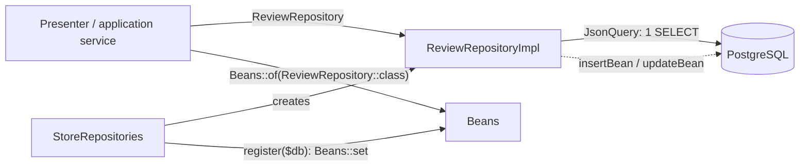

# Creating a repository

This guide shows, step by step, how to add a new entity to the data layer: from the domain bean
to the test that proves the screen reads everything in a single query. The example running
through the guide is a **product reviews** feature (`Review`): each user gives a product a
rating from 1 to 5, with an optional comment.

> Related guides: [building-a-feature.md](building-a-feature.md) (the full roadmap for a
> feature), [json-query.md](json-query.md) (how reading works inside),
> [application-service.md](application-service.md), [transaction-service.md](transaction-service.md),
> [setup-local.md](setup-local.md) (test database), [../architecture.md](../architecture.md) and the
> short reference in [persistence.md](../../skills/cube-architecture-php/references/persistence.md).

## Contents

1. [Why so many pieces?](#why-so-many-pieces)
2. [Step 1 — The entity](#step-1--the-entity)
3. [Step 2 — The criteria and the ordering enum](#step-2--the-criteria-and-the-ordering-enum)
4. [Step 3 — The repository interface](#step-3--the-repository-interface)
5. [Step 4 — Schema and seed (`StoreSchema`)](#step-4--schema-and-seed-storeschema)
6. [Step 5 — The implementation (`AbstractRepository` + `JsonQuery`)](#step-5--the-implementation-abstractrepository--jsonquery)
7. [Step 6 — Permissions](#step-6--permissions)
8. [Step 7 — Wiring it all (composition root)](#step-7--wiring-it-all-composition-root)
9. [Using the repository in an application service](#using-the-repository-in-an-application-service)
10. [Step 8 — Tests (`RepositoryTestCase`)](#step-8--tests-repositorytestcase)
11. [Pitfalls](#pitfalls)
12. [Checklist](#checklist)

---

## Why so many pieces?

A new entity touches several files, but each one has a single responsibility:

```text
src/Store/Domain/Review/                     ← contract: entity, criteria, OrderBy, interface
src/Store/Persistence/StoreSchema.php     ← DDL and seed (there is no migration tool)
src/Store/Persistence/Repository/            ← SQL implementation (JsonQuery + Table)
src/Store/Persistence/StoreRepositories   ← assembly: creates the repositories and registers them in Beans
tests/Store/Persistence/                     ← tests against a real PostgreSQL
```



The domain (`Wdc\Store\Domain`) knows nothing about SQL: whoever uses the repository only
knows the `ReviewRepository` interface. The implementation knows nothing about the session. That's
why each part is testable on its own — and why the list of files is long.

---

## Step 1 — The entity

`src/Store/Domain/Review/Review.php`. It is a plain class, with **every field nullable** and a
fluent API: `field()` reads, `withField()` writes and returns `$this`.

```php
final class Review
{
    private ?int $id = null;
    private ?Product $product = null;
    private ?User $user = null;
    private ?int $rating = null;
    private ?string $comment = null;
    private ?DateTimeImmutable $createdAt = null;

    public function id(): ?int { return $this->id; }

    public function withId(?int $id): static
    {
        $this->id = $id;

        return $this;
    }

    // product()/withProduct(), user()/withUser(), rating(), comment(), createdAt()...

    /** The PRODUCTID FK value: the product only needs its id. */
    public function productId(): ?int
    {
        return $this->product?->id();
    }

    /** The USERID FK value: the user only needs its id. */
    public function userId(): ?int
    {
        return $this->user?->id();
    }
}
```

Why is everything nullable? Because the same bean serves as a **projection** (a mask): a non-null
field = a field to fetch. In a bean read from the database, `null` means "not loaded/not
projected". See [json-query.md](json-query.md).

Decisions in the example:

- **Relations are entities**, not loose ids: `product(): ?Product`, `user(): ?User`. To store
  only the reference, `new Product()->withId(3)` is enough.
- **FK shortcuts** (`productId()`, `userId()`) read the relation's id. The implementation uses them
  to write the `PRODUCTID` and `USERID` columns.
- Dates are `DateTimeImmutable` (`ColumnType::DateTime` always returns them in UTC).
- Seed ids start at 0: never test an id with `!$id`; use `=== null`.

---

## Step 2 — The criteria and the ordering enum

`ReviewCriteria` implements `Wdc\Framework\Domain\Criteria\Criteria`: one `Criterion` per
filterable field, **created in the constructor and never null**, plus the projection and the
ordering.

```php
final class ReviewCriteria implements Criteria
{
    private ?Review $projection = null;

    private ?ReviewOrderBy $orderBy = null;

    /** @var ComparableCriterion<self, int> */
    private readonly ComparableCriterion $reviewId;
    /** @var ComparableCriterion<self, int> */
    private readonly ComparableCriterion $productId;
    /** @var ComparableCriterion<self, int> */
    private readonly ComparableCriterion $userId;
    /** @var ComparableCriterion<self, int> */
    private readonly ComparableCriterion $rating;

    public function __construct()
    {
        // a property's initial value must be constant: objects that depend on $this are created here
        $this->reviewId = new ComparableCriterion($this, 'reviewId');
        $this->productId = new ComparableCriterion($this, 'productId');
        $this->userId = new ComparableCriterion($this, 'userId');
        $this->rating = new ComparableCriterion($this, 'rating');
    }

    // projection()/withProjection(?Review) and orderBy()/withOrderBy(?ReviewOrderBy): plain getters/setters

    /** @return ComparableCriterion<self, int> */
    public function productId(): ComparableCriterion { return $this->productId; }

    public function hasProductId(): bool { return $this->productId->isSet(); }

    /** Shortcut for productId()->eq($value). */
    public function withProductId(?int $value): static
    {
        return $value === null ? $this : $this->productId->eq($value);
    }

    // the same trio (xxx(), hasXxx(), withXxx()) for reviewId, userId and rating

    public function criterions(): array
    {
        return [$this->reviewId, $this->productId, $this->userId, $this->rating];
    }
}
```

Which `Criterion` type to use:

| Field                        | Class                 | Extra operations                              |
|------------------------------|-----------------------|-----------------------------------------------|
| any (equality, `in`)         | `Criterion`           | `eq ne in isNull isNotNull`                   |
| number, date                 | `ComparableCriterion` | `gt ge lt le between`                         |
| text                         | `TextCriterion`       | `like ilike containing startingWith`          |

The ordering enum lives next to the criteria (`src/Store/Domain/Review/ReviewOrderBy.php`) and
lists only the orderings some screen uses:

```php
/** Provisioned Review orderings. */
enum ReviewOrderBy
{
    case NEWEST_FIRST;
    case OLDEST_FIRST;
    case BEST_RATED_FIRST;
}
```

The enum is neutral — it contains no SQL. The implementation decides which columns each case
orders by (Step 5).

---

## Step 3 — The repository interface

```php
/**
 * @extends Repository<Review, ReviewCriteria>
 */
interface ReviewRepository extends Repository
{
}
```

The generic `Repository<E, C>` (`src/Framework/Domain/Repository/Repository.php`) already brings
`insert`, `update`, `insertOrUpdate`, `delete`, `count`, `fetch`, `fetchPage`, `fetchById` and
`newProjection`. The specific interface exists to (a) provide a type the presenters can ask for
and (b) hold its own operations when there are any — like `ProductRepository::fetchImage`. The
`@extends` is what lets PHPStan know that `fetch()` returns `list<Review>`.

---

## Step 4 — Schema and seed (`StoreSchema`)

**There is no migration tool.** The whole schema lives in constants in
`src/Store/Persistence/StoreSchema.php`:

| Method     | What it does                                                                        |
|------------|-------------------------------------------------------------------------------------|
| `create()` | creates tables and sequences if `EN_USER` doesn't exist, then calls `reset()`       |
| `drop()`   | removes tables and sequences (used by the tests at the start of the run)            |
| `reset()`  | deletes every row and writes the demo seed                                          |

The server calls `create()` at startup; the tests call `drop()` + `create()` once and `reset()`
before each test (see `tests/Support/TestDatabase.php`).

### 4a. The DDL

The new table goes in a separate constant, so it can be applied on its own:

```php
private const string REVIEW_DDL = <<<'SQL'
    CREATE TABLE EN_REVIEW (
        ID BIGINT NOT NULL PRIMARY KEY,
        PRODUCTID BIGINT NOT NULL REFERENCES EN_PRODUCT (ID),
        USERID BIGINT NOT NULL REFERENCES EN_USER (ID),
        RATING INT NOT NULL,
        REVIEWCOMMENT TEXT,
        CREATEDAT TIMESTAMP NOT NULL
    );
    CREATE SEQUENCE SQ_REVIEW START WITH 1 INCREMENT BY 1;
    CREATE INDEX IX_REVIEW_PRODUCT ON EN_REVIEW (PRODUCTID);
    SQL;
```

Conventions: table `EN_<ENTITY>`, sequence `SQ_<ENTITY>`, key `ID BIGINT`, FKs `<ENTITY>ID`,
dates `TIMESTAMP` (no time zone; stored in UTC). Identifiers are **unquoted**: PostgreSQL folds
them to lowercase, and all the SQL code writes them in uppercase without quotes — both sides
meet. Note `REVIEWCOMMENT`: the bean field is called `comment`, but the column doesn't need the
same name (the mapping is done in Step 5).

### 4b. `DROP` and `reset()` respect the FKs

The table that points to the others goes **first**:

```php
/** EN_REVIEW first: it points to EN_PRODUCT and EN_USER. */
private const string DROP = 'DROP TABLE IF EXISTS EN_REVIEW, EN_PURCHASEITEM, EN_PURCHASE, EN_PRODUCT, EN_USER;'
    . ' DROP SEQUENCE IF EXISTS SQ_USER, SQ_PRODUCT, SQ_PURCHASE, SQ_PURCHASEITEM, SQ_REVIEW;';
```

```php
public static function reset(Database $db): void
{
    // EN_REVIEW before EN_PRODUCT and EN_USER, because of the FKs
    $db->exec('DELETE FROM EN_REVIEW; DELETE FROM EN_PURCHASEITEM; DELETE FROM EN_PURCHASE; DELETE FROM EN_PRODUCT; DELETE FROM EN_USER;');
    // ... users, products, purchases ...

    $db->execute('INSERT INTO EN_REVIEW (ID, PRODUCTID, USERID, RATING, REVIEWCOMMENT, CREATEDAT) VALUES '
        . "(0, 0, 0, 5, 'Excellent! Makes great coffee and is easy to clean.', '2024-03-10 12:00:00'), "
        . "(1, 0, 1, 4, 'Good coffee maker, but the carafe gets quite hot.', '2024-05-02 18:45:00')");
    $db->restartSequence('SQ_REVIEW', 2);
}
```

The seed writes explicit ids and then restarts the sequence at the next free id — otherwise the
first `insert()` would collide with the seed. The ids become public constants, used by the tests:

```php
// coffee maker reviews: average 4.5; john's is the most recent
public const int ADMIN_COFFEE_MAKER_REVIEW_ID = 0;
public const int JOHN_COFFEE_MAKER_REVIEW_ID = 1;
```

### 4c. A `create()` step for databases that already exist

`create()` returns early when `EN_USER` exists. On a database created before reviews, the new
table would never be created and the server would fail on the first query. So the new table
gets its own step:

```php
public static function create(Database $db): bool
{
    if ($db->dialect()->tableExists($db, 'EN_USER')) {
        if (!$db->dialect()->tableExists($db, 'EN_REVIEW')) {
            $db->exec(self::REVIEW_DDL);
        }

        return false;
    }
    $db->exec(self::DDL . self::REVIEW_DDL);
    self::reset($db);

    return true;
}
```

On that path the table is created **empty** (the seed only runs on a new database).

---

## Step 5 — The implementation (`AbstractRepository` + `JsonQuery`)

`src/Store/Persistence/Repository/ReviewRepositoryImpl.php`. The `AbstractRepository` base
(`src/Framework/Persistence/AbstractRepository.php`) already implements `count`, `fetch`,
`fetchPage`, `fetchById` and `insertOrUpdate`, and provides `insertBean`, `updateBean` and
`deleteWhere`. The subclass describes **the table, the relations, the conditions and the
ordering**.

### 5a. Table and column constants

Each repository declares, as **public class constants**, the name of its table, its sequence and
each column — and uses those constants everywhere, never loose text:

```php
final class ReviewRepositoryImpl extends AbstractRepository implements ReviewRepository
{
    /*
     * Table, sequence and column names - this repository owns them. They are public
     * because other repositories use them too (EXISTS, cascading DELETE).
     */
    public const string TABLE = 'EN_REVIEW';
    public const string SEQUENCE = 'SQ_REVIEW';
    public const string ID = 'ID';
    public const string PRODUCTID = 'PRODUCTID';
    public const string USERID = 'USERID';
    public const string RATING = 'RATING';
    public const string REVIEWCOMMENT = 'REVIEWCOMMENT';
    public const string CREATEDAT = 'CREATEDAT';
    // ...
```

- **Why constants.** A typo in `self::RATNG` is an undefined constant, which PHPStan flags in
  `composer check`; in `'RATNG'` it would be an SQL error that only shows up when that query runs.
  And there is a single place to rename: the `Table` and the queries can't drift apart.
- **Why public.** Other repositories write SQL over this table: the `EXISTS` in
  `PurchaseRepositoryImpl::existsItemMatching` and the cascading `DELETE` in
  `PurchaseRepositoryImpl::delete` use `PurchaseItemRepositoryImpl::TABLE` and
  `PurchaseItemRepositoryImpl::PURCHASEID`.
- **Alias + column in a string.** PHP doesn't interpolate constants inside `"..."`, but it does
  interpolate the call to a closure stored in a variable. `Sql::alias($a)`
  (`src/Framework/Persistence/Sql.php`) returns that closure, which prefixes the column with the
  alias: `$c = Sql::alias($a);` and then `$c(self::RATING)` is `rv1.RATING`, even inside
  `"{$c(self::CREATEDAT)} DESC, {$c(self::ID)} DESC"`.
- **Hand-written SQL concatenates** the table constants:
  `'EXISTS (SELECT 1 FROM ' . PurchaseItemRepositoryImpl::TABLE . " {$pi} WHERE ...)"`.
- The DDL in `StoreSchema` remains plain SQL text; a mismatch between it and the constants is
  caught by the repository tests.

### 5b. Constructor: `Table` + `JsonQuery`

```php
/** @extends AbstractRepository<Review, ReviewCriteria> */
final class ReviewRepositoryImpl extends AbstractRepository implements ReviewRepository
{
    // ... the constants from the previous section

    /** @var JsonQuery<Review, ReviewCriteria> */
    private readonly JsonQuery $query;

    private ?ProductRepositoryImpl $productRepository = null;

    private ?UserRepositoryImpl $userRepository = null;

    public function __construct(Database $db)
    {
        parent::__construct($db);
        // order matters: the first column is the primary key (insertBean/updateBean rely on it)
        $table = new Table(self::TABLE, static fn (): Review => new Review(), [
            new Column('id', self::ID, ColumnType::Int, static fn (Review $r) => $r->id(), static fn (Review $r, mixed $v) => $r->withId($v)),
            new Column('rating', self::RATING, ColumnType::Int, static fn (Review $r) => $r->rating(), static fn (Review $r, mixed $v) => $r->withRating($v)),
            new Column('comment', self::REVIEWCOMMENT, ColumnType::Text, static fn (Review $r) => $r->comment(), static fn (Review $r, mixed $v) => $r->withComment($v)),
            new Column('createdAt', self::CREATEDAT, ColumnType::DateTime, static fn (Review $r) => $r->createdAt(), static fn (Review $r, mixed $v) => $r->withCreatedAt($v)),
        ]);
        // target queries in closures: when this constructor runs, the other repositories
        // may not be registered in Beans yet
        $this->query = new JsonQuery($table, ReviewCriteria::class, 'rv', $db->dialect())
            ->withConditions($this->conditions(...))
            ->withOrdering($this->orderBy(...))
            ->addToOne(
                'product',
                static fn (Review $r) => $r->product(),
                static fn (Review $r, ?Product $p) => $r->withProduct($p),
                fn () => $this->productRepository()->query(),
                self::PRODUCTID,
            )
            ->addToOne(
                'user',
                static fn (Review $r) => $r->user(),
                static fn (Review $r, ?User $u) => $r->withUser($u),
                fn () => $this->userRepository()->query(),
                self::USERID,
            );
    }

    public function query(): JsonQuery
    {
        return $this->query;
    }

    /** Looked up in Beans on the first call and kept; later calls return the field. */
    private function productRepository(): ProductRepositoryImpl
    {
        return $this->productRepository ??= self::repositoryOf(ProductRepository::class, ProductRepositoryImpl::class);
    }

    private function userRepository(): UserRepositoryImpl
    {
        return $this->userRepository ??= self::repositoryOf(UserRepository::class, UserRepositoryImpl::class);
    }
```

What each piece does:

- **`Column(field, column, type, getter, setter)`** maps a bean field to a column. The field name
  (`'comment'`) is also the key in the JSON that comes back from the database. `ColumnType`
  converts both ways (`Int`, `Float` with 2 decimals, `Text`, `DateTime` in UTC, `Blob`).
- **`Table`**: name, bean factory and columns. **The first column is the primary key** —
  `Table::id()` returns `columns[0]`, and `insertBean`/`updateBean` depend on it.
- **FKs are not `Table` columns.** `PRODUCTID` and `USERID` are relations; they appear in
  `addToOne` (reading) and as extra columns in `insertBean`/`updateBean` (writing) — always
  through the `self::PRODUCTID` and `self::USERID` constants.
- **`'rv'`** is the alias prefix: queries use `rv1`, `rv2`... generated by `QueryContext`.
- **`$this->conditions(...)`** is PHP's *first-class callable* syntax: it turns the method into a
  `Closure`. `JsonQuery` calls it whenever it needs this entity's WHERE, including inside other
  entities' subqueries.
- **`addToOne`** declares an N:1 relation (this table holds the FK). The target is a closure
  because, when this constructor runs, the target repository may not exist yet — and because
  relations can form cycles. Details in [json-query.md](json-query.md).

### 5c. Default projection

```php
public function newProjection(): object
{
    return new Review()
        ->withId(PV::INT)
        ->withRating(PV::INT)
        ->withComment(PV::STR)
        ->withCreatedAt(PV::dateTime())
        ->withProduct(new Product()->withId(PV::INT))   // id only: read from the PRODUCTID column, no subquery
        ->withUser(new User()->withId(PV::INT));
}
```

This is what `fetch`/`fetchById` use when the criteria carries no projection: the flat fields
and, for relations, only the id (read straight from the FK column, without a subquery).

### 5d. Writing: `insert`, `update`, `delete`

```php
/** FKs are not Table columns: they go as extra columns, read from the relations. */
public function insert(object $bean): bool
{
    return $this->insertBean($bean, [
        self::PRODUCTID => $bean->productId(),
        self::USERID => $bean->userId(),
    ]);
}

public function update(object $newBean, ?object $oldBean = null, ?object $projection = null): bool
{
    return $this->updateBean($newBean, $oldBean, $projection, [
        self::PRODUCTID => [static fn (Review $r) => $r->productId(), ColumnType::Int],
        self::USERID => [static fn (Review $r) => $r->userId(), ColumnType::Int],
    ]);
}

public function delete(object $criteria): int
{
    if (!$criteria->hasReviewId() && !$criteria->hasProductId()) {
        throw new LogicException('Review delete requires reviewId or productId (guard against DELETE without WHERE)');
    }

    return $this->deleteWhere($criteria);
}
```

- `insertBean` generates the id from `sequence()` when it is null, writes it to the bean and
  inserts only the non-null fields.
- `updateBean` writes only the fields that are **projected and changed** relative to `$oldBean`
  (`$oldBean = null` ⇒ every projected field). With no change, it returns `false` and sends no SQL.
- `deleteWhere` deletes by criteria. An empty criteria becomes a `DELETE` without `WHERE`: that's
  why the `delete` above rejects criteria without `reviewId` or `productId` with a
  `LogicException` (the `delete_withoutReviewOrProduct_isRefused` test covers it). The product and
  user repositories do the same (with `hasProductId()` and `hasUserId()`); always guard yours when
  deleting everything is not a legitimate operation.
- If the entity has children without `ON DELETE CASCADE`, delete them first — see
  `PurchaseRepositoryImpl::delete`.

### 5e. Sequence, conditions, ordering

```php
protected function sequence(): string
{
    return self::SEQUENCE;
}

protected function conditions(object $criteria, string $a, QueryContext $ctx): ?Sql
{
    $c = Sql::alias($a);

    return Sql::and([
        CT::translate($c(self::ID), $criteria->reviewId()),
        CT::translate($c(self::PRODUCTID), $criteria->productId()),
        CT::translate($c(self::USERID), $criteria->userId()),
        CT::translate($c(self::RATING), $criteria->rating()),
    ]);
}

/** Every ordering ends with the id: two reviews at the same instant don't swap places between pages. */
protected function orderBy(?object $criteria, string $a): string
{
    $c = Sql::alias($a);

    return match ($criteria?->orderBy()) {
        null => '',
        ReviewOrderBy::NEWEST_FIRST => "{$c(self::CREATEDAT)} DESC, {$c(self::ID)} DESC",
        ReviewOrderBy::OLDEST_FIRST => "{$c(self::CREATEDAT)} ASC, {$c(self::ID)} ASC",
        ReviewOrderBy::BEST_RATED_FIRST => "{$c(self::RATING)} DESC, {$c(self::CREATEDAT)} DESC, {$c(self::ID)} DESC",
    };
}
```

- `CT` is the alias for `CriterionTranslator`: it turns each `Criterion` into SQL with `?`
  parameters. A field with no request returns `null`, and `Sql::and` drops the nulls.
- **Always against the alias `$a`** (via `$c = Sql::alias($a)`), never against the table name:
  the same entity can appear several times in one query (root and subqueries).
- `orderBy` returns the ordering list **without** `ORDER BY`; `''` ⇒ `JsonQuery` orders by id.
  The `match` without `default` makes PHP throw `UnhandledMatchError` if someone adds a case to
  the enum and forgets it here — which is good.
- For filters on a date column, pass the converter: `CT::translate($c(self::BUYDATE),
  $criteria->buyDate(), ColumnType::formatDate(...))` (as in `PurchaseRepositoryImpl`).

### 5f. The two read hooks

```php
protected function projectionOf(object $criteria): ?object
{
    return $criteria->projection();
}

protected function criteriaForIds(array $ids, object $projection): object
{
    return new ReviewCriteria()->reviewId()->in($ids)->withProjection($projection);
}
```

`criteriaForIds` is what `fetchById` uses under the hood. Note that `reviewId()->in($ids)` returns
the **owner** (the `ReviewCriteria`), so the chain continues with `withProjection`.

---

## Step 6 — Permissions

Permissions live in `src/Store/Domain/Security/Role.php`, in the `entity:operation` format.
The example added `'review:*'` to `ADMIN` and `'review:read', 'review:write'` to `CUSTOMER`.

They are checked by the **REST API** (`SecurityEnforcer`, in `src/Store/Persistence/Rest/`):
there the request arrives ready-made from a client we don't control, so each endpoint checks
whether the caller has the permission and, without `data:all`, restricts the criteria to the
user's own data.

The presentation layer uses the repository directly, with no security wrapper. The presenter runs
on the server and is written to respect the authorization rules: it decides what to show and what
to change based on the user logged into the session, and the browser only receives what the screen
draws.

---

## Step 7 — Wiring it all (composition root)

There is no dependency injection container: objects are created by hand in `StoreRepositories`
and registered, by interface, in `Beans` (`src/Framework/Commons/Beans.php`). The class keeps
nothing: there is no field per repository, and a new repository is **one line**.

### 7a. `register()` — create and register by interface

```php
public static function register(Database $db): void
{
    // ... users, products, purchases, purchaseItems ...
    Beans::set(ReviewRepository::class, new ReviewRepositoryImpl($db));
    Beans::set(TransactionService::class, new SqlTransactionService($db));
}
```

The server calls `StoreRepositories::open(...)` once, at startup: it opens the database,
creates the schema and the seed if needed, calls `register($db)` and returns the `Database`. From
then on, presenters and services find the repository by interface:

```php
$this->reviews = Beans::of(ReviewRepository::class);   // in the ReviewService constructor
```

`Beans::of` is typed: PHPStan knows the return is a `ReviewRepository`. Without registration, the
call throws a `LogicException` with the interface name - an assembly error, seen on the first
screen that uses the repository.

### 7b. A repository that uses another

Each repository that needs another declares a nullable field of the **concrete** type and a
private method that looks it up in `Beans` once and keeps it (5b shows `productRepository()` and
`userRepository()`):

```php
private ?UserRepositoryImpl $userRepository = null;

/** Looked up in Beans on the first call and kept; later calls return the field. */
private function userRepository(): UserRepositoryImpl
{
    return $this->userRepository ??= self::repositoryOf(UserRepository::class, UserRepositoryImpl::class);
}
```

- **`repositoryOf`** (from `AbstractRepository`) looks up by interface (`Beans::of`) and checks
  that the registered implementation is the expected concrete class; otherwise it throws a
  `LogicException`. The domain interface doesn't expose `query()` — the domain knows nothing about
  SQL —, so the field has the concrete type: it is the one that has the `JsonQuery`, and PHPStan
  checks that the target's entity matches the relation's.
- **The relation target is a closure** (`fn () => $this->userRepository()->query()`) because,
  when a constructor runs, the other repository may not be registered yet (purchase ⇄ item is a
  cycle; the order of the lines in `register()` doesn't matter). It isn't `static`: it uses
  `$this`.
- **The lookup happens once**: on the method's first call; after that it returns the field.
- **To write** to another repository, use the same method: the purchase writes its items with
  `$this->purchaseItemRepository()->insert($item->withPurchase($bean))`.

The repository is the same for every session: it keeps no user state, and each query receives
everything it needs in the criteria. `Beans` is only written at startup and only read afterwards,
so the Fibers of the various sessions can use it at the same time.

> **Why not `ReviewRepository::$bean`?** A PHP interface can't have a static property, nor a
> constant holding an object. The registry lives in a separate class, keyed by the interface.

---

## Using the repository in an application service

Presenters don't build criteria: they delegate to an application service, which finds the
repository by **interface** (details in [application-service.md](application-service.md)). In
the example, the reviews panel creates `new ReviewService()`:

```php
final class ReviewService
{
    private readonly ReviewRepository $reviews;

    public function __construct()
    {
        $this->reviews = Beans::of(ReviewRepository::class);
    }

    /** @return list<ReviewInfo> newest first */
    public function listForProduct(int $productId, int $limit = 50): array
    {
        $criteria = new ReviewCriteria()
            ->withProductId($productId)
            ->withProjection(ReviewInfo::projection())
            ->withOrderBy(ReviewOrderBy::NEWEST_FIRST);

        return array_map(ReviewInfo::create(...), $this->reviews->fetch($criteria, 0, $limit));
    }

    public function add(Subject $subject, int $productId, ?int $rating, ?string $comment): void
    {
        // ... validation (throws InvalidReviewException) ...
        $review = new Review()
            ->withProduct(new Product()->withId($productId))   // id only: becomes the PRODUCTID FK
            ->withUser(new User()->withId($subject->id))        // the author is always the logged-in user, never from the view
            ->withRating($rating)
            ->withComment($comment === '' ? null : $comment)
            ->withCreatedAt(new DateTimeImmutable('now', new DateTimeZone('UTC')));
        $this->reviews->insert($review);
    }
}
```

The projection lives next to the structure it fills (`ReviewInfo::projection()`), so that "what
the screen shows" and "what the query selects" change together:

```php
public static function projection(): Review
{
    return new Review()
        ->withId(PV::INT)
        ->withRating(PV::INT)
        ->withComment(PV::STR)
        ->withCreatedAt(PV::dateTime())
        ->withUser(new User()->withId(PV::INT)->withName(PV::STR));   // author name: same query
}
```

Usage rules:

- **Every screen read passes a projection** with exactly what it shows.
- **Never call the repository inside a loop over rows** — put the relation in the projection.
  The author's name above comes in the same query, as a JSON subquery.
- **Several writes that must be atomic go in a `required()`** — see
  [transaction-service.md](transaction-service.md). A single write (like `add`) doesn't need it.
- **A criterion with `null` doesn't filter.** `withProductId(null)` adds nothing: a list that
  should be "for this product" would show every review. An id that must restrict the query has to
  arrive non-null (that's why `listForProduct(int $productId)` doesn't accept `?int`).

---

## Step 8 — Tests (`RepositoryTestCase`)

Repository tests run against a **real PostgreSQL**, configured in `[test.database]` (see
[setup-local.md](setup-local.md) and `tests/Support/TestDatabase.php`). The `RepositoryTestCase`
base provides `$this->db` (the `Database`) with the database **at the seed** and the repositories
registered in `Beans` at the start of each test (`TestDatabase::open()`).

`tests/Store/Persistence/ReviewRepositoryTest.php` covers reading with a relation, orderings,
the default projection, insertion, counting and updating. The most important test proves there is
**no N+1**:

```php
final class ReviewRepositoryTest extends RepositoryTestCase
{
    #[Test]
    public function fetchByProduct_withAuthorName_inASingleStatement(): void
    {
        $statements = [];
        $this->db->onQuery(static function (string $sql) use (&$statements): void {
            $statements[] = $sql;   // &$statements: the closure changes the outer array
        });

        $reviews = Beans::of(ReviewRepository::class)->fetch(new ReviewCriteria()
            ->withProductId(Seed::COFFEE_MAKER_ID)
            ->withProjection(self::withAuthorName())
            ->withOrderBy(ReviewOrderBy::NEWEST_FIRST));

        self::assertCount(1, $statements, 'reviews + author names in a single round trip (no N+1)');
        self::assertSame([Seed::JOHN_COFFEE_MAKER_REVIEW_ID, Seed::ADMIN_COFFEE_MAKER_REVIEW_ID], self::ids($reviews));
        self::assertSame('John Doe', $reviews[0]->user()?->name());
        self::assertNull($reviews[0]->product(), 'the product was not projected');
    }
```

The example's other cases: orderings (`OLDEST_FIRST`, `BEST_RATED_FIRST`), the default projection
(only the relation ids, `user()?->name()` null), `count` by product and by rating, a partial
`update` (`clone` the bean read, change the rating, check the comment stayed) and
`delete_withoutReviewOrProduct_isRefused` (`delete(new ReviewCriteria())` throws `LogicException`).

- `insert` must generate the id from the sequence (`2`, because the seed restarted `SQ_REVIEW` at 2).
- Test dates with `assertEquals` (same instant), not `assertSame` (object identity).
- Run `vendor/bin/phpunit tests/Store/Persistence/ReviewRepositoryTest.php` and, before
  committing, `composer check` (PHPStan level 8 + the whole suite).

---

## Pitfalls

Real problems found while implementing the example:

- **A new FK can break old tests.** `ProductRepositoryTest` deletes `FLASH_DRIVE2GB_ID` and
  `UserRepositoryTest` deletes `JANE_ID`. If the reviews seed pointed to them, those `DELETE`s
  would fail on the FK. The example seed uses the coffee maker and the users admin and john.
  Before writing the seed, search the tests for `->delete(`.
- **The test database is shared across branches.** When you go back to a branch without the new
  table, the old `DROP` (which doesn't know `EN_REVIEW`) fails to remove `EN_PRODUCT`/`EN_USER`
  because of the FK. Drop it by hand: `DROP TABLE EN_REVIEW; DROP SEQUENCE SQ_REVIEW;`.
- **Dates without fractional seconds.** `ColumnType::DateTime` stores in the `'Y-m-d H:i:s'`
  format in UTC: two records in the same second tie. **Every ordering ends with the id**,
  otherwise pagination repeats or skips rows.
- **The first `Table` column is the key.** Changing the order makes `UPDATE ... WHERE` use the
  wrong column.
- **FKs that are not bean fields** go as extra columns in `insertBean`/`updateBean`. Forget one
  and it reaches the database as `NULL` (or violates `NOT NULL`).
- **Repository not registered**: without the `Beans::set` line in
  `StoreRepositories::register()`, `Beans::of` (and the `repositoryOf` of whoever uses it)
  throws "No implementation registered".
- **`create()` returns early** when `EN_USER` exists: a new table needs its own step.
- **A criterion with `null` doesn't filter** — a required id can't arrive null.
- **Unquoted identifiers**: `"EN_REVIEW"` with quotes would be a different table for PostgreSQL.

---

## Checklist

Domain (`src/Store/Domain/<Entity>/`)

- [ ] Entity with nullable fields, `field()`/`withField()`, relations as entities and FK shortcuts.
- [ ] `XxxCriteria implements Criteria`: one `Criterion` per filterable field, created in the
      constructor; `xxx()`, `hasXxx()`, `withXxx()`; `projection`/`orderBy`; `criterions()`.
- [ ] `XxxOrderBy` with only the orderings in use.
- [ ] `XxxRepository extends Repository` with `@extends Repository<Xxx, XxxCriteria>`.

Schema (`StoreSchema`)

- [ ] DDL in its own constant (`XXX_DDL`), unquoted identifiers, FKs with `REFERENCES`.
- [ ] `create()` also creates the new table on an existing database.
- [ ] `DROP` and `reset()` delete the new table before the ones it references.
- [ ] Seed with explicit ids, `restartSequence`, public constants; not pointing to rows that
      other tests delete.

Implementation (`XxxRepositoryImpl`)

- [ ] Table, sequence and column names as public repository constants; no column name as loose
      text.
- [ ] `Table` with the key as the **first** column; FKs outside the `Table`.
- [ ] `JsonQuery` with a short alias prefix, `withConditions`, `withOrdering`, relations with a closure target (`fn () => $this->xxxRepository()->query()`), each repository used kept in a concrete field found through `repositoryOf`.
- [ ] `newProjection()` with flat fields and only the relation ids.
- [ ] `insert`/`update` pass the FKs as extra columns; `delete` guarded if needed.
- [ ] `conditions` against the alias; `orderBy` always ends with the id.
- [ ] `projectionOf` and `criteriaForIds`.

Wiring and security

- [ ] Permissions in `Role`.
- [ ] `Beans::set(XxxRepository::class, new XxxRepositoryImpl($db))` in `StoreRepositories::register()`.

Tests

- [ ] `XxxRepositoryTest extends RepositoryTestCase`: reading with a relation while counting
      statements (`onQuery`), orderings, default projection, insert (generated id), count,
      partial update.
- [ ] Whole suite green (the new FKs didn't break old tests) and PHPStan clean.
