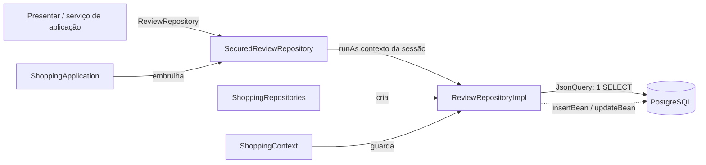

# Criando um repositório

Este guia mostra, passo a passo, como acrescentar uma entidade nova à camada de dados: do bean
de domínio até o teste que prova que a tela lê tudo numa consulta só. O exemplo que atravessa o
guia é uma funcionalidade de **avaliações de produto** (`Review`): cada usuário dá uma nota de 1 a
5 a um produto, com um comentário opcional.

> Guias relacionados: [criar-funcionalidade.md](criar-funcionalidade.md) (o roteiro completo de
> uma funcionalidade), [json-query.md](json-query.md) (como a leitura funciona por dentro),
> [application-service.md](application-service.md), [transaction-service.md](transaction-service.md),
> [setup-local.md](setup-local.md) (banco de testes), [../arquitetura.md](../arquitetura.md) e a
> referência curta em [persistence.md](../../skills/cube-architecture-php/references/persistence.md).

## Índice

1. [Por que tantas peças?](#por-que-tantas-peças)
2. [Passo 1 — A entidade](#passo-1--a-entidade)
3. [Passo 2 — O critério e o enum de ordenação](#passo-2--o-critério-e-o-enum-de-ordenação)
4. [Passo 3 — A interface do repositório](#passo-3--a-interface-do-repositório)
5. [Passo 4 — Schema e seed (`ShoppingSchema`)](#passo-4--schema-e-seed-shoppingschema)
6. [Passo 5 — A implementação (`AbstractRepository` + `JsonQuery`)](#passo-5--a-implementação-abstractrepository--jsonquery)
7. [Passo 6 — O decorador de segurança](#passo-6--o-decorador-de-segurança)
8. [Passo 7 — Ligar tudo (composition root)](#passo-7--ligar-tudo-composition-root)
9. [Usando o repositório num serviço de aplicação](#usando-o-repositório-num-serviço-de-aplicação)
10. [Passo 8 — Testes (`RepositoryTestCase`)](#passo-8--testes-repositorytestcase)
11. [Armadilhas](#armadilhas)
12. [Checklist](#checklist)

---

## Por que tantas peças?

Uma entidade nova toca em vários arquivos, mas cada um tem uma única responsabilidade:

```text
src/Shopping/Domain/Review/                     ← contrato: entidade, critério, OrderBy, interface
src/Shopping/Persistence/ShoppingSchema.php     ← DDL e seed (não há ferramenta de migração)
src/Shopping/Persistence/Repository/            ← implementação SQL (JsonQuery + Table)
src/Shopping/Persistence/ShoppingRepositories   ← agregado que cria e liga os repositórios
src/Shopping/Presentation/Security/             ← decorador Secured*Repository (contexto de segurança)
src/Shopping/Presentation/ShoppingContext       ← serviços compartilhados por todas as sessões
src/Shopping/Presentation/ShoppingApplication   ← o repositório que cada sessão (presenters) usa
tests/Shopping/Persistence/                     ← testes contra um PostgreSQL de verdade
```



O domínio (`Wdc\Shopping\Domain`) não sabe nada de SQL: quem usa o repositório só conhece a
interface `ReviewRepository`. A implementação não sabe nada de sessão. O decorador não sabe nada
de SQL. Por isso cada parte é testável sozinha — e por isso a lista de arquivos é longa.

---

## Passo 1 — A entidade

`src/Shopping/Domain/Review/Review.php`. É uma classe simples, com **todos os campos anuláveis** e
API fluente: `campo()` lê, `withCampo()` escreve e devolve `$this`.

```php
final class Review
{
    private ?int $id = null;
    private ?Product $product = null;
    private ?User $user = null;
    private ?int $rating = null;
    private ?string $comment = null;
    private ?DateTimeImmutable $createdAt = null;

    public function id(): ?int { return $this->id; }

    public function withId(?int $id): static
    {
        $this->id = $id;

        return $this;
    }

    // product()/withProduct(), user()/withUser(), rating(), comment(), createdAt()...

    /** O valor da FK PRODUCTID: basta o produto ter o id. */
    public function productId(): ?int
    {
        return $this->product?->id();
    }

    /** O valor da FK USERID: basta o usuário ter o id. */
    public function userId(): ?int
    {
        return $this->user?->id();
    }
}
```

Por que tudo anulável? Porque o mesmo bean serve de **projeção** (máscara): campo não-null = campo
a buscar. Num bean lido do banco, `null` significa "não carregado/não projetado". Veja
[json-query.md](json-query.md).

Decisões do exemplo:

- **Relações são entidades**, não ids soltos: `product(): ?Product`, `user(): ?User`. Para gravar
  só a referência, basta `new Product()->withId(3)`.
- **Atalhos de FK** (`productId()`, `userId()`) leem o id da relação. A implementação usa-os para
  escrever as colunas `PRODUCTID` e `USERID`.
- Datas são `DateTimeImmutable` (o `ColumnType::DateTime` devolve sempre em UTC).
- Ids do seed começam em 0: nunca teste um id com `!$id`; use `=== null`.

---

## Passo 2 — O critério e o enum de ordenação

`ReviewCriteria` implementa `Wdc\Framework\Domain\Criteria\Criteria`: um `Criterion` por campo
filtrável, **criado no construtor e nunca null**, mais a projeção e a ordenação.

```php
final class ReviewCriteria implements Criteria
{
    private ?Review $projection = null;

    private ?ReviewOrderBy $orderBy = null;

    /** @var ComparableCriterion<self, int> */
    private readonly ComparableCriterion $reviewId;
    /** @var ComparableCriterion<self, int> */
    private readonly ComparableCriterion $productId;
    /** @var ComparableCriterion<self, int> */
    private readonly ComparableCriterion $userId;
    /** @var ComparableCriterion<self, int> */
    private readonly ComparableCriterion $rating;

    public function __construct()
    {
        // valor inicial de propriedade precisa ser constante: objetos que dependem de $this nascem aqui
        $this->reviewId = new ComparableCriterion($this, 'reviewId');
        $this->productId = new ComparableCriterion($this, 'productId');
        $this->userId = new ComparableCriterion($this, 'userId');
        $this->rating = new ComparableCriterion($this, 'rating');
    }

    // projection()/withProjection(?Review) e orderBy()/withOrderBy(?ReviewOrderBy): getters/setters comuns

    /** @return ComparableCriterion<self, int> */
    public function productId(): ComparableCriterion { return $this->productId; }

    public function hasProductId(): bool { return $this->productId->isSet(); }

    /** Atalho para productId()->eq($value). */
    public function withProductId(?int $value): static
    {
        return $value === null ? $this : $this->productId->eq($value);
    }

    // o mesmo trio (xxx(), hasXxx(), withXxx()) para reviewId, userId e rating

    public function criterions(): array
    {
        return [$this->reviewId, $this->productId, $this->userId, $this->rating];
    }
}
```

Qual tipo de `Criterion` usar:

| Campo                        | Classe                | Operações extras                              |
|------------------------------|-----------------------|-----------------------------------------------|
| qualquer (igualdade, `in`)   | `Criterion`           | `eq ne in isNull isNotNull`                   |
| número, data                 | `ComparableCriterion` | `gt ge lt le between`                         |
| texto                        | `TextCriterion`       | `like ilike containing startingWith`          |

O enum de ordenação mora ao lado do critério (`src/Shopping/Domain/Review/ReviewOrderBy.php`) e lista
só as ordens que alguma tela usa:

```php
/** Ordenações provisionadas de Review. */
enum ReviewOrderBy
{
    case NEWEST_FIRST;
    case OLDEST_FIRST;
    case BEST_RATED_FIRST;
}
```

O enum é neutro — não contém SQL. Quem decide quais colunas cada caso ordena é a implementação
(Passo 5).

---

## Passo 3 — A interface do repositório

```php
/**
 * @extends Repository<Review, ReviewCriteria>
 */
interface ReviewRepository extends Repository
{
}
```

O `Repository<E, C>` genérico (`src/Framework/Domain/Repository/Repository.php`) já traz `insert`,
`update`, `insertOrUpdate`, `delete`, `count`, `fetch`, `fetchPage`, `fetchById` e `newProjection`.
A interface específica existe para (a) dar um tipo que os presenters possam pedir e (b) receber
operações próprias quando houver — como `ProductRepository::fetchImage`. O `@extends` é o que faz
o PHPStan saber que `fetch()` devolve `list<Review>`.

---

## Passo 4 — Schema e seed (`ShoppingSchema`)

**Não há ferramenta de migração.** O schema inteiro mora em constantes de
`src/Shopping/Persistence/ShoppingSchema.php`:

| Método     | O que faz                                                                           |
|------------|-------------------------------------------------------------------------------------|
| `create()` | cria tabelas e sequências se `EN_USER` não existe, e então chama `reset()`           |
| `drop()`   | remove tabelas e sequências (usado pelos testes no início da execução)              |
| `reset()`  | apaga todas as linhas e grava o seed de demonstração                                |

O servidor chama `create()` ao subir; os testes chamam `drop()` + `create()` uma vez e `reset()`
antes de cada teste (ver `tests/Support/TestDatabase.php`).

### 4a. O DDL

A tabela nova vai numa constante separada, para poder ser aplicada sozinha:

```php
private const string REVIEW_DDL = <<<'SQL'
    CREATE TABLE EN_REVIEW (
        ID BIGINT NOT NULL PRIMARY KEY,
        PRODUCTID BIGINT NOT NULL REFERENCES EN_PRODUCT (ID),
        USERID BIGINT NOT NULL REFERENCES EN_USER (ID),
        RATING INT NOT NULL,
        REVIEWCOMMENT TEXT,
        CREATEDAT TIMESTAMP NOT NULL
    );
    CREATE SEQUENCE SQ_REVIEW START WITH 1 INCREMENT BY 1;
    CREATE INDEX IX_REVIEW_PRODUCT ON EN_REVIEW (PRODUCTID);
    SQL;
```

Convenções: tabela `EN_<ENTIDADE>`, sequência `SQ_<ENTIDADE>`, chave `ID BIGINT`, FKs
`<ENTIDADE>ID`, datas `TIMESTAMP` (sem fuso; gravadas em UTC). Identificadores **sem aspas**: o
PostgreSQL converte para minúsculas, e o código SQL todo escreve em maiúsculas sem aspas — os dois
lados se encontram. Repare em `REVIEWCOMMENT`: o campo do bean se chama `comment`, mas a coluna
não precisa ter o mesmo nome (o mapeamento é feito no Passo 5).

### 4b. O `DROP` e o `reset()` respeitam as FKs

A tabela que aponta para as outras sai **primeiro**:

```php
/** EN_REVIEW primeiro: ela aponta para EN_PRODUCT e EN_USER. */
private const string DROP = 'DROP TABLE IF EXISTS EN_REVIEW, EN_PURCHASEITEM, EN_PURCHASE, EN_PRODUCT, EN_USER;'
    . ' DROP SEQUENCE IF EXISTS SQ_USER, SQ_PRODUCT, SQ_PURCHASE, SQ_PURCHASEITEM, SQ_REVIEW;';
```

```php
public static function reset(Database $db): void
{
    // EN_REVIEW antes de EN_PRODUCT e EN_USER, por causa das FKs
    $db->exec('DELETE FROM EN_REVIEW; DELETE FROM EN_PURCHASEITEM; DELETE FROM EN_PURCHASE; DELETE FROM EN_PRODUCT; DELETE FROM EN_USER;');
    // ... usuários, produtos, compras ...

    $db->execute('INSERT INTO EN_REVIEW (ID, PRODUCTID, USERID, RATING, REVIEWCOMMENT, CREATEDAT) VALUES '
        . "(0, 0, 0, 5, 'Excelente! Faz um café ótimo e é fácil de limpar.', '2024-03-10 12:00:00'), "
        . "(1, 0, 1, 4, 'Boa cafeteira, mas a jarra esquenta bastante.', '2024-05-02 18:45:00')");
    $db->restartSequence('SQ_REVIEW', 2);
}
```

O seed grava ids explícitos e depois reinicia a sequência no próximo id livre — senão o primeiro
`insert()` colidiria com o seed. Os ids viram constantes públicas, usadas pelos testes:

```php
// avaliações da cafeteira: média 4,5; a do fulano é a mais recente
public const int ADMIN_CAFETEIRA_REVIEW_ID = 0;
public const int FULANO_CAFETEIRA_REVIEW_ID = 1;
```

### 4c. Um passo de `create()` para bancos que já existem

`create()` retorna cedo quando `EN_USER` existe. Num banco criado antes das avaliações, a tabela
nova nunca seria criada e o servidor falharia na primeira consulta. Por isso a tabela nova ganha
o seu próprio passo:

```php
public static function create(Database $db): bool
{
    if ($db->dialect()->tableExists($db, 'EN_USER')) {
        if (!$db->dialect()->tableExists($db, 'EN_REVIEW')) {
            $db->exec(self::REVIEW_DDL);
        }

        return false;
    }
    $db->exec(self::DDL . self::REVIEW_DDL);
    self::reset($db);

    return true;
}
```

Nesse caminho a tabela nasce **vazia** (o seed só roda em banco novo).

---

## Passo 5 — A implementação (`AbstractRepository` + `JsonQuery`)

`src/Shopping/Persistence/Repository/ReviewRepositoryImpl.php`. A base `AbstractRepository`
(`src/Framework/Persistence/AbstractRepository.php`) já implementa `count`, `fetch`, `fetchPage`,
`fetchById` e `insertOrUpdate`, e oferece `insertBean`, `updateBean` e `deleteWhere`. A subclasse
descreve **a tabela, as relações, as condições e a ordenação**.

### 5a. Construtor: `Table` + `JsonQuery`

```php
/** @extends AbstractRepository<Review, ReviewCriteria> */
final class ReviewRepositoryImpl extends AbstractRepository implements ReviewRepository
{
    /** @var JsonQuery<Review, ReviewCriteria> */
    private readonly JsonQuery $query;

    public function __construct(Database $db, private readonly ShoppingRepositories $repos)
    {
        parent::__construct($db);
        // a ordem importa: a primeira coluna é a chave primária (insertBean/updateBean contam com isso)
        $table = new Table('EN_REVIEW', static fn (): Review => new Review(), [
            new Column('id', 'ID', ColumnType::Int, static fn (Review $r) => $r->id(), static fn (Review $r, mixed $v) => $r->withId($v)),
            new Column('rating', 'RATING', ColumnType::Int, static fn (Review $r) => $r->rating(), static fn (Review $r, mixed $v) => $r->withRating($v)),
            new Column('comment', 'REVIEWCOMMENT', ColumnType::Text, static fn (Review $r) => $r->comment(), static fn (Review $r, mixed $v) => $r->withComment($v)),
            new Column('createdAt', 'CREATEDAT', ColumnType::DateTime, static fn (Review $r) => $r->createdAt(), static fn (Review $r, mixed $v) => $r->withCreatedAt($v)),
        ]);
        // consultas-alvo em closures: quando este construtor roda, os outros repositórios
        // do agregado podem ainda não existir
        $this->query = new JsonQuery($table, ReviewCriteria::class, 'rv', $db->dialect())
            ->withConditions($this->conditions(...))
            ->withOrdering($this->orderBy(...))
            ->addToOne(
                'product',
                static fn (Review $r) => $r->product(),
                static fn (Review $r, ?Product $p) => $r->withProduct($p),
                fn () => $this->repos->products->query(),
                'PRODUCTID',
            )
            ->addToOne(
                'user',
                static fn (Review $r) => $r->user(),
                static fn (Review $r, ?User $u) => $r->withUser($u),
                fn () => $this->repos->users->query(),
                'USERID',
            );
    }

    public function query(): JsonQuery
    {
        return $this->query;
    }
```

O que cada peça faz:

- **`Column(campo, coluna, tipo, getter, setter)`** mapeia um campo do bean a uma coluna. O nome
  do campo (`'comment'`) é também a chave no JSON que volta do banco. O `ColumnType` converte nos
  dois sentidos (`Int`, `Float` com 2 casas, `Text`, `DateTime` em UTC, `Blob`).
- **`Table`**: nome, fábrica do bean e colunas. **A primeira coluna é a chave primária** —
  `Table::id()` devolve `columns[0]`, e `insertBean`/`updateBean` dependem disso.
- **As FKs não são colunas da `Table`.** `PRODUCTID` e `USERID` são relações; aparecem em
  `addToOne` (leitura) e como colunas extras em `insertBean`/`updateBean` (escrita).
- **`'rv'`** é o prefixo de alias: as consultas usam `rv1`, `rv2`... gerados pelo `QueryContext`.
- **`$this->conditions(...)`** é a sintaxe *first-class callable* do PHP: transforma o método numa
  `Closure`. A `JsonQuery` a chama sempre que precisar do WHERE desta entidade, inclusive dentro de
  subconsultas de outras entidades.
- **`addToOne`** declara uma relação N:1 (esta tabela guarda a FK). O alvo é uma closure porque,
  quando este construtor roda, o repositório-alvo pode ainda não existir — e porque relações podem
  formar ciclos. Detalhes em [json-query.md](json-query.md).

### 5b. Projeção padrão

```php
public function newProjection(): object
{
    return new Review()
        ->withId(PV::INT)
        ->withRating(PV::INT)
        ->withComment(PV::STR)
        ->withCreatedAt(PV::dateTime())
        ->withProduct(new Product()->withId(PV::INT))   // só o id: sai da coluna PRODUCTID, sem subconsulta
        ->withUser(new User()->withId(PV::INT));
}
```

É o que `fetch`/`fetchById` usam quando o critério não traz projeção: os campos rasos e, das
relações, só o id (que sai direto da coluna de FK, sem subconsulta).

### 5c. Escrita: `insert`, `update`, `delete`

```php
/** As FKs não são colunas da Table: vão como colunas extras, lidas das relações. */
public function insert(object $bean): bool
{
    return $this->insertBean($bean, [
        'PRODUCTID' => $bean->productId(),
        'USERID' => $bean->userId(),
    ]);
}

public function update(object $newBean, ?object $oldBean = null, ?object $projection = null): bool
{
    return $this->updateBean($newBean, $oldBean, $projection, [
        'PRODUCTID' => [static fn (Review $r) => $r->productId(), ColumnType::Int],
        'USERID' => [static fn (Review $r) => $r->userId(), ColumnType::Int],
    ]);
}

public function delete(object $criteria): int
{
    return $this->deleteWhere($criteria);
}
```

- `insertBean` gera o id pela `sequence()` quando ele é null, grava-o no bean e insere só os
  campos não-null.
- `updateBean` escreve só os campos **projetados e alterados** em relação a `$oldBean`
  (`$oldBean = null` ⇒ todos os projetados). Sem mudança, devolve `false` e não envia SQL.
- `deleteWhere` apaga pelo critério. Um critério vazio vira `DELETE` sem `WHERE`: os repositórios
  de produto e usuário recusam isso explicitamente (`if (!$criteria->hasProductId()) throw new
  LogicException(...)`); faça o mesmo se apagar tudo nunca for uma operação legítima.
- Se a entidade tem filhos sem `ON DELETE CASCADE`, apague-os antes — veja
  `PurchaseRepositoryImpl::delete`.

### 5d. Sequência, condições, ordenação

```php
protected function sequence(): string
{
    return 'SQ_REVIEW';
}

protected function conditions(object $criteria, string $a, QueryContext $ctx): ?Sql
{
    return Sql::and([
        CT::translate("{$a}.ID", $criteria->reviewId()),
        CT::translate("{$a}.PRODUCTID", $criteria->productId()),
        CT::translate("{$a}.USERID", $criteria->userId()),
        CT::translate("{$a}.RATING", $criteria->rating()),
    ]);
}

/** Toda ordenação termina no id: duas avaliações no mesmo instante não trocam de lugar entre páginas. */
protected function orderBy(?object $criteria, string $a): string
{
    return match ($criteria?->orderBy()) {
        null => '',
        ReviewOrderBy::NEWEST_FIRST => "{$a}.CREATEDAT DESC, {$a}.ID DESC",
        ReviewOrderBy::OLDEST_FIRST => "{$a}.CREATEDAT ASC, {$a}.ID ASC",
        ReviewOrderBy::BEST_RATED_FIRST => "{$a}.RATING DESC, {$a}.CREATEDAT DESC, {$a}.ID DESC",
    };
}
```

- `CT` é o alias de `CriterionTranslator`: ele converte cada `Criterion` em SQL com parâmetros `?`.
  Campo sem pedido devolve `null`, e `Sql::and` descarta os nulls.
- **Sempre contra o alias `$a`**, nunca contra o nome da tabela: a mesma entidade pode aparecer
  várias vezes numa consulta (raiz e subconsultas).
- `orderBy` devolve a lista de ordenação **sem** o `ORDER BY`; `''` ⇒ a `JsonQuery` ordena pelo id.
  O `match` sem `default` faz o PHP lançar `UnhandledMatchError` se alguém acrescentar um caso ao
  enum e esquecer daqui — o que é bom.
- Para filtros por coluna de data, passe o conversor: `CT::translate("{$a}.BUYDATE",
  $criteria->buyDate(), ColumnType::formatDate(...))` (como em `PurchaseRepositoryImpl`).

### 5e. Os dois ganchos de leitura

```php
protected function projectionOf(object $criteria): ?object
{
    return $criteria->projection();
}

protected function criteriaForIds(array $ids, object $projection): object
{
    return new ReviewCriteria()->reviewId()->in($ids)->withProjection($projection);
}
```

`criteriaForIds` é o que `fetchById` usa por baixo. Repare que `reviewId()->in($ids)` devolve o
**dono** (o `ReviewCriteria`), por isso o encadeamento continua com `withProjection`.

---

## Passo 6 — O decorador de segurança

`src/Shopping/Presentation/Security/SecuredReviewRepository.php`:

```php
/**
 * @extends SecuredRepository<Review, ReviewCriteria>
 */
final class SecuredReviewRepository extends SecuredRepository implements ReviewRepository
{
}
```

Toda a lógica está na base `SecuredRepository`: cada chamada roda dentro de
`CurrentSecurityContext::runAs($contextoDaSessão, ...)`, de modo que o código mais abaixo enxerga
quem é o usuário da sessão. O contexto corrente é **por Fiber** (cada sessão roda na sua) — nunca o
guarde num campo estático.

A subclasse vazia existe porque o PHP não gera em tempo de execução uma classe que implemente uma
interface: é ela que faz o decorador "ser" um `ReviewRepository`. Se a interface ganhar operações
próprias, elas vão aqui, cada uma embrulhada em `$this->run(fn () => ...)` (veja
`SecuredProductRepository::fetchImage`).

As permissões ficam em `src/Shopping/Domain/Security/Role.php`, no formato `entidade:operação`.
O exemplo acrescentou `'review:*'` ao `ADMIN` e `'review:read', 'review:write'` ao `CUSTOMER`. Hoje
quem as confere é a API REST (`SecurityEnforcer`); o decorador da apresentação só estabelece o
contexto.

---

## Passo 7 — Ligar tudo (composition root)

Não há contêiner de injeção de dependências: os objetos são criados à mão, em três lugares.

### 7a. `ShoppingRepositories` — cria a implementação

```php
public readonly ReviewRepositoryImpl $reviews;

public function __construct(public readonly Database $db)
{
    // ... users, products ...
    // compra ⇄ item se referenciam: recebem o agregado e o consultam quando precisam
    $this->purchases = new PurchaseRepositoryImpl($db, $this);
    $this->purchaseItems = new PurchaseItemRepositoryImpl($db, $this);
    // avaliação → produto/usuário: consulta os outros repositórios pelo agregado
    $this->reviews = new ReviewRepositoryImpl($db, $this);
    $this->transactions = new SqlTransactionService($db);
}
```

O agregado passa `$this` para os repositórios com relações; é por isso que os alvos de
`addToOne` são closures (`fn () => $this->repos->products->query()`): eles só são resolvidos na
hora da consulta, quando todos já existem.

### 7b. `ShoppingContext` — um argumento novo no construtor

```php
public function __construct(
    public UserRepository $users,
    public ProductRepository $products,
    public PurchaseRepository $purchases,
    public PurchaseItemRepository $purchaseItems,
    public ReviewRepository $reviews,          // ← novo
    public TransactionService $transactions,
    public Scheduler $scheduler,
    // ...
```

**Atenção:** `ShoppingContext` é construído **posicionalmente** em mais de um lugar —
`ShoppingContext::of()`, `src/Shopping/Server/ShoppingServer.php` e
`tests/Shopping/Presentation/PresentationBehaviourTest.php`. Acrescente `$repos->reviews` (ou
`$this->repos->reviews`) **na mesma posição** em todos. Procure com
`grep -rn 'new ShoppingContext' src tests`.

### 7c. `ShoppingApplication` — o repositório da sessão

```php
private ?ReviewRepository $reviewRepository = null;

public function reviewRepository(): ReviewRepository
{
    return $this->reviewRepository ??= new SecuredReviewRepository($this->context->reviews, $this->securityContext(...));
}
```

`??=` cria o decorador na primeira chamada e reaproveita depois. `$this->securityContext(...)` é
passado como closure para que o contexto seja lido **a cada chamada** (ele muda no login/logout).

---

## Usando o repositório num serviço de aplicação

Presenters não montam critérios: delegam a um serviço de aplicação, que recebe a **interface**
(detalhes em [application-service.md](application-service.md)). No exemplo, o painel de avaliações
cria `new ReviewService($app->reviewRepository())`:

```php
final class ReviewService
{
    public function __construct(private readonly ReviewRepository $reviews)
    {
    }

    /** @return list<ReviewInfo> mais recentes primeiro */
    public function listForProduct(int $productId, int $limit = 50): array
    {
        $criteria = new ReviewCriteria()
            ->withProductId($productId)
            ->withProjection(ReviewInfo::projection())
            ->withOrderBy(ReviewOrderBy::NEWEST_FIRST);

        return array_map(ReviewInfo::create(...), $this->reviews->fetch($criteria, 0, $limit));
    }

    public function add(Subject $subject, int $productId, ?int $rating, ?string $comment): void
    {
        // ... validação (lança InvalidReviewException) ...
        $review = new Review()
            ->withProduct(new Product()->withId($productId))   // só o id: vira a FK PRODUCTID
            ->withUser(new User()->withId($subject->id))        // o autor é sempre o logado, nunca vem da view
            ->withRating($rating)
            ->withComment($comment === '' ? null : $comment)
            ->withCreatedAt(new DateTimeImmutable('now', new DateTimeZone('UTC')));
        $this->reviews->insert($review);
    }
}
```

A projeção mora ao lado da estrutura que ela preenche (`ReviewInfo::projection()`), para que "o
que a tela mostra" e "o que a consulta seleciona" mudem juntos:

```php
public static function projection(): Review
{
    return new Review()
        ->withId(PV::INT)
        ->withRating(PV::INT)
        ->withComment(PV::STR)
        ->withCreatedAt(PV::dateTime())
        ->withUser(new User()->withId(PV::INT)->withName(PV::STR));   // nome do autor: mesma consulta
}
```

Regras de uso:

- **Toda leitura de tela passa uma projeção** com exatamente o que ela mostra.
- **Nunca chame o repositório dentro de um laço sobre linhas** — ponha a relação na projeção. O
  nome do autor acima vem na mesma consulta, como subconsulta JSON.
- **Várias escritas que precisam ser atômicas vão num `required()`** — veja
  [transaction-service.md](transaction-service.md). Uma escrita só (como `add`) não precisa.
- **Critério com `null` não filtra.** `withProductId(null)` não acrescenta nada: uma lista que
  devia ser "deste produto" mostraria todas as avaliações. Um id que precisa restringir a
  consulta tem de chegar não-null (por isso `listForProduct(int $productId)` não aceita `?int`).

---

## Passo 8 — Testes (`RepositoryTestCase`)

Os testes de repositório rodam contra um **PostgreSQL de verdade**, configurado em
`[test.database]` (ver [setup-local.md](setup-local.md) e `tests/Support/TestDatabase.php`). A base
`RepositoryTestCase` entrega `$this->repos` (um `ShoppingRepositories`) com o banco **no seed** no
início de cada teste.

`tests/Shopping/Persistence/ReviewRepositoryTest.php` cobre leitura com relação, ordens, projeção
padrão, inserção, contagem e atualização. O teste mais importante prova que **não há N+1**:

```php
final class ReviewRepositoryTest extends RepositoryTestCase
{
    #[Test]
    public function fetchByProduct_withAuthorName_inASingleStatement(): void
    {
        $statements = [];
        $this->repos->db->onQuery(static function (string $sql) use (&$statements): void {
            $statements[] = $sql;   // &$statements: a closure altera o array de fora
        });

        $reviews = $this->repos->reviews->fetch(new ReviewCriteria()
            ->withProductId(Seed::CAFETEIRA_ID)
            ->withProjection(self::withAuthorName())
            ->withOrderBy(ReviewOrderBy::NEWEST_FIRST));

        self::assertCount(1, $statements, 'avaliações + nomes dos autores numa ida só (sem N+1)');
        self::assertSame([Seed::FULANO_CAFETEIRA_REVIEW_ID, Seed::ADMIN_CAFETEIRA_REVIEW_ID], self::ids($reviews));
        self::assertSame('Fulano de Tal', $reviews[0]->user()?->name());
        self::assertNull($reviews[0]->product(), 'o produto não foi projetado');
    }
```

Os outros casos do exemplo: ordens (`OLDEST_FIRST`, `BEST_RATED_FIRST`), projeção padrão (só os
ids das relações, `user()?->name()` null), `count` por produto e por nota, e `update` parcial
(`clone` do bean lido, muda a nota, confere que o comentário ficou).

- `insert` deve gerar o id da sequência (`2`, porque o seed reiniciou `SQ_REVIEW` em 2).
- Teste as datas com `assertEquals` (instante igual), não `assertSame` (identidade do objeto).
- Rode `vendor/bin/phpunit tests/Shopping/Persistence/ReviewRepositoryTest.php` e, antes do
  commit, `composer check` (PHPStan nível 8 + a suíte inteira).

---

## Armadilhas

Problemas reais encontrados ao implementar o exemplo:

- **Uma FK nova pode quebrar testes antigos.** `ProductRepositoryTest` apaga o
  `PEN_DRIVE2GB_ID` e `UserRepositoryTest` apaga o `BEOTRANO_ID`. Se o seed de avaliações
  apontasse para eles, esses `DELETE` falhariam na FK. O seed do exemplo usa a cafeteira e os
  usuários admin e fulano. Antes de escrever o seed, procure `->delete(` nos testes.
- **O banco de testes é compartilhado entre branches.** Ao voltar para uma branch sem a tabela
  nova, o `DROP` antigo (que não conhece `EN_REVIEW`) falha ao remover `EN_PRODUCT`/`EN_USER` por
  causa da FK. Apague à mão: `DROP TABLE EN_REVIEW; DROP SEQUENCE SQ_REVIEW;`.
- **Datas sem fração de segundo.** `ColumnType::DateTime` grava no formato `'Y-m-d H:i:s'` em UTC:
  dois registros no mesmo segundo empatam. **Toda ordenação termina no id**, senão a paginação
  repete ou pula linhas.
- **A primeira coluna da `Table` é a chave.** Trocar a ordem faz o `UPDATE ... WHERE` usar a coluna
  errada.
- **FKs que não são campos do bean** vão como colunas extras em `insertBean`/`updateBean`. Esqueça
  uma e ela chega `NULL` no banco (ou viola `NOT NULL`).
- **`ShoppingContext` posicional**: acrescente o repositório na mesma posição em todos os lugares
  que o constroem, ou um teste receberá o `TransactionService` no lugar do repositório.
- **`create()` retorna cedo** quando `EN_USER` existe: tabela nova precisa do próprio passo.
- **Critério com `null` não filtra** — um id obrigatório não pode chegar null.
- **Identificadores sem aspas**: `"EN_REVIEW"` com aspas seria outra tabela para o PostgreSQL.

---

## Checklist

Domínio (`src/Shopping/Domain/<Entidade>/`)

- [ ] Entidade com campos anuláveis, `campo()`/`withCampo()`, relações como entidades e atalhos de FK.
- [ ] `XxxCriteria implements Criteria`: um `Criterion` por campo filtrável, criado no construtor;
      `xxx()`, `hasXxx()`, `withXxx()`; `projection`/`orderBy`; `criterions()`.
- [ ] `XxxOrderBy` com só as ordens usadas.
- [ ] `XxxRepository extends Repository` com `@extends Repository<Xxx, XxxCriteria>`.

Schema (`ShoppingSchema`)

- [ ] DDL em constante própria (`XXX_DDL`), identificadores sem aspas, FKs com `REFERENCES`.
- [ ] `create()` cria a tabela nova também em banco já existente.
- [ ] `DROP` e `reset()` apagam a tabela nova antes das que ela referencia.
- [ ] Seed com ids explícitos, `restartSequence`, constantes públicas; sem apontar para linhas
      que outros testes apagam.

Implementação (`XxxRepositoryImpl`)

- [ ] `Table` com a chave como **primeira** coluna; FKs fora da `Table`.
- [ ] `JsonQuery` com prefixo de alias curto, `withConditions`, `withOrdering`, relações com alvo em closure.
- [ ] `newProjection()` com campos rasos e só o id das relações.
- [ ] `insert`/`update` passam as FKs como colunas extras; `delete` protegido se precisar.
- [ ] `conditions` contra o alias; `orderBy` termina sempre no id.
- [ ] `projectionOf` e `criteriaForIds`.

Ligação e segurança

- [ ] `SecuredXxxRepository extends SecuredRepository implements XxxRepository`.
- [ ] Permissões em `Role`.
- [ ] `ShoppingRepositories::$xxx`.
- [ ] `ShoppingContext`: argumento novo, na mesma posição em `of()`, `ShoppingServer` e testes.
- [ ] `ShoppingApplication::xxxRepository()` com `??=` e o decorador.

Testes

- [ ] `XxxRepositoryTest extends RepositoryTestCase`: leitura com relação contando comandos
      (`onQuery`), ordens, projeção padrão, insert (id gerado), count, update parcial.
- [ ] Suíte inteira verde (as FKs novas não quebraram testes antigos) e PHPStan limpo.
