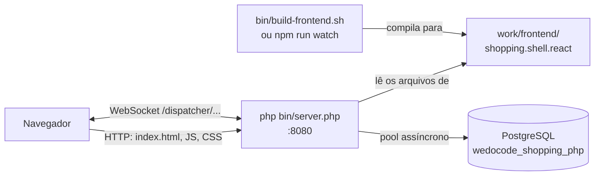
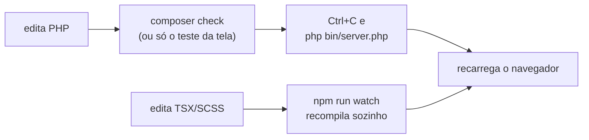

# Rodar o projeto localmente — passo a passo

> **Para quem é:** quem vai rodar o Shopping na própria máquina pela primeira vez.
> **Ao final:** o servidor no ar em `http://localhost:8080`, o login funcionando, o frontend
> recompilando sozinho e os testes passando.

O projeto tem duas partes que você vai compilar e rodar:

- **o servidor PHP** (`bin/server.php`) — um processo de longa duração, com um event loop (Amp),
  que roda os presenters de todas as sessões, fala com o PostgreSQL e serve o frontend;
- **o shell React** (`frontend/shopping.shell.react`) — compilado para `work/frontend/`, de onde o
  próprio servidor PHP o serve. Não há um servidor Node em produção nem em desenvolvimento.



---

## Sumário

1. [Pré-requisitos](#1-pré-requisitos)
2. [Clone](#2-clone)
3. [Configuração local](#3-configuração-local)
4. [Dependências PHP](#4-dependências-php)
5. [Build do frontend](#5-build-do-frontend)
6. [Subir o servidor](#6-subir-o-servidor)
7. [Validação rápida (smoke test)](#7-validação-rápida-smoke-test)
8. [Fluxo de desenvolvimento](#8-fluxo-de-desenvolvimento)
9. [Rodar os testes](#9-rodar-os-testes)
10. [Desligar tudo](#10-desligar-tudo)
11. [Troubleshooting](#11-troubleshooting)
12. [Onde ler para continuar](#12-onde-ler-para-continuar)

---

## 1. Pré-requisitos

| Ferramenta | Versão | Para quê |
|---|---|---|
| PHP | 8.4+ com `gmp`, `openssl` e `pgsql` | o servidor e os testes |
| PostgreSQL | 14+ | o banco do servidor e um banco separado para os testes |
| Composer | 2 | dependências PHP |
| Node.js | 20+ (com `npm`) | só para compilar o shell React |

No macOS, com Homebrew:

```bash
brew install php composer node postgresql@17
brew services start postgresql@17     # deixa o PostgreSQL rodando em segundo plano
```

O PHP do Homebrew já traz `pgsql`, `gmp` e `openssl`. Confira:

```bash
php -v                                   # 8.4 ou mais novo
php -m | grep -E '^(gmp|openssl|pgsql)$' # as três precisam aparecer
composer --version                       # Composer version 2.x
node -v                                  # v20 ou mais novo
psql --version                           # 14 ou mais novo
```

Em Linux, instale os pacotes equivalentes da sua distribuição (por exemplo `php-gmp`, `php-pgsql`).

> **Por que `gmp`?** O canal entre navegador e servidor é cifrado; o handshake usa RSA com
> aritmética de números grandes, feita pela extensão `gmp`. **`pgsql`** é exigida pelo
> `composer.json` junto do driver assíncrono `amphp/postgres`.

Você também precisa de um **usuário do PostgreSQL com senha** que possa criar bancos (ou de dois
bancos já criados para você — veja a seção 3). No Homebrew, o superusuário padrão costuma ter o
nome do seu usuário do macOS; se preferir um usuário `postgres` com senha:

```bash
psql -d postgres -c "CREATE ROLE postgres WITH LOGIN SUPERUSER PASSWORD '...';"
```

---

## 2. Clone

```bash
git clone <url-do-repositório> wdc-cube-php
cd wdc-cube-php
```

Todos os comandos deste guia partem da **raiz do projeto**, salvo quando indicado.

---

## 3. Configuração local

A configuração tem dois arquivos, na mesma pasta:

| Arquivo | No git? | O que tem |
|---|---|---|
| `work/config/application.toml` | sim | os padrões: URL do banco, porta, `devMode`, segredo do JWT de desenvolvimento |
| `work/config/application.local.toml` | **não** (está no `.gitignore`) | o que é seu: usuário e senha do banco, banco de testes, chaves geradas |

O arquivo local **sobrescreve** o principal, chave por chave. Crie-o com:

```toml
# work/config/application.local.toml — fora do git, nunca commite

[database]
username = "postgres"
password = "..."

[test.database]
# um banco SÓ para os testes: é apagado e recriado a cada execução
url = "pgsql:host=localhost;port=5432;dbname=wedocode_shopping_php_test"
username = "postgres"
password = "..."
```

O que cada bloco faz:

- **`[database]`** — o banco do servidor. A URL fica no `application.toml`
  (`pgsql:host=localhost;port=5432;dbname=wedocode_shopping_php`); aqui vão só as credenciais. Se o
  seu PostgreSQL estiver em outra porta ou máquina, sobrescreva também `url` aqui.
- **`[test.database]`** — o banco usado **apenas** pelos testes. O nome precisa ser **diferente** do
  banco do servidor: os testes apagam todas as tabelas dele no início de cada execução.

> **Chaves de desenvolvimento.** Na primeira vez que o servidor sobe, ele percebe que não há chaves
> do canal cifrado (`[remote]`) e **acrescenta** ao `application.local.toml` um bloco `[remote]`
> com chaves geradas na hora. Não apague esse bloco: com ele, as sessões e as URLs assinadas
> continuam válidas entre reinícios. São chaves só para desenvolvimento.

Variáveis de ambiente úteis:

| Variável | Efeito |
|---|---|
| `SERVER_PORT` | porta do servidor (padrão: `server.port` do arquivo, 8080) |
| `LOG_LEVEL` | `debug`, `info` (padrão), `notice`, `warning`, `error`... |
| `SHOPPING_CONFIG_FILE` | usa outro arquivo no lugar de `work/config/application.toml` (o `application.local.toml` é procurado na pasta dele) |
| `WDC_TEST_DB_URL`, `WDC_TEST_DB_USER`, `WDC_TEST_DB_PASSWORD` | substituem o `[test.database]` (útil em CI) |

---

## 4. Dependências PHP

```bash
composer install
```

Baixa as bibliotecas para `vendor/` — o servidor HTTP e WebSocket do Amp, o driver PostgreSQL
assíncrono, e, para desenvolvimento, PHPUnit e PHPStan. Se faltar uma extensão (`gmp`, `pgsql`...),
é aqui que o Composer avisa (veja a seção 11).

---

## 5. Build do frontend

```bash
bin/build-frontend.sh
```

O script:

1. na **primeira vez**, roda `npm install` em `frontend/shopping.shell.react` e em
   `frontend/remote.bridge.react` (o bridge é a parte do protocolo do Cube no cliente) — demora
   alguns minutos;
2. compila o shell com Parcel (`npm run build:clean`);
3. grava o resultado em **`work/frontend/shopping.shell.react/`**.

No fim aparece `Deploy complete: ../../work/frontend/shopping.shell.react`. Confira:

```bash
ls work/frontend/shopping.shell.react/index.html
```

---

## 6. Subir o servidor

```bash
php bin/server.php
```

O processo fica em primeiro plano, mostrando o log. Na **primeira** subida ele:

1. conecta ao PostgreSQL e, se o banco `wedocode_shopping_php` **não existir, cria-o** (pela base
   de manutenção `postgres`; precisa de permissão para `CREATE DATABASE`);
2. cria as tabelas e as sequências, e semeia os **dados de demonstração** (usuários e produtos) —
   só quando ainda não há tabelas;
3. gera as chaves de desenvolvimento no `application.local.toml` (seção 3).

Quando estiver pronto, o log mostra:

```text
Shopping (PHP) em http://localhost:8080/shopping.shell.react/index.html
```

Outra porta: `php bin/server.php 8081` (o argumento tem precedência sobre `SERVER_PORT`, que tem
precedência sobre o arquivo). Mais log: `LOG_LEVEL=debug php bin/server.php`.

> **Por que um processo que não termina?** Diferente do PHP tradicional (um processo por
> requisição), aqui o servidor mantém na memória as sessões, com seus presenters e estados, e
> conversa com cada navegador por um WebSocket aberto. Isso tem uma consequência prática para o
> desenvolvimento: **mudou código PHP, reinicie o servidor** (seção 8).

---

## 7. Validação rápida (smoke test)

Em outro terminal:

```bash
curl -s localhost:8080/health
# {"status":"UP"}

curl -sI localhost:8080/ | grep -i location
# location: /shopping.shell.react/index.html
```

No navegador:

1. abra **http://localhost:8080/** — redireciona para o shell React;
2. entre com **`admin` / `admin`** (administrador: vê os dados de todos);
3. abra um produto, adicione ao carrinho e compre — o recibo deve aparecer;
4. saia e entre com **`fulano` / `fulano`** (cliente): o histórico mostra só as compras dele.

Os usuários de demonstração têm a senha igual ao login: `admin`, `fulano` e `beotrano`.

Quer voltar o banco do servidor aos dados iniciais? Com `server.devMode = true` (o padrão no
`application.toml`):

```bash
curl -X POST localhost:8080/__dev/db-reset
# {"reset":true}
```

---

## 8. Fluxo de desenvolvimento

### Frontend: recompilação automática

Num terminal separado:

```bash
cd frontend/shopping.shell.react
npm run watch
```

O `watch` deixa o Parcel observando os fontes e recompilando para o mesmo
`work/frontend/shopping.shell.react/` que o servidor serve. Salvou um `.tsx` ou `.scss`?
**Recarregue a página** no navegador. O servidor PHP **não** precisa ser reiniciado para mudanças
no frontend.

### Servidor: reinicie depois de mudar PHP

O servidor carrega as classes uma vez e fica rodando. Uma mudança em `src/` só vale depois de:

```bash
# no terminal do servidor
Ctrl+C
php bin/server.php
```

As sessões vivem na memória do processo, então o reinício as descarta. O navegador tenta se
reconectar; se a página ficar sem resposta, recarregue-a — o endereço carrega o estado da tela, e
você volta para onde estava (entrando de novo, se for preciso).

### O ciclo típico



Para a maior parte do trabalho em presenters e serviços, o **teste de aceitação** (que roda o
presenter com views falsas, sem navegador) é mais rápido do que subir o servidor — veja
[criar-funcionalidade.md](criar-funcionalidade.md).

---

## 9. Rodar os testes

```bash
composer check
```

Roda, em sequência:

1. **PHPStan nível 8** (`composer analyse`) — análise estática de tipos em `src/` e `tests/`;
2. **PHPUnit** (`composer test`) — motor, persistência, presenters, protocolo remoto, API REST e o
   servidor de ponta a ponta (HTTP e WebSocket numa porta livre).

Para rodar só uma parte:

```bash
vendor/bin/phpunit tests/Shopping/Presentation          # uma pasta
vendor/bin/phpunit --filter SqlTransactionServiceTest   # uma classe ou método
```

O que os testes precisam:

- **o `[test.database]` configurado** (seção 3). O banco de testes também é criado se não existir;
  a cada execução, as tabelas são apagadas e recriadas uma vez, e os dados de demonstração são
  refeitos antes de cada teste. **Nunca aponte para o banco do servidor.**
- **o frontend compilado** para o `ShoppingServerTest`, que sobe o servidor e carrega o shell
  React. Sem `work/frontend/shopping.shell.react/index.html`, esse teste é **pulado**
  (`shell React ausente: rode bin/build-frontend.sh`), não falha.

O PHPUnit está configurado para falhar também em *warnings* e testes *risky*.

---

## 10. Desligar tudo

```bash
# servidor PHP: Ctrl+C no terminal dele (SIGINT ou SIGTERM encerram de forma ordenada:
#   fecha as sessões, reverte transações remotas abertas e fecha o pool)

# frontend em watch: Ctrl+C no terminal do npm

# PostgreSQL (se não quiser deixá-lo rodando)
brew services stop postgresql@17
```

---

## 11. Troubleshooting

### Porta 8080 já em uso

O servidor não sobe e reclama que não conseguiu escutar no endereço. Descubra quem está na porta:

```bash
lsof -nP -iTCP:8080 -sTCP:LISTEN
```

Encerre o processo (muitas vezes é um `php bin/server.php` esquecido em outro terminal) ou use
outra porta: `php bin/server.php 8081`.

### `Banco de testes não configurado`

```text
Banco de testes não configurado: defina [test.database] url, username e password em
work/config/application.local.toml (ex.: url = "pgsql:host=localhost;port=5432;dbname=wedocode_shopping_php_test")
```

Falta o bloco `[test.database]` no `application.local.toml` (ou as variáveis `WDC_TEST_DB_*`).
Veja a seção 3.

### O banco não existe e não pôde ser criado

```text
O banco 'wedocode_shopping_php' não existe e não foi possível criá-lo: ...
```

O usuário configurado não tem permissão de `CREATE DATABASE`. Ou dê a permissão
(`ALTER ROLE <usuário> CREATEDB;`), ou peça/crie o banco com um usuário que tenha:

```bash
createdb -U postgres wedocode_shopping_php
createdb -U postgres wedocode_shopping_php_test
```

Se a mensagem for de **conexão recusada** ou de **autenticação**, o PostgreSQL não está rodando
(`brew services start postgresql@17`) ou o usuário/senha do `application.local.toml` estão
errados — teste com `psql -h localhost -U <usuário> -d postgres`.

### Extensão do PHP faltando

O `composer install` recusa com `requires ext-gmp * -> it is missing from your system` (ou
`ext-pgsql`, `ext-openssl`). Confira com `php -m` e veja se o `php` do terminal é o que você
instalou (`which php`): é comum haver mais de um PHP na máquina. No Homebrew, `brew install php`
traz as três.

### Página vazia ou `Not found`

O frontend não foi compilado (ou foi apagado): o servidor responde `Not found` em
`/shopping.shell.react/index.html` e o log de subida avisa
`Pasta de frontends não encontrada`. Rode `bin/build-frontend.sh` (ou deixe o `npm run watch`
rodando) e recarregue. Se a página abre mas fica em branco, olhe o console do navegador: em geral é
um erro de compilação que o `watch` mostrou no terminal dele.

### Aviso sobre asserções no log

```text
Running in production with assertions enabled is not recommended; ...
```

É o Amp avisando que `zend.assertions = 1` no seu `php.ini`. Em desenvolvimento, pode ignorar —
as asserções até ajudam a achar defeitos. Em produção, desligue (`zend.assertions = -1`); veja
[../escalando.md](../escalando.md).

### Testes falham no início com erro de chave estrangeira no `DROP TABLE`

Os testes começam apagando as tabelas conhecidas pelo código **do branch atual**. Se você rodou os
testes num branch que criou uma tabela a mais (por exemplo `EN_REVIEW`, que aponta para
`EN_PRODUCT`) e voltou para um branch sem ela, o `DROP` falha com algo como
`cannot drop table en_product because other objects depend on it`. Apague a tabela que sobrou no
**banco de testes**:

```bash
psql -h localhost -U postgres -d wedocode_shopping_php_test -c 'DROP TABLE en_review CASCADE;'
```

Ou recrie o banco de testes inteiro (`dropdb` + `createdb`, ou deixe os testes o recriarem).

### Mudei o schema e a tabela nova não aparece no servidor

O servidor só cria o schema quando o banco **ainda não tem tabelas** (ele confere a `EN_USER`); não
há migrações. Num banco de desenvolvimento que já existia, apague-o e deixe o servidor recriá-lo na
próxima subida:

```bash
dropdb -h localhost -U postgres wedocode_shopping_php
php bin/server.php
```

### Mudei o PHP e nada mudou

O servidor é um processo de longa duração: reinicie-o (seção 8). Mudanças no frontend não pedem
reinício, só recarregar a página.

---

## 12. Onde ler para continuar

1. [../guia-para-quem-vem-do-php.md](../guia-para-quem-vem-do-php.md) — a proposta do Cube a partir
   do PHP que você já conhece, com um exercício guiado.
2. [../arquitetura.md](../arquitetura.md) — places, presenters, navegação, protocolo, persistência,
   segurança.
3. [criar-funcionalidade.md](criar-funcionalidade.md) — uma funcionalidade do banco à tela.
4. [repository.md](repository.md) e [json-query.md](json-query.md) — acesso a dados sem N+1.
5. [application-service.md](application-service.md) e
   [transaction-service.md](transaction-service.md) — regras de negócio e transações.
6. [presentation-module.md](presentation-module.md) e [react-views.md](react-views.md) — presenter e
   view.
7. [../escalando.md](../escalando.md) — várias instâncias atrás de um balanceador.
8. [../../README.md](../../README.md) — visão geral, API REST e estrutura de pastas.
