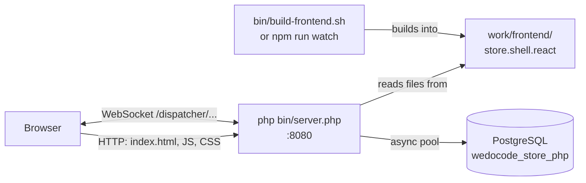
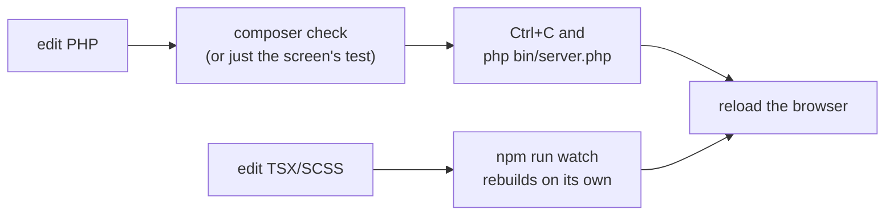

# Running the project locally — step by step

> **Who it is for:** anyone running Store on their own machine for the first time.
> **By the end:** the server up at `http://localhost:8080`, login working, the frontend
> rebuilding on its own and the tests passing.

The project has two parts you will build and run:

- **the PHP server** (`bin/server.php`) — a long-lived process with an event loop (Amp) that runs
  the presenters of every session, talks to PostgreSQL and serves the frontend;
- **the React shell** (`frontend/store.shell.react`) — built into `work/frontend/`, from where
  the PHP server itself serves it. There is no Node server, neither in production nor in development.



---

## Contents

1. [Prerequisites](#1-prerequisites)
2. [Clone](#2-clone)
3. [Local configuration](#3-local-configuration)
4. [PHP dependencies](#4-php-dependencies)
5. [Frontend build](#5-frontend-build)
6. [Starting the server](#6-starting-the-server)
7. [Quick check (smoke test)](#7-quick-check-smoke-test)
8. [Development workflow](#8-development-workflow)
9. [Running the tests](#9-running-the-tests)
10. [Shutting everything down](#10-shutting-everything-down)
11. [Troubleshooting](#11-troubleshooting)
12. [Further reading](#12-further-reading)

---

## 1. Prerequisites

| Tool | Version | Used for |
|---|---|---|
| PHP | 8.4+ with `gmp`, `openssl` and `pgsql` | the server and the tests |
| PostgreSQL | 14+ | the server database and a separate database for the tests |
| Composer | 2 | PHP dependencies |
| Node.js | 20+ (with `npm`) | only to build the React shell |

On macOS, with Homebrew:

```bash
brew install php composer node postgresql@17
brew services start postgresql@17     # keeps PostgreSQL running in the background
```

Homebrew's PHP already includes `pgsql`, `gmp` and `openssl`. Check:

```bash
php -v                                   # 8.4 or newer
php -m | grep -E '^(gmp|openssl|pgsql)$' # all three must show up
composer --version                       # Composer version 2.x
node -v                                  # v20 or newer
psql --version                           # 14 or newer
```

On Linux, install your distribution's equivalent packages (for example `php-gmp`, `php-pgsql`).

> **Why `gmp`?** The channel between browser and server is encrypted; the handshake uses RSA with
> big-number arithmetic, done by the `gmp` extension. **`pgsql`** is required by
> `composer.json` alongside the asynchronous `amphp/postgres` driver.

You also need a **PostgreSQL user with a password** that can create databases (or two databases
already created for you — see section 3). With Homebrew, the default superuser is usually named
after your macOS user; if you prefer a `postgres` user with a password:

```bash
psql -d postgres -c "CREATE ROLE postgres WITH LOGIN SUPERUSER PASSWORD '...';"
```

---

## 2. Clone

```bash
git clone <repository-url> wdc-cube-php
cd wdc-cube-php
```

Every command in this guide runs from the **project root**, unless stated otherwise.

---

## 3. Local configuration

The configuration has two files, in the same folder:

| File | In git? | What it holds |
|---|---|---|
| `work/config/application.toml` | yes | the defaults: database URL, port, `devMode`, development JWT secret |
| `work/config/application.local.toml` | **no** (it is in `.gitignore`) | what is yours: database user and password, test database, generated keys |

The local file **overrides** the main one, key by key. Create it with:

```toml
# work/config/application.local.toml — not in git, never commit it

[database]
username = "postgres"
password = "..."

[test.database]
# a database ONLY for the tests: it is dropped and recreated on every run
url = "pgsql:host=localhost;port=5432;dbname=wedocode_store_php_test"
username = "postgres"
password = "..."
```

What each block does:

- **`[database]`** — the server database. The URL lives in `application.toml`
  (`pgsql:host=localhost;port=5432;dbname=wedocode_store_php`); only the credentials go here. If
  your PostgreSQL runs on another port or machine, override `url` here too.
- **`[test.database]`** — the database used **only** by the tests. Its name must be **different**
  from the server database: the tests drop all of its tables at the start of every run.

> **Development keys.** The first time the server starts, it notices there are no keys for the
> encrypted channel (`[remote]`) and **appends** a `[remote]` block with freshly generated keys to
> `application.local.toml`. Do not delete that block: with it, sessions and signed URLs stay valid
> across restarts. These keys are for development only.

Useful environment variables:

| Variable | Effect |
|---|---|
| `SERVER_PORT` | server port (default: the file's `server.port`, 8080) |
| `LOG_LEVEL` | `debug`, `info` (default), `notice`, `warning`, `error`... |
| `STORE_CONFIG_FILE` | uses another file instead of `work/config/application.toml` (`application.local.toml` is looked up in its folder) |
| `WDC_TEST_DB_URL`, `WDC_TEST_DB_USER`, `WDC_TEST_DB_PASSWORD` | replace `[test.database]` (useful in CI) |

---

## 4. PHP dependencies

```bash
composer install
```

Downloads the libraries into `vendor/` — Amp's HTTP and WebSocket server, the asynchronous
PostgreSQL driver and, for development, PHPUnit and PHPStan. If an extension is missing (`gmp`,
`pgsql`...), this is where Composer tells you (see section 11).

---

## 5. Frontend build

```bash
bin/build-frontend.sh
```

The script:

1. the **first time**, runs `npm install` in `frontend/store.shell.react` and in
   `frontend/remote.bridge.react` (the bridge is the client side of the Cube protocol) — it takes
   a few minutes;
2. builds the shell with Parcel (`npm run build:clean`);
3. writes the result to **`work/frontend/store.shell.react/`**.

At the end you see `Deploy complete: ../../work/frontend/store.shell.react`. Check:

```bash
ls work/frontend/store.shell.react/index.html
```

---

## 6. Starting the server

```bash
php bin/server.php
```

The process stays in the foreground, showing the log. On the **first** start it:

1. connects to PostgreSQL and, if the `wedocode_store_php` database **does not exist, creates
   it** (through the `postgres` maintenance database; it needs `CREATE DATABASE` permission);
2. creates the tables and sequences, and seeds the **demo data** (users and products) — only when
   there are no tables yet;
3. generates the development keys in `application.local.toml` (section 3).

When it is ready, the log shows:

```text
Store (PHP) at http://localhost:8080/store.shell.react/index.html
```

Another port: `php bin/server.php 8081` (the argument takes precedence over `SERVER_PORT`, which
takes precedence over the file). More logging: `LOG_LEVEL=debug php bin/server.php`.

> **Why a process that never ends?** Unlike traditional PHP (one process per request), here the
> server keeps the sessions in memory, with their presenters and states, and talks to each browser
> over an open WebSocket. This has a practical consequence for development: **if you changed PHP
> code, restart the server** (section 8).

---

## 7. Quick check (smoke test)

In another terminal:

```bash
curl -s localhost:8080/health
# {"status":"UP"}

curl -sI localhost:8080/ | grep -i location
# location: /store.shell.react/index.html
```

In the browser:

1. open **http://localhost:8080/** — it redirects to the React shell;
2. log in with **`admin` / `admin`** (administrator: sees everyone's data);
3. open a product, add it to the cart and buy it — the receipt should appear;
4. log out and log in with **`john` / `john`** (customer): the history shows only his purchases.

The demo users' passwords equal their logins: `admin`, `john` and `jane`.

Want to reset the server database to the initial data? With `server.devMode = true` (the default
in `application.toml`):

```bash
curl -X POST localhost:8080/__dev/db-reset
# {"reset":true}
```

---

## 8. Development workflow

### Frontend: automatic rebuilds

In a separate terminal:

```bash
cd frontend/store.shell.react
npm run watch
```

`watch` keeps Parcel watching the sources and rebuilding into the same
`work/frontend/store.shell.react/` that the server serves. Saved a `.tsx` or `.scss`?
**Reload the page** in the browser. The PHP server does **not** need a restart for frontend
changes.

### Server: restart after changing PHP

The server loads the classes once and keeps running. A change in `src/` only takes effect after:

```bash
# in the server terminal
Ctrl+C
php bin/server.php
```

Sessions live in the process memory, so the restart discards them. The browser tries to
reconnect; if the page stops responding, reload it — the address carries the screen state, and
you return to where you were (logging in again, if needed).

### The typical cycle



For most work on presenters and services, the **acceptance test** (which runs the presenter with
fake views, without a browser) is faster than starting the server — see
[building-a-feature.md](building-a-feature.md).

---

## 9. Running the tests

```bash
composer check
```

Runs, in sequence:

1. **PHPStan level 8** (`composer analyse`) — static type analysis over `src/` and `tests/`;
2. **PHPUnit** (`composer test`) — engine, persistence, presenters, remote protocol, REST API and
   the server end to end (HTTP and WebSocket on a free port).

To run only a part:

```bash
vendor/bin/phpunit tests/Store/Presentation          # a folder
vendor/bin/phpunit --filter SqlTransactionServiceTest   # a class or method
```

What the tests need:

- **`[test.database]` configured** (section 3). The test database is also created if it does not
  exist; on every run, the tables are dropped and recreated once, and the demo data is reseeded
  before each test. **Never point it at the server database.**
- **the built frontend** for `StoreServerTest`, which starts the server and loads the React
  shell. Without `work/frontend/store.shell.react/index.html`, that test is **skipped**
  (`React shell missing: run bin/build-frontend.sh`), not failed.

PHPUnit is configured to also fail on *warnings* and *risky* tests.

---

## 10. Shutting everything down

```bash
# PHP server: Ctrl+C in its terminal (SIGINT or SIGTERM shut down gracefully:
#   closes the sessions, rolls back open remote transactions and closes the pool)

# frontend in watch mode: Ctrl+C in the npm terminal

# PostgreSQL (if you do not want to leave it running)
brew services stop postgresql@17
```

---

## 11. Troubleshooting

### Port 8080 already in use

The server does not start and complains that it could not listen on the address. Find out who is
on the port:

```bash
lsof -nP -iTCP:8080 -sTCP:LISTEN
```

Kill the process (often it is a forgotten `php bin/server.php` in another terminal) or use
another port: `php bin/server.php 8081`.

### `Test database not configured`

```text
Test database not configured: set [test.database] url, username and password in
work/config/application.local.toml (e.g. url = "pgsql:host=localhost;port=5432;dbname=wedocode_store_php_test")
```

The `[test.database]` block is missing from `application.local.toml` (or the `WDC_TEST_DB_*`
variables). See section 3.

### The database does not exist and could not be created

```text
Database 'wedocode_store_php' does not exist and could not be created: ...
```

The configured user lacks `CREATE DATABASE` permission. Either grant it
(`ALTER ROLE <user> CREATEDB;`), or ask for / create the database with a user that has it:

```bash
createdb -U postgres wedocode_store_php
createdb -U postgres wedocode_store_php_test
```

If the message is about a **refused connection** or **authentication**, PostgreSQL is not running
(`brew services start postgresql@17`) or the user/password in `application.local.toml` are
wrong — test with `psql -h localhost -U <user> -d postgres`.

### Missing PHP extension

`composer install` refuses with `requires ext-gmp * -> it is missing from your system` (or
`ext-pgsql`, `ext-openssl`). Check with `php -m` and whether the terminal's `php` is the one you
installed (`which php`): it is common to have more than one PHP on the machine. With Homebrew,
`brew install php` brings all three.

### Empty page or `Not found`

The frontend was not built (or was deleted): the server answers `Not found` at
`/store.shell.react/index.html` and the startup log warns
`Frontends folder not found`. Run `bin/build-frontend.sh` (or leave `npm run watch`
running) and reload. If the page opens but stays blank, look at the browser console: it is usually
a build error that `watch` showed in its terminal.

### Assertions warning in the log

```text
Running in production with assertions enabled is not recommended; ...
```

This is Amp warning that `zend.assertions = 1` in your `php.ini`. In development you can ignore
it — assertions even help find bugs. In production, turn them off (`zend.assertions = -1`); see
[../scaling.md](../scaling.md).

### Tests fail at the start with a foreign key error on `DROP TABLE`

The tests start by dropping the tables known to the code **of the current branch**. If you ran
the tests on a branch that created an extra table (for example `EN_REVIEW`, which references
`EN_PRODUCT`) and went back to a branch without it, the `DROP` fails with something like
`cannot drop table en_product because other objects depend on it`. Drop the leftover table in the
**test database**:

```bash
psql -h localhost -U postgres -d wedocode_store_php_test -c 'DROP TABLE en_review CASCADE;'
```

Or recreate the whole test database (`dropdb` + `createdb`, or let the tests recreate it).

### I changed the schema and the new table does not show up on the server

The server only creates the schema when the database **has no tables yet** (it checks `EN_USER`);
there are no migrations. On a development database that already existed, drop it and let the
server recreate it on the next start:

```bash
dropdb -h localhost -U postgres wedocode_store_php
php bin/server.php
```

### I changed PHP and nothing changed

The server is a long-lived process: restart it (section 8). Frontend changes do not need a
restart, just a page reload.

---

## 12. Further reading

1. [../guide-for-php-developers.md](../guide-for-php-developers.md) — the Cube idea starting from
   the PHP you already know, with a guided exercise.
2. [../architecture.md](../architecture.md) — places, presenters, navigation, protocol,
   persistence, security.
3. [building-a-feature.md](building-a-feature.md) — a feature from database to screen.
4. [repository.md](repository.md) and [json-query.md](json-query.md) — data access without N+1.
5. [application-service.md](application-service.md) and
   [transaction-service.md](transaction-service.md) — business rules and transactions.
6. [presentation-module.md](presentation-module.md) and [react-views.md](react-views.md) — presenter
   and view.
7. [../scaling.md](../scaling.md) — multiple instances behind a load balancer.
8. [../../README.md](../../README.md) — overview, REST API and folder layout.
