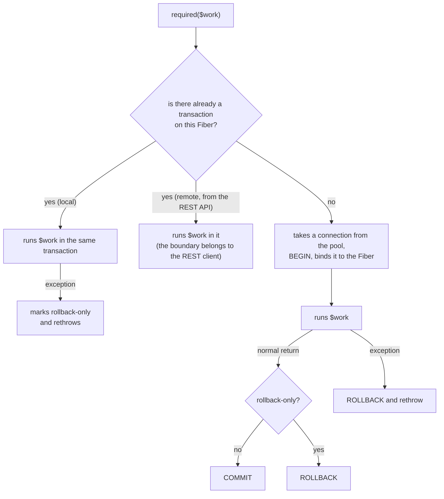

# TransactionService — several writes, all or nothing

> **Who it's for:** anyone writing a service that writes to more than one place and needs the
> writes to be atomic, or anyone about to use the REST API's remote transaction.
> **Read first:** [application-service.md](application-service.md) (where the transaction is
> opened) and [repository.md](repository.md) (what each repository call does in the database).

---

## Contents

1. [Why it exists](#1-why-it-exists)
2. [How to get it](#2-how-to-get-it)
3. [The only method: `required()`](#3-the-only-method-required)
4. [Examples](#4-examples)
5. [The `TransactionContext` handle](#5-the-transactioncontext-handle)
6. [Exceptions](#6-exceptions)
7. [How it works underneath](#7-how-it-works-underneath)
8. [The REST API's remote transaction](#8-the-rest-apis-remote-transaction)
9. [Usage rules](#9-usage-rules)
10. [References](#10-references)

---

## 1. Why it exists

Outside a transaction, **each repository call is an independent statement**: `Database` takes any
free connection from the pool, runs it and returns the connection. If the statement succeeded, it
is saved — PostgreSQL auto-commits each standalone statement.

That's enough for a single write (inserting a review). It isn't enough when the business operation
is **several** writes that only make sense together. Checking out a purchase writes the purchase
row and one row per item; if the third item fails, without a transaction the purchase would stay
in the database with two of its five items — a wrong receipt and a cart already emptied.

`TransactionService` delimits that block: everything that runs inside it goes into **one**
database transaction, which is committed at the end or undone entirely.

---

## 2. How to get it

The interface is `Wdc\Framework\Domain\Transaction\TransactionService`; the implementation is
`Wdc\Framework\Persistence\SqlTransactionService`. There is one instance per server, created and
registered in `Beans` by `ShoppingRepositories::register()`:

| Where you are | How to get it |
|---|---|
| Presenter, presentation service, REST API, tests | `Beans::of(TransactionService::class)` (in the constructor, or directly in the test) |
| Optional (e.g. REST routes built without a database) | `Beans::find(TransactionService::class)` (returns `null` if not registered) |

The application service looks up the `TransactionService` in its constructor, the same way it looks
up the repositories:

```php
// CartManager: the session's cart
public function __construct()
{
    $this->tx = Beans::of(TransactionService::class);
    $this->purchases = Beans::of(PurchaseRepository::class);
}
```

---

## 3. The only method: `required()`

```php
interface TransactionService
{
    /**
     * Runs $work inside a transaction: joins the current one or opens a new one.
     * Commits on normal return; rolls back on an exception (rethrown) or if setRollbackOnly().
     *
     * @template T
     * @param callable(TransactionContext): T $work
     * @return T
     */
    public function required(callable $work): mixed;
}
```

It is the only propagation mode there is: **REQUIRED**. There is no "always new", "no transaction"
or equivalent — if you miss one of them, talk to the team first; the common case doesn't need it.

The behavior:

- **There is no transaction on the current Fiber** → this call is the "owner": it opens the
  transaction, runs `$work`, **commits** on normal return and **rolls back** if `$work` throws (and
  rethrows the exception).
- **There already is a transaction** (someone above called `required()`) → this call **joins** it:
  it runs `$work` in the same transaction, without its own commit. If `$work` throws, the whole
  transaction is marked *rollback-only* and the exception propagates.
- **The return value of `$work` is returned** by `required()` (`$id = $tx->required(fn () => ...)`).
  In PHP, a closure "with no return" returns `null`, so there is no separate version for work with
  and without a result.



---

## 4. Examples

### 4.1 The real case: purchase + items (`CartManager`)

```php
// the presentation layer's only transaction boundary: purchase + items, all or nothing
$this->tx->required(function () use ($purchase): void {
    if (!$this->purchases->insert($purchase)) {
        throw new LogicException('Record not inserted');
    }
});

return $purchase->id() ?? throw new LogicException('Purchase has no id after insert');
```

`PurchaseRepositoryImpl::insert()` writes the purchase and calls the items repository for each
item. All those `INSERT`s run on the Fiber that called `required()`, so they all go into the same
transaction. Note that validating the items and building the `Purchase` happen **before** — the
transaction only wraps the writes — and that emptying the cart and notifying the listeners happen
**after**, in `CartManager::commit()`, once the write has been committed.

> **PHP tip:** `function () use ($purchase): void { ... }` is a closure that captures `$purchase`
> by value. Inside it, `$this` is still the `CartManager` (closures declared in a method inherit
> `$this`). `fn () => ...` captures automatically, but accepts only one expression.

### 4.2 Reentrancy: one service calls another

Since `required()` joins the current transaction, a transactional method can call another without
worrying:

```php
$tx->required(function (TransactionContext $outer) use ($tx): void {
    $this->insertProduct('A');
    $tx->required(function (TransactionContext $inner) use ($outer): void {
        // $inner is the same object as $outer: the inner call joins the same transaction
        $this->insertProduct('B');
    });
    $outer->setRollbackOnly();
});
// nothing was saved: the outer rollback also undoes the inner work
```

(This snippet is from `tests/Framework/Persistence/SqlTransactionServiceTest.php`.)

If the inner call **throws**, it marks the transaction as rollback-only before rethrowing. Even if
the outer one catches the exception and finishes normally, the result is a **rollback** — a
transaction in which one part failed is not half-committed.

### 4.3 Giving up for a business reason: `setRollbackOnly()`

When the work finds out, midway, that it shouldn't save — but it isn't an error that should
propagate as an exception —, mark the transaction:

```php
Beans::of(TransactionService::class)->required(function (TransactionContext $tx): void {
    $this->insertProduct('A');
    $tx->setRollbackOnly();
});
// required() returned normally, but did a ROLLBACK
```

Careful: `required()` **returns normally** in this case. The caller doesn't learn about the
rollback through the flow; if it needs to know, return that in the return value. In most business
cases, throwing an expected exception (which the presenter turns into a message) is clearer.

---

## 5. The `TransactionContext` handle

`$work` receives a `TransactionContext` (it can ignore it, as `CartManager` does):

```php
interface TransactionContext
{
    public function setRollbackOnly(): void;   // the outcome will be ROLLBACK, even on normal return
    public function isRollbackOnly(): bool;
    public function isActive(): bool;          // false after the transaction has ended
}
```

- In a nested call, the context received is **the same object** as in the owner call.
- After `required()` returns, the context becomes inactive (`isActive() === false`). Don't keep the
  handle for later.
- When `required()` joins a REST API **remote transaction** (section 8), it hands over a new
  context that doesn't control the outcome: there, the REST client decides commit or rollback.

---

## 6. Exceptions

| Situation | What happens |
|---|---|
| `$work` throws any exception | rollback (if owner) or rollback-only (if participant); the **same** exception propagates. `required()` neither wraps nor replaces the exception. |
| `setRollbackOnly()` and normal return | silent rollback; `required()` returns the value. |
| Failure to open, commit or roll back (database down, connection dropped) | the driver's exception (`amphp/postgres`) propagates; in the presenter, it lands in `catch (Throwable)` → `alertUnexpectedError()`. |

The presenter handles the expected exceptions the service throws — they cross `required()`
intact:

```php
} catch (InvalidCartItemException $caught) {
    $this->alert(1, 'There must be at least one item in the cart to complete a purchase');
} catch (OfflineException $caught) {
    $this->alert(4, 'The database is currently offline. ...');
} catch (Throwable $caught) {
    $this->app->alertUnexpectedError('Buying a product', $caught);
}
```

The **remote** transaction exceptions are in section 8.

---

## 7. How it works underneath

### Transaction = exclusive connection, bound to the Fiber

The server runs in a single process, with one event loop, and each session is a **Fiber** (a
cooperative thread of execution). When a query waits on the database, only that Fiber is
suspended; the other sessions keep going.

That creates a problem: inside a transaction, every statement must go to the **same connection** —
and only those statements. If session A opened a transaction and, while it waits on an `INSERT`,
session B makes a write, B's write must not land in A's transaction.

The solution, in `SqlTransactionService::required()` and `Database`:

1. the owner call takes a connection from the pool and opens the transaction:
   `$this->db->beginTransaction()`;
2. it binds the transaction **to the current Fiber**: `$this->db->bind($transaction)`;
3. from then on, `Database::executor()` sends **this** Fiber's SQL to the transaction; the other
   Fibers' SQL keeps going to the pool;
4. in the `finally`, it unbinds (`bind($previous)`) and returns the connection to the pool.

"Binding to the Fiber" means storing the value in a `FiberValue` — a variable each Fiber sees
separately (the event-loop equivalent of a per-thread variable). `SqlTransactionService` uses
another `FiberValue` for the current `TransactionContext`, and that's how a nested call finds out
it should join.

```mermaid
sequenceDiagram
    participant A as Session A's Fiber
    participant TS as SqlTransactionService
    participant DB as Database
    participant B as Session B's Fiber
    A->>TS: required($work)
    TS->>DB: beginTransaction() (pool connection)
    TS->>DB: bind(tx) — only for Fiber A
    A->>DB: INSERT purchase
    Note over A,DB: A waits on the database; the event loop serves B
    B->>DB: INSERT review
    DB-->>B: goes to the pool (outside A's transaction)
    A->>DB: INSERT items (in the transaction)
    TS->>DB: COMMIT, bind(null)
```

The `DatabaseConcurrencyTest::aTransaction_doesNotCaptureOtherFibersWrites` test proves it: one
Fiber opens the transaction, writes, yields with `pg_sleep` and then throws; another Fiber writes
during the wait. The first write is undone, the second stays.

### Consequence: `async()` inside the transaction runs OUTSIDE it

Anything started **on another Fiber** — an `async()`, a `scheduler()` timer — starts with an empty
`FiberValue`: it doesn't see the transaction. The SQL goes to the pool, auto-committed, and a call
to `required()` in there would open an **independent** transaction.

```php
$this->tx->required(function (): void {
    $this->purchases->insert($purchase);                       // in the transaction
    async(fn () => $this->products->update($product));          // WRONG: outside it,
                                                                //  committed even if the one above fails
});
```

If the write is part of the "all or nothing", call it directly, on the same Fiber.

### When a remote transaction is already bound to the Fiber

A REST write request with the `X-Tx-Id` header binds the client's remote transaction to the Fiber
(section 8). If, during that request, some code calls `required()`, it sees that
`$db->inTransaction()` is true and **joins**: it runs `$work` in it, with neither commit nor
rollback. The boundary belongs to the REST client, which will send `commit` or `rollback` later.

---

## 8. The REST API's remote transaction

Clients that access the repositories through the REST API (native apps, other SPAs) sometimes need
the same "all or nothing" that `CartManager` has — but spread over several HTTP requests. The
remote transaction exists for that.

### The protocol

| Route | What | Response |
|---|---|---|
| `POST /api/tx/begin` | opens a transaction for the caller | `{"txId": "..."}` |
| a write with `X-Tx-Id: <txId>` | `insert`/`update`/`delete` on `/api/repo/*` and `PUT .../image` run in it | the usual one |
| `POST /api/tx/commit` (with `X-Tx-Id`) | commits | `{"status": "committed"}` |
| `POST /api/tx/rollback` (with `X-Tx-Id`) | rolls back | `{"status": "rolledback"}` |
| `GET /api/tx/status` (with `X-Tx-Id`) | `open`, `committed`, `rolledback` or `unknown` | `{"status": "..."}` |

The same routes exist under each frontend's prefix (`/<frontend>/api/tx/...`). With security
enabled (`security.jwt.secret`), all of them require `Authorization: Bearer <jwt>`.

```bash
TX=$(curl -s -X POST localhost:8080/api/tx/begin -H "Authorization: Bearer $TOKEN" | jq -r .txId)

curl -X POST localhost:8080/api/repo/purchase/insert \
  -H "Authorization: Bearer $TOKEN" -H "X-Tx-Id: $TX" \
  -d '{"buyDate": "2024-05-01T12:00:00Z", "items": [{"amount": 1, "price": 1.0, "product": {"id": 0}}]}'

curl -X POST localhost:8080/api/tx/commit -H "Authorization: Bearer $TOKEN" -H "X-Tx-Id: $TX"
```

### How writes join it

`RepositoryApiRoutes::transactional()` wraps each write route:

- **with `X-Tx-Id`** → `coordinator->resume($txId, $owner)` binds the transaction to the request's
  Fiber, the endpoint runs, and in the `finally` `suspend()` unbinds it — it stays open for the next
  request;
- **without `X-Tx-Id`, but the caller has an open remote transaction** → **409**: the header was
  probably lost, and writing outside the transaction would break the block's atomicity;
- **otherwise** → one local transaction per request: `$transactions->required(...)`.

The read routes (`fetch`, `count`, `fetch-page`, `fetch-by-id`) don't go through that wrapper: they
run on the pool, outside the remote transaction, and therefore **don't see** its not-yet-committed
writes.

### The coordinator: `SqlRemoteTransactionCoordinator`

- **Its own connection, outside the pool.** Each `txId` keeps a connection opened by
  `Database::newConnection()` with the transaction in progress. A transaction that spans several
  requests can't hold a pool connection, which belongs to every session.
- **Owner.** Set at `begin` and checked on every operation: `user:<id>` for an authenticated user;
  `anon:<X-Client-Id>` with no user (security disabled); `null` with neither. Another user with the
  same `txId` gets **403**.
- **Concurrent use** of the same `txId` (two requests at the same time) is refused.
- **Limits** (`RemoteTransactionOptions`, read from `[database] remoteTransaction.*`, times in
  seconds):

| Key | Default | Purpose |
|---|---|---|
| `remoteTransaction.idleTimeoutSeconds` | 60 | idle for longer than this → rolled back |
| `remoteTransaction.maxLifetimeSeconds` | 600 | maximum lifetime since `begin`, even while in use |
| `remoteTransaction.outcomeRetentionSeconds` | 300 | how long the outcome is remembered |
| `remoteTransaction.maxOpen` | 128 | global cap on open transactions (each one is a connection) |
| `remoteTransaction.maxOpenPerOwner` | 16 | cap per owner |

- **Sweep.** Transactions that are idle or too old (and not in use) are rolled back by the sweep
  that runs **on every `begin`**; the outcome is recorded as `rolledback`. On server shutdown,
  `close()` rolls back every open one.
- **Idempotent commit and rollback.** If a `commit` response gets lost and the client retries,
  repeating the **same** outcome is a no-op (while the outcome is retained); asking for the
  **opposite** outcome gives **409**. When in doubt, `GET /api/tx/status` tells what happened.

### HTTP codes

| Exception | HTTP | When |
|---|---|---|
| `TransactionConflictException` | 409 | outcome opposite to one already recorded; a write without `X-Tx-Id` while a transaction is open |
| `TransactionLimitExceededException` | 429 | global or per-owner cap reached at `begin` |
| `AccessDeniedException` | 403 | `txId` of another owner; `commit`/`rollback`/`status` without `X-Tx-Id` |
| — | 401 | `begin` without a token, with security enabled |
| `TransactionSystemException` | 500 | unknown or expired `txId`; concurrent use; database failure |

---

## 9. Usage rules

1. **More than one write that must be atomic ⇒ `required()`.** A single write doesn't need it.
2. **The boundary lives in the application service**, not in the presenter or the repository.
   Today there is only one in the presentation layer: `CartManager::doPurchase()`.
3. **Short transaction.** Validate and build first; only the writes inside. Each open transaction
   holds a pool connection (16 by default, for every session).
4. **No waiting inside the transaction** — no async `sleep`, no call to an external service. The
   connection stays held meanwhile.
5. **Non-database effects after `required()`**: clearing the cart, notifying listeners,
   navigating, `update()`. If the transaction fails, they must not have happened.
6. **Don't swallow exceptions inside `$work`.** The rollback depends on the exception reaching
   `required()`. If you catch to decide something, use `setRollbackOnly()` or rethrow.
7. **Don't use `async()` or timers to write "inside" the transaction**: another Fiber runs outside
   it.
8. **Don't keep the `TransactionContext`** past `required()`.
9. **There is no propagation mode** other than REQUIRED.

---

## 10. References

Code:

- `src/Framework/Domain/Transaction/TransactionService.php`, `TransactionContext.php` — the contracts
- `src/Framework/Persistence/SqlTransactionService.php`, `SqlTransactionContext.php` — the implementation
- `src/Framework/Persistence/Database.php` — pool, `beginTransaction()`, `bind()`, `newConnection()`
- `src/Framework/Commons/Concurrent/FiberValue.php` — the per-Fiber value
- `src/Framework/Persistence/Transaction/SqlRemoteTransactionCoordinator.php`, `RemoteTransactionOptions.php`
- `src/Shopping/Persistence/Rest/TxApiController.php`, `RepositoryApiRoutes.php` — the `/api/tx/*` routes and the write wrapper
- `src/Shopping/Presentation/Presenter/Restricted/Cart/CartManager.php` — the real usage

Tests:

- `tests/Framework/Persistence/SqlTransactionServiceTest.php` — commit, rollback, rollback-only, nesting
- `tests/Framework/Persistence/DatabaseConcurrencyTest.php` — the transaction doesn't capture other Fibers
- `tests/Framework/Persistence/RemoteTransactionCoordinatorTest.php` — idempotency, owner, limits, sweep
- `tests/Shopping/Rest/RestApiTest.php` — the protocol over HTTP

Guides: [application-service.md](application-service.md), [repository.md](repository.md),
[../architecture.md](../architecture.md) (asynchronous access and REST API),
[../scaling.md](../scaling.md) (connections per instance).
