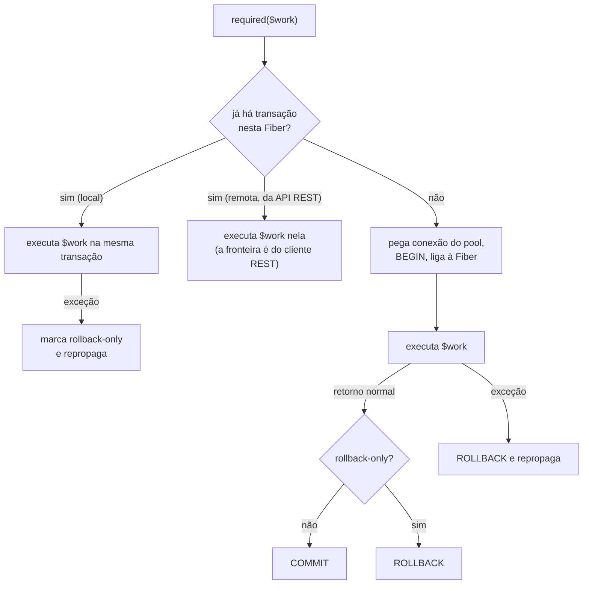

# TransactionService — várias escritas, tudo ou nada

> **Para quem é:** quem escreve um serviço que grava em mais de um lugar e precisa que as gravações
> sejam atômicas, ou quem vai usar a transação remota da API REST.
> **Pré-leitura:** [application-service.md](application-service.md) (onde a transação é aberta) e
> [repository.md](repository.md) (o que cada chamada de repositório faz no banco).

---

## Índice

1. [Por que existe](#1-por-que-existe)
2. [Como acessar](#2-como-acessar)
3. [O único método: `required()`](#3-o-único-método-required)
4. [Exemplos](#4-exemplos)
5. [O handle `TransactionContext`](#5-o-handle-transactioncontext)
6. [Exceções](#6-exceções)
7. [Como funciona por baixo](#7-como-funciona-por-baixo)
8. [A transação remota da API REST](#8-a-transação-remota-da-api-rest)
9. [Regras de uso](#9-regras-de-uso)
10. [Referências](#10-referências)

---

## 1. Por que existe

Fora de uma transação, **cada chamada de repositório é um comando independente**: o `Database`
pega qualquer conexão livre do pool, executa e devolve a conexão. Se o comando deu certo, está
gravado — o PostgreSQL faz o *commit* automático de cada comando avulso.

Isso basta para uma gravação única (inserir uma avaliação). Não basta quando a operação de negócio
são **várias** escritas que só fazem sentido juntas. Fechar uma compra grava a linha da compra e
uma linha por item; se o terceiro item falhar, sem transação a compra ficaria no banco com dois
itens dos cinco — um recibo errado e um carrinho já esvaziado.

O `TransactionService` demarca esse bloco: tudo o que roda dentro dele vai para **uma** transação
do banco, que é confirmada no fim ou desfeita inteira.

---

## 2. Como acessar

A interface é `Wdc\Framework\Domain\Transaction\TransactionService`; a implementação é
`Wdc\Framework\Persistence\SqlTransactionService`. Há uma instância por servidor, criada pelo
`ShoppingRepositories`:

| Onde você está | Como obter |
|---|---|
| Presenter ou serviço da apresentação | `Beans::of(TransactionService::class)` (registrado pelo `ShoppingRepositories::register()`) |
| Persistência, API REST, testes | `$repos->transactions` (campo público de `ShoppingRepositories`) |

O serviço de aplicação busca o `TransactionService` no construtor, como busca os repositórios:

```php
// CartManager: o carrinho da sessão
public function __construct()
{
    $this->tx = Beans::of(TransactionService::class);
    $this->purchases = Beans::of(PurchaseRepository::class);
}
```

---

## 3. O único método: `required()`

```php
interface TransactionService
{
    /**
     * Executa $work dentro de uma transação: participa da corrente ou abre uma nova.
     * Commit no retorno normal; rollback em exceção (repropagada) ou se setRollbackOnly().
     *
     * @template T
     * @param callable(TransactionContext): T $work
     * @return T
     */
    public function required(callable $work): mixed;
}
```

É o único modo de propagação que existe: **REQUIRED**. Não há "sempre nova", "sem transação" ou
equivalentes — se você sentir falta de um deles, converse com o time antes; o caso comum não
precisa.

O comportamento:

- **Não há transação na Fiber corrente** → esta chamada é a "dona": abre a transação, executa
  `$work`, faz **commit** no retorno normal e **rollback** se `$work` lançar (e repropaga a
  exceção).
- **Já há transação** (alguém acima chamou `required()`) → esta chamada **participa**: executa
  `$work` na mesma transação, sem commit próprio. Se `$work` lançar, a transação inteira é marcada
  *rollback-only* e a exceção sobe.
- **O valor de retorno de `$work` é devolvido** por `required()` (`$id = $tx->required(fn () => ...)`). Em PHP, uma closure "sem
  retorno" devolve `null`, por isso não há uma versão separada para trabalho com e sem resultado.



---

## 4. Exemplos

### 4.1 O caso real: compra + itens (`CartManager`)

```php
// a única fronteira de transação da apresentação: compra + itens, tudo ou nada
$this->tx->required(function () use ($purchase): void {
    if (!$this->purchases->insert($purchase)) {
        throw new LogicException('Record not inserted');
    }
});

return $purchase->id() ?? throw new LogicException('Compra sem id depois do insert');
```

`PurchaseRepositoryImpl::insert()` grava a compra e chama o repositório de itens para cada item.
Todos esses `INSERT` rodam na Fiber que chamou `required()`, então todos vão para a mesma
transação. Note que a validação dos itens e a montagem da `Purchase` acontecem **antes** — a
transação só envolve as escritas — e que esvaziar o carrinho e avisar os ouvintes acontece
**depois**, em `CartManager::commit()`, quando a gravação já foi confirmada.

> **Dica de PHP:** `function () use ($purchase): void { ... }` é uma closure que captura
> `$purchase` por valor. Dentro dela `$this` continua sendo o `CartManager` (closures declaradas
> num método herdam o `$this`). `fn () => ...` captura automaticamente, mas aceita só uma
> expressão.

### 4.2 Reentrância: um serviço chama outro

Como `required()` participa da transação corrente, um método transacional pode chamar outro sem
se preocupar:

```php
$tx->required(function (TransactionContext $outer) use ($tx): void {
    $this->insertProduct('A');
    $tx->required(function (TransactionContext $inner) use ($outer): void {
        // $inner é o mesmo objeto que $outer: a interna participa da mesma transação
        $this->insertProduct('B');
    });
    $outer->setRollbackOnly();
});
// nada foi gravado: o rollback da externa desfaz também o trabalho da interna
```

(Este trecho é do `tests/Framework/Persistence/SqlTransactionServiceTest.php`.)

Se a chamada interna **lançar**, ela marca a transação como rollback-only antes de repropagar.
Mesmo que a externa capture a exceção e termine normalmente, o resultado é **rollback** — uma
transação que teve uma parte falhando não é confirmada pela metade.

### 4.3 Desistir por regra de negócio: `setRollbackOnly()`

Quando o trabalho descobre, no meio, que não deve gravar — mas não é um erro que deva subir como
exceção —, marque a transação:

```php
$this->repos->transactions->required(function (TransactionContext $tx): void {
    $this->insertProduct('A');
    $tx->setRollbackOnly();
});
// required() voltou normalmente, mas fez ROLLBACK
```

Cuidado: `required()` **devolve normalmente** nesse caso. Quem chamou não fica sabendo do rollback
pelo fluxo; se precisar saber, devolva isso no valor de retorno. Na maioria dos casos de negócio,
lançar uma exceção esperada (que o presenter transforma em mensagem) é mais claro.

---

## 5. O handle `TransactionContext`

`$work` recebe um `TransactionContext` (pode ignorá-lo, como o `CartManager` faz):

```php
interface TransactionContext
{
    public function setRollbackOnly(): void;   // o desfecho será ROLLBACK, mesmo com retorno normal
    public function isRollbackOnly(): bool;
    public function isActive(): bool;          // false depois que a transação terminou
}
```

- Numa chamada aninhada, o contexto recebido é **o mesmo objeto** da chamada dona.
- Depois que `required()` volta, o contexto fica inativo (`isActive() === false`). Não guarde o
  handle para usar depois.
- Quando `required()` participa de uma **transação remota** da API REST (seção 8), ele entrega um
  contexto novo, que não comanda o desfecho: ali quem decide commit ou rollback é o cliente REST.

---

## 6. Exceções

| Situação | O que acontece |
|---|---|
| `$work` lança qualquer exceção | rollback (se dono) ou rollback-only (se participante); a **mesma** exceção sobe. `required()` não embrulha nem troca a exceção. |
| `setRollbackOnly()` e retorno normal | rollback silencioso; `required()` devolve o valor. |
| Falha ao abrir, confirmar ou desfazer (banco fora, conexão caiu) | a exceção do driver (`amphp/postgres`) sobe; no presenter, cai no `catch (Throwable)` → `alertUnexpectedError()`. |

O presenter trata as exceções esperadas que o serviço lança — elas atravessam o `required()`
intactas:

```php
} catch (InvalidCartItemException $caught) {
    $this->alert(1, 'Deve existir pelo menos um item no carrinho para se efetivar uma compra');
} catch (OfflineException $caught) {
    $this->alert(4, 'O banco de dados encontra-se fora do ar no momento. ...');
} catch (Throwable $caught) {
    $this->app->alertUnexpectedError('Buying a product', $caught);
}
```

As exceções da transação **remota** estão na seção 8.

---

## 7. Como funciona por baixo

### Transação = conexão exclusiva, ligada à Fiber

O servidor roda num único processo, com um event loop, e cada sessão é uma **Fiber** (uma linha de
execução cooperativa). Quando uma consulta espera o banco, só aquela Fiber é suspensa; as outras
sessões seguem.

Isso cria um problema: dentro de uma transação, todos os comandos precisam ir para a **mesma
conexão** — e só eles. Se a sessão A abriu uma transação e, enquanto espera um `INSERT`, a sessão
B faz uma gravação, a de B não pode cair na transação de A.

A solução, em `SqlTransactionService::required()` e `Database`:

1. a chamada dona pega uma conexão do pool e abre a transação: `$this->db->beginTransaction()`;
2. liga a transação **à Fiber corrente**: `$this->db->bind($transaction)`;
3. daí em diante, `Database::executor()` manda o SQL **desta** Fiber para a transação; o SQL das
   outras Fibers continua indo para o pool;
4. no `finally`, desliga (`bind($previous)`) e devolve a conexão ao pool.

"Ligar à Fiber" é guardar o valor num `FiberValue` — uma variável que cada Fiber enxerga
separadamente (o equivalente, no event loop, a uma variável por thread). O `SqlTransactionService`
usa outro `FiberValue` para o `TransactionContext` corrente, e é assim que uma chamada aninhada
descobre que deve participar.

```mermaid
sequenceDiagram
    participant A as Fiber da sessão A
    participant TS as SqlTransactionService
    participant DB as Database
    participant B as Fiber da sessão B
    A->>TS: required($work)
    TS->>DB: beginTransaction() (conexão do pool)
    TS->>DB: bind(tx) — só para a Fiber A
    A->>DB: INSERT compra
    Note over A,DB: A espera o banco; o event loop atende B
    B->>DB: INSERT avaliação
    DB-->>B: vai para o pool (fora da transação de A)
    A->>DB: INSERT itens (na transação)
    TS->>DB: COMMIT, bind(null)
```

O teste `DatabaseConcurrencyTest::aTransaction_doesNotCaptureOtherFibersWrites` prova isso: uma
Fiber abre a transação, grava, cede a vez com `pg_sleep` e depois lança; outra Fiber grava durante
a espera. A primeira gravação é desfeita, a segunda fica.

### Consequência: `async()` dentro da transação roda FORA dela

Tudo o que for disparado **em outra Fiber** — um `async()`, um timer do `scheduler()` — começa com
o `FiberValue` vazio: não enxerga a transação. O SQL vai para o pool, com commit automático, e uma
chamada a `required()` lá dentro abriria uma transação **independente**.

```php
$this->tx->required(function (): void {
    $this->purchases->insert($purchase);                       // na transação
    async(fn () => $this->products->update($product));          // ERRADO: fora dela,
                                                                //  confirmado mesmo se a de cima falhar
});
```

Se a escrita faz parte do "tudo ou nada", chame-a diretamente, na mesma Fiber.

### Quando já existe uma transação remota ligada à Fiber

Uma requisição REST de escrita com o cabeçalho `X-Tx-Id` liga à Fiber a transação remota do
cliente (seção 8). Se, nessa requisição, algum código chamar `required()`, ele percebe que
`$db->inTransaction()` é verdadeiro e **participa**: executa `$work` nela, sem commit nem rollback.
A fronteira é do cliente REST, que vai mandar `commit` ou `rollback` depois.

---

## 8. A transação remota da API REST

Clientes que acessam os repositórios pela API REST (apps nativos, outras SPAs) às vezes precisam do
mesmo "tudo ou nada" que o `CartManager` tem — mas espalhado por várias requisições HTTP. A
transação remota existe para isso.

### O protocolo

| Rota | O quê | Resposta |
|---|---|---|
| `POST /api/tx/begin` | abre uma transação para o solicitante | `{"txId": "..."}` |
| escrita com `X-Tx-Id: <txId>` | `insert`/`update`/`delete` de `/api/repo/*` e `PUT .../image` rodam nela | a de sempre |
| `POST /api/tx/commit` (com `X-Tx-Id`) | confirma | `{"status": "committed"}` |
| `POST /api/tx/rollback` (com `X-Tx-Id`) | desfaz | `{"status": "rolledback"}` |
| `GET /api/tx/status` (com `X-Tx-Id`) | `open`, `committed`, `rolledback` ou `unknown` | `{"status": "..."}` |

As mesmas rotas existem sob o prefixo de cada frontend (`/<frontend>/api/tx/...`). Com a segurança
ligada (`security.jwt.secret`), todas exigem `Authorization: Bearer <jwt>`.

```bash
TX=$(curl -s -X POST localhost:8080/api/tx/begin -H "Authorization: Bearer $TOKEN" | jq -r .txId)

curl -X POST localhost:8080/api/repo/purchase/insert \
  -H "Authorization: Bearer $TOKEN" -H "X-Tx-Id: $TX" \
  -d '{"buyDate": "2024-05-01T12:00:00Z", "items": [{"amount": 1, "price": 1.0, "product": {"id": 0}}]}'

curl -X POST localhost:8080/api/tx/commit -H "Authorization: Bearer $TOKEN" -H "X-Tx-Id: $TX"
```

### Como as escritas entram nela

`RepositoryApiRoutes::transactional()` envolve cada rota de escrita:

- **com `X-Tx-Id`** → `coordinator->resume($txId, $owner)` liga a transação à Fiber da requisição,
  o endpoint roda, e no `finally` `suspend()` a desliga — ela continua aberta para a próxima
  requisição;
- **sem `X-Tx-Id`, mas o solicitante tem uma transação remota aberta** → **409**: o cabeçalho
  provavelmente se perdeu, e gravar fora da transação quebraria a atomicidade do bloco;
- **senão** → uma transação local por requisição: `$transactions->required(...)`.

As rotas de leitura (`fetch`, `count`, `fetch-page`, `fetch-by-id`) não passam por esse
envoltório: rodam no pool, fora da transação remota, e por isso **não enxergam** as escritas ainda
não confirmadas dela.

### O coordenador: `SqlRemoteTransactionCoordinator`

- **Conexão própria, fora do pool.** Cada `txId` guarda uma conexão aberta por
  `Database::newConnection()` com a transação em andamento. Uma transação que atravessa várias
  requisições não pode prender uma conexão do pool, que é de todas as sessões.
- **Dono.** Fixado no `begin` e conferido em toda operação: `user:<id>` para um usuário
  autenticado; `anon:<X-Client-Id>` sem usuário (segurança desligada); `null` sem nenhum dos dois.
  Outro usuário com o mesmo `txId` recebe **403**.
- **Uso concorrente** do mesmo `txId` (duas requisições ao mesmo tempo) é recusado.
- **Limites** (`RemoteTransactionOptions`, lidos de `[database] remoteTransaction.*`, tempos em
  segundos):

| Chave | Padrão | Para quê |
|---|---|---|
| `remoteTransaction.idleTimeoutSeconds` | 60 | ociosa há mais que isso → revertida |
| `remoteTransaction.maxLifetimeSeconds` | 600 | vida máxima desde o `begin`, mesmo com uso |
| `remoteTransaction.outcomeRetentionSeconds` | 300 | por quanto tempo o desfecho é lembrado |
| `remoteTransaction.maxOpen` | 128 | teto global de transações abertas (cada uma é uma conexão) |
| `remoteTransaction.maxOpenPerOwner` | 16 | teto por dono |

- **Varredura.** As transações ociosas ou velhas demais (e que não estão em uso) são revertidas na
  varredura que roda **a cada `begin`**; o desfecho fica registrado como `rolledback`. No
  desligamento do servidor, `close()` reverte todas as abertas.
- **Commit e rollback idempotentes.** Se a resposta de um `commit` se perder e o cliente repetir,
  repetir o **mesmo** desfecho é no-op (enquanto o desfecho estiver retido); pedir o desfecho
  **oposto** dá **409**. Na dúvida, `GET /api/tx/status` diz o que aconteceu.

### Códigos HTTP

| Exceção | HTTP | Quando |
|---|---|---|
| `TransactionConflictException` | 409 | desfecho oposto a um já registrado; escrita sem `X-Tx-Id` com transação aberta |
| `TransactionLimitExceededException` | 429 | teto global ou por dono atingido no `begin` |
| `AccessDeniedException` | 403 | `txId` de outro dono; `commit`/`rollback`/`status` sem `X-Tx-Id` |
| — | 401 | `begin` sem token, com a segurança ligada |
| `TransactionSystemException` | 500 | `txId` desconhecido ou expirado; uso concorrente; falha do banco |

---

## 9. Regras de uso

1. **Mais de uma escrita que precisa ser atômica ⇒ `required()`.** Uma escrita só não precisa.
2. **A fronteira fica no serviço de aplicação**, não no presenter nem no repositório. Hoje há uma
   só na apresentação: `CartManager::doPurchase()`.
3. **Transação curta.** Valide e monte antes; só as escritas dentro. Cada transação aberta segura
   uma conexão do pool (16 por padrão, para todas as sessões).
4. **Nada de espera dentro da transação** — nem `sleep` assíncrono, nem chamada a serviço
   externo. A conexão fica presa enquanto isso.
5. **Efeitos fora do banco depois do `required()`**: limpar carrinho, avisar ouvintes, navegar,
   `update()`. Se a transação falhar, eles não devem ter acontecido.
6. **Não engula exceções dentro de `$work`.** O rollback depende de a exceção chegar ao
   `required()`. Se capturar para decidir algo, use `setRollbackOnly()` ou relance.
7. **Não use `async()` nem timers para escrever "dentro" da transação**: outra Fiber roda fora dela.
8. **Não guarde o `TransactionContext`** para depois do `required()`.
9. **Não existe outro modo de propagação** além de REQUIRED.

---

## 10. Referências

Código:

- `src/Framework/Domain/Transaction/TransactionService.php`, `TransactionContext.php` — os contratos
- `src/Framework/Persistence/SqlTransactionService.php`, `SqlTransactionContext.php` — a implementação
- `src/Framework/Persistence/Database.php` — pool, `beginTransaction()`, `bind()`, `newConnection()`
- `src/Framework/Commons/Concurrent/FiberValue.php` — o valor por Fiber
- `src/Framework/Persistence/Transaction/SqlRemoteTransactionCoordinator.php`, `RemoteTransactionOptions.php`
- `src/Shopping/Persistence/Rest/TxApiController.php`, `RepositoryApiRoutes.php` — as rotas `/api/tx/*` e o envoltório das escritas
- `src/Shopping/Presentation/Presenter/Restricted/Cart/CartManager.php` — o uso real

Testes:

- `tests/Framework/Persistence/SqlTransactionServiceTest.php` — commit, rollback, rollback-only, aninhamento
- `tests/Framework/Persistence/DatabaseConcurrencyTest.php` — a transação não captura outras Fibers
- `tests/Framework/Persistence/RemoteTransactionCoordinatorTest.php` — idempotência, dono, limites, varredura
- `tests/Shopping/Rest/RestApiTest.php` — o protocolo pela HTTP

Guias: [application-service.md](application-service.md), [repository.md](repository.md),
[../arquitetura.md](../arquitetura.md) (acesso assíncrono e API REST),
[../escalando.md](../escalando.md) (conexões por instância).
