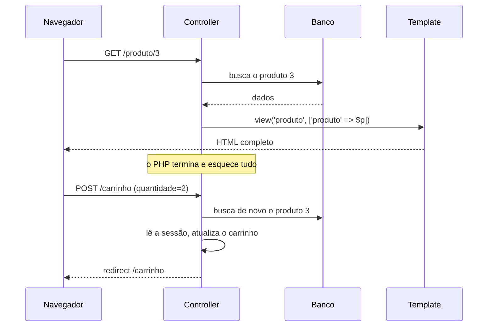
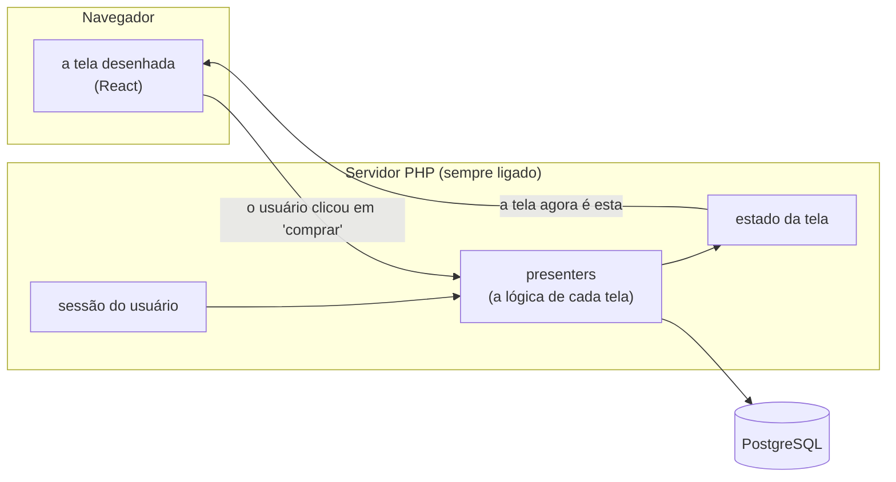
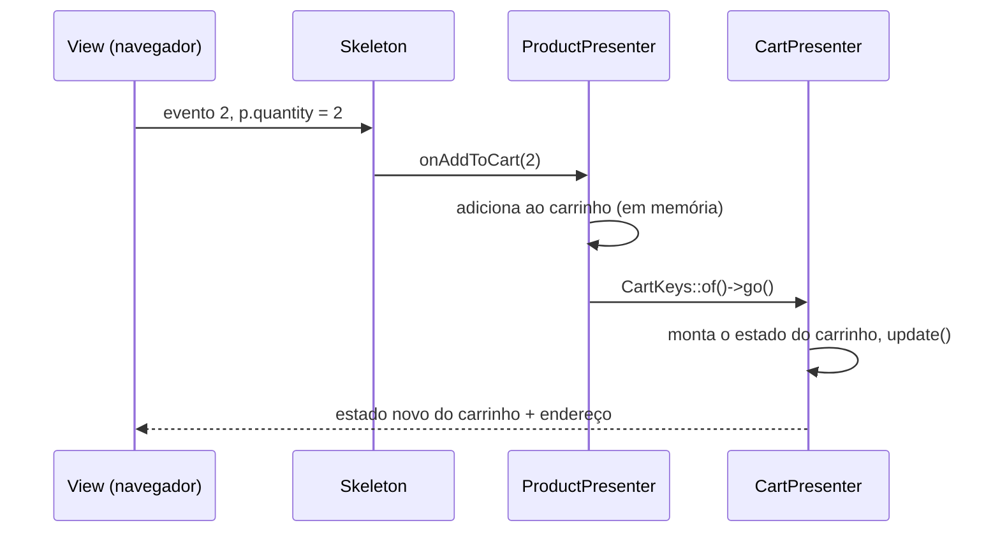
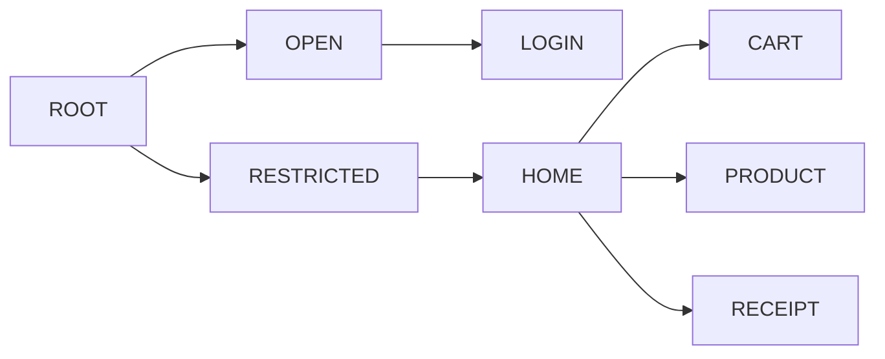

# Guia para quem vem do PHP tradicional

Você programa em PHP. Provavelmente com Laravel, Symfony, CodeIgniter ou PHP "puro": chega uma
requisição, um controller busca dados, um template (Blade, Twig, um `.php` com HTML) monta a
página e a resposta vai para o navegador. Funciona, você conhece cada passo, e é assim que a
maior parte da web em PHP é feita.

Este projeto propõe outra forma de organizar uma aplicação: o **Cube**. A proposta é mais
estruturada, e por isso parece estranha à primeira vista. Este guia apresenta a ideia a partir do
que você já sabe, sem pressa, com um exercício no final para você sentir na mão.

Não é preciso saber React nem nada de arquitetura de software. Basta PHP.

## Sumário

1. O jeito que você já conhece
2. A ideia do Cube em uma frase
3. Do seu mundo para o Cube: o dicionário
4. Uma tela por dentro: o detalhe do produto
5. Pensar em estado, não em páginas
6. O endereço da página nasce do estado
7. O que você ganha (e o que custa)
8. Hábitos do PHP tradicional que aqui atrapalham
9. Exercício: frete grátis no carrinho
10. Para onde ir depois

---

## 1. O jeito que você já conhece

Num framework de template, cada clique é uma conversa nova e completa:



Três características desse modelo vão importar daqui a pouco:

- **O PHP morre a cada requisição.** Tudo o que precisa sobreviver vai para a sessão, para o
  banco ou para um cookie, e é relido na requisição seguinte.
- **O template recebe dados e decide como mostrar.** Formatação, contas, "se a lista estiver
  vazia, mostre tal coisa" - muita lógica de tela acaba no template, ou espalhada em JavaScript.
- **Cada tela é uma página.** A rota diz qual controller atende; a navegação é de página em
  página.

## 2. A ideia do Cube em uma frase

> No Cube, **o PHP não morre**: cada usuário conectado tem, no servidor, objetos vivos que sabem
> o que a tela dele está mostrando. O navegador só desenha o que recebe e avisa o que o usuário
> fez.



A conversa entre navegador e servidor é contínua, por **WebSocket** (uma conexão que fica aberta
nos dois sentidos). Não há "página nova" a cada clique: o servidor manda só o que mudou na tela.

Para isso o servidor é um processo PHP que fica rodando - como um worker de fila, ou um servidor
Node. Ele é iniciado uma vez (`php bin/server.php`) e atende todos os usuários.

## 3. Do seu mundo para o Cube: o dicionário

| Você conhece | No Cube | Onde ver |
|---|---|---|
| Rota (`routes/web.php`) | **Place** (uma tela possível) + **Routes** (o caminho até ela) | `src/Shopping/Presentation/Place.php`, `Routes.php` |
| Controller | **Presenter**: a lógica de uma tela | `.../Presenter/Restricted/Products/ProductPresenter.php` |
| Ação do controller (`show`, `store`) | `applyParameters` (entrar na tela) e métodos `onXxx` (eventos) | idem |
| Variáveis passadas ao template | **ViewState**: um objeto com o que a tela mostra | `ProductViewState.php` |
| Template Blade/Twig | **View React**: só desenha o ViewState | `frontend/shopping.shell.react/src/scripts/views/` |
| `$request->query('id')` | `$keys->productId` (as **Keys** leem o endereço, já validado) | `ProductKeys.php` |
| `redirect()->route('cart')` | `CartKeys::of($this->app)->go()` | `ProductPresenter::onAddToCart` |
| `session()->flash('sucesso')` | um atributo do intent (`$keys->purchaseMade = true`) | `ReceiptKeys.php` |
| `$_SESSION` / `session()` | campos do presenter: **vivem na memória** enquanto o usuário está ali | `CartManager.php` |
| Middleware de autenticação | **presenter-guarda** (`RestrictedPresenter`) | `.../Restricted/RestrictedPresenter.php` |
| Layout com `@yield` / `` | **slots**: um lugar na tela onde a tela de baixo se encaixa | `HomePresenter.php` |
| Componentes / partials | **presenters-filhos** (os painéis da home) | `.../Home/Products/ProductsPanelPresenter.php` |
| `Produto::with('itens')` (eager loading) | **projeção**: o que buscar, numa consulta só | `ProductInfo::projection()` |
| `DB::transaction(fn () => ...)` | `Beans::of(TransactionService::class)->required(fn () => ...)` | `CartManager::commit` |

Se você guardar só uma linha dessa tabela, guarde esta: **o controller vira um objeto que
continua existindo enquanto a tela está aberta**. É daí que vem todo o resto.

## 4. Uma tela por dentro: o detalhe do produto

Vamos abrir a tela de produto do Shopping (a loja de demonstração) e ler as quatro peças.

### 4.1 O estado da tela

```php
final class ProductViewState implements ViewState
{
    public ?ProductInfo $product = null;
    public int $errorCode = 0;
    public ?string $errorMessage = null;
}
```

Pense nele como **o array que você passaria para o template** - só que é um objeto, e ele fica
guardado. Tudo o que a tela mostra está aqui, em propriedades públicas. O servidor transforma
esse objeto em JSON e manda para o navegador.

### 4.2 As keys: ler o endereço com segurança

```php
final class ProductKeys extends HomeKeys
{
    private const string PREFIX = 'pr';
    private const string P_ID = self::PREFIX . '-id';

    public ?int $productId {
        get => $this->idParameter(self::P_ID);          // inteiro >= 0, ou null
        set (?int $value) {
            $this->intent->setParameter(self::P_ID, $value);
        }
    }
}
```

É o equivalente a ler `$_GET['id']`, mas num lugar só, com tipo e validação. O endereço da tela
fica `#product?pr-id=3`. (A sintaxe `get =>` / `set` é dos *property hooks* do PHP 8.4: por fora
parece uma propriedade comum, por dentro roda código.)

### 4.3 O presenter: a lógica

```php
final class ProductPresenter extends AbstractCubePresenter
{
    public readonly ProductViewState $state;

    // entrar na tela - o "show" do controller
    public function applyParameters(CubeIntent $intent, bool $initialization, bool $deepest): bool
    {
        $keys = new ProductKeys($this->app, $intent);
        $id = $keys->productId ?? throw new ProductNotFoundException();
        if ($this->state->product?->id !== $id) {
            $this->state->product = $this->productService->loadProductById($id);
            $this->update();                        // "a tela mudou, mande de novo"
        }
        // ... cria a view na primeira vez e se encaixa no lugar certo da tela
        return true;
    }

    // um evento - o "store" do controller
    public function onAddToCart(?int $quantity): void
    {
        try {
            if ($quantity === null || $quantity < 1) {
                $this->alert(2, 'A quantidade deve ser maior ou igual a 1.');
                return;
            }
            $this->app->cart()->addProduct($this->state->product, $quantity);
            CartKeys::of($this->app)->go();         // o "redirect" para o carrinho
        } catch (Throwable $caught) {
            $this->app->alertUnexpectedError('Adding an item to cart', $caught);
        }
    }
}
```

Repare em duas coisas que não existiriam num controller:

- **`$this->state->product` continua lá depois do método terminar.** Quando o usuário clicar em
  "adicionar ao carrinho", o produto já está na memória - não é preciso buscá-lo de novo.
- **`$this->update()`.** Mudar o estado não basta: é preciso avisar que a tela mudou. Ao fim do
  clique, o servidor junta o que foi marcado e manda para o navegador.

### 4.4 Os eventos: o que liga o clique ao método

```php
public function skeleton(): CubeSkeleton
{
    return new Skeleton('48b693f67410', function (int $event, int $qtde, array $form): void {
        match ($event) {
            1 => $this->onOpenProducts(),
            2 => $this->onAddToCart(Coerce::asInt($form['p.quantity'] ?? null)),
            default => Skeleton::unknownEvent($event),
        };
    });
}
```

O navegador não chama URLs: ele manda "o evento 2 aconteceu na tela `48b693f67410`, com
`p.quantity = 2`". O `match` traduz isso numa chamada de método. O código `48b693f67410`
identifica o tipo de tela, e a view React usa o mesmo código.

### 4.5 A view: só desenha

```tsx
class ProductViewClass extends BaseViewClass<ViewProps, ProductViewState> {
  override render() {
    const product = this.state.product ?? DefaultProduct
    return (/* nome, descrição, preço, botão "Adicionar ao Carrinho" */)
  }

  readonly emitAddToCart = () => {
    bridge.setFormField(this.vsid, "p.quantity", this.state.quantity)
    bridge.submit(this.vsid, ON_ADD_TO_CART)     // o evento 2
  }
}
export default BaseViewClass.FC(ProductViewClass, "48b693f67410")
```

A view é o seu template. A diferença é a disciplina: ela **não decide nada**. Não calcula total,
não formata regra de negócio, não valida. Recebe o estado e desenha; recebe um clique e avisa.

### O caminho completo de um clique



## 5. Pensar em estado, não em páginas

A mudança de cabeça mais importante: **pare de pensar "qual página eu devolvo?" e comece a
pensar "qual é o estado da tela agora?"**.

Compare o carrinho nos dois mundos:

| | Framework de template | Cube |
|---|---|---|
| Onde fica o carrinho | na sessão (serializado), relido a cada requisição | num objeto (`CartManager`) que vive na memória da sessão |
| Mudar a quantidade | POST → controller lê a sessão → altera → grava → redirect → GET → re-renderiza tudo | evento → `onModifyQuantity()` altera o objeto → `update()` → só o carrinho é redesenhado |
| Mostrar o número de itens no cabeçalho | cada página relê a sessão para mostrar o contador | a home é avisada quando o carrinho muda e atualiza o contador |

E as telas se compõem como peças: a home tem os painéis e um espaço central; o produto, o
carrinho e o recibo se encaixam nesse espaço. É o seu layout com `@yield`, mas com cada pedaço
tendo a própria lógica.



Estar no carrinho significa ter vivos os presenters de todo o caminho: raiz, área restrita
(a guarda que exige login), home e carrinho. Ir do carrinho para o produto troca só a ponta:
a home continua lá, com os painéis do jeito que estavam.

## 6. O endereço da página nasce do estado

Num framework de template, a URL vem primeiro: ela escolhe o controller. No Cube é o contrário:
**o estado vem primeiro, e o endereço é calculado a partir dele**. Cada presenter publica o mínimo
para recriar o que mostra (`publishParameters`), e a soma vira o endereço:

```
#product?rt-user=0&pr-id=3&sign=7CVbXLDU1zqkuEUHElyqba
```

Na prática:

- **F5, favorito e voltar funcionam.** O servidor lê o endereço, entrega os parâmetros a cada
  presenter (`applyParameters`) e a tela volta igual.
- **O endereço é assinado** (`sign=`). Editado à mão, ele é ignorado. Mesmo assim, as keys
  validam tudo: um link antigo pode apontar para um produto que já não existe.
- **Você nunca monta URL na mão.** Para levar o usuário a outra tela, você diz o que ela precisa
  (`$keys->purchaseId = 7`) e manda ir (`->go()`).

## 7. O que você ganha (e o que custa)

**Você ganha:**

- **Lógica de tela num lugar só, testável sem navegador.** Um teste chama
  `$presenter->onAddToCart(2)` e confere o estado - sem HTTP, sem HTML, sem Selenium. Veja
  `tests/Shopping/Presentation/ShoppingWorkflowTest.php`.
- **Menos idas ao banco.** O que a tela já carregou fica na memória; e cada consulta traz
  exatamente o que a tela mostra, com as relações já montadas (adeus, N+1).
- **Telas que respondem na hora**, sem recarregar a página nem escrever uma API e um front-end
  separados para cada tela.
- **Segurança por construção**: o navegador nunca recebe dados que a tela não mostra, e as regras
  ficam no servidor.

**Custa:**

- **Um processo que fica ligado.** Não é um PHP-FPM que nasce e morre: você o inicia, ele roda.
  Atualizar o código é reiniciar o processo.
- **Memória por usuário conectado.** Cada sessão tem seus objetos vivos.
- **Disciplina.** O modelo só funciona se cada peça fizer o seu papel (a próxima seção mostra os
  tropeços mais comuns).
- **Para muitos usuários**, várias instâncias atrás de um balanceador - veja
  [escalando.md](escalando.md).

## 8. Hábitos do PHP tradicional que aqui atrapalham

Num PHP que morre a cada requisição, vários hábitos são inofensivos. Num processo que fica
ligado, servindo todo mundo ao mesmo tempo, eles viram defeitos.

| Hábito | O que acontece aqui | Faça assim |
|---|---|---|
| `sleep(3)`, `file_get_contents('https://...')`, um laço pesado | **trava todos os usuários**: o processo é um só | `($this->app->context->sleep)(3)`, clientes HTTP do Amp, tarefa pesada num worker |
| `static $usuarioAtual` ou `global` | um usuário enxerga o dado do outro | estado no presenter; contexto por requisição em `FiberValue` |
| `$_GET`, `$_POST`, `$_SESSION` | não existem: não há requisição HTTP por clique | keys (endereço), argumentos do evento (`$form`), campos do presenter (sessão) |
| `echo` / `var_dump` para depurar | sai no terminal do servidor, não no navegador | o logger (`$this->app->logger()`) ou um teste |
| `die()` / `exit()` | derruba o servidor de todos | lance uma exceção |
| Mudar o estado e esperar que a tela mude | a tela não muda | `$this->update()` |
| Formatar, somar ou decidir no template | lógica duplicada, difícil de testar | calcule no presenter e mande pronto no estado |
| Criar timer ou ouvinte e esquecer | continua rodando depois que a tela fecha | guarde o registro e desfaça em `release()` |
| Buscar dados dentro de um `foreach` | uma consulta por linha | ponha a relação na projeção |

## 9. Exercício: frete grátis no carrinho

Hoje a view do carrinho **calcula o total sozinha**, em TypeScript:

```tsx
const total = items.reduce((sum, item) => sum + item.price * item.quantity, 0)
const totalText = `R$ ${total.toFixed(2)}`
```

Pela regra da seção 4.5, isso está no lugar errado: é conta, e conta é do presenter. Vamos
corrigir e, de quebra, mostrar um aviso: "Frete grátis!" a partir de R$ 100,00, ou "Faltam
R$ X para o frete grátis".

### Passo 1 - o estado ganha os campos

`src/Shopping/Presentation/Presenter/Restricted/Cart/CartViewState.php`:

```php
final class CartViewState implements ViewState
{
    /** @var list<CartItem> */
    public array $items = [];
    public string $total = '';               // já formatado: "R$ 112,00"
    public ?string $shippingNote = null;     // o aviso do frete
    public int $errorCode = 0;
    public ?string $errorMessage = null;
}
```

### Passo 2 - o presenter calcula

O lugar certo para valores derivados é `commitComputedState()`: ele roda logo antes de o estado
ir para o navegador, depois de qualquer mudança. Em `CartPresenter.php`:

```php
public const float FREE_SHIPPING_FROM = 100.0;

public function commitComputedState(): void
{
    $sum = 0.0;
    foreach ($this->state->items as $item) {
        $sum += $item->price * $item->quantity;
    }
    $total = 'R$ ' . number_format($sum, 2, ',', '.');
    $note = $sum >= self::FREE_SHIPPING_FROM
        ? 'Frete grátis!'
        : 'Faltam R$ ' . number_format(self::FREE_SHIPPING_FROM - $sum, 2, ',', '.') . ' para o frete grátis';

    if ($this->state->total !== $total || $this->state->shippingNote !== $note) {
        $this->state->total = $total;
        $this->state->shippingNote = $note;
        $this->update();    // só se mudou: senão o estado seria reenviado para sempre
    }
}
```

### Passo 3 - a view só desenha

Em `frontend/shopping.shell.react/src/scripts/views/cart/CartView.tsx`:

```tsx
export type CartViewState = {
  items?: CartItem[]
  total?: string
  shippingNote?: string
  errorMessage?: string
}

// no render(): apague o reduce e use o que veio pronto
<span className={Sel.footerTotal}>{state.total}</span>
{state.shippingNote && <div className={Sel.footer}>{state.shippingNote}</div>}
```

### Passo 4 - um teste, sem navegador

Em `tests/Shopping/Presentation/`, um teste novo (o pen drive custa R$ 16,00):

```php
final class FreeShippingTest extends PresentationTestCase
{
    #[Test]
    public function aboveOneHundred_shippingIsFree(): void
    {
        $home = $this->login();
        $home->presenter->onOpenProduct(Seed::PEN_DRIVE2GB_ID);
        ProductViewMock::cast($home->state->contentView)->presenter->onAddToCart(7);   // R$ 112,00

        $cart = CartViewMock::cast($home->state->contentView);
        $cart->presenter->commitComputedState();      // no servidor, roda antes de enviar

        self::assertSame('R$ 112,00', $cart->state->total);
        self::assertSame('Frete grátis!', $cart->state->shippingNote);
    }
}
```

Rode `composer check`. Escreva também o caso abaixo de R$ 100,00 - ele é seu.

### Passo 5 - veja funcionando

```bash
bin/build-frontend.sh
php bin/server.php
```

Abra http://localhost:8080/, entre com `admin`/`admin`, ponha produtos no carrinho e mude as
quantidades: o total e o aviso acompanham, calculados no servidor.

**O que você praticou:** o estado como contrato com a view, `update()` explícito, valor derivado
em `commitComputedState`, a view que só desenha, e um teste da lógica de tela sem navegador.

## 10. Para onde ir depois

- [README](../README.md) - instalar, rodar, testar.
- [arquitetura.md](arquitetura.md) - a arquitetura completa: navegação, protocolo, persistência
  sem N+1, segurança.
- [escalando.md](escalando.md) - quando um processo não basta.
- `skills/cube-architecture-php/` - as regras do modelo, em detalhe, com checklist de revisão e
  tabela de diagnóstico (escrito para assistentes de código, mas útil para pessoas também).
- O código do Shopping: comece por `src/Shopping/Presentation/Place.php` e siga até a tela de
  produto - é o melhor exemplo do que este guia descreve.
