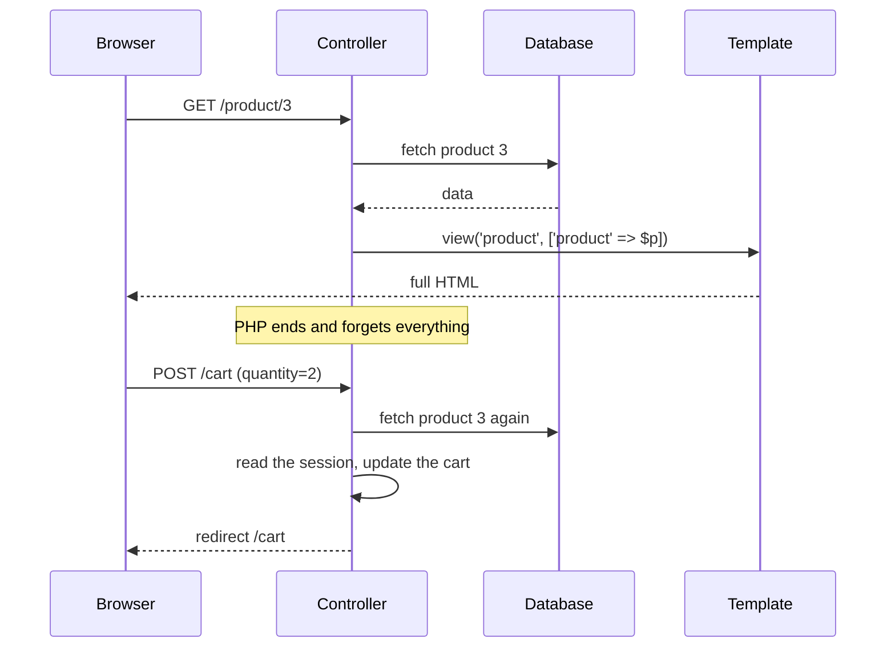
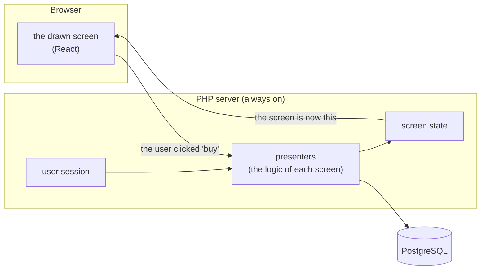
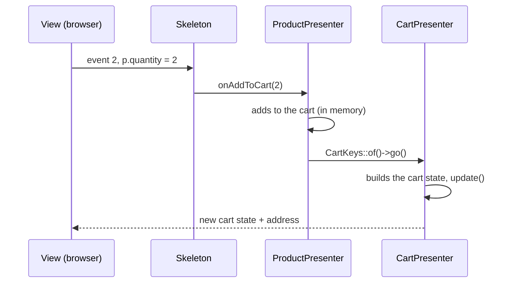
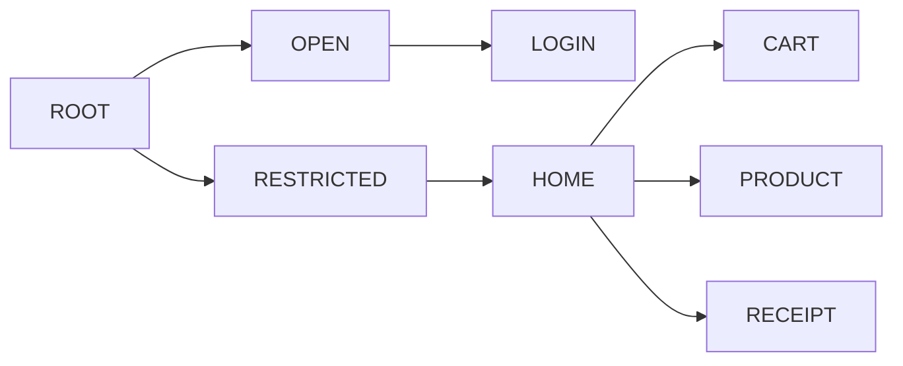

# Guide for developers coming from traditional PHP

You write PHP. Probably with Laravel, Symfony, CodeIgniter or "plain" PHP: a request comes in, a
controller fetches data, a template (Blade, Twig, a `.php` file with HTML) builds the page, and
the response goes to the browser. It works, you know every step, and it is how most of the PHP
web is built.

This project proposes another way to organize an application: **Cube**. It is more structured,
and that is why it looks strange at first. This guide introduces the idea starting from what you
already know, at an easy pace, with a hands-on exercise at the end.

You don't need to know React or anything about software architecture. PHP is enough.

## Contents

1. The way you already know
2. The Cube idea in one sentence
3. From your world to Cube: the dictionary
4. A screen from the inside: the product detail
5. Think in state, not in pages
6. The page address is born from the state
7. What you gain (and what it costs)
8. Traditional PHP habits that get in the way here
9. Exercise: free shipping in the cart
10. Where to go next

---

## 1. The way you already know

In a template framework, every click is a new, complete conversation:



Three traits of this model will matter in a moment:

- **PHP dies on every request.** Everything that must survive goes to the session, the database
  or a cookie, and is read again on the next request.
- **The template receives data and decides how to show it.** Formatting, arithmetic, "if the
  list is empty, show this" - a lot of screen logic ends up in the template, or scattered in
  JavaScript.
- **Every screen is a page.** The route says which controller handles it; navigation goes from
  page to page.

## 2. The Cube idea in one sentence

> In Cube, **PHP does not die**: every connected user has, on the server, live objects that know
> what their screen is showing. The browser only draws what it receives and reports what the
> user did.



The conversation between browser and server is continuous, over **WebSocket** (a connection that
stays open in both directions). There is no "new page" on every click: the server sends only what
changed on the screen.

For that, the server is a PHP process that keeps running - like a queue worker, or a Node server.
It is started once (`php bin/server.php`) and serves every user.

## 3. From your world to Cube: the dictionary

| You know | In Cube | Where to look |
|---|---|---|
| Route (`routes/web.php`) | **Place** (a possible screen) + **Routes** (the path to it) | `src/Store/Presentation/Place.php`, `Routes.php` |
| Controller | **Presenter**: the logic of one screen | `.../Presenter/Restricted/Products/ProductPresenter.php` |
| Controller action (`show`, `store`) | `applyParameters` (entering the screen) and `onXxx` methods (events) | same |
| Variables passed to the template | **ViewState**: an object with what the screen shows | `ProductViewState.php` |
| Blade/Twig template | **React view**: only draws the ViewState | `frontend/store.shell.react/src/scripts/views/` |
| `$request->query('id')` | `$keys->productId` (the **Keys** read the address, already validated) | `ProductKeys.php` |
| `redirect()->route('cart')` | `CartKeys::of($this->app)->go()` | `ProductPresenter::onAddToCart` |
| `session()->flash('success')` | an intent attribute (`$keys->purchaseMade = true`) | `ReceiptKeys.php` |
| `$_SESSION` / `session()` | presenter fields: **they live in memory** while the user is there | `CartManager.php` |
| Authentication middleware | **guard presenter** (`RestrictedPresenter`) | `.../Restricted/RestrictedPresenter.php` |
| Layout with `@yield` / `` | **slots**: a place on the screen where the screen below fits in | `HomePresenter.php` |
| Components / partials | **child presenters** (the home panels) | `.../Home/Products/ProductsPanelPresenter.php` |
| `Product::with('items')` (eager loading) | **projection**: what to fetch, in a single query | `ProductInfo::projection()` |
| `DB::transaction(fn () => ...)` | `Beans::of(TransactionService::class)->required(fn () => ...)` | `CartManager::commit` |

If you keep only one row of this table, keep this one: **the controller becomes an object that
keeps existing while the screen is open**. Everything else follows from that.

## 4. A screen from the inside: the product detail

Let's open the product screen of Store (the demo shop) and read its four pieces.

### 4.1 The screen state

```php
final class ProductViewState implements ViewState
{
    public ?ProductInfo $product = null;
    public int $errorCode = 0;
    public ?string $errorMessage = null;
}
```

Think of it as **the array you would pass to the template** - except it is an object, and it is
kept around. Everything the screen shows is here, in public properties. The server turns this
object into JSON and sends it to the browser.

### 4.2 The keys: reading the address safely

```php
final class ProductKeys extends HomeKeys
{
    private const string PREFIX = 'pr';
    private const string P_ID = self::PREFIX . '-id';

    public ?int $productId {
        get => $this->idParameter(self::P_ID);          // integer >= 0, or null
        set (?int $value) {
            $this->intent->setParameter(self::P_ID, $value);
        }
    }
}
```

It is the equivalent of reading `$_GET['id']`, but in a single place, with a type and validation.
The screen address becomes `#product?pr-id=3`. (The `get =>` / `set` syntax is PHP 8.4
*property hooks*: from the outside it looks like a regular property, on the inside it runs code.)

### 4.3 The presenter: the logic

```php
final class ProductPresenter extends AbstractCubePresenter
{
    public readonly ProductViewState $state;

    // entering the screen - the controller's "show"
    public function applyParameters(CubeIntent $intent, bool $initialization, bool $deepest): bool
    {
        $keys = new ProductKeys($this->app, $intent);
        $id = $keys->productId ?? throw new ProductNotFoundException();
        if ($this->state->product?->id !== $id) {
            $this->state->product = $this->productService->loadProductById($id);
            $this->update();                        // "the screen changed, send it again"
        }
        // ... creates the view the first time and fits it into the right place on the screen
        return true;
    }

    // an event - the controller's "store"
    public function onAddToCart(?int $quantity): void
    {
        try {
            if ($quantity === null || $quantity < 1) {
                $this->alert(2, 'The quantity must be greater than or equal to 1.');
                return;
            }
            $this->app->cart()->addProduct($this->state->product, $quantity);
            CartKeys::of($this->app)->go();         // the "redirect" to the cart
        } catch (Throwable $caught) {
            $this->app->alertUnexpectedError('Adding an item to cart', $caught);
        }
    }
}
```

Notice two things that would not exist in a controller:

- **`$this->state->product` is still there after the method ends.** When the user clicks "add to
  cart", the product is already in memory - no need to fetch it again.
- **`$this->update()`.** Changing the state is not enough: you have to say the screen changed. At
  the end of the click, the server gathers what was marked and sends it to the browser.

### 4.4 The events: what connects the click to the method

```php
public function skeleton(): CubeSkeleton
{
    return new Skeleton('48b693f67410', function (int $event, int $count, array $form): void {
        match ($event) {
            1 => $this->onOpenProducts(),
            2 => $this->onAddToCart(Coerce::asInt($form['p.quantity'] ?? null)),
            default => Skeleton::unknownEvent($event),
        };
    });
}
```

The browser does not call URLs: it sends "event 2 happened on screen `48b693f67410`, with
`p.quantity = 2`". The `match` turns that into a method call. The code `48b693f67410` identifies
the screen type, and the React view uses the same code.

### 4.5 The view: it only draws

```tsx
class ProductViewClass extends BaseViewClass<ViewProps, ProductViewState> {
  override render() {
    const product = this.state.product ?? DefaultProduct
    return (/* name, description, price, "Add to Cart" button */)
  }

  readonly emitAddToCart = () => {
    bridge.setFormField(this.vsid, "p.quantity", this.state.quantity)
    bridge.submit(this.vsid, ON_ADD_TO_CART)     // event 2
  }
}
export default BaseViewClass.FC(ProductViewClass, "48b693f67410")
```

The view is your template. The difference is discipline: it **decides nothing**. It does not
compute totals, does not apply business rules, does not validate. It receives the state and
draws; it receives a click and reports it.

### The full path of a click



## 5. Think in state, not in pages

The most important mindset change: **stop thinking "which page do I return?" and start thinking
"what is the state of the screen now?"**.

Compare the cart in both worlds:

| | Template framework | Cube |
|---|---|---|
| Where the cart lives | in the session (serialized), read again on every request | in an object (`CartManager`) that lives in the session's memory |
| Changing the quantity | POST → controller reads the session → changes it → saves → redirect → GET → re-renders everything | event → `onModifyQuantity()` changes the object → `update()` → only the cart is redrawn |
| Showing the item count in the header | every page reads the session again to show the counter | the home is notified when the cart changes and updates the counter |

And screens compose like pieces: the home has the panels and a central area; the product, the
cart and the receipt fit into that area. It is your layout with `@yield`, but with each piece
having its own logic.



Being on the cart means having the presenters of the whole path alive: root, restricted area
(the guard that requires login), home and cart. Going from the cart to the product swaps only the
tip: the home stays there, with the panels just as they were.

## 6. The page address is born from the state

In a template framework, the URL comes first: it picks the controller. In Cube it is the other
way around: **the state comes first, and the address is computed from it**. Each presenter
publishes the minimum needed to recreate what it shows (`publishParameters`), and the sum becomes
the address:

```
#product?rt-user=0&pr-id=3&sign=7CVbXLDU1zqkuEUHElyqba
```

In practice:

- **F5, bookmarks and back work.** The server reads the address, hands the parameters to each
  presenter (`applyParameters`) and the screen comes back the same.
- **The address is signed** (`sign=`). If edited by hand, it is ignored. Even so, the keys
  validate everything: an old link may point to a product that no longer exists.
- **You never build URLs by hand.** To take the user to another screen, you say what it needs
  (`$keys->purchaseId = 7`) and tell it to go (`->go()`).

## 7. What you gain (and what it costs)

**You gain:**

- **Screen logic in a single place, testable without a browser.** A test calls
  `$presenter->onAddToCart(2)` and checks the state - no HTTP, no HTML, no Selenium. See
  `tests/Store/Presentation/StoreWorkflowTest.php`.
- **Fewer trips to the database.** What the screen already loaded stays in memory; and each
  query brings exactly what the screen shows, with the relations already assembled (goodbye,
  N+1).
- **Screens that respond instantly**, without reloading the page or writing a separate API and
  front end for each screen.
- **Security by construction**: the browser never receives data the screen does not show, and the
  rules stay on the server.

**It costs:**

- **A process that stays on.** It is not PHP-FPM that is born and dies: you start it, it runs.
  Updating the code means restarting the process.
- **Memory per connected user.** Each session has its live objects.
- **Discipline.** The model only works if each piece does its job (the next section shows the
  most common stumbles).
- **For many users**, several instances behind a load balancer - see
  [scaling.md](scaling.md).

## 8. Traditional PHP habits that get in the way here

In PHP that dies on every request, many habits are harmless. In a process that stays on, serving
everyone at the same time, they become bugs.

| Habit | What happens here | Do this instead |
|---|---|---|
| `sleep(3)`, `file_get_contents('https://...')`, a heavy loop | **freezes every user**: there is only one process | `($this->app->context->sleep)(3)`, Amp HTTP clients, heavy work in a worker |
| `static $currentUser` or `global` | one user sees another user's data | state in the presenter; per-request context in `FiberValue` |
| `$_GET`, `$_POST`, `$_SESSION` | they don't exist: there is no HTTP request per click | keys (address), event arguments (`$form`), presenter fields (session) |
| `echo` / `var_dump` to debug | goes to the server terminal, not to the browser | the logger (`$this->app->logger()`) or a test |
| `die()` / `exit()` | takes down the server for everyone | throw an exception |
| Changing the state and expecting the screen to change | the screen does not change | `$this->update()` |
| Formatting, summing or deciding in the template | duplicated logic, hard to test | compute in the presenter and send it ready in the state |
| Creating a timer or listener and forgetting it | keeps running after the screen closes | keep the registration and undo it in `release()` |
| Fetching data inside a `foreach` | one query per row | put the relation in the projection |

## 9. Exercise: free shipping in the cart

Today the cart view **computes the total on its own**, in TypeScript:

```tsx
const total = items.reduce((sum, item) => sum + item.price * item.quantity, 0)
const totalText = `$${total.toFixed(2)}`
```

By the rule in section 4.5, this is in the wrong place: it is arithmetic, and arithmetic belongs
to the presenter. Let's fix it and, as a bonus, show a notice: "Free shipping!" from $100.00
up, or "$X left for free shipping".

### Step 1 - the state gets the fields

`src/Store/Presentation/Presenter/Restricted/Cart/CartViewState.php`:

```php
final class CartViewState implements ViewState
{
    /** @var list<CartItem> */
    public array $items = [];
    public string $total = '';               // already formatted: "$112.00"
    public ?string $shippingNote = null;     // the shipping notice
    public int $errorCode = 0;
    public ?string $errorMessage = null;
}
```

### Step 2 - the presenter computes

The right place for derived values is `commitComputedState()`: it runs right before the state
goes to the browser, after any change. In `CartPresenter.php`:

```php
public const float FREE_SHIPPING_FROM = 100.0;

public function commitComputedState(): void
{
    $sum = 0.0;
    foreach ($this->state->items as $item) {
        $sum += $item->price * $item->quantity;
    }
    $total = '$' . number_format($sum, 2);
    $note = $sum >= self::FREE_SHIPPING_FROM
        ? 'Free shipping!'
        : '$' . number_format(self::FREE_SHIPPING_FROM - $sum, 2) . ' left for free shipping';

    if ($this->state->total !== $total || $this->state->shippingNote !== $note) {
        $this->state->total = $total;
        $this->state->shippingNote = $note;
        $this->update();    // only if it changed: otherwise the state would be resent forever
    }
}
```

### Step 3 - the view only draws

In `frontend/store.shell.react/src/scripts/views/cart/CartView.tsx`:

```tsx
export type CartViewState = {
  items?: CartItem[]
  total?: string
  shippingNote?: string
  errorMessage?: string
}

// in render(): delete the reduce and use what came ready
<span className={Sel.footerTotal}>{state.total}</span>
{state.shippingNote && <div className={Sel.footer}>{state.shippingNote}</div>}
```

### Step 4 - a test, no browser

In `tests/Store/Presentation/`, a new test (the flash drive costs $16.00):

```php
final class FreeShippingTest extends PresentationTestCase
{
    #[Test]
    public function aboveOneHundred_shippingIsFree(): void
    {
        $home = $this->login();
        $home->presenter->onOpenProduct(Seed::FLASH_DRIVE2GB_ID);
        ProductViewMock::cast($home->state->contentView)->presenter->onAddToCart(7);   // $112.00

        $cart = CartViewMock::cast($home->state->contentView);
        $cart->presenter->commitComputedState();      // on the server, this runs before sending

        self::assertSame('$112.00', $cart->state->total);
        self::assertSame('Free shipping!', $cart->state->shippingNote);
    }
}
```

Run `composer check`. Also write the case below $100.00 - that one is yours.

### Step 5 - see it working

```bash
bin/build-frontend.sh
php bin/server.php
```

Open http://localhost:8080/, log in with `admin`/`admin`, put products in the cart and change the
quantities: the total and the notice follow along, computed on the server.

**What you practiced:** the state as a contract with the view, explicit `update()`, a derived
value in `commitComputedState`, the view that only draws, and a test of screen logic without a
browser.

## 10. Where to go next

- [README](../README.md) - install, run, test.
- [architecture.md](architecture.md) - the full architecture: navigation, protocol, persistence
  without N+1, security.
- [scaling.md](scaling.md) - when one process is not enough.
- `skills/cube-architecture-php/` - the rules of the model, in detail, with a review checklist and
  a diagnosis table (written for coding assistants, but useful for people too).
- The Store code: start at `src/Store/Presentation/Place.php` and follow it to the product
  screen - it is the best example of what this guide describes.
