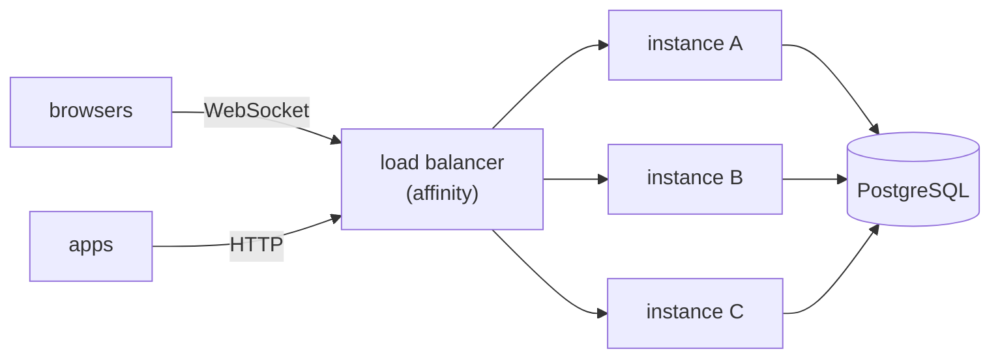

# Scaling Cube MVP in PHP

How to go from one server to several when a single PHP process is no longer enough. For anyone
deploying or operating a Cube application in PHP (Store is the example).

**Summary:** run several server instances behind a WebSocket-capable load balancer, all with the
same PostgreSQL and the same keys. The load balancer always sends each session to the same
instance, routing by the `appId` in the WebSocket URL.

## 1. How one instance serves users

Each instance is **one PHP process with an event loop** (Amp). Each connected user is a Fiber
inside that process, and database queries use an **asynchronous connection pool**.

- Waits do not block: while a query waits for PostgreSQL (or a message waits for the network), the
  loop serves the other sessions. Queries from different sessions run at the same time, each on a
  pooled connection (`database.pool.maxConnections`, default 16).
- The PHP code itself (presenters, building the responses) runs on one CPU core, and the sessions
  take turns on it.
- What burns a lot of CPU at once (the handshake's PBKDF2, ~180 ms) runs outside the loop, in
  worker processes (`amphp/parallel`).

This is enough for many users: a slow query delays only whoever issued it, and a typical query
takes milliseconds, because `JsonQuery` builds the graph in a single SELECT. The limits are:

| Limit | Effect |
|---|---|
| One CPU core per process | the instance does not use the rest of the machine |
| Pool exhausted | with every connection busy, the next query waits for one to free up |
| Slow PHP code (not waiting on I/O) | a heavy loop in a presenter delays every session on the instance |

## 2. When to scale

Signs that one instance is not enough:

- the process spends a lot of time near 100% of one core;
- response time grows with the number of sessions, even with fast queries;
- the shell's "sending" indicator shows up often.

Before multiplying instances, check that the bottleneck is not the database (a query without an
index, an oversized projection) or a pool that is too small: more instances fix neither.

## 3. The strategy: several instances + load balancer



Each instance is independent: it has its own event loop, its own connection pool and its own
users' sessions. The gain is using the machine's other cores (or other machines).

## 4. Where each piece of state lives

This decides what needs affinity and what must be identical on every instance.

| State | Where it lives | Consequence |
|---|---|---|
| Cube session (presenters, cart, current screen) | instance memory | needs affinity |
| Data (users, products, purchases) | PostgreSQL | shared by all |
| `[remote]` keys (`appId` signature, `app_skey`) | configuration | identical on every instance |
| "Remember me" token (automatic login) | client storage, JWT | valid on any instance (same `jwt.secret`) |
| REST API: challenge nonce, access token session, refresh | instance memory | needs affinity |
| Remote transaction (`X-Tx-Id`) | connection open on the instance that ran `begin` | needs affinity |
| CDN cache (`/web-cache`) | disk | can be per instance |

## 5. Requirements

- [ ] **The same PostgreSQL** for every instance, with enough connections (section 9).
- [ ] **The same `[remote]` keys on every instance.** An instance only accepts `appId`s signed
  with its own key. Without that section, each instance would generate its own development keys
  and would not recognize the other instances' sessions. Generate the keys once and distribute the
  same `application.local.toml`.
- [ ] **The same `security.jwt.secret`** on all of them.
- [ ] **`server.devMode = false`**: disables `POST /__dev/db-reset`.
- [ ] **Affinity in the load balancer** (section 6).
- [ ] **Health check** at `GET /health` (responds `{"status":"UP"}`).

Example `application.local.toml` shared by every instance:

```toml
[database]
url = "pgsql:host=db.internal;port=5432;dbname=store"
username = "store"
password = "..."

[security]
jwt.secret = "..."

[server]
devMode = false

[remote]
rsaPublicKey = "..."
rsaPrivateKey = "..."
signPublicKey = "..."
signPrivateKey = "..."
```

## 6. Affinity

### WebSocket: by `appId`

The shell opens the WebSocket at `/<frontend>/dispatcher/<appId>` (or `/dispatcher/<appId>`). Just
route by that `appId`, with consistent hashing, and the session always comes back to the same
instance, reconnections included.

`index.html` does **not** need affinity. Any instance can generate the `appId`, because they all
sign with the same key. The session is only born on the first WebSocket message, on the instance
the hash points to.

### REST API: by `X-Client-Id`

REST clients send `X-Client-Id` on every request, one id per app instance. Route by it: challenge,
login, refresh and remote transaction land on the same instance.

### When affinity fails

This happens when an instance goes down, when it restarts during a deploy, or when the number of
instances changes and the hash redistributes the sessions.

- **WebSocket:** the other instance does not refuse. It creates a new session from what the client
  keeps: it returns to the same screen (the URL `path`) and logs in again with the "remember me"
  token. Whatever lived only in the old instance's memory is lost: the cart, for example.
- **REST API:** the access token is not recognized (401), and neither is the refresh, because the
  session was in the other instance's memory. The client has to log in again. A remote transaction
  open on the old instance is lost and rolled back by that instance's sweep.

## 7. nginx example

Four instances on the same machine, on ports 8081 to 8084:

```nginx
map $http_upgrade $connection_upgrade {
    default upgrade;
    ''      close;
}

upstream wdc_ws {                       # Cube sessions: affinity by appId
    hash $wdc_app consistent;
    server 127.0.0.1:8081;
    server 127.0.0.1:8082;
    server 127.0.0.1:8083;
    server 127.0.0.1:8084;
}

upstream wdc_api {                      # REST API: affinity by client
    hash $http_x_client_id consistent;
    server 127.0.0.1:8081;
    server 127.0.0.1:8082;
    server 127.0.0.1:8083;
    server 127.0.0.1:8084;
}

upstream wdc_any {                      # pages, images, health: any instance
    server 127.0.0.1:8081;
    server 127.0.0.1:8082;
    server 127.0.0.1:8083;
    server 127.0.0.1:8084;
}

server {
    listen 80;

    location ~ ^/(?:[^/]+/)?dispatcher/(?<wdc_app>[^/]+)$ {
        proxy_pass http://wdc_ws;
        proxy_http_version 1.1;
        proxy_set_header Upgrade $http_upgrade;
        proxy_set_header Connection $connection_upgrade;
        proxy_set_header Host $host;
        proxy_read_timeout 120s;        # the server pings every 10 s
    }

    location ~ ^/(?:[^/]+/)?api/(?:auth|repo|tx)/ {
        proxy_pass http://wdc_api;
        proxy_set_header Host $host;
        client_max_body_size 16m;       # product image upload
    }

    location / {
        proxy_pass http://wdc_any;
        proxy_set_header Host $host;
    }
}
```

## 8. Starting the instances

Each instance is a `php bin/server.php <port>` with the same configuration. With systemd, a
template unit does the job:

```ini
# /etc/systemd/system/wdc-store@.service
[Unit]
Description=WDC Store (PHP) on port %i
After=network.target

[Service]
WorkingDirectory=/opt/wdc-cube-php
Environment=STORE_CONFIG_FILE=/etc/wdc/application.toml
Environment=LOG_LEVEL=info
ExecStart=/usr/bin/php bin/server.php %i
Restart=always
KillSignal=SIGTERM

[Install]
WantedBy=multi-user.target
```

```bash
systemctl enable --now wdc-store@8081 wdc-store@8082 wdc-store@8083 wdc-store@8084
```

`SIGTERM` shuts the instance down gracefully (`StoreServer::stop()`).

In production, turn off PHP assertions (`zend.assertions = -1` in `php.ini`). Amp logs a warning
when they are on.

## 9. Sizing

- **Instances per machine:** one per core is the starting point. Leave headroom for the PBKDF2
  workers, which also use CPU during login peaks.
- **PostgreSQL connections:** each instance uses up to `database.pool.maxConnections` (default 16),
  plus 1 per open remote transaction (capped at 128 per instance). Add it all up and check the
  database's `max_connections` (PostgreSQL's default is 100).
- **Sessions per instance:** `server.maxSessions` sets the limit (the default `-1` means
  unlimited). Above the limit, the connection is closed with code 4003. A session with no
  connection expires after `server.sessionTtlSeconds` (default 180 s).
- **Connections per IP:** the server accepts up to 1000 simultaneous connections per IP. Behind a
  load balancer they all come from its IP, so that is the practical ceiling of connections per
  instance. The value lives in `StoreServer` (`connectionLimitPerIp`); raise it if you need more.
- **Memory:** grows with the number of sessions (presenters and screen state). Measure with your
  real usage before fixing the number of sessions per instance.

## 10. Deploying without kicking everyone out

Update **one instance at a time**. Its users reconnect, the hash sends them to another instance
and they get a new session: same screen, automatic login, cart lost (section 6). With consistent
hashing, only the sessions of the restarted instance move.

To keep even the cart, you would have to drain the instance before stopping it (stop sending new
sessions to it and wait for the current ones to end). The example load balancer does not do that
on its own.

## 11. Limitations and next steps

| What | How to solve it |
|---|---|
| REST login tied to the instance (nonce and sessions in memory) | store the nonce and refresh sessions in the database: then the REST API no longer needs affinity, except for remote transactions |
| Cart lost when the session changes instance | store the cart in the client storage or in the database |
| Real capacity unknown | benchmark: N simultaneous sessions and the response time, to find how many users one instance can handle |
