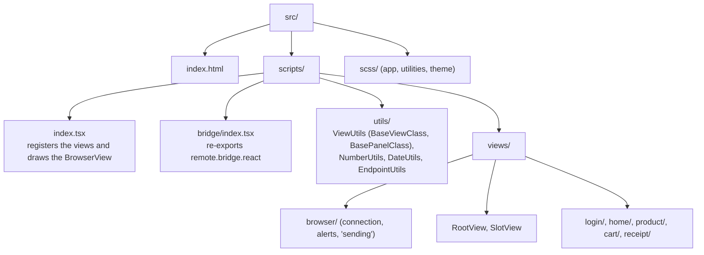

# Shopping — React shell

The demo shop's view: a **React 19** + **TypeScript** SPA that draws the states the PHP server's
presenters send over **WebSocket** and sends clicks back as events. All screen logic lives on the
server; this side only draws.

The protocol (connection, handshake, states, forms, storage) lives in the bridge,
[`../remote.bridge.react`](../remote.bridge.react/README.md), re-exported as `@root/bridge`.

> To write a new view, read the guide [docs/dev/react-views.md](../../docs/dev/react-views.md).

## Stack

| Technology | Used for |
|---|---|
| React 19 + TypeScript | the views (classes over `BaseViewClass`) |
| Spectrum Web Components (`@swc-react/*`) | buttons, fields, dividers, theme (`src/scripts/swc.ts`) |
| Sass + selectors (`*-sel.ts` + `.scss`) | per-view styles, with global utilities in `src/scss/` |
| Bootstrap Icons, Inter font | icons and typography, served from the server's local cache (`/web-cache/...`) |
| Parcel 2 | bundler (the build does not type-check TypeScript) |
| Prettier 3 | formatting |

## Layout



Each view is a class that extends `BaseViewClass` and registers itself under the presenter's
**classId** (the same as the `Skeleton` in PHP):

```tsx
class ProductViewClass extends BaseViewClass<ViewProps, ProductViewState> {
  override render() { /* draws this.state, which came from the server */ }

  readonly emitAddToCart = () => {
    bridge.setFormField(this.vsid, "p.quantity", 2)   // event argument: "p." prefix
    bridge.submit(this.vsid, ON_ADD_TO_CART)          // the event code in the skeleton
  }
}
export default BaseViewClass.FC(ProductViewClass, "48b693f67410")
```

Every new view goes into `bridge.registerComponents(...)`, in `index.tsx`. A `classId` with no
registered view makes the bridge log `No view registered for viewId` to the console.

## Build and development

From the repository root:

```bash
bin/build-frontend.sh    # installs dependencies the first time and builds
```

The output goes to `work/frontend/shopping.shell.react/`, from where the PHP server serves it:
http://localhost:8080/shopping.shell.react/index.html (the root `/` redirects there).

In this folder:

```bash
npm run watch          # rebuilds on every change
npm run build          # production build
npm run format         # Prettier
npm run format:check
```

## Formatting (Prettier)

No semicolons, double quotes, trailing commas everywhere, 120 columns, 2-space indentation.
