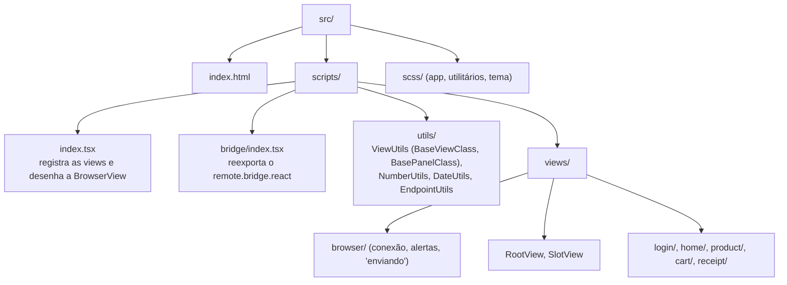

# Shopping — shell React

A view da loja de demonstração: uma SPA em **React 19** + **TypeScript** que desenha os estados
que os presenters do servidor PHP mandam por **WebSocket** e devolve os cliques como eventos. Toda
a lógica de tela está no servidor; aqui só se desenha.

O protocolo (conexão, handshake, estados, formulários, armazenamento) fica no bridge,
[`../remote.bridge.react`](../remote.bridge.react/README.md), reexportado em `@root/bridge`.

> Para escrever uma view nova, leia o guia [docs/dev/react-views.md](../../docs/dev/react-views.md).

## Pilha

| Tecnologia | Para quê |
|---|---|
| React 19 + TypeScript | as views (classes sobre `BaseViewClass`) |
| Spectrum Web Components (`@swc-react/*`) | botões, campos, divisores, tema (`src/scripts/swc.ts`) |
| Sass + seletores (`*-sel.ts` + `.scss`) | estilos por view, com utilitários globais em `src/scss/` |
| Bootstrap Icons, fonte Inter | ícones e tipografia, servidos pelo cache local do servidor (`/web-cache/...`) |
| Parcel 2 | bundler (o build não checa tipos TypeScript) |
| Prettier 3 | formatação |

## Estrutura



Cada view é uma classe que estende `BaseViewClass` e se registra pelo **classId** do presenter
(o mesmo do `Skeleton` no PHP):

```tsx
class ProductViewClass extends BaseViewClass<ViewProps, ProductViewState> {
  override render() { /* desenha this.state, que veio do servidor */ }

  readonly emitAddToCart = () => {
    bridge.setFormField(this.vsid, "p.quantity", 2)   // argumento do evento: prefixo "p."
    bridge.submit(this.vsid, ON_ADD_TO_CART)          // o código do evento no skeleton
  }
}
export default BaseViewClass.FC(ProductViewClass, "48b693f67410")
```

Toda view nova entra em `bridge.registerComponents(...)`, no `index.tsx`. Um `classId` sem view
registrada faz o bridge lançar `Nenhuma view registrada para a viewId` no console.

## Build e desenvolvimento

Pela raiz do repositório:

```bash
bin/build-frontend.sh    # instala as dependências na primeira vez e compila
```

A saída vai para `work/frontend/shopping.shell.react/`, de onde o servidor PHP a serve:
http://localhost:8080/shopping.shell.react/index.html (a raiz `/` redireciona para lá).

Nesta pasta:

```bash
npm run watch          # recompila a cada alteração
npm run build          # build de produção
npm run format         # Prettier
npm run format:check
```

## Formatação (Prettier)

Sem ponto-e-vírgula, aspas duplas, vírgula final em tudo, 120 colunas, indentação de 2 espaços.
